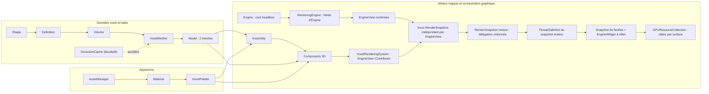
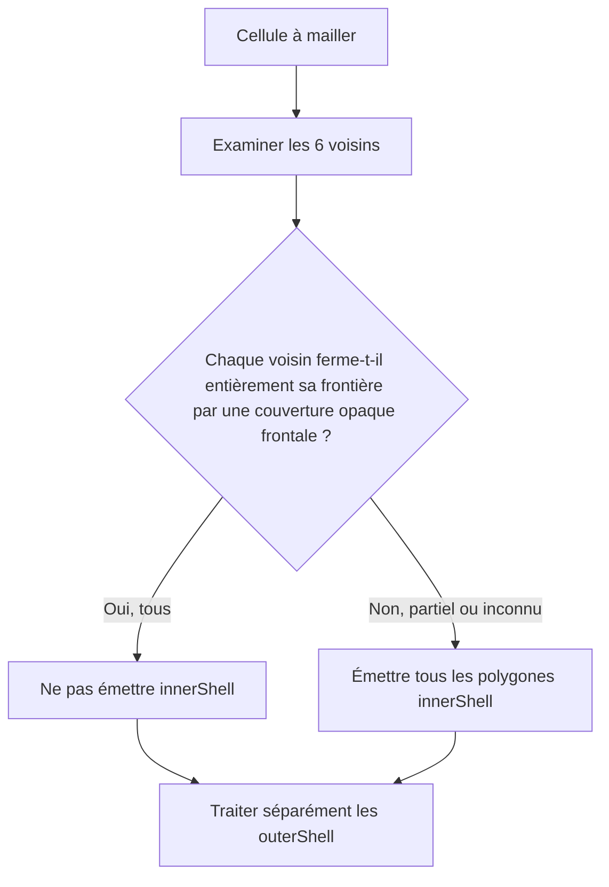
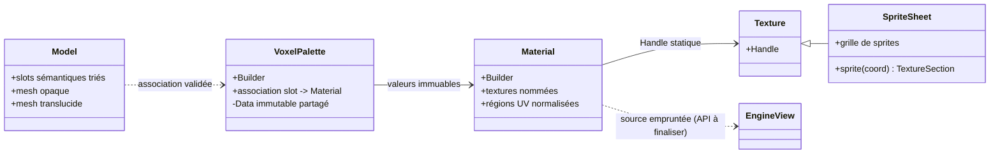
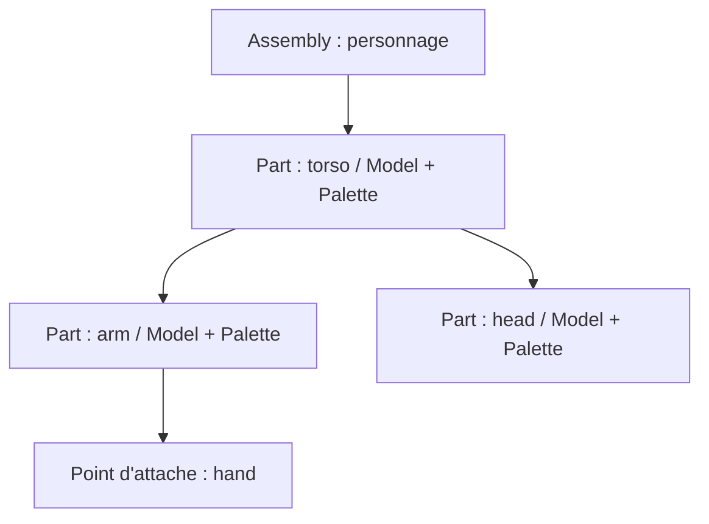
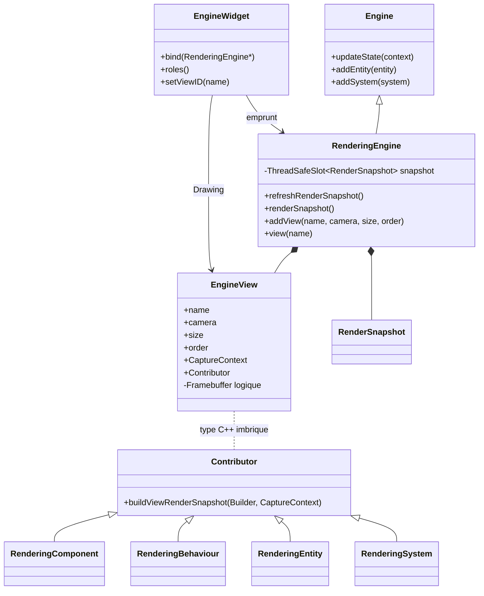
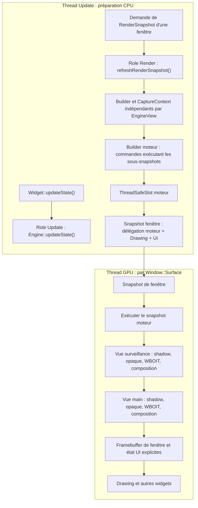
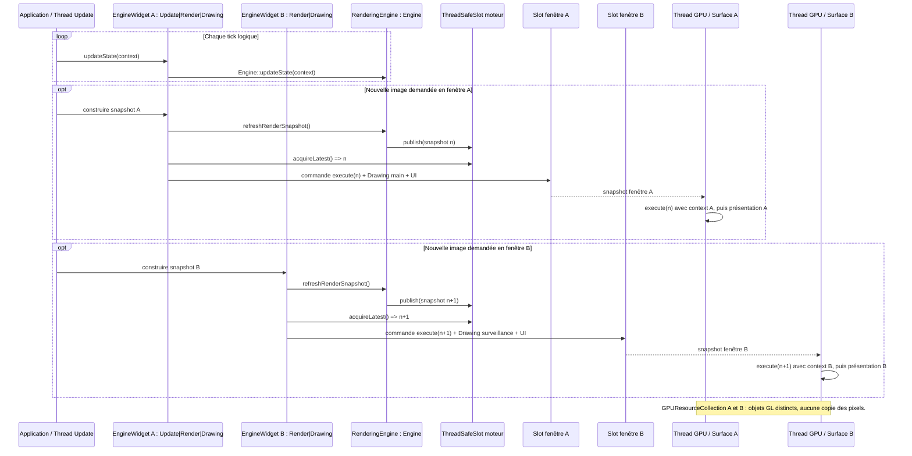
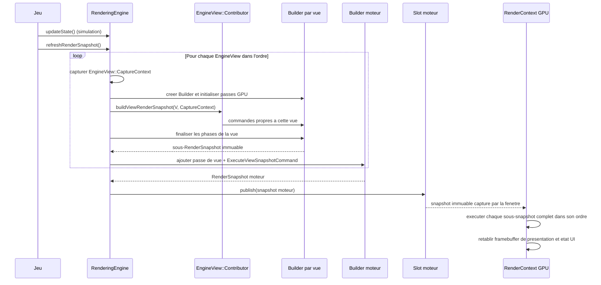
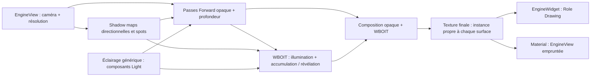

# Sparkle V0.1.4 — Architecture cible du moteur voxel

> **Spécification d'architecture, préalable à l'implémentation.** Ce document décrit le comportement et les responsabilités attendus de la bibliothèque, indépendamment de l'ordre dans lequel les décisions ont été prises. Les exemples C++ représentent l'intention de l'API ; une signature illustrative ne constitue pas, à elle seule, une interface définitive. Aucune implémentation de ces nouveaux modules n'est présumée existante.
>
> **Objectif :** offrir au sein de Sparkle une infrastructure voxel publique, générique, utilisable pour des objets, personnages articulés et volumes de cellules, sans introduire de dépendance à un jeu, à un terrain, à Erelia ou à un catalogue global.

## 1. Vue d'ensemble

Un programme décrit des géométries élémentaires indépendantes de toute texture, les assemble en cellules d'un volume, puis construit un modèle maillé. Il choisit séparément les matériaux à utiliser et les associations de palettes. Les modèles peuvent être affichés directement ou composés en hiérarchies articulées. Le système de rendu rassemble les occurrences actives pour créer des commandes graphiques instanciées.



Les frontières sont intentionnelles :

- **Géométrie et meshing :** aucune lecture de pixels, aucun atlas et aucune émission directe de commande OpenGL. La visibilité entre cellules est déterminée uniquement à partir des surfaces, de leur orientation et de l'opacité déclarée par les slots de géométrie. **Shape, Definition, Cell et Volume** restent indépendants d'OpenGL ; en revanche, **Model/Mesh** réutilisent le vrai `spk::Mesh<TVertex>`, dont le `LayoutBuffer` dépend déjà des types graphiques de Sparkle. Le bake ne doit pas être décrit comme un module intégralement headless.
- **Apparence :** `spk::Material` est générique et possède des rôles de textures nommés ; `spk::VoxelPalette` relie ces matériaux aux slots d'un modèle voxel. Une palette différente ne nécessite pas de remailler.
- **Scène :** `Voxel::Assembly` compose des modèles et des transformations locales, sans créer une Entity par partie.
- **Graphisme :** `VoxelRenderingSystem` collecte les voxels et contribue séparément au sous-snapshot de chaque `EngineView`, sans ordonnancer lui-même les vues. `Engine` reste headless ; `RenderingEngine : Engine` possède les vues et le slot de snapshot partagé. `GPUResourceCollection` réalise les framebuffers et textures séparément pour chaque fenêtre ; un `EngineWidget` associe librement les rôles `Update`, `Render` et `Drawing`.
- **Chargement :** `spk::AssetManager` est un utilitaire générique de Sparkle, pas un sous-système réservé aux voxels. Il partage les assets chargés selon une clé comprenant type, identifiant et configuration JSON.

Le rendu voxel produit **au maximum deux meshes par Model** : un opaque et un translucide. Aucun troisième mesh « cutout » n'est introduit. Chaque mesh non vide peut être dessiné avec un seul atlas `albedo` pour une association `Model`/`VoxelPalette` compatible, même si plusieurs slots choisissent des régions différentes de cet atlas.

### Exemple de parcours utilisateur

```cpp
// Exemple conceptuel : noms secondaires et signatures à finaliser.
spk::Voxel::Shape shape = makeShape();
spk::Voxel::Definition stone = makeDefinition(shape);

spk::Voxel::Volume::Builder volumeBuilder({16, 16, 16});
volumeBuilder.set({2, 4, 1}, spk::Voxel::Cell{stone, orientation});
spk::Voxel::Volume volume = std::move(volumeBuilder).build();

spk::Voxel::VoxelMesher mesher;
spk::Voxel::Model model = mesher.bake(volume);

spk::Material material = makeMaterial(texture);
spk::VoxelPalette palette = makePalette(model, material);

spk::Voxel::Assembly character;
auto torso = character.addPart("torso", model, palette);
auto arm = character.addPart("arm", armModel, armPalette, torso);
character.setLocalTransform(arm, armLocalTransform);
character.invalidate();

// Un composant lié à l'Entity3D expose l'Assembly au système de rendu.
// Le VoxelRenderingSystem produira les commandes du prochain snapshot.
```

## 2. Modèle de données voxel


### 2.1 `spk::Voxel::Shape` : géométrie locale réutilisable

Une `Shape` représente les surfaces d'une cellule dans le **cube local `[0,1]³`**. Elle ne connaît ni matériaux concrets, ni volume, ni Engine.

Chaque polygone :

- possède au moins trois sommets, de positions flottantes dans le cube unité ; il est **plan et convexe**. Une forme globalement concave est représentée par plusieurs polygones ;
- est **simple face**. Son ordre de sommets est CCW vu du côté avant, et sa normale géométrique est orientée par `(v1 - v0) × (v2 - v0)` pour des sommets initiaux non colinéaires ;
- peut porter des UV arbitraires et des normales d'éclairage par sommet. La normale géométrique est utilisée par défaut pour l'éclairage, mais les normales personnalisées ne modifient jamais l'orientation géométrique ou l'occlusion ;
- référence un **slot géométrique local** déclaré par son nom dans la Shape. Ce slot porte `opacity`, un flottant de `[0,1]`, de valeur `1.0` par défaut.

Pour afficher une feuille ou une pancarte des deux côtés, l'application fournit **deux polygones explicites** de windings opposés. Il n'existe pas de propriété `doubleSided` ni de duplication implicite. Des polygones coplanaires de même winding peuvent se recouvrir, même totalement ; leur existence séparée est conservée. Une Shape de **zéro polygone** est valide.

Les surfaces sont réparties selon leur position :

- `outerShell` : polygones dont tous les sommets sont situés sur l'un des six plans de frontière (`x`, `y` ou `z` égal à `0` ou `1`), identifiables par face et par slot local ;
- `innerShell` : autres polygones, notamment les surfaces inclinées ou internes, qui ne sont jamais projetés artificiellement sur une frontière.

Les positions et les UV ne sont pas confondus : les **positions** doivent être dans `[0,1]³`, mais les **UV** peuvent être hors `[0,1]`. Dans ce dernier cas, la construction/validation CPU de la Shape émet un `Warning` non bloquant via `spk::Logger`. Aucun clamp ou modulo de sprite n'est ajouté automatiquement et cet avertissement n'est jamais répété à chaque frame.

#### Construction et immutabilité

`Shape::Builder` recueille des slots et des polygones, les valide **au moment de leur ajout** et publie une Shape immuable par `build()`. Toute géométrie invalide provoque une `spk::Exception` descriptive à l'ajout. Un ajout qui échoue, quelle qu'en soit la cause, laisse le Builder **strictement inchangé**. Un `build()` échoué laisse également son état entièrement intact, autorisant une nouvelle tentative. **Seul un build réussi consomme le Builder** ; il ne peut plus être exploité pour une nouvelle construction.

Une Shape publiée conserve un bloc `shared_ptr<const Data>` interne : les copies sont légères et partagent les mêmes données et la même identité. Deux Shapes construites indépendamment peuvent avoir des données géométriquement identiques mais des **identités de Data distinctes**. Cette identité est notamment utilisée par le cache d'occlusion. La représentation propriétaire n'est pas exposée dans les API publiques.

### 2.2 `spk::Voxel::Definition` : sens des slots

Une `Definition` immuable associe une `Shape` à une correspondance **slot géométrique de Shape → nom de slot sémantique** destiné au Model. Elle ne contient pas de `Material` et n'ajoute ni catégorie de rendu, ni règle d'occlusion indépendante à l'opacité déclarée dans la Shape.

`Definition` utilise également des données immuables partagées (`shared_ptr<const Data>`) et conserve la durée de vie de sa Shape. Copier une Definition est léger. Une même Shape peut être réutilisée dans différentes Definitions pour produire des noms de slots sémantiques différents.

Sparkle fournit une **Definition Air prédéfinie**. Elle représente une vraie cellule d'air, sans surface occultante ni slot de matériau supplémentaire présumé. Elle est créée automatiquement dans les Volumes ; l'application n'a pas à la fabriquer pour initialiser une grille vide.

### 2.3 `spk::Voxel::Cell` et orientations

L'API publique représente une Cell **par valeur**, contenant sa Definition (copie légère) et une orientation discrète. Les orientations disponibles comprennent les quatre rotations de 90° autour de Y et une possibilité d'inversion verticale, soit **huit orientations**.

L'orientation transforme correctement la géométrie, les UV et les normales. Un flip qui modifie la parité doit également préserver la **face avant physique voulue** par adaptation appropriée du winding/des indices, afin d'éviter qu'une surface visible ou occultante ne se retourne accidentellement.

Une cellule d'air est une Cell valide, et non `null`, un `optional` vide ou un indicateur « absence ».

### 2.4 `spk::Voxel::Volume` : snapshot dense immuable

Un Volume représente une grille **dense et contiguë** de cellules, d'extensions fixes. Chaque position a une entrée, y compris l'air. Pour éviter un `shared_ptr` complet par cellule, le stockage interne repose sur :

1. une **table locale de Definitions** partageant leurs blocs Data ;
2. une grille compacte d'indices vers cette table, avec l'orientation de chaque cellule.

L'index interne `0` est **toujours réservé à Air**. Une Cell d'air référence l'entrée `0`, jamais un sentinel d'absence.

La table locale déduplique une Definition **par identité de `Definition::Data`**, pas par comparaison profonde de contenu. Deux copies d'une même Definition partagent donc un index ; deux Definitions indépendantes au contenu identique peuvent occuper deux entrées. La lecture publique `cell(position)` reconstitue une **Cell par valeur** et n'expose pas les indices ni une référence vers le stockage compact. Ne pas promettre un `span<const Cell>` vers la grille.

`Volume::Builder` peut être initialisé depuis les dimensions d'une nouvelle grille entièrement remplie d'air ou depuis un `const Volume&` existant. Il propose des opérations de remplacement `set(position, Cell)` et de remise à l'air `erase(position)` ; les noms exacts peuvent être ajustés. **Ses dimensions ne changent jamais** : pas de `resize()` ni d'expansion implicite. Les accès hors limites sont invalides. Le produit des dimensions, les tailles d'indices et les allocations doivent être vérifiés avant tout débordement.

Un build réussi publie un **nouveau snapshot immuable**, à copies légères, sans modifier d'anciens Volumes, puis consomme le Builder. Toute exception pendant `build()` laisse l'intégralité de son état inchangé et réutilisable. L'implémentation peut partager des données entre snapshots seulement si cela ne permet aucune mutation rétroactive.

Les classes Shape, Definition, Cell et Volume fonctionnent **sans Engine ni OpenGL**.

## 3. Meshing, visibilité et occlusion

### 3.1 `spk::Voxel::VoxelMesher`

Le Mesher transforme un `Volume` immuable en un **nouveau `Model` immuable** par un **bake synchrone et complet**. Le programme peut lancer le bake dans le thread de son choix, gérer les priorités et choisir d'utiliser ou non le résultat, mais Sparkle n'impose aucun ordonnanceur ni rebake incrémental. Changer des cellules ou des données voisines nécessite un nouveau bake pour modifier le résultat du Model.

Son travail est indépendant des matériaux concrets et des pixels de texture. Il peut, de manière facultative, emprunter un `OcclusionCache` externe :

```cpp
spk::Voxel::VoxelMesher mesher;
spk::Voxel::OcclusionCache cache;

mesher.bind(&cache);
auto model = mesher.bake(volume);
mesher.unbind();
```

`bind(OcclusionCache*)` est un emprunt non propriétaire ; le cache doit rester vivant tant qu'il est lié et utilisé. La liaison est facultative : sans cache, le même algorithme de visibilité s'exécute sans mémorisation de ses résultats. Une nouvelle liaison à cible unique exige normalement un `unbind()` préalable ; le type exact du Mesher et ses méthodes secondaires restent à finaliser.

La tolérance de clipping est un seul paramètre configurable du Mesher, **`1e-5` par défaut** dans les unités locales du cube. Toute valeur non finie ou non strictement positive est rejetée par `spk::Exception`. Cette tolérance contribue à la clé du cache. La détermination des longueurs, aires et seuils de dégénérescence doit rester dimensionnellement cohérente : ne pas comparer une aire directement à une longueur.

### 3.2 Voisinage et cellules extérieures

Pour les positions internes au Volume, chaque voisin existe toujours, éventuellement comme Cell Air. Pour une position **extérieure**, une spécialisation du Mesher peut fournir un état de voisin :

```cpp
struct OutsideCell
{
    enum class State { Empty, Occupied, Unknown };
    State state;
    // Cell associée lorsque Occupied.
};
```

- `Empty` signifie que l'application déclare l'extérieur vide : les surfaces de la cellule courante restent exposées.
- `Occupied` fournit une vraie Cell extérieure, y compris éventuellement Air. Le Mesher étudie **sa géométrie effective**, pas simplement son caractère « occupé ».
- `Unknown` représente une donnée indisponible : elle ne constitue **jamais une preuve d'occultation**. Le programme effectuera un nouveau bake lorsque cette donnée deviendra connue.

Le Mesher ne conserve pas ces cellules extérieures dans le Volume. Aucun composant de gestion de chunks ni dépendance à un terrain n'est imposé.

### 3.3 Clipping polygonal exact selon le contrat flottant

La visibilité entre deux cellules adjacentes est calculée en géométrie flottante, à partir des polygones réellement présents sur leurs frontières opposées. Le Mesher peut effectuer des rejets rapides par AABB, mais une AABB ou une rasterisation discrète **ne remplace jamais** le calcul des intersections, unions et différences polygonales pour les recouvrements partiels.

Pour une face de la cellule A, la couverture de la cellule B n'est occultante que pour ses polygones qui remplissent **simultanément** ces conditions :

1. le polygone appartient à `outerShell` sur la frontière correspondante ;
2. son **slot local de Shape** possède `opacity == 1.0` ;
3. sa **face avant géométrique** est tournée vers la cellule A.

Le canal alpha de `albedo`, les normales personnalisées d'éclairage, et les faces `innerShell` n'entrent jamais dans cette décision. Une texture trouée peut donc afficher visuellement un trou alors que son slot d'opacité 1 a été traité comme occultant : il appartient à l'auteur de la géométrie et des matériaux de ne pas introduire cette incohérence.

Plusieurs polygones opaques frontaux peuvent conjointement fermer une frontière. Leur **union géométrique** est prise en compte, y compris s'ils se chevauchent : ni addition d'aires, ni XOR, ni double comptage, ni modification des polygones sources.

Le clipping préserve **positions, slots locaux, UV et normales**. Un nouveau sommet hérite de ses UV par interpolation des UV de la surface source, **pas** par reprojection automatique sur un plan. Pour un polygone convexe à plus de trois sommets dont les UV sont arbitraires, une triangulation **déterministe** fixe le domaine d'interpolation affine, triangle par triangle. Les fragments qui traversent plusieurs triangles doivent conserver ce mapping ; les normales d'éclairage interpolées sont renormalisées. Les triangles GPU émis respectent le winding CCW et les flips d'orientation.

Les fragments/triangles dégénérés selon la tolérance du Mesher sont écartés, sans supprimer artificiellement une couverture opaque légitime ou déclarer une frontière entièrement fermée par erreur. Aucun triangle GPU dégénéré ne doit être émis.

### 3.4 Règle d'émission des `innerShell`

Les surfaces intérieures ont une règle volontairement globale par cellule :



Chaque direction est **fermée** seulement si les polygones occultants du voisin couvrent **l'intégralité du carré `[0,1]²`** de sa frontière en vis-à-vis. La fermeture ne dépend pas des `outerShell` de la cellule courante. Si les six directions sont fermées, aucun `innerShell` de cette cellule n'est émis. Si au moins une direction est ouverte, partiellement couverte ou inconnue, **tous ses `innerShell`** sont émis, sans culling individuel supplémentaire par cette règle.

Les `outerShell` continuent à être traités par clipping directionnel indépendamment des `innerShell`.

**Limite fonctionnelle assumée :** cette optimisation ne prend pas en charge une caméra placée **à l'intérieur d'un espace entièrement enfermé** dont les surfaces intérieures ont été éliminées. Le moteur ne conserve pas ces faces de manière préventive et n'effectue aucun rebake automatique lié à la position de la caméra. L'application doit éviter ce scénario si elle veut garantir le rendu de ses surfaces intérieures.

### 3.5 `spk::Voxel::OcclusionCache`

Le cache est une ressource autonome **facultative** et indépendante des Meshers, des palettes et du GPU. Plusieurs Meshers peuvent l'utiliser.

Une entrée représente **une requête directionnelle A → B** : quels fragments de l'`outerShell` de A restent visibles après occultation par B ? Le sens **B → A** constitue une autre requête, une autre clé et éventuellement un autre résultat. Une valeur valide contenant zéro fragment signifie **occlusion totale**, tandis que l'absence d'entrée est représentée par `std::nullopt`.

La clé identifie les blocs immuables `Shape::Data` des deux cellules, leurs orientations, la direction du voisinage, les contrats géométriques d'opacité pertinents et la tolérance de clipping. L'identité de Shape vient du Data partagé, **pas d'un hash de contenu ni d'un identifiant artificiel**. Les clés conservent une propriété partagée suffisante sur ces Data pour empêcher le recyclage d'adresse de créer de fausses correspondances. Les slots sémantiques de Model et les matériaux concrets n'entrent pas dans l'identité d'un résultat si les contrats géométriques sont équivalents.

`OcclusionResult` est une valeur immuable, à copie légère, contenant les **fragments visibles de A dans le repère local de la Shape A**, leurs UV, leurs attributs et leurs **slots géométriques locaux**. Il ne contient ni indices des slots du Model ni pointeurs vers une palette. Après lecture du cache, le Mesher applique le mapping de la Definition, l'orientation et le placement dans le Volume.

`OcclusionCache` protège sa table par un `spk::ProtectedData<Data>` **privé** :

- `find(key)` copie légèrement un `std::optional<OcclusionResult>` sous verrou de lecture, puis libère le verrou avant de rendre la main ; aucun emprunt sur la table ne s'échappe ;
- `store(key, result)` publie une entrée complète sous verrou d'écriture ; deux Meshers peuvent calculer la même clé simultanément et n'en conserver qu'un résultat valide ;
- `clear()` supprime, sous verrou d'écriture, **les entrées présentes à cet instant**. Il n'annule pas un clipping déjà commencé hors verrou : un `store()` ultérieur peut réinsérer un résultat calculé avant la purge.

Le clipping lui-même s'effectue **hors verrou**. Les copies immuables d'`OcclusionResult` récupérées avant une purge restent valides. Les entrées du cache et les références aux Shapes restent détenues **jusqu'à `clear()` ou destruction** : aucune éviction automatique, aucun LRU et aucun budget de mémoire obligatoire.

Un cache partagé peut être interrogé simultanément ; en revanche, sa **destruction** et la modification de son binding pendant un bake actif ne sont pas rendues sûres par la seule synchronisation de `find/store/clear`.

### 3.6 `spk::Voxel::Model` : résultat immuable

Le Model contient ou conserve de manière sûre les données issues du Volume, **deux meshes immuables** (opaque et translucide, éventuellement vides) et la table complète des slots sémantiques déclarés par les Definitions effectivement utilisées.

Chaque polygone d'opacité **égale à 1** alimente le mesh opaque, et tout polygone d'opacité **inférieure à 1** alimente le mesh translucide. Il n'existe pas de catégorie `cutout` distincte. La texture ne modifie pas cette classification.

Tous les slots sémantiques **référencés par les Definitions des cellules du Volume** sont conservés, même si leurs triangles sont totalement occultés ou si leur Shape est vide. Une Definition qui reste dans une table interne mais n'est référencée par aucune Cell n'ajoute pas ses slots au Model.

Deux déclarations de slot portant le **même nom et la même opacité** sont fusionnées. Si elles portent le **même nom et des opacités différentes**, `bake()` échoue avec une `spk::Exception` descriptive ; aucune promotion implicite de catégories n'est tentée. Une fois fusionnés, les slots sont triés par **ordre lexicographique déterministe de leurs noms**, indépendamment de l'ordre de visite des cellules ou du culling.

Le sommet voxel comporte au minimum :

```cpp
struct MeshVertex
{
    spk::Vector3 position;
    spk::Vector3 normal;
    spk::Vector2 uv;
    std::uint32_t materialIndex; // Index dans la table triée du Model
};
```

Les deux meshes réutilisent **l'infrastructure `spk::Mesh<TVertex>` existante** et ses buffers/layouts GPU ; pas de nouveau framework de maillage. `materialIndex` n'est jamais réattribué selon les seuls triangles visibles. Remplacer une palette ou déplacer un Assembly ne change pas les meshes du Model.

## 4. Matériaux, textures et palettes



### 4.1 `spk::Material` : ressource générique

`spk::Material` est un **type générique Sparkle**, sans spécialisation `VoxelMaterial`. Il est construit via `Material::Builder`, puis devient **immuable**. Il peut associer zéro, une ou plusieurs textures à des **noms de rôles libres** (`albedo`, ou tout autre nom choisi par le programme). Seul le système voxel donne une signification au rôle `albedo`. Le Builder générique ne valide pas les conventions propres aux voxels.

Chaque liaison à une texture conserve un **`spk::Texture::Handle`** obtenu depuis la `const spk::Texture&` fournie lors du binding, ainsi qu'une région UV normalisée (`Texture::Section`, exprimable en `anchor` et `size`). Le Material conserve le **handle de l'état exact choisi** et non un pointeur brut vers l'objet Texture, une copie complète de Texture ou un pointeur vers l'AssetManager.

Un handle conserve l'état GPU partagé de la Texture après destruction du wrapper Texture initial. Il ne conserve toutefois **ni la grille du SpriteSheet, ni à lui seul son ensemble de résolutions**. Le Material final n'a pas besoin de la grille : la conversion d'un sprite en `Texture::Section` est réalisée **avant** sa construction.

La résolution effectivement capturée est celle de la Texture explicitement passée au Builder. Il n'existe **aucune sélection automatique de résolution** dans Material ou dans le rendu voxel. Changer de résolution implique de fournir la nouvelle Texture choisie à un **nouveau Material**, puis de choisir la nouvelle palette correspondante. Les mipmaps standards du State GPU restent possibles.

**Extension pour les textures de vues :** la source statique conserve le contrat `Texture::Handle` ci-dessus. Une liaison à une `EngineView` est une **source non propriétaire**, dont l'identité reste fixe dans le Material immuable mais dont le handle GPU est résolu **à la construction de chaque nouveau snapshot**. Le Material ne prolonge pas la vie de la vue et ne conserve pas durablement les handles de cette source ; les commandes déjà publiées peuvent les conserver. L'API exacte de liaison et la compatibilité avec les règles d'atlas voxel restent à finaliser. Les JSON d'assets ne recherchent pas implicitement des vues.

Les **propriétés et l'identité des handles** d'un Material sont immuables. Les **pixels de l'état Texture partagé** peuvent évoluer selon les API graphiques existantes, avec validation et synchronisation CPU/GPU adaptées : les Materials qui partagent ce même State verront son contenu actualisé. Si une opération détache/remplace le State d'une Texture source, un handle déjà capturé continue de référencer **l'ancien State** : il ne suit pas automatiquement cette substitution. Les paramètres du Material et les anciennes palettes restent inchangés.

### 4.2 Texture simple, SpriteSheet et région d'atlas

La configuration JSON d'une texture peut représenter une simple image :

```json
{
  "Texture": { "path": "terrain.png" },
  "UV": {
    "anchor": { "x": 0.25, "y": 0.5 },
    "size": { "x": 0.125, "y": 0.125 }
  }
}
```

Elle peut également demander un `spk::SpriteSheet`, en donnant une **grille de nombres de sprites**, et sélectionner une cellule de la grille :

```json
{
  "Texture": {
    "path": "terrain.png",
    "size": { "x": 16, "y": 16 }
  },
  "UV": {
    "sprite": { "x": 3, "y": 5 }
  }
}
```

Ici, `Texture.size` signifie **16 sprites en largeur et 16 en hauteur**, **pas une résolution en pixels**. `SpriteSheet::sprite(Vector2UInt)` retourne une `Texture::Section` normalisée. Des UV explicites (`anchor`/`size`) restent utilisables **même avec un SpriteSheet**. La syntaxe `sprite` exige une grille valide et des coordonnées de sprite valides.

Ces exemples illustrent le **bloc de description d'une texture**, pas nécessairement la structure complète d'un Material à rôles multiples ; les noms et l'organisation des rôles restent génériques. Le chargement JSON et la construction manuelle doivent aboutir à la **même représentation Material : handle + section UV**.

La Shape conserve des UV locaux ; le shader applique le rectangle du Material :

```text
uvFinal = material.anchor + shapeUV * material.size
```

Plusieurs Materials peuvent donc référencer le **même atlas** avec des rectangles UV distincts, sans rebake. Un UV local hors `[0,1]` est utilisé tel quel, sans répétition forcée dans la région ni clamp automatique. Le résultat visuel et la maîtrise des bords du sprite sont sous la responsabilité de l'appelant.

### 4.3 `Material::Builder` et l'AssetManager

Le Builder peut fonctionner **sans AssetManager** lorsque le programme lui passe directement des Textures existantes. En revanche, un chargement JSON qui doit résoudre un chemin ou un asset requiert un AssetManager préalablement lié :

```cpp
spk::Material::Builder builder;
builder.bind(&assets);  // Liaison non propriétaire
// Construction depuis un JSON de matériau.
```

`void bind(spk::AssetManager*)` est la forme retenue. **`bind(nullptr)` provoque immédiatement une `spk::Exception`.** Une liaison à cible unique n'est pas implicitement remplacée sans détachement préalable, selon les conventions Sparkle. Le Material obtenu ne conserve aucune référence au gestionnaire.

### 4.4 `spk::VoxelPalette` : association des slots aux matériaux

Une `VoxelPalette` associe des **noms de slots sémantiques et leurs contrats d'opacité** à des valeurs `spk::Material`. C'est une valeur immuable, à copies légères partageant un bloc de données internes ; elle ne contient **aucun SSBO** et n'hérite d'aucun objet GPU.

Son Builder mutable peut être initialisé à partir d'un Model, de plusieurs Models, d'un Assembly (union de leurs besoins) ou d'une palette existante pour en créer une variante. Les collisions de **même nom avec des opacités différentes** entre sources sont rejetées explicitement. Construire une nouvelle palette n'altère pas l'ancienne, ses Materials ou les snapshots existants.

**Chaque slot déclaré** doit recevoir un Material compatible, **même s'il n'a aucun triangle visible**. Le Builder valide que chaque Material affecté possède au moins la texture nommée exactement **`albedo`**, avec exception descriptive sur absence. Le système voxel ne requiert, n'examine ni n'utilise d'autres noms de textures dans cette version. La présence d'autres rôles sur un Material reste autorisée.

Un Model peut être associé à une palette contenant **plus de slots** que lui. L'association est compatible seulement si tous ses noms et opacités requis sont présents. `Model::isCompatible(palette)` est la forme d'API envisagée pour vérifier ce contrat, y compris la limite d'atlas par passe décrite ci-dessous. La palette n'est pas obligée d'être identique au Model, et une même palette peut servir à plusieurs Models.

**Source de vue dynamique :** les vérifications d'identité d'atlas ne pourront pas reposer uniquement sur un `Texture::Handle` figé après resize ; leur contrat exact est un point ouvert. Les règles suivantes restent acquises pour les sources statiques.

**Contrainte des atlas :** pour chaque association **Model + VoxelPalette**, les Materials des slots **opaques** requis par ce Model doivent tous référencer **un unique `albedo` `Texture::Handle` au maximum** ; la même règle s'applique, indépendamment, aux slots **translucides**. Cette vérification concerne **tous les slots déclarés par le Model, même sans triangles émis**, pas l'intégralité des slots supplémentaires de la palette. Les passes opaque et translucide peuvent utiliser le même atlas ou deux atlas différents.

Une palette peut donc contenir arbitrairement plusieurs atlas pour répondre aux besoins de divers Models ; elle n'est pas rejetée globalement pour cette raison. C'est une **association** qui est refusée explicitement lorsqu'elle demanderait deux atlas différents dans une même passe. Aucun remaillage silencieux ni découpage des meshes en sous-meshes par texture n'est prévu.

### 4.5 Alpha, opacité et visibilité

La classification géométrique reste celle de la Shape :

- `slot.opacity == 1.0` : triangles dans le mesh opaque ;
- `slot.opacity < 1.0` : triangles dans le mesh translucide (WBOIT).

Dans les **deux** fragment shaders :

```glsl
float alphaFinal = texture(albedo, uvFinal).a * slotOpacity;
if (alphaFinal == 0.0)
    discard;
```

Le mesh opaque est dessiné sans blending de translucence. Une texture contenant de l'alpha intermédiaire sur un slot d'opacité 1 **ne déclenche donc pas automatiquement** un passage translucide ; c'est un choix explicite de l'auteur. Le mesh translucide utilise Weighted Blended Order-Independent Transparency (WBOIT).

L'alpha des pixels n'a **jamais** d'incidence sur la décision de culling effectuée au bake. Il n'existe ni troisième mesh voxel cutout, ni booléen transparent supplémentaire, ni contrat d'occlusion indépendant.

## 5. AssetManager générique

Le gestionnaire d'assets appartient à Sparkle, indépendamment de l'API voxel. Il gère la création et la possession d'objets de types variés, sans leur imposer de méthode `fromJSON()` ou `toJSON()` universelle.

### 5.1 API de chargement et identité de cache

```cpp
spk::AssetManager assets;

auto& first = assets.load<spk::SpriteSheet>("terrain", config16);
auto& same  = assets.load<spk::SpriteSheet>("terrain", config16);
auto& other = assets.load<spk::SpriteSheet>("terrain", config8);

// &first == &same ; &first != &other
```

Le cache distingue les assets par le **triplet `(type C++ T, identifiant, valeur structurelle de spk::JSON::Value)`**. Le même identifiant peut désigner plusieurs configurations : ce sont alors des ressources distinctes. L'identifiant est une chaîne libre ; l'AssetManager ne l'interprète pas automatiquement comme un chemin.

L'égalité des JSON est **structurelle** : l'ordre textuel des propriétés d'un objet JSON n'altère pas la clé. La configuration est conservée par valeur dans l'identité du cache, et non par pointeur vers l'argument. Deux appels pour un même triplet rendent **la même instance** sans réexécuter la factory.

La configuration peut être omise :

```cpp
auto& a = assets.load<MyAsset>("simple");
auto& b = assets.load<MyAsset>(
    "simple", spk::JSON::Value::object()
);
// &a == &b
```

La forme à un seul argument signifie **exactement un objet JSON vide**, obtenu par `spk::JSON::Value::object()`. Un `spk::JSON::Value{}` est en revanche **Null** dans l'API actuelle et demeure une clé **différente**. Ne jamais confondre objet vide et Null.

### 5.2 Factories statiques par type

Lorsqu'une clé est absente, le gestionnaire appelle une **factory spécialisée statiquement pour T**. Aucune inscription de factory par instance, aucun `registerFactory<T>()` et aucun registre dynamique de constructeurs ne sont requis.

L'interface conceptuelle est :

```cpp
template <>
struct spk::AssetFactory<MyAsset>
{
    static MyAsset create(
        spk::AssetManager& assets,
        const std::string& id,
        const spk::JSON::Value& config
    );
};
```

La factory reçoit **explicitement** le gestionnaire, l'identifiant original et la configuration. Elle peut appeler `assets.load<U>()` pour résoudre des dépendances et décider elle-même comment interpréter son identifiant ou le JSON (nom logique, fichier, options métier, etc.). Une spécialisation applicative est possible pour tout type d'asset pris en charge. Le nom exact de la spécialisation, le type de paramètre de chaîne et certaines contraintes de compilation sont encore des détails d'interface.

**La factory retourne `T` par valeur.** Elle ne retourne pas un `unique_ptr`, un `shared_ptr` ou un handle de possession et n'a pas à connaître la structure du cache. Une absence de factory pour un type demandé doit être signalée explicitement au niveau compilation/contrat, sans fallback arbitraire. Un chargement ne suppose aucune sérialisation JSON du type lui-même.

### 5.3 Possession, adresses stables et construction directe

`AssetManager::load<T>()` retourne **`T&`**, emprunt non propriétaire sur un asset que **l'AssetManager possède**. Tant que l'entrée est conservée, son adresse **ne change pas**, même lorsque de nouvelles entrées sont insérées, que des conteneurs sont réalloués ou qu'une table de hachage est réorganisée. Le gestionnaire peut utiliser des allocations dédiées et des pointeurs propriétaires **strictement internes** pour garantir cette stabilité.

Pour des types non copiables ou non déplaçables, C++23 permet de construire directement l'objet dans son emplacement final à partir d'une prvalue de `T` retournée par la factory :

```cpp
// Pseudo-implémentation interne : unique_ptr reste invisible de la factory.
auto owned = std::unique_ptr<T>(
    new T(spk::AssetFactory<T>::create(*this, id, config))
);
cache.emplace(key, std::move(owned));
```

L'élision obligatoire des copies fonctionne avec un retour direct de type `return T(args...);`. La forme `return local;` dépend, elle, d'une NRVO non garantie ; et `std::make_unique<T>(AssetFactory<T>::create(...))` peut demander une opération de déplacement. **Ni `unique_ptr` ni `new` ne constituent une obligation de l'API publique** : seuls comptent le retour par valeur de la factory, le retour `T&` du gestionnaire et l'adresse stable de l'objet stocké.

### 5.4 Dépendances et détection des cycles

Une factory peut effectuer des chargements imbriqués dans **le même AssetManager et le même thread**. Si elle redemande un asset **déjà en cours de construction dans la chaîne active**, le gestionnaire détecte ce cycle, direct ou indirect, et lance une **`spk::Exception` descriptive**.

La comparaison utilise le triplet **complet** `(type, id, JSON structurel)` ; deux configurations différentes du même nom ne sont pas un cycle à elles seules. Un asset déjà **terminé et publié** dans le cache est simplement réutilisé. Le message d'erreur doit permettre d'identifier la chaîne de dépendances en cause.

Une factory échouée **ne publie aucune entrée partiellement initialisée**. L'état provisoire de détection des cycles est nettoyé en cas de succès comme d'exception, permettant une nouvelle tentative ultérieure. Les dépendances qui ont été **chargées avec succès** avant cet échec restent dans le cache : il n'existe pas de transaction globale ou rollback de toutes les dépendances.

### 5.5 Synchronisation et durée de vie

**L'AssetManager n'est pas intrinsèquement thread-safe.** Tous les accès concurrents à **une même instance**, même pour des clés différentes, relèvent de la synchronisation de l'application. Les appels imbriqués depuis une factory **dans le même thread** restent autorisés ; une synchronisation externe doit tenir compte de cette réentrance séquentielle. L'AssetManager n'introduit ni verrou de coordination automatique ni attente implicite entre factories de threads différents.

Le gestionnaire garde tous ses assets jusqu'à :

- la destruction de l'AssetManager ;
- ou l'appel explicite à **`void AssetManager::clear()`**.

Il n'existe **aucune éviction automatique**, aucun LRU ni nettoyage des seules entrées prétendument inutilisées. `clear()` détruit **tous les objets appartenant au gestionnaire**, puis laisse celui-ci réutilisable pour de nouveaux chargements. Tous les `T&` et pointeurs empruntés deviennent invalides après la purge ; un chargement ultérieur de même clé crée un **nouvel asset** et ne restaure jamais la validité des anciennes références.

Les mécanismes propriétaires propres aux assets restent distincts de la vie du wrapper `T` : notamment, un `Texture::Handle` déjà capturé par un Material peut conserver son état graphique après `clear()`, sans conserver la grille SpriteSheet ni un Font d'origine. Des widgets détenant un `Font*` doivent cesser de l'utiliser avant la destruction de l'asset correspondant.

`clear()` suit les mêmes contraintes de synchronisation externe que `load<T>()`. La purge au milieu d'une factory ou d'une chaîne de chargements active n'est **pas un scénario pris en charge**. Aucun `unload<T>()` par clé, rechargement ciblé ou surveillance automatique des emprunts n'est ajouté dans cette version.

## 6. Assembly, composants et scène

### 6.1 `spk::Voxel::Assembly`

Une Assembly est une **hiérarchie mutable de parties** sans Entity propre pour chaque membre. Chaque Part possède un identifiant stable au sein de son Assembly, un nom, éventuellement un parent, une transformation locale et éventuellement une copie légère de `Model` **avec sa propre association à une `VoxelPalette`**. Un point d'attache nommé peut ne contenir aucun mesh ; il peut servir à composer des modèles ou sous-assemblages.

Les opérations couvrent ajout, accès, transformation locale, changement de parent et retrait de parties, avec **refus des cycles**. La forme exacte des identifiants et des signatures est une question d'API, pas une raison d'introduire un deuxième système hiérarchique.



Les transformations locales sont indépendantes de `spk::Transform3D`, qui est déjà un Component3D. Une copie d'Assembly est **autonome pour sa hiérarchie et ses transformations**, tout en réutilisant les données immuables des Models et Palettes. L'Assembly copié démarre avec son **propre VersionedTrait, à version 1**, et non une copie des abonnés ou du compteur de version source. Les évolutions générales de `VersionedTrait` doivent rester compatibles avec cette propriété.

L'animation demeure **externe** à la bibliothèque voxel : un système de jeu peut modifier les transforms des parties, puis appeler `invalidate()` sur l'Assembly. Le rendu ne s'appuie toutefois sur **aucun cache de version** pour ses occurrences : il recalcule les transformations visibles à chaque RenderSnapshot.

### 6.2 `ModelRenderingComponent` et `AssemblyRenderingComponent`

Les deux composants sont des **composants de données** liés à une Entity3D et exposés au système de rendu par les mécanismes de Registry du moteur. Ils ne génèrent jamais eux-mêmes de `RenderCommand`.

- `ModelRenderingComponent` emprunte un `Model` et une `VoxelPalette` compatibles, sans transférer leur propriété ;
- `AssemblyRenderingComponent` emprunte une `Assembly`, sans la posséder.

Leurs méthodes de liaison (`bind` / `unbind`, signatures à finaliser) utilisent des **pointeurs non propriétaires**, conformément aux usages Sparkle. Le programme doit conserver les objets liés en vie jusqu'à leur détachement et pendant tout accès nécessaire à la préparation d'un snapshot. Une liaison à cible unique n'est pas implicitement remplacée.

Les composants actifs sont trouvés **par Engine**, au moyen de `spk::Registry<T, Engine*>` ou de l'inscription typée réellement disponible. L'héritage Registry des composants spécialisés est à adapter à l'API existante et ne doit pas être inventé indépendamment de sa construction/contexte.

## 7. VoxelRenderingSystem et commandes GPU

### Caméras et lumières : composants 3D de l'Engine

Les **caméras et les lumières sont représentées par des composants spécialisés dérivant de `spk::Component3D`**, attachés aux `Entity3D` existantes. Leur position et leur orientation dans le monde proviennent des **`Transform3D` des entités qui les portent** : il n'existe pas de seconde hiérarchie de transformations dédiée aux caméras ou aux lumières. Ces composants appartiennent à l'Engine concerné et sont découvrables par ses mécanismes de Registry, comme les autres composants du moteur.

**Types de lumières requis en V0.1.4 :** l'infrastructure de rendu 3D générique prendra en charge les trois catégories suivantes, représentées par des composants spécialisés de l'Engine :

- **Directionnelle** : une direction d'éclairage globale, sans atténuation liée à la distance, adaptée notamment au soleil ; sa direction est issue de l'orientation de l'Entity3D porteuse. **Peut projeter des ombres.**
- **Ponctuelle** : une source située à la position de son Entity3D, émettant dans toutes les directions, avec une portée et une atténuation à définir dans son contrat d'éclairage. **Éclaire sans projeter d'ombres en V0.1.4.**
- **Spot** : une source positionnée et orientée par son Entity3D, dont l'émission est limitée à un cône, avec des paramètres de portée et d'ouverture à définir. **Peut projeter des ombres.**

Les noms d'API `CameraComponent`, `DirectionalLightComponent`, `PointLightComponent` et `SpotLightComponent` restent **illustratifs**, mais la prise en charge des **trois catégories de lumières** est requise. Les paramètres de caméra (projection, plans proche/lointain, etc.) et de lumière (couleur, intensité, portée, cône selon le type) appartiendront à leurs composants respectifs ; les matrices et données graphiques nécessaires seront préparées par le système de rendu générique, puis capturées dans les commandes et snapshots concernés. **Contrat de projection d'ombres :** seules les lumières **directionnelles** et **spots** pourront projeter des ombres dans V0.1.4. Les lumières **ponctuelles** participent à l'éclairage mais **ne produisent aucune ombre**. **Les ombres sont activées par défaut sur toute nouvelle lumière directionnelle ou spot**, et peuvent être **désactivées puis réactivées explicitement** sur chaque composant (par exemple par une propriété `castShadows`, nom d'API indicatif). Une lumière compatible contribue donc par défaut au calcul des ombres ; lorsque la projection est désactivée, elle continue d'éclairer sans nécessiter de shadow map ni de passe d'ombre pour cette lumière. Les lumières ponctuelles ne disposent pas de cette capacité en V0.1.4. Les techniques de génération (shadow maps), les réglages de qualité et leurs coûts restent à préciser au niveau de l'infrastructure de rendu 3D générique. Ne pas introduire de shadow maps omnidirectionnelles pour les lumières ponctuelles dans cette version.

**Projection des ombres directionnelles :** chaque lumière directionnelle ayant les ombres activées utilise **une seule shadow map de profondeur pour le rendu concerné**, représentant une région pertinente pour celui-ci. Il n'y a **ni Cascaded Shadow Maps (CSM), ni subdivision obligatoire du frustum en plusieurs cascades**, ni atlas de cascades pour une même lumière directionnelle dans V0.1.4. Cela n'interdit pas plusieurs lumières directionnelles, chacune avec sa propre carte pour un rendu donné. En présence de plusieurs EngineView, aucune mutualisation des shadow maps n'est exigée en V0.1.4 : chaque vue peut préparer les siennes indépendamment. Le choix d'une seule carte par lumière directionnelle dans une vue n'impose aucune cache inter-vues. La définition de la région couverte, des matrices de projection d'ombre, de la résolution, du biais et de la fréquence de rafraîchissement reste à finaliser ; ne pas inventer de couverture mondiale infinie ni de mécanisme de sélection automatique des cascades. Le contrat des ombres des spots sera précisé séparément.




Dans ce diagramme, `Contributor` est **`EngineView::Contributor`** : le lien pointillé indique l'imbrication du **type**, pas la possession d'une instance. Un même contributeur peut participer au rendu de plusieurs vues. Les classes `RenderingComponent`, `RenderingBehaviour`, `RenderingEntity` et `RenderingSystem` conservent leurs noms et variantes 2D/3D.

**Frontière des bibliothèques.** `spk::Engine` reste un moteur logique et headless de `sparkle::core`, responsable des entités, systèmes, événements et `updateState(UpdateContext&)`. `spk::RenderingEngine : public spk::Engine` se trouve dans `sparkle::sparkle` et ajoute les capacités graphiques : `EngineView`, contribution des objets graphiques, construction du `RenderSnapshot` moteur et publication via `ThreadSafeSlot<RenderSnapshot>`. Un serveur peut instancier `Engine` seul ; une application graphique instancie directement `RenderingEngine`. La conversion d'un Engine existant en RenderingEngine n'est pas prévue. L'héritage impose de rendre virtuel le destructeur de `Engine`. L'ancien `RenderingEngine` adaptateur possédant un `Engine*` et les événements/input qu'il propage devront être refactorisés, sans perdre ces fonctionnalités.

**Propriété des vues.** Chaque `RenderingEngine` possède une collection de `spk::EngineView`, identifiées par une chaîne unique. Une vue désigne une `CameraComponent` explicite, sa résolution choisie par le jeu et son ordre de capture. Une caméra peut être utilisée dans plusieurs vues. `EngineView` et `CameraComponent` relèvent désormais du module graphique et non de `sparkle::core` ; la caméra reste un `Component3D` positionné par son `Entity3D/Transform3D` habituel. Aucune caméra, vue, résolution, projection ou hiérarchie alternative n'est créée implicitement. Le nom `"main"` est uniquement la sélection par défaut du rôle `Drawing` d'un EngineWidget.

**Unicité des ordres de capture (choix B validé).** Au sein d'un même `RenderingEngine`, **deux `EngineView` distinctes ne peuvent jamais porter le même ordre numérique**. Lors de l'ajout d'une vue ou d'une modification de son ordre, une collision doit déclencher une `spk::Exception` descriptive, sans laisser une configuration d'ordonnancement invalide. Le tri stable des `RenderPass` ne doit pas servir de mécanisme implicite pour départager les vues. Les ordres peuvent avoir des écarts : l'exigence est leur unicité, non leur contiguïté. Le comportement d'une éventuelle surcharge sans ordre explicite reste à préciser séparément ; elle doit, si elle existe, préserver cette garantie.

**Accès aux vues depuis l'Engine ou la caméra.** `renderingEngine.view("monitor")` retrouve une vue par son nom et lance `spk::Exception` si absente. `surveillanceCamera.view("monitor")` est également prévu : il utilise le contexte `Engine*` déjà transmis aux composants pour retrouver le `RenderingEngine`, puis vérifie que la vue demandée désigne bien cette caméra. Absence de moteur graphique, nom inconnu ou mauvaise caméra : `spk::Exception`. Cela ne demande **aucun registre inverse** dans la caméra. Signatures et noms secondaires restent illustratifs.

**Resize sous contrôle du jeu.** Redimensionner la fenêtre ou un widget ne change **ni la résolution d'une EngineView ni la projection de la caméra**. Le jeu ajuste chacune explicitement. L'affichage peut simplement étirer la texture existante. Une vue dont la résolution change crée une **nouvelle version des cibles logiques** ; les handles déjà publiés ne doivent pas être modifiés rétroactivement. Le `Framebuffer::resize()` actuel, qui modifie les States de ses attachments sur place, n'est donc pas le mécanisme à employer sur une cible encore référencée par des snapshots.

**Un framebuffer logique, plusieurs réalisations OpenGL.** `spk::Framebuffer` dérive déjà de `GPUResource` ; ses attachments de couleur sont des `Texture`, elles-mêmes `GPUResource`. `GPUResource::activate(context)` passe par la `GPUResourceCollection` de `context.targetSurface` et matérialise une instance OpenGL **par Window::Surface**. Une `EngineView` peut donc décrire un framebuffer logique, réalisé indépendamment en fenêtre A et B, sans ajout d'une map `(Window, Engine, ViewID)` à l'API des vues. Il s'agit d'images **locales et distinctes** : rendre A ne copie ni ne met à jour les pixels de B. La dernière image rendue dans B reste disponible tant que sa cible locale n'est pas remplacée. Pour une cible locale jamais rendue (ou nouvellement remplacée), les pixels ne sont pas garantis ; pas de warning, texture de secours ou transfert automatique.

**Durées de vie.** Les vues sont possédées par `RenderingEngine`. Toutes les références vers une `EngineView`, y compris celles éventuellement détenues par des matériaux, sont **non propriétaires** et deviennent invalides lorsque la vue disparaît. Une vue qui référence une caméra détruite devient impropre à l'utilisation : c'est au développeur de ne plus la dessiner. Utiliser une référence C++ pendante peut être un comportement indéfini, pas une exception garantie. Une vue supprimée ne doit pas laisser une texture accessible aux **nouveaux rendus**. En revanche, les `RenderSnapshot` **déjà construits** peuvent conserver les `Framebuffer::Handle` et `Texture::Handle` concrets jusqu'à leur fin d'utilisation, sans prolonger la vie logique de la vue.

**API de contribution par EngineView.** L'ancienne base `RenderingObjectTrait` laisse place à `EngineView::Contributor`, qui fournit les capacités d'événements, de mise à jour par DeviceContext et de contribution graphique propre à une vue. Le trait générique `RenderSnapshotContributorTrait` demeure inchangé et reste utilisé par les widgets : il n'est plus une base des objets graphiques du moteur. Le nouveau `EngineView::CaptureContext` est transmis explicitement pendant la construction CPU des sous-snapshots, sans caméra courante mutable ni propriété d'une vue par le Contributor.

**Deux opérations distinctes.** `Engine::updateState(context)` fait avancer le monde, les entités et systèmes ; **ne construit et ne publie aucun snapshot**. `RenderingEngine::refreshRenderSnapshot()` lit les contributeurs et les `EngineView`, prépare les commandes des vues, construit le `RenderSnapshot` moteur puis le publie dans un `ThreadSafeSlot<RenderSnapshot>` propre au moteur. Une construction échouée ne publie pas de snapshot partiel et laisse le précédent en place. Les `RenderCommand` publiées ne lisent plus les `Transform3D`, `Assembly`, caméras ou lumières mutables. Le slot fournit des `shared_ptr<const RenderSnapshot>`, chacun utilisable par plusieurs consommateurs. Aucune exécution OpenGL n'a lieu durant les deux opérations.

**Rafraîchissement au rythme des fenêtres.** La boucle Update de l'Application continue d'appeler les mises à jour des widgets. La construction du `RenderSnapshot` **de fenêtre** reste **sur demande**, comme dans Sparkle actuel : un rendu précédent peut demander la prochaine capture. Ce n'est que lors de cette construction qu'un `EngineWidget` ayant le rôle `Render` appelle `refreshRenderSnapshot()`. Publier un nouveau snapshot moteur **ne déclenche pas** automatiquement le rafraîchissement des autres fenêtres. Chaque demande `Render` est indépendante, sans déduplication automatique : plusieurs widgets peuvent reconstruire le snapshot moteur successivement, à la charge du développeur.

**Un seul `EngineWidget`, trois rôles combinables.** `bind(RenderingEngine*)` installe une liaison **non propriétaire**. Un `spk::Flags<EngineWidget::Role>` (syntaxe indicative) distingue :

- `Update` : appelle `Engine::updateState()` et utilise la propagation existante des événements et du device, selon le contrat de focus ;
- `Render` : sur demande de snapshot de **sa fenêtre**, appelle `refreshRenderSnapshot()` et ajoute la commande d'exécution du snapshot moteur dans cette fenêtre ;
- `Drawing` : affiche dans sa géométrie la **texture locale** d'une vue sélectionnée, sans provoquer update ni capture.

Les rôles peuvent être combinés : `Update|Render|Drawing` pour une fenêtre principale, `Render|Drawing` pour une fenêtre secondaire, `Drawing` pour un écran de contrôle affichant le résultat courant, ou `Update` sans vue affichée. Il n'existe plus de `EngineViewWidget` séparé. Deux widgets avec rôle `Update` peuvent faire deux mises à jour, sans garde-fou ni association automatique. Les rôles `Render` et `Drawing` sont également indépendants ; le second ne relance jamais le premier.

```cpp
// Exemple conceptuel (constructeurs/Flags et noms secondaires à finaliser).
spk::RenderingEngine engine;
engine.addView("surveillance", surveillanceCamera, {640, 360}, 0);
engine.addView("main", playerCamera, {1280, 720}, 1);

mainWidget.bind(&engine);
mainWidget.setRoles(Role::Update | Role::Render | Role::Drawing);
mainWidget.setViewID("main");

secondaryWidget.bind(&engine);
secondaryWidget.setRoles(Role::Render | Role::Drawing);
secondaryWidget.setViewID("surveillance");

// Une autre vue est retrouvable depuis sa propre CameraComponent :
spk::EngineView& monitor = surveillanceCamera.view("surveillance");

// Un matériau de surveillance emprunte la source logique de la vue.
// Surcharge indicative à finaliser ; le Material ne possède pas la vue.
spk::Material::Builder builder;
builder.setTexture("albedo", monitor);
spk::Material screenMaterial = builder.build();
```

**Deux niveaux de snapshots, sans seconde boucle GPU.** Le `RenderingEngine` possède son slot de snapshot moteur, commun à toutes les fenêtres. L'`Application` conserve son slot de `RenderSnapshot` **par fenêtre**, contenant UI et commandes de ses widgets. Le widget `Render` insère, dans le snapshot de cette fenêtre, une `RenderCommand` qui **capture le `shared_ptr<const RenderSnapshot>` moteur sélectionné**, puis exécute `engineSnapshot->execute(renderContext)` sur le thread de rendu de la fenêtre. Ainsi une publication ultérieure du slot moteur ne change pas le snapshot déjà capturé par A, même si B en choisit un plus récent.



L'ordre surveillance puis main illustre une configuration demandée par le jeu. Les cibles graphiques de chaque vue sont matérialisées localement dans la `GPUResourceCollection` de chaque surface.

**Rendu partagé, réentrance obligatoire.** Un snapshot moteur est une **description de commandes immuable**. Il doit être possible de l'exécuter sur deux `RenderContext` distincts, éventuellement simultanément, sans écrire dans l'état mutable partagé des commandes. Les allocations et synchronisations OpenGL sont locales à la `Window::Surface`. Le `ThreadSafeSlot` garantit la durée de vie de l'objet snapshot, mais **n'assure pas** à lui seul la réentrance des commandes personnalisées ni la synchronisation de mutations concurrentes durant la capture CPU. Les mutations de `Engine` / caméra / Assemblies et `refreshRenderSnapshot()` doivent être coordonnées sur le thread Update, ou synchronisées explicitement par l'appelant.

**Cas de l'écran de surveillance.** La vue `surveillance` d'ordre 0 doit être **complètement** rendue (ombres, opaque, WBOIT, composition, texture finale) avant que la vue `main` d'ordre 1 utilise sa texture comme matériau de son écran 3D. Le jeu fixe l'ordre des vues ; Sparkle ne déduit pas de dépendances automatiquement d'un Material. **Le choix est désormais fixé :** les vues sont exécutées intégralement et successivement via leurs sous-snapshots indépendants (section 7.1), avec préparation GPU par `RenderCommand` typées et restauration explicite de la présentation.

**Une source de texture EngineView dans un Material.** Le `Material` statique existant capture un `Texture::Handle`. Pour représenter un écran de surveillance dont la source survit aux changements de résolution **mais pas à la destruction de la vue**, une variante de source doit référencer **non propriétaire** la `EngineView`. Lors de la construction d'un snapshot, Sparkle résout sa version courante du framebuffer et capture **les handles concrets** dans les commandes. Le `Material` lui-même ne conserve pas des handles GPU pérennes pour cette source ; il n'empêche pas la destruction de la vue. Ceci ne copie pas les pixels entre fenêtres : un handle de sortie de vue se réalise localement selon `RenderContext::targetSurface`. Le type exact de liaison et les règles d'unicité d'atlas voxel pour les sources dynamiques restent à définir.

**Rendu ou dessin seul.** `Render` produit les vues du moteur dans la surface courante sans nécessairement en afficher aucune ; `Drawing` dessine la vue sélectionnée sans forcément déclencher une nouvelle capture. Il affiche donc la dernière sortie **locale** de cette vue, si elle existe. Un widget ne doit pas supposer que la dernière exécution du snapshot moteur dans une autre fenêtre a mis à jour ses propres textures.

**Séquence multifenêtre et publication indépendante.**



### 7.1 Architecture validée : sous-snapshot par vue et états GPU explicites

**Orchestration A — un sous-`RenderSnapshot` indépendant par `EngineView`.** À chaque `RenderingEngine::refreshRenderSnapshot()`, le moteur crée un `RenderSnapshot::Builder` neuf pour chaque vue. Les `EngineView::Contributor` actifs contribuent tous au **même Builder de cette vue**, à l'aide d'un `EngineView::CaptureContext` explicite (caméra, matrices, résolution, identifiant de vue, lumières pertinentes et handles de cibles logiques). Le moteur prépare les passes standard avant de solliciter les contributeurs.

Le sous-snapshot de chaque vue est construit puis **détenu par valeur** par une commande de délégation (nom illustratif : `ExecuteViewSnapshotCommand`). Le Builder du snapshot moteur contient une passe par vue, de nom unique, ordonnée numériquement selon l'ordre explicite de l'EngineView. L'exécution d'une passe du moteur appelle `subSnapshot.execute(renderContext)` : **toutes** les phases de `surveillance` (ombres, opaque, WBOIT, composition) sont exécutées avant la première phase de `main`, lorsque leurs ordres sont 0 et 1. Les noms et ordres des passes **internes** sont isolés entre vues. Aucun second ordonnanceur, tri de dépendances des Materials ou encodage global des phases n'est introduit.

**Pas de mutualisation inter-vues pour V0.1.4.** Chaque vue recalcule indépendamment ses transforms, sa visibilité, ses buckets, ses SSBO d'instances et ses commandes. Les ressources sources préexistantes (meshes, matériaux, textures, handles) demeurent réutilisables ; aucun cache ou objet de capture partagé entre vues n'est exigé. La mutualisation est une optimisation future éventuelle, seulement après mesures. La simulation `Engine::updateState()` n'est pas répétée pour chaque vue.



**Contribution graphique.** `EngineView::Contributor` remplace `RenderingObjectTrait`. Il conserve les responsabilités de `EventDispatcher` et `UpdatableByDeviceTrait`, mais ne dérive plus de `RenderSnapshotContributorTrait`. Les variantes existantes `RenderingComponent`, `RenderingBehaviour`, `RenderingEntity` (y compris 2D/3D) et `RenderingSystem` en héritent. Les widgets gardent le trait générique `RenderSnapshotContributorTrait`. Le Contributor participe à toutes les vues, sans appartenir à l'une d'elles ; sa contribution reçoit `RenderSnapshot::Builder&` et `const EngineView::CaptureContext&` (API illustrative), avec vérification d'activation et propagation d'exceptions. La capture CPU fige les matrices et handles utilisés par les commandes ; aucune « caméra active » mutable n'est consultée pendant l'exécution GPU.

**Initialisation des passes et transitions GPU.** Sparkle emploie déjà ce principe pour `RootWidget` : les passes `sparkle.Background`, `sparkle.Overlay`, `sparkle.Popup` et `sparkle.Tooltip` reçoivent des commandes de viewport, scissor ou clear avant les dessins. De même, `RenderingEngine` ajoute les commandes d'état en **début de chaque passe standard de chaque vue**, puis les Contributors enrichissent ces passes. Les phases shadow, opaque, WBOIT et composition établissent chacune leurs états d'entrée (framebuffer, viewport, scissor, blending, profondeur, culling et masques d'écriture), sans supposer ceux de la phase précédente. Les clear tiennent compte des masques d'écriture actifs.

Les nouvelles `RenderCommand` sont **génériques à Sparkle, par famille d'état OpenGL** et configurables avec des types/enums C++ : `BlendRenderCommand` (activation, facteurs, équations et configuration par attachment pour WBOIT), `DepthRenderCommand` (test, comparaison, depth mask), `CullFaceRenderCommand` (activation, face et winding), `ColorMaskRenderCommand` (écritures couleur) et `FramebufferRenderCommand` (cible logique ou framebuffer de présentation). Les commandes existantes `ViewportRenderCommand` et `ScissorRenderCommand` sont réutilisées ou étendues pour les cibles offscreen et pour activer/désactiver le scissor. Les noms et signatures restent indicatifs. Aucune commande monolithique de sauvegarde/restauration de tout l'état GL n'est nécessaire.

**Frontière EngineWidget/fenêtre — décision B validée.** Le **snapshot moteur ne restaure pas lui-même l'état de présentation** : il ne connaît pas les exigences graphiques de l'interface et se limite à ses vues et à leurs passes. Dans le **snapshot de fenêtre**, la commande de délégation qui exécute le snapshot moteur est suivie **immédiatement, avant toute commande ultérieure de dessin UI**, des `RenderCommand` génériques et typées qui rétablissent le framebuffer de présentation de la `Window::Surface`, le viewport/scissor de fenêtre et les autres états OpenGL nécessaires aux widgets (profondeur, blending, culling, masques d'écriture selon leur contrat). Cette transition appartient à la frontière `EngineWidget`/fenêtre, pas à une passe finale du `RenderingEngine` ; elle doit rester vraie même si les commandes de délégation et de dessin appartiennent à un même `RenderPass` de fenêtre. Chaque passe UI conserve la responsabilité de préparer ses propres états d'entrée et ne dépend pas d'un état global laissé par le moteur. Un `EngineWidget` avec rôle `Drawing` seul n'exécute aucune délégation moteur ; il dessine dans le cadre des passes UI, avec leur état de présentation explicitement préparé. Si plusieurs widgets demandent des rendus, chaque délégation doit respecter cette transition indépendamment, sans garde-fou de déduplication. L'emplacement concret et les clés de passes nécessaires pour préserver cet ordre dans tous les agencements de widgets restent à finaliser, sans déplacer la responsabilité de la transition.

Les configurations de rendu jusqu'ici fixées uniquement dans `Window::Surface::initializeRenderState()` doivent être exprimées dans les passes appropriées ; l'initialisation effective du contexte OpenGL reste dans `Window::Surface`. Les commandes sont construites sur CPU sans appel GL, puis exécutées dans le `RenderContext` de chaque surface, sans état CPU mutable partagé.

**Extension par passes personnalisées — décision B validée.** Les `EngineView::Contributor` peuvent contribuer aux passes standard initialisées par `RenderingEngine` **et** créer leurs propres `RenderPass`, en utilisant le `RenderSnapshot::Builder` existant et des `RenderPass::Key` à ordre numérique explicite. `RenderingEngine` réserve les identifiants de ses passes système et des bornes/plages d'ordonnancement pour les étapes qu'il doit garantir (notamment la composition finale et les transitions de cibles). Une passe ajoutée par un Contributor doit respecter ces réservations et ne peut pas intercaler ses commandes à l'intérieur d'une étape réservée ni déplacer la finalisation. Les passes personnalisées restent **locales au sous-snapshot de l'EngineView concernée** : elles ne peuvent pas réordonner deux vues, et elles doivent préparer explicitement les états OpenGL dont elles dépendent. Aucune nouvelle interface de scheduling ou ordonnanceur de dépendances n'est introduit. Les clés et limites numériques exactes ainsi que le contrôle des collisions seront finalisés dans le contrat des passes avant implémentation ; ne pas inventer de valeurs fixes dans la présente spécification.

**À préciser sans réouvrir ces décisions :** politique d'attribution d'un ordre lorsqu'il n'est pas fourni (si une telle API est proposée), valeurs exactes des bornes réservées, contrats précis des attachments/blend WBOIT, **clés/positionnement concret de la transition EngineWidget/fenêtre désormais validée**, réentrance effective des commandes existantes (dont les UBO partagés), et qualification des mesures Profiler lors de l'exécution imbriquée. Une construction incomplète ne publie pas de snapshot partiel et conserve la précédente publication.


### 7.2 SSBO d'instances

Pour **chaque bucket non vide produit dans une vue et un RenderSnapshot**, le système crée un **nouveau `spk::ShaderStorageBuffer` d'instances**, écrit la totalité de ses données compactes et appelle sa validation (`validate()`) conformément au fonctionnement existant des ressources Sparkle.

Les occurrences d'un bucket sont toujours **contiguës et sans trous**. La disparition d'une instance à la frame suivante revient simplement à ne pas la recollecter. Aucun stockage persistant `InstanceID → offset`, swap-and-pop entre frames, dirty range, update partiel de buffer, commande de mise à jour d'une occurrence ou double buffering explicite de SSBO n'est requis.

Chaque commande conserve le **handle du SSBO propre à son snapshot** : un snapshot plus récent ne peut pas altérer le contenu des buffers d'un snapshot encore exploité. Le coût d'allocation et d'upload intégral, même en l'absence de changement, est accepté comme compromis de simplicité. Cette politique **ne rebake jamais** un Model chaque frame.

### 7.3 SSBO de matériaux par couple Model/Palette

La palette publique ne contient **aucun état GPU mutable**. Pour chaque couple `Model`/`VoxelPalette` réellement employé par le snapshot, le rendu construit un SSBO de matériaux **dans l'ordre des slots sémantiques du Model**.

La correspondance entre les **noms de slots** du Model et ceux de la palette est résolue **sur CPU**. Le shader peut ensuite accéder directement à son matériau par `MeshVertex::materialIndex`, **sans table d'indirection GPU**. Les slots supplémentaires de la palette n'ont pas à être encodés dans le SSBO adapté au Model. Les slots du Model sans triangles visibles restent pris en compte dans l'ordre et la validation du couple.

Les commandes utilisant le **même couple compatible** à l'intérieur d'un même snapshot, **y compris dans plusieurs vues de la même fenêtre**, peuvent partager ce SSBO si les paramètres de matériaux restent identiques. La table temporaire de mutualisation disparaît après la préparation du snapshot ; **aucun SSBO de matériaux n'est réutilisé entre deux snapshots**. Une même palette employée avec des Models différents peut nécessiter des dispositions de SSBO différentes. Deux palettes distinctes d'un même Model ne sont pas fusionnées dans un draw si leurs `materialIndex` auraient des interprétations différentes.

### 7.4 Buckets et commandes de dessin

Le `BucketKey` distingue toutes les ressources ou états qui doivent rester identiques au cours d'un dessin instancié : **vue et passe de rendu**, mesh, atlas `albedo`, représentation de matériaux adaptée, et éventuels autres bindings nécessaires au pipeline réel. La caméra, la profondeur et la destination GPU d'une vue ne doivent jamais être confondues avec celles d'une autre. Des géométries de Models différents ne sont **pas fusionnées automatiquement** parce qu'elles utilisent le même atlas.

Un `DrawVoxelBucketCommand` est un `RenderCommand` qui conserve les handles/ressources de mesh, de SSBO d'instances, de SSBO de matériaux et de textures nécessaires à l'exécution. Il n'emprunte aucune donnée d'Assembly mutable pendant son `execute(RenderContext&) const`. La gestion existante des ressources GPU de Sparkle assure que les handles capturés sont utilisables jusqu'à la fin effective de leur usage GPU, sans réutilisation anticipée d'un State appartenant à un ancien snapshot.

Une association compatible emploie au plus **un atlas `albedo` par mesh/passe**, permettant **un draw instancié par mesh non vide et par bucket compatible**, hors éventuelles passes graphiques complémentaires. Les occurrences présentant des mappings ou états de rendu incompatibles restent séparées.

### 7.5 Pipeline opaque, translucence et éclairage

**Architecture retenue : Forward Rendering.** Le rendu 3D générique calcule l'éclairage **directement pendant le dessin des surfaces dans leurs shaders**, à partir des données des lumières de l'Engine et, pour les catégories autorisées, des ressources d'ombres correspondantes. Il ne requiert pas de passe de remplissage d'un **G-buffer** ni d'une passe différée de calcul de l'éclairage. L'infrastructure graphique n'impose pas non plus d'étape de classification des lumières par tuiles ou clusters de type Forward+ dans cette version. Les paramètres de lumière nécessaires sont préparés pour les commandes de dessin ou leur environnement de rendu ; les structures GPU et les limites quantitatives restent à concevoir.

La passe **opaque** calcule la couleur éclairée directement, avec les tests de profondeur appropriés. La transparence reste un traitement **WBOIT distinct** : les shaders des surfaces translucides calculent eux aussi leur couleur éclairée au moment de leur dessin, puis l'écrivent dans les buffers d'accumulation/révélation prévus par le WBOIT avant la composition finale. Les shadow maps, passes de profondeur préalables éventuellement nécessaires et composition de transparence sont **compatibles** avec le Forward Rendering : exclure le Deferred n'interdit pas ces passes auxiliaires. Aucune architecture privée d'éclairage voxel n'est introduite.



**L'éclairage, les ombres et le pipeline WBOIT ne sont pas encore implémentés dans Sparkle : ils font partie des fonctionnalités à créer en V0.1.4 comme infrastructure graphique 3D générique.** Le système voxel doit s'y intégrer, sans en posséder une implémentation privée. Le mesh opaque participera au rendu opaque/profondeur avec éclairage et ombres ; le mesh translucide passera par **Weighted Blended OIT** puis sa composition. L'alpha est calculé et les pixels d'alpha exactement nul écartés dans les deux shaders, conformément à la section sur les Materials. L'orchestration utilise les RenderPass ordonnées déjà disponibles, avec une éventuelle passe `.init` avant une passe de dessin ; le nom ne détermine jamais leur ordre. Les clés exactes de passes et les valeurs des nouvelles commandes d'état GPU typées, les sources lumineuses, les attachments WBOIT et la composition restent à préciser dans cette architecture commune (section 7.1). Les cibles sont décrites par les framebuffers logiques des EngineView et réalisées, via GPUResourceCollection, en instances propres à chaque Window::Surface ; leur résolution n'est modifiée que par le jeu. Les ombres sont disponibles uniquement pour les lumières directionnelles et spots ; les lumières ponctuelles éclairent sans créer de passe d'ombres. Les ombres directionnelles utilisent une seule carte de profondeur par lumière dans une EngineView rendue, sans Cascaded Shadow Maps dans cette version ; aucune mutualisation des cartes entre vues n'est requise en V0.1.4.

L'infrastructure 3D non voxel peut conserver ses mécanismes existants, y compris ses usages spécifiques du cutout ; ce document ne change pas son contrat général.

## 8. Garanties transversales et frontières des interfaces

### 8.1 Propriété des données

| Ressource | Propriétaire / représentation | Relation vers les utilisateurs |
|---|---|---|
| `Shape`, `Definition`, `Volume`, `Model` | Données immuables, copies légères et partage interne | Réutilisables indépendamment du Builder d'origine |
| `OcclusionCache` | Propriété de l'application ; table protégée | Mesher lié par pointeur **non propriétaire** |
| `OcclusionResult` | Valeur immuable à données partagées | Survit à `OcclusionCache::clear()` si une copie existe |
| `Material` | Valeur immuable : handles statiques ou source EngineView empruntée | Aucune propriété d'une EngineView ; handles GPU capturés par les snapshots |
| `VoxelPalette` | Valeur immuable, association de Materials | Aucune ressource GPU propre à la palette |
| `AssetManager` | Possède les objets `T` du cache | `load<T>()` retourne `T&` emprunté ; `clear()` invalide |
| `Assembly` | Possède sa hiérarchie mutable ; partage Models/Palettes immuables | Les composants empruntent l'Assembly |
| `Engine` | Moteur logique dans `sparkle::core` | Ne possède ni EngineView ni RenderSnapshot |
| `RenderingEngine : Engine` | Moteur logique + graphiques dans `sparkle::sparkle` | Possède les EngineView et le slot du snapshot moteur |
| `EngineView` | Vue logique/graphique possédée par RenderingEngine | Références non propriétaires ; framebuffer logique avec instances par surface |
| `EngineView::Contributor` | Type imbriqué hérité par RenderingComponent/Behaviour/Entity/System | Contributions à toutes les vues via `CaptureContext`, sans possession de vue |
| `CameraComponent` | Component3D graphique lié à une Entity | Accès à ses vues par `camera.view(name)` contrôlé |
| `Window::Surface` / `GPUResourceCollection` | Propriété de l'Application, propre à la fenêtre | Instance OpenGL par State de framebuffer ou texture |
| `EngineWidget` | Widget avec rôles `Update`, `Render`, `Drawing` | `bind(RenderingEngine*)`, non propriétaire ; aucune classe d'affichage secondaire |
| Slot moteur | ThreadSafeSlot de RenderingEngine | Snapshot partagé entre fenêtres via `shared_ptr<const RenderSnapshot>` |
| Slot de fenêtre | ThreadSafeSlot de l'Application par fenêtre | Snapshot UI, capture du snapshot moteur et Drawing |
| Material à source de vue | Material immuable, référence logique empruntée (API à préciser) | Ne maintient pas la vue en vie ; capture de handles uniquement dans les snapshots |
| `RenderSnapshot` et commandes | Conservent les handles de ressources graphiques nécessaires | Aucun accès aux transforms mutables après publication |

### 8.2 Règles d'erreur et de publication

Les opérations publiques invalides, les incompatibilités de slots, les violations des invariants géométriques, les cycles d'assets et les appels de liaison interdits déclenchent des **`spk::Exception` descriptives**. Les opérations de Builder garantissant un état inchangé après échec doivent préserver cette propriété même lors d'une exception technique ; ne pas transformer systématiquement les exceptions d'allocation en `spk::Exception` si cela détruit leur cause.

Aucune Shape, Volume, Model, VoxelPalette ou entrée AssetManager **partiellement construite** ne doit être publiée. Les avertissements d'UV hors `[0,1]` sont, au contraire, **non bloquants** et émis au niveau de la géométrie source, sans répétition par pixel ou par frame.

### 8.3 Niveau de précision des exemples

Les **responsabilités, données, règles de propriété, classifications, algorithmes et comportements décrits ci-dessus** constituent l'architecture à produire. Les exemples illustrent des interfaces possibles, sans obliger à employer un nom secondaire, un emplacement précis de classe, un conteneur particulier, un algorithme de triangulation spécifique ou une nouvelle abstraction de façade lorsque Sparkle dispose déjà du mécanisme nécessaire.

En particulier, l'intégration finale doit s'appuyer sur les vrais `spk::Mesh<TVertex>`, `ShaderStorageBuffer`, `Texture::Handle`, `Registry`, `RenderingSystem`, `RenderSnapshot` et `RenderCommand` disponibles dans la bibliothèque. `EngineView`, `EngineView::Contributor`, les sous-snapshots par vue, les commandes OpenGL typées, la source Material fondée sur une vue et l'héritage `RenderingEngine : Engine` sont des **capacités à introduire ou refactoriser**. `ThreadSafeSlot`, `GPUResourceCollection` et `Framebuffer` existent déjà ; `EngineWidget` existe mais doit adopter les trois rôles configurables. Les détails numériques du clipping, les signatures définitives des Builders et des bindings de textures nommées, les types d'identifiants de Part et les bindings GPU exacts doivent respecter les contrats décrits sans ajouter de comportements implicites.

Le présent texte est **la description de l'architecture souhaitée pour Sparkle V0.1.4**. Il ne constitue pas une autorisation de développement, de fusion ou de modification du code existant.

Les **arbitrages architecturaux et précisions techniques encore nécessaires** sont regroupés dans un [document complémentaire de points à clarifier](voxel-engine-v0.1.4-points-a-clarifier.md). Ce document distinct ne modifie pas les contrats présentés ici tant qu'aucune décision nouvelle n'a été validée.
