# Sparkle V0.1.4 — Architecture cible du moteur voxel

> **Spécification d'architecture, préalable à l'implémentation.** Ce document décrit le comportement et les responsabilités attendus de la bibliothèque, indépendamment de l'ordre dans lequel les décisions ont été prises. Les exemples C++ représentent l'intention de l'API ; une signature illustrative ne constitue pas, à elle seule, une interface définitive. Aucune implémentation de ces nouveaux modules n'est présumée existante.
>
> **Objectif :** offrir au sein de Sparkle une infrastructure voxel publique, générique, utilisable pour des objets, personnages articulés et volumes de cellules, sans introduire de dépendance à un jeu, à un terrain, à Erelia ou à un catalogue global.

## 1. Vue d'ensemble

Un programme décrit des géométries élémentaires indépendantes de toute texture, les assemble en cellules d'un volume, puis construit un modèle maillé. Il choisit séparément les matériaux à utiliser et les associations de palettes. Les modèles peuvent être affichés directement ou composés en hiérarchies articulées. Le système de rendu rassemble les occurrences actives pour créer des commandes graphiques instanciées.

```mermaid
flowchart LR
  subgraph G["Données voxel et bake"]
    S["Shape"]
    D["Definition"]
    V["Volume"]
    M["VoxelMesher"]
    O["OcclusionCache (facultatif)"]
    Model["Model : 2 meshes"]
    S --> D --> V --> M --> Model
    O -. "accélère" .-> M
  end
  subgraph A["Apparence"]
    AM["AssetManager"]
    Mat["Material"]
    Palette["VoxelPalette"]
    AM --> Mat --> Palette
  end
  subgraph R["Moteur logique et orchestration graphique"]
    Assembly["Assembly"]
    Components["Composants 3D"]
    Engine["Engine : core headless"]
    Render["RenderingEngine : hérite d'Engine"]
    Views["EngineView nommées"]
    Sys["VoxelRenderingSystem : rendu visuel uniquement"]
    ShadowMapClass["ShadowMap : passe logique autonome"]
    ShadowSys["ShadowMap::RenderingSystem : une RenderPass par vue"]
    ShadowSource["ShadowMap::Contributor : composant caster"]
    ShadowRegistry["Registry des sources d ombre"]
    ViewSnap["Sous-RenderSnapshot indépendant par EngineView"]
    EngineSnap["RenderSnapshot moteur : délégation ordonnée"]
    Slot["ThreadSafeSlot du snapshot moteur"]
    Window["Snapshot de fenêtre + EngineWidget à rôles"]
    GPU["GPUResourceCollection : cibles par surface"]
    Engine --> Render --> Views --> ViewSnap --> EngineSnap --> Slot
    Assembly --> Components
    Components -->|"Layers, meshes de scene"| Sys
    Components -.->|"ShadowMap::Contributor attache a Entity"| ShadowSource
    ShadowMapClass --> ShadowSource
    ShadowMapClass --> ShadowSys
    ShadowSource --> ShadowRegistry --> ShadowSys
    Views -->|"Layers filtres"| Sys
    Views -->|"CaptureContext generique"| ShadowSys
    Sys -->|"Commandes visuelles uniquement"| ViewSnap
    ShadowSys -->|"Une passe ombres : toutes les lumieres compatibles"| ViewSnap
    LightCull["Forward+ : culling GPU par tiles ou clusters"]
    Views -->|"Capture des lumieres"| LightCull
    LightCull -->|"Listes pertinentes pour dessin visuel"| Sys
    Slot --> Window --> GPU
  end
  Model --> Assembly
  Model --> Components
  Palette --> Assembly
  Palette --> Components
```

Les frontières sont intentionnelles :

- **Géométrie et meshing :** aucune lecture de pixels, aucun atlas et aucune émission directe de commande OpenGL. La visibilité entre cellules est déterminée uniquement à partir des surfaces, de leur orientation et de l'opacité déclarée par les slots de géométrie. **Shape, Definition, Cell et Volume** restent indépendants d'OpenGL ; en revanche, **Model/Mesh** réutilisent le vrai `spk::Mesh<TVertex>`, dont le `LayoutBuffer` dépend déjà des types graphiques de Sparkle. Le bake ne doit pas être décrit comme un module intégralement headless.
- **Apparence :** `spk::Material` est générique et possède des rôles de textures nommés ; `spk::VoxelPalette` relie ces matériaux aux slots d'un modèle voxel. Une palette différente ne nécessite pas de remailler.
- **Scène :** `Voxel::Assembly` compose des modèles et des transformations locales, sans créer une Entity par partie.
- **Graphisme :** `VoxelRenderingSystem` collecte les composants graphiques voxel et produit **uniquement les passes visuelles** (opaque et translucide), pour chaque vue dont les layers admettent le système et ses composants. Il **ne génère aucune commande de shadow map**. Un **`ShadowMap::RenderingSystem` distinct et générique** est exclusivement responsable de la capture des casters et de la construction des passes des shadow maps, à partir d’un Registry de **`ShadowMap::Contributor` spécialisés**. Chaque `ShadowMap::Contributor` porte `ShadowMode`, `ShadowPropagation`, les layers utiles au filtrage et un **`MeshFilter` intégré** désignant la géométrie d'ombre, qui peut différer du mesh visible (par exemple un mesh voxel greedy-meshé). Ce composant est graphique et distinct de `EngineView::Contributor` : ce dernier ne connaît plus ni ombres, ni `ShadowMode`, ni invalidation de shadow maps. L'interface précise et la propriété du mesh restent à définir. L’admission par layers et les modes d’ombres effectifs restent vérifiés pour chaque objet par le système chargé des ombres. `Engine` reste headless ; `RenderingEngine : Engine` possède les vues et le slot de snapshot partagé. `GPUResourceCollection` réalise les framebuffers et textures séparément pour chaque fenêtre ; un `EngineWidget` associe librement les rôles `Update`, `Render` et `Drawing`.
- **Chargement :** `spk::AssetManager` est un utilitaire générique de Sparkle, pas un sous-système réservé aux voxels. Il partage les assets chargés selon une clé comprenant type, identifiant et configuration JSON.

Le rendu voxel produit **au maximum deux meshes par Model** : un opaque et un translucide. Aucun troisième mesh « cutout » n'est introduit. Chaque mesh non vide peut être dessiné avec un seul atlas `albedo` pour une association `Model`/`VoxelPalette` compatible, même si plusieurs slots choisissent des régions différentes de cet atlas.

### Exemple de parcours utilisateur

```cpp
// Exemple conceptuel : noms secondaires et signatures à finaliser.
spk::Voxel::Shape shape = makeShape();
spk::Voxel::Definition stone = makeDefinition(shape);

spk::Voxel::Volume::Builder volumeBuilder({16, 16, 16});
volumeBuilder.set({2, 4, 1}, spk::Voxel::Cell{stone, orientation});
spk::Voxel::Volume volume = std::move(volumeBuilder).build();

spk::Voxel::VoxelMesher mesher;
spk::Voxel::Model model = mesher.bake(volume);

spk::Material material = makeMaterial(texture);
spk::VoxelPalette palette = makePalette(model, material);

spk::Voxel::Assembly character;
auto torso = character.addPart("torso", model, palette);
auto arm = character.addPart("arm", armModel, armPalette, torso);
character.setLocalTransform(arm, armLocalTransform);
character.invalidate();

// Un composant lié à l'Entity3D expose l'Assembly au système de rendu.
// Le VoxelRenderingSystem produira les commandes du prochain snapshot.
```

## 2. Modèle de données voxel

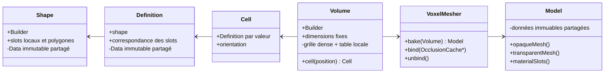

### 2.1 `spk::Voxel::Shape` : géométrie locale réutilisable

Une `Shape` représente les surfaces d'une cellule dans le **cube local `[0,1]³`**. Elle ne connaît ni matériaux concrets, ni volume, ni Engine.

Chaque polygone :

- possède au moins trois sommets, de positions flottantes dans le cube unité ; il est **plan et convexe**. Une forme globalement concave est représentée par plusieurs polygones ;
- est **simple face**. Son ordre de sommets est CCW vu du côté avant, et sa normale géométrique est orientée par `(v1 - v0) × (v2 - v0)` pour des sommets initiaux non colinéaires ;
- peut porter des UV arbitraires et des normales d'éclairage par sommet. La normale géométrique est utilisée par défaut pour l'éclairage, mais les normales personnalisées ne modifient jamais l'orientation géométrique ou l'occlusion ;
- référence un **slot géométrique local** déclaré par son nom dans la Shape. Ce slot porte `opacity`, un flottant de `[0,1]`, de valeur `1.0` par défaut.

Pour afficher une feuille ou une pancarte des deux côtés, l'application fournit **deux polygones explicites** de windings opposés. Il n'existe pas de propriété `doubleSided` ni de duplication implicite. Des polygones coplanaires de même winding peuvent se recouvrir, même totalement ; leur existence séparée est conservée. Une Shape de **zéro polygone** est valide.

Les surfaces sont réparties selon leur position :

- `outerShell` : polygones dont tous les sommets sont situés sur l'un des six plans de frontière (`x`, `y` ou `z` égal à `0` ou `1`), identifiables par face et par slot local ;
- `innerShell` : autres polygones, notamment les surfaces inclinées ou internes, qui ne sont jamais projetés artificiellement sur une frontière.

Les positions et les UV ne sont pas confondus : les **positions** doivent être dans `[0,1]³`, mais les **UV** peuvent être hors `[0,1]`. Dans ce dernier cas, la construction/validation CPU de la Shape émet un `Warning` non bloquant via `spk::Logger`. Aucun clamp ou modulo de sprite n'est ajouté automatiquement et cet avertissement n'est jamais répété à chaque frame.

#### Construction et immutabilité

`Shape::Builder` recueille des slots et des polygones, les valide **au moment de leur ajout** et publie une Shape immuable par `build()`. Toute géométrie invalide provoque une `spk::Exception` descriptive à l'ajout. Un ajout qui échoue, quelle qu'en soit la cause, laisse le Builder **strictement inchangé**. Un `build()` échoué laisse également son état entièrement intact, autorisant une nouvelle tentative. **Seul un build réussi consomme le Builder** ; il ne peut plus être exploité pour une nouvelle construction.

Une Shape publiée conserve un bloc `shared_ptr<const Data>` interne : les copies sont légères et partagent les mêmes données et la même identité. Deux Shapes construites indépendamment peuvent avoir des données géométriquement identiques mais des **identités de Data distinctes**. Cette identité est notamment utilisée par le cache d'occlusion. La représentation propriétaire n'est pas exposée dans les API publiques.

### 2.2 `spk::Voxel::Definition` : sens des slots

Une `Definition` immuable associe une `Shape` à une correspondance **slot géométrique de Shape → nom de slot sémantique** destiné au Model. Elle ne contient pas de `Material` et n'ajoute ni catégorie de rendu, ni règle d'occlusion indépendante à l'opacité déclarée dans la Shape.

`Definition` utilise également des données immuables partagées (`shared_ptr<const Data>`) et conserve la durée de vie de sa Shape. Copier une Definition est léger. Une même Shape peut être réutilisée dans différentes Definitions pour produire des noms de slots sémantiques différents.

Sparkle fournit une **Definition Air prédéfinie**. Elle représente une vraie cellule d'air, sans surface occultante ni slot de matériau supplémentaire présumé. Elle est créée automatiquement dans les Volumes ; l'application n'a pas à la fabriquer pour initialiser une grille vide.

### 2.3 `spk::Voxel::Cell` et orientations

L'API publique représente une Cell **par valeur**, contenant sa Definition (copie légère) et une orientation discrète. Les orientations disponibles comprennent les quatre rotations de 90° autour de Y et une possibilité d'inversion verticale, soit **huit orientations**.

L'orientation transforme correctement la géométrie, les UV et les normales. Un flip qui modifie la parité doit également préserver la **face avant physique voulue** par adaptation appropriée du winding/des indices, afin d'éviter qu'une surface visible ou occultante ne se retourne accidentellement.

Une cellule d'air est une Cell valide, et non `null`, un `optional` vide ou un indicateur « absence ».

### 2.4 `spk::Voxel::Volume` : snapshot dense immuable

Un Volume représente une grille **dense et contiguë** de cellules, d'extensions fixes. Chaque position a une entrée, y compris l'air. Pour éviter un `shared_ptr` complet par cellule, le stockage interne repose sur :

1. une **table locale de Definitions** partageant leurs blocs Data ;
2. une grille compacte d'indices vers cette table, avec l'orientation de chaque cellule.

L'index interne `0` est **toujours réservé à Air**. Une Cell d'air référence l'entrée `0`, jamais un sentinel d'absence.

La table locale déduplique une Definition **par identité de `Definition::Data`**, pas par comparaison profonde de contenu. Deux copies d'une même Definition partagent donc un index ; deux Definitions indépendantes au contenu identique peuvent occuper deux entrées. La lecture publique `cell(position)` reconstitue une **Cell par valeur** et n'expose pas les indices ni une référence vers le stockage compact. Ne pas promettre un `span<const Cell>` vers la grille.

`Volume::Builder` peut être initialisé depuis les dimensions d'une nouvelle grille entièrement remplie d'air ou depuis un `const Volume&` existant. Il propose des opérations de remplacement `set(position, Cell)` et de remise à l'air `erase(position)` ; les noms exacts peuvent être ajustés. **Ses dimensions ne changent jamais** : pas de `resize()` ni d'expansion implicite. Les accès hors limites sont invalides. Le produit des dimensions, les tailles d'indices et les allocations doivent être vérifiés avant tout débordement.

Un build réussi publie un **nouveau snapshot immuable**, à copies légères, sans modifier d'anciens Volumes, puis consomme le Builder. Toute exception pendant `build()` laisse l'intégralité de son état inchangé et réutilisable. L'implémentation peut partager des données entre snapshots seulement si cela ne permet aucune mutation rétroactive.

Les classes Shape, Definition, Cell et Volume fonctionnent **sans Engine ni OpenGL**.

## 3. Meshing, visibilité et occlusion

### 3.1 `spk::Voxel::VoxelMesher`

Le Mesher transforme un `Volume` immuable en un **nouveau `Model` immuable** par un **bake synchrone et complet**. Le programme peut lancer le bake dans le thread de son choix, gérer les priorités et choisir d'utiliser ou non le résultat, mais Sparkle n'impose aucun ordonnanceur ni rebake incrémental. Changer des cellules ou des données voisines nécessite un nouveau bake pour modifier le résultat du Model.

Son travail est indépendant des matériaux concrets et des pixels de texture. Il peut, de manière facultative, emprunter un `OcclusionCache` externe :

```cpp
spk::Voxel::VoxelMesher mesher;
spk::Voxel::OcclusionCache cache;

mesher.bind(&cache);
auto model = mesher.bake(volume);
mesher.unbind();
```

`bind(OcclusionCache*)` est un emprunt non propriétaire ; le cache doit rester vivant tant qu'il est lié et utilisé. La liaison est facultative : sans cache, le même algorithme de visibilité s'exécute sans mémorisation de ses résultats. Une nouvelle liaison à cible unique exige normalement un `unbind()` préalable ; le type exact du Mesher et ses méthodes secondaires restent à finaliser.

La tolérance de clipping est un seul paramètre configurable du Mesher, **`1e-5` par défaut** dans les unités locales du cube. Toute valeur non finie ou non strictement positive est rejetée par `spk::Exception`. Cette tolérance contribue à la clé du cache. La détermination des longueurs, aires et seuils de dégénérescence doit rester dimensionnellement cohérente : ne pas comparer une aire directement à une longueur.

### 3.2 Voisinage et cellules extérieures

Pour les positions internes au Volume, chaque voisin existe toujours, éventuellement comme Cell Air. Pour une position **extérieure**, une spécialisation du Mesher peut fournir un état de voisin :

```cpp
struct OutsideCell
{
    enum class State { Empty, Occupied, Unknown };
    State state;
    // Cell associée lorsque Occupied.
};
```

- `Empty` signifie que l'application déclare l'extérieur vide : les surfaces de la cellule courante restent exposées.
- `Occupied` fournit une vraie Cell extérieure, y compris éventuellement Air. Le Mesher étudie **sa géométrie effective**, pas simplement son caractère « occupé ».
- `Unknown` représente une donnée indisponible : elle ne constitue **jamais une preuve d'occultation**. Le programme effectuera un nouveau bake lorsque cette donnée deviendra connue.

Le Mesher ne conserve pas ces cellules extérieures dans le Volume. Aucun composant de gestion de chunks ni dépendance à un terrain n'est imposé.

### 3.3 Clipping polygonal exact selon le contrat flottant

La visibilité entre deux cellules adjacentes est calculée en géométrie flottante, à partir des polygones réellement présents sur leurs frontières opposées. Le Mesher peut effectuer des rejets rapides par AABB, mais une AABB ou une rasterisation discrète **ne remplace jamais** le calcul des intersections, unions et différences polygonales pour les recouvrements partiels.

Pour une face de la cellule A, la couverture de la cellule B n'est occultante que pour ses polygones qui remplissent **simultanément** ces conditions :

1. le polygone appartient à `outerShell` sur la frontière correspondante ;
2. son **slot local de Shape** possède `opacity == 1.0` ;
3. sa **face avant géométrique** est tournée vers la cellule A.

Le canal alpha de `albedo`, les normales personnalisées d'éclairage, et les faces `innerShell` n'entrent jamais dans cette décision. Une texture trouée peut donc afficher visuellement un trou alors que son slot d'opacité 1 a été traité comme occultant : il appartient à l'auteur de la géométrie et des matériaux de ne pas introduire cette incohérence.

Plusieurs polygones opaques frontaux peuvent conjointement fermer une frontière. Leur **union géométrique** est prise en compte, y compris s'ils se chevauchent : ni addition d'aires, ni XOR, ni double comptage, ni modification des polygones sources.

Le clipping préserve **positions, slots locaux, UV et normales**. Un nouveau sommet hérite de ses UV par interpolation des UV de la surface source, **pas** par reprojection automatique sur un plan. Pour un polygone convexe à plus de trois sommets dont les UV sont arbitraires, une triangulation **déterministe** fixe le domaine d'interpolation affine, triangle par triangle. Les fragments qui traversent plusieurs triangles doivent conserver ce mapping ; les normales d'éclairage interpolées sont renormalisées. Les triangles GPU émis respectent le winding CCW et les flips d'orientation.

Les fragments/triangles dégénérés selon la tolérance du Mesher sont écartés, sans supprimer artificiellement une couverture opaque légitime ou déclarer une frontière entièrement fermée par erreur. Aucun triangle GPU dégénéré ne doit être émis.

### 3.4 Règle d'émission des `innerShell`

Les surfaces intérieures ont une règle volontairement globale par cellule :

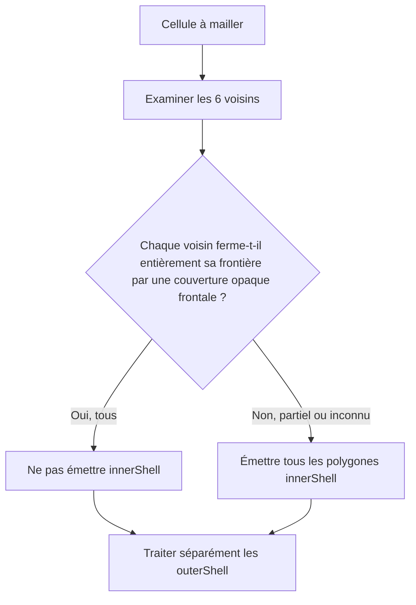

Chaque direction est **fermée** seulement si les polygones occultants du voisin couvrent **l'intégralité du carré `[0,1]²`** de sa frontière en vis-à-vis. La fermeture ne dépend pas des `outerShell` de la cellule courante. Si les six directions sont fermées, aucun `innerShell` de cette cellule n'est émis. Si au moins une direction est ouverte, partiellement couverte ou inconnue, **tous ses `innerShell`** sont émis, sans culling individuel supplémentaire par cette règle.

Les `outerShell` continuent à être traités par clipping directionnel indépendamment des `innerShell`.

**Limite fonctionnelle assumée :** cette optimisation ne prend pas en charge une caméra placée **à l'intérieur d'un espace entièrement enfermé** dont les surfaces intérieures ont été éliminées. Le moteur ne conserve pas ces faces de manière préventive et n'effectue aucun rebake automatique lié à la position de la caméra. L'application doit éviter ce scénario si elle veut garantir le rendu de ses surfaces intérieures.

### 3.5 `spk::Voxel::OcclusionCache`

Le cache est une ressource autonome **facultative** et indépendante des Meshers, des palettes et du GPU. Plusieurs Meshers peuvent l'utiliser.

Une entrée représente **une requête directionnelle A → B** : quels fragments de l'`outerShell` de A restent visibles après occultation par B ? Le sens **B → A** constitue une autre requête, une autre clé et éventuellement un autre résultat. Une valeur valide contenant zéro fragment signifie **occlusion totale**, tandis que l'absence d'entrée est représentée par `std::nullopt`.

La clé identifie les blocs immuables `Shape::Data` des deux cellules, leurs orientations, la direction du voisinage, les contrats géométriques d'opacité pertinents et la tolérance de clipping. L'identité de Shape vient du Data partagé, **pas d'un hash de contenu ni d'un identifiant artificiel**. Les clés conservent une propriété partagée suffisante sur ces Data pour empêcher le recyclage d'adresse de créer de fausses correspondances. Les slots sémantiques de Model et les matériaux concrets n'entrent pas dans l'identité d'un résultat si les contrats géométriques sont équivalents.

`OcclusionResult` est une valeur immuable, à copie légère, contenant les **fragments visibles de A dans le repère local de la Shape A**, leurs UV, leurs attributs et leurs **slots géométriques locaux**. Il ne contient ni indices des slots du Model ni pointeurs vers une palette. Après lecture du cache, le Mesher applique le mapping de la Definition, l'orientation et le placement dans le Volume.

`OcclusionCache` protège sa table par un `spk::ProtectedData<Data>` **privé** :

- `find(key)` copie légèrement un `std::optional<OcclusionResult>` sous verrou de lecture, puis libère le verrou avant de rendre la main ; aucun emprunt sur la table ne s'échappe ;
- `store(key, result)` publie une entrée complète sous verrou d'écriture ; deux Meshers peuvent calculer la même clé simultanément et n'en conserver qu'un résultat valide ;
- `clear()` supprime, sous verrou d'écriture, **les entrées présentes à cet instant**. Il n'annule pas un clipping déjà commencé hors verrou : un `store()` ultérieur peut réinsérer un résultat calculé avant la purge.

Le clipping lui-même s'effectue **hors verrou**. Les copies immuables d'`OcclusionResult` récupérées avant une purge restent valides. Les entrées du cache et les références aux Shapes restent détenues **jusqu'à `clear()` ou destruction** : aucune éviction automatique, aucun LRU et aucun budget de mémoire obligatoire.

Un cache partagé peut être interrogé simultanément ; en revanche, sa **destruction** et la modification de son binding pendant un bake actif ne sont pas rendues sûres par la seule synchronisation de `find/store/clear`.

### 3.6 `spk::Voxel::Model` : résultat immuable

Le Model contient ou conserve de manière sûre les données issues du Volume, **deux meshes immuables** (opaque et translucide, éventuellement vides) et la table complète des slots sémantiques déclarés par les Definitions effectivement utilisées.

Chaque polygone d'opacité **égale à 1** alimente le mesh opaque, et tout polygone d'opacité **inférieure à 1** alimente le mesh translucide. Il n'existe pas de catégorie `cutout` distincte. La texture ne modifie pas cette classification.

Tous les slots sémantiques **référencés par les Definitions des cellules du Volume** sont conservés, même si leurs triangles sont totalement occultés ou si leur Shape est vide. Une Definition qui reste dans une table interne mais n'est référencée par aucune Cell n'ajoute pas ses slots au Model.

Deux déclarations de slot portant le **même nom et la même opacité** sont fusionnées. Si elles portent le **même nom et des opacités différentes**, `bake()` échoue avec une `spk::Exception` descriptive ; aucune promotion implicite de catégories n'est tentée. Une fois fusionnés, les slots sont triés par **ordre lexicographique déterministe de leurs noms**, indépendamment de l'ordre de visite des cellules ou du culling.

Le sommet voxel comporte au minimum :

```cpp
struct MeshVertex
{
    spk::Vector3 position;
    spk::Vector3 normal;
    spk::Vector2 uv;
    std::uint32_t materialIndex; // Index dans la table triée du Model
};
```

Les deux meshes réutilisent **l'infrastructure `spk::Mesh<TVertex>` existante** et ses buffers/layouts GPU ; pas de nouveau framework de maillage. `materialIndex` n'est jamais réattribué selon les seuls triangles visibles. Remplacer une palette ou déplacer un Assembly ne change pas les meshes du Model.

## 4. Matériaux, textures et palettes


### 4.1 `spk::Material` : ressource générique

`spk::Material` est un **type générique Sparkle**, sans spécialisation `VoxelMaterial`. Il est construit via `Material::Builder`, puis devient **immuable**. Il peut associer zéro, une ou plusieurs textures à des **noms de rôles libres** (`albedo`, ou tout autre nom choisi par le programme). Seul le système voxel donne une signification au rôle `albedo`. Le Builder générique ne valide pas les conventions propres aux voxels.

Chaque liaison à une texture conserve un **`spk::Texture::Handle`** obtenu depuis la `const spk::Texture&` fournie lors du binding, ainsi qu'une région UV normalisée (`Texture::Section`, exprimable en `anchor` et `size`). Le Material conserve le **handle de l'état exact choisi** et non un pointeur brut vers l'objet Texture, une copie complète de Texture ou un pointeur vers l'AssetManager.

Un handle conserve l'état GPU partagé de la Texture après destruction du wrapper Texture initial. Il ne conserve toutefois **ni la grille du SpriteSheet, ni à lui seul son ensemble de résolutions**. Le Material final n'a pas besoin de la grille : la conversion d'un sprite en `Texture::Section` est réalisée **avant** sa construction.

La résolution effectivement capturée est celle de la Texture explicitement passée au Builder. Il n'existe **aucune sélection automatique de résolution** dans Material ou dans le rendu voxel. Changer de résolution implique de fournir la nouvelle Texture choisie à un **nouveau Material**, puis de choisir la nouvelle palette correspondante. Les mipmaps standards du State GPU restent possibles.

**Extension pour les textures de vues :** la source statique conserve le contrat `Texture::Handle` ci-dessus. Une liaison à une `EngineView` est une **source non propriétaire**, dont l'identité reste fixe dans le Material immuable. **La construction CPU du nouveau snapshot** sélectionne et capture la **version logique courante de la texture** (ou la texture de remplacement explicite), avec vérification des erreurs logiques déjà connues ; **l'exécution GPU** matérialise ce handle pour chaque `Window::Surface` et contrôle la disponibilité de son image au moment de l'utilisation. Le Material ne prolonge pas la vie de la vue et ne conserve pas durablement les handles de sa sortie ; les commandes déjà publiées peuvent conserver les handles logiques capturés. L'API exacte de liaison et la compatibilité avec les règles d'atlas voxel restent à finaliser. Les JSON d'assets ne recherchent pas implicitement des vues.

Les **propriétés et l'identité des handles** d'un Material sont immuables. Les **pixels de l'état Texture partagé** peuvent évoluer selon les API graphiques existantes, avec validation et synchronisation CPU/GPU adaptées : les Materials qui partagent ce même State verront son contenu actualisé. Si une opération détache/remplace le State d'une Texture source, un handle déjà capturé continue de référencer **l'ancien State** : il ne suit pas automatiquement cette substitution. Les paramètres du Material et les anciennes palettes restent inchangés.

### 4.2 Texture simple, SpriteSheet et région d'atlas

La configuration JSON d'une texture peut représenter une simple image :

```json
{
  "Texture": { "path": "terrain.png" },
  "UV": {
    "anchor": { "x": 0.25, "y": 0.5 },
    "size": { "x": 0.125, "y": 0.125 }
  }
}
```

Elle peut également demander un `spk::SpriteSheet`, en donnant une **grille de nombres de sprites**, et sélectionner une cellule de la grille :

```json
{
  "Texture": {
    "path": "terrain.png",
    "size": { "x": 16, "y": 16 }
  },
  "UV": {
    "sprite": { "x": 3, "y": 5 }
  }
}
```

Ici, `Texture.size` signifie **16 sprites en largeur et 16 en hauteur**, **pas une résolution en pixels**. `SpriteSheet::sprite(Vector2UInt)` retourne une `Texture::Section` normalisée. Des UV explicites (`anchor`/`size`) restent utilisables **même avec un SpriteSheet**. La syntaxe `sprite` exige une grille valide et des coordonnées de sprite valides.

Ces exemples illustrent le **bloc de description d'une texture**, pas nécessairement la structure complète d'un Material à rôles multiples ; les noms et l'organisation des rôles restent génériques. Le chargement JSON et la construction manuelle doivent aboutir à la **même représentation Material : handle + section UV**.

La Shape conserve des UV locaux ; le shader applique le rectangle du Material :

```text
uvFinal = material.anchor + shapeUV * material.size
```

Plusieurs Materials peuvent donc référencer le **même atlas** avec des rectangles UV distincts, sans rebake. Un UV local hors `[0,1]` est utilisé tel quel, sans répétition forcée dans la région ni clamp automatique. Le résultat visuel et la maîtrise des bords du sprite sont sous la responsabilité de l'appelant.

### 4.3 `Material::Builder` et l'AssetManager

Le Builder peut fonctionner **sans AssetManager** lorsque le programme lui passe directement des Textures existantes. En revanche, un chargement JSON qui doit résoudre un chemin ou un asset requiert un AssetManager préalablement lié :

```cpp
spk::Material::Builder builder;
builder.bind(&assets);  // Liaison non propriétaire
// Construction depuis un JSON de matériau.
```

`void bind(spk::AssetManager*)` est la forme retenue. **`bind(nullptr)` provoque immédiatement une `spk::Exception`.** Une liaison à cible unique n'est pas implicitement remplacée sans détachement préalable, selon les conventions Sparkle. Le Material obtenu ne conserve aucune référence au gestionnaire.

### 4.4 `spk::VoxelPalette` : association des slots aux matériaux

Une `VoxelPalette` associe des **noms de slots sémantiques et leurs contrats d'opacité** à des valeurs `spk::Material`. C'est une valeur immuable, à copies légères partageant un bloc de données internes ; elle ne contient **aucun SSBO** et n'hérite d'aucun objet GPU.

Son Builder mutable peut être initialisé à partir d'un Model, de plusieurs Models, d'un Assembly (union de leurs besoins) ou d'une palette existante pour en créer une variante. Les collisions de **même nom avec des opacités différentes** entre sources sont rejetées explicitement. Construire une nouvelle palette n'altère pas l'ancienne, ses Materials ou les snapshots existants.

**Chaque slot déclaré** doit recevoir un Material compatible, **même s'il n'a aucun triangle visible**. Le Builder valide que chaque Material affecté possède au moins la texture nommée exactement **`albedo`**, avec exception descriptive sur absence. Le système voxel ne requiert, n'examine ni n'utilise d'autres noms de textures dans cette version. La présence d'autres rôles sur un Material reste autorisée.

Un Model peut être associé à une palette contenant **plus de slots** que lui. L'association est compatible seulement si tous ses noms et opacités requis sont présents. `Model::isCompatible(palette)` est la forme d'API envisagée pour vérifier ce contrat, y compris la limite d'atlas par passe décrite ci-dessous. La palette n'est pas obligée d'être identique au Model, et une même palette peut servir à plusieurs Models.

**Source de vue dynamique :** les vérifications d'identité d'atlas ne pourront pas reposer uniquement sur un `Texture::Handle` figé après resize ; leur contrat exact est un point ouvert. Les règles suivantes restent acquises pour les sources statiques.

**Contrainte des atlas :** pour chaque association **Model + VoxelPalette**, les Materials des slots **opaques** requis par ce Model doivent tous référencer **un unique `albedo` `Texture::Handle` au maximum** ; la même règle s'applique, indépendamment, aux slots **translucides**. Cette vérification concerne **tous les slots déclarés par le Model, même sans triangles émis**, pas l'intégralité des slots supplémentaires de la palette. Les passes opaque et translucide peuvent utiliser le même atlas ou deux atlas différents.

Une palette peut donc contenir arbitrairement plusieurs atlas pour répondre aux besoins de divers Models ; elle n'est pas rejetée globalement pour cette raison. C'est une **association** qui est refusée explicitement lorsqu'elle demanderait deux atlas différents dans une même passe. Aucun remaillage silencieux ni découpage des meshes en sous-meshes par texture n'est prévu.

### 4.5 Alpha, opacité et visibilité

La classification géométrique reste celle de la Shape :

- `slot.opacity == 1.0` : triangles dans le mesh opaque ;
- `slot.opacity < 1.0` : triangles dans le mesh translucide (WBOIT).

Dans les **deux** fragment shaders :

```glsl
float alphaFinal = texture(albedo, uvFinal).a * slotOpacity;
if (alphaFinal == 0.0)
    discard;
```

Le mesh opaque est dessiné sans blending de translucence. Une texture contenant de l'alpha intermédiaire sur un slot d'opacité 1 **ne déclenche donc pas automatiquement** un passage translucide ; c'est un choix explicite de l'auteur. Le mesh translucide utilise Weighted Blended Order-Independent Transparency (WBOIT).

L'alpha des pixels n'a **jamais** d'incidence sur la décision de culling effectuée au bake. Il n'existe ni troisième mesh voxel cutout, ni booléen transparent supplémentaire, ni contrat d'occlusion indépendant.

## 5. AssetManager générique

Le gestionnaire d'assets appartient à Sparkle, indépendamment de l'API voxel. Il gère la création et la possession d'objets de types variés, sans leur imposer de méthode `fromJSON()` ou `toJSON()` universelle.

### 5.1 API de chargement et identité de cache

```cpp
spk::AssetManager assets;

auto& first = assets.load<spk::SpriteSheet>("terrain", config16);
auto& same  = assets.load<spk::SpriteSheet>("terrain", config16);
auto& other = assets.load<spk::SpriteSheet>("terrain", config8);

// &first == &same ; &first != &other
```

Le cache distingue les assets par le **triplet `(type C++ T, identifiant, valeur structurelle de spk::JSON::Value)`**. Le même identifiant peut désigner plusieurs configurations : ce sont alors des ressources distinctes. L'identifiant est une chaîne libre ; l'AssetManager ne l'interprète pas automatiquement comme un chemin.

L'égalité des JSON est **structurelle** : l'ordre textuel des propriétés d'un objet JSON n'altère pas la clé. La configuration est conservée par valeur dans l'identité du cache, et non par pointeur vers l'argument. Deux appels pour un même triplet rendent **la même instance** sans réexécuter la factory.

La configuration peut être omise :

```cpp
auto& a = assets.load<MyAsset>("simple");
auto& b = assets.load<MyAsset>(
    "simple", spk::JSON::Value::object()
);
// &a == &b
```

La forme à un seul argument signifie **exactement un objet JSON vide**, obtenu par `spk::JSON::Value::object()`. Un `spk::JSON::Value{}` est en revanche **Null** dans l'API actuelle et demeure une clé **différente**. Ne jamais confondre objet vide et Null.

### 5.2 Factories statiques par type

Lorsqu'une clé est absente, le gestionnaire appelle une **factory spécialisée statiquement pour T**. Aucune inscription de factory par instance, aucun `registerFactory<T>()` et aucun registre dynamique de constructeurs ne sont requis.

L'interface conceptuelle est :

```cpp
template <>
struct spk::AssetFactory<MyAsset>
{
    static MyAsset create(
        spk::AssetManager& assets,
        const std::string& id,
        const spk::JSON::Value& config
    );
};
```

La factory reçoit **explicitement** le gestionnaire, l'identifiant original et la configuration. Elle peut appeler `assets.load<U>()` pour résoudre des dépendances et décider elle-même comment interpréter son identifiant ou le JSON (nom logique, fichier, options métier, etc.). Une spécialisation applicative est possible pour tout type d'asset pris en charge. Le nom exact de la spécialisation, le type de paramètre de chaîne et certaines contraintes de compilation sont encore des détails d'interface.

**La factory retourne `T` par valeur.** Elle ne retourne pas un `unique_ptr`, un `shared_ptr` ou un handle de possession et n'a pas à connaître la structure du cache. Une absence de factory pour un type demandé doit être signalée explicitement au niveau compilation/contrat, sans fallback arbitraire. Un chargement ne suppose aucune sérialisation JSON du type lui-même.

### 5.3 Possession, adresses stables et construction directe

`AssetManager::load<T>()` retourne **`T&`**, emprunt non propriétaire sur un asset que **l'AssetManager possède**. Tant que l'entrée est conservée, son adresse **ne change pas**, même lorsque de nouvelles entrées sont insérées, que des conteneurs sont réalloués ou qu'une table de hachage est réorganisée. Le gestionnaire peut utiliser des allocations dédiées et des pointeurs propriétaires **strictement internes** pour garantir cette stabilité.

Pour des types non copiables ou non déplaçables, C++23 permet de construire directement l'objet dans son emplacement final à partir d'une prvalue de `T` retournée par la factory :

```cpp
// Pseudo-implémentation interne : unique_ptr reste invisible de la factory.
auto owned = std::unique_ptr<T>(
    new T(spk::AssetFactory<T>::create(*this, id, config))
);
cache.emplace(key, std::move(owned));
```

L'élision obligatoire des copies fonctionne avec un retour direct de type `return T(args...);`. La forme `return local;` dépend, elle, d'une NRVO non garantie ; et `std::make_unique<T>(AssetFactory<T>::create(...))` peut demander une opération de déplacement. **Ni `unique_ptr` ni `new` ne constituent une obligation de l'API publique** : seuls comptent le retour par valeur de la factory, le retour `T&` du gestionnaire et l'adresse stable de l'objet stocké.

### 5.4 Dépendances et détection des cycles

Une factory peut effectuer des chargements imbriqués dans **le même AssetManager et le même thread**. Si elle redemande un asset **déjà en cours de construction dans la chaîne active**, le gestionnaire détecte ce cycle, direct ou indirect, et lance une **`spk::Exception` descriptive**.

La comparaison utilise le triplet **complet** `(type, id, JSON structurel)` ; deux configurations différentes du même nom ne sont pas un cycle à elles seules. Un asset déjà **terminé et publié** dans le cache est simplement réutilisé. Le message d'erreur doit permettre d'identifier la chaîne de dépendances en cause.

Une factory échouée **ne publie aucune entrée partiellement initialisée**. L'état provisoire de détection des cycles est nettoyé en cas de succès comme d'exception, permettant une nouvelle tentative ultérieure. Les dépendances qui ont été **chargées avec succès** avant cet échec restent dans le cache : il n'existe pas de transaction globale ou rollback de toutes les dépendances.

### 5.5 Synchronisation et durée de vie

**L'AssetManager n'est pas intrinsèquement thread-safe.** Tous les accès concurrents à **une même instance**, même pour des clés différentes, relèvent de la synchronisation de l'application. Les appels imbriqués depuis une factory **dans le même thread** restent autorisés ; une synchronisation externe doit tenir compte de cette réentrance séquentielle. L'AssetManager n'introduit ni verrou de coordination automatique ni attente implicite entre factories de threads différents.

Le gestionnaire garde tous ses assets jusqu'à :

- la destruction de l'AssetManager ;
- ou l'appel explicite à **`void AssetManager::clear()`**.

Il n'existe **aucune éviction automatique**, aucun LRU ni nettoyage des seules entrées prétendument inutilisées. `clear()` détruit **tous les objets appartenant au gestionnaire**, puis laisse celui-ci réutilisable pour de nouveaux chargements. Tous les `T&` et pointeurs empruntés deviennent invalides après la purge ; un chargement ultérieur de même clé crée un **nouvel asset** et ne restaure jamais la validité des anciennes références.

Les mécanismes propriétaires propres aux assets restent distincts de la vie du wrapper `T` : notamment, un `Texture::Handle` déjà capturé par un Material peut conserver son état graphique après `clear()`, sans conserver la grille SpriteSheet ni un Font d'origine. Des widgets détenant un `Font*` doivent cesser de l'utiliser avant la destruction de l'asset correspondant.

`clear()` suit les mêmes contraintes de synchronisation externe que `load<T>()`. La purge au milieu d'une factory ou d'une chaîne de chargements active n'est **pas un scénario pris en charge**. Aucun `unload<T>()` par clé, rechargement ciblé ou surveillance automatique des emprunts n'est ajouté dans cette version.

## 6. Assembly, composants et scène

### 6.1 `spk::Voxel::Assembly`

Une Assembly est une **hiérarchie mutable de parties** sans Entity propre pour chaque membre. Chaque Part possède un identifiant stable au sein de son Assembly, un nom, éventuellement un parent, une transformation locale et éventuellement une copie légère de `Model` **avec sa propre association à une `VoxelPalette`**. Un point d'attache nommé peut ne contenir aucun mesh ; il peut servir à composer des modèles ou sous-assemblages.

Les opérations couvrent ajout, accès, transformation locale, changement de parent et retrait de parties, avec **refus des cycles**. La forme exacte des identifiants et des signatures est une question d'API, pas une raison d'introduire un deuxième système hiérarchique.

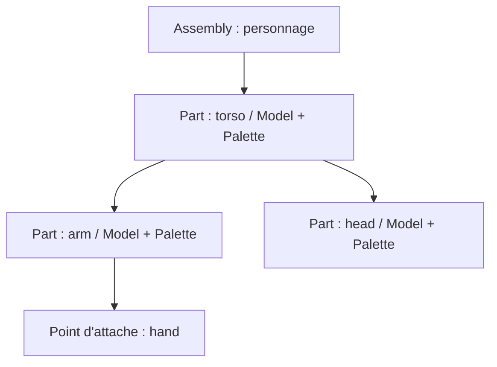

Les transformations locales sont indépendantes de `spk::Transform3D`, qui est déjà un Component3D. Une copie d'Assembly est **autonome pour sa hiérarchie et ses transformations**, tout en réutilisant les données immuables des Models et Palettes. L'Assembly copié démarre avec son **propre VersionedTrait, à version 1**, et non une copie des abonnés ou du compteur de version source. Les évolutions générales de `VersionedTrait` doivent rester compatibles avec cette propriété.

L'animation demeure **externe** à la bibliothèque voxel : un système de jeu peut modifier les transforms des parties, puis appeler `invalidate()` sur l'Assembly. Le rendu ne s'appuie toutefois sur **aucun cache de version** pour ses occurrences : il recalcule les transformations visibles à chaque RenderSnapshot.

### 6.2 `ModelRenderingComponent` et `AssemblyRenderingComponent`

Les deux composants sont des **composants de données** liés à une Entity3D et exposés au système de rendu par les mécanismes de Registry du moteur. Ils ne génèrent jamais eux-mêmes de `RenderCommand`.

- `ModelRenderingComponent` emprunte un `Model` et une `VoxelPalette` compatibles, sans transférer leur propriété ;
- `AssemblyRenderingComponent` emprunte une `Assembly`, sans la posséder. **Les layers individuels utilisés par le filtrage de `VoxelRenderingSystem` sont portés par ce composant graphique**, et non par l'Entity3D propriétaire ; l'API concrète des layers reprend le contrat générique des Contributors graphiques et du helper `CaptureContext::isLayerCompatible(...)`.

Leurs méthodes de liaison (`bind` / `unbind`, signatures à finaliser) utilisent des **pointeurs non propriétaires**, conformément aux usages Sparkle. Le programme doit conserver les objets liés en vie jusqu'à leur détachement et pendant tout accès nécessaire à la préparation d'un snapshot. Une liaison à cible unique n'est pas implicitement remplacée.

Les composants actifs sont trouvés **par Engine**, au moyen de `spk::Registry<T, Engine*>` ou de l'inscription typée réellement disponible. L'héritage Registry des composants spécialisés est à adapter à l'API existante et ne doit pas être inventé indépendamment de sa construction/contexte.

## 7. Systèmes de rendu visuel, d’ombres et commandes GPU

**Séparation des responsabilités — décision validée et approfondie.** `VoxelRenderingSystem` produit **exclusivement** les passes visibles des voxels (opaque, WBOIT translucide, matériaux et SSBO). Il ne génère **aucune commande** de shadow map, n'observe aucun mode d'ombre de ses composants et ne gère aucune souscription RAII de cache d'ombres.

La classe publique **`ShadowMap`** représente une **passe logique de rendu d'ombres**, sans dépendance de `EngineView` vers la gestion des ombres. Elle contient les **types imbriqués `ShadowMap::Contributor`** (composant graphique attachable à une `Entity3D`, qui fournit la géométrie d'ombre) et **`ShadowMap::RenderingSystem`** (système autonome qui découvre ces composants par Registry et construit les `RenderPass` et les caches). **Choix A validé : pour chaque `EngineView`, le système construit une seule `RenderPass` d'ombres commune, qui regroupe les commandes nécessaires à toutes les lumières projetant des ombres** ; il n'existe pas une `RenderPass` distincte par lumière, ni une passe statique et une passe finale séparées par lumière. Le `VoxelRenderingSystem` ne produit que les passes visuelles ; les composants de la même Entity peuvent fournir indépendamment un mesh visible et un mesh d'ombre.

**Ordonnancement et clé de la passe d'ombres — choix A validé.** Chaque sous-`RenderSnapshot` de vue utilise son **Builder indépendant**. `ShadowMap::RenderingSystem` y inscrit **une seule `RenderPass` d'ombres**, sous une `RenderPass::Key` unique dans ce Builder, qui doit précéder les passes d'éclairage consommant les résultats. **Une clé statique commune** (par exemple `ShadowMap::RenderPassKey`) **redevient une option cohérente**, puisqu'elle est réutilisée dans des Builders de vues différents, mais sa déclaration `static const`/`static constexpr`, sa réservation par le moteur et sa valeur numérique **ne sont pas encore décidées**. Elle ne doit pas entrer en collision avec une autre passe au sein de la même vue, et le nom ne détermine jamais l'ordre : le Builder continue à ordonner numériquement ses `RenderPass::Key`.

**Contenu de la passe commune.** Pour chacune des lumières **directionnelles et spots dont les ombres sont activées, ainsi que des ponctuelles activées et retenues par le budget souple X/Y/tolérance de la vue**, le système écrit, à l'intérieur de **la même `RenderPass`**, la suite **ordonnée** des commandes nécessaires : choisir les cibles de profondeur **propres à cette lumière**, reconstruire le cache statique seulement s'il est invalide, reconstruire la carte finale par copie de la statique puis dessins des casters dynamiques seulement si la finale est invalide, et poursuivre avec la lumière suivante. Si aucune reconstruction n'est requise, ne pas redessiner ni recopier inutilement. Les caches **ne sont jamais partagés entre lumières** : la combinaison `EngineView × lumière` conserve ses deux ressources logiques et ses générations, matérialisées séparément pour chaque `Window::Surface`. Les lumières ponctuelles dont les ombres sont activées ajoutent **des commandes de projection omnidirectionnelle sur les six faces d'une cubemap de profondeur** dans cette même `RenderPass`, et non six `RenderPass` indépendantes. Les spots et directionnelles conservent chacun une projection 2D ; les six faces d'une lumière ponctuelle forment une seule source d'ombre logique à caches séparés par lumière. Le comportement exact lorsqu'aucune lumière compatible n'est présente (passe vide ou absente) reste un détail à finaliser, sans remettre en cause l'unicité maximale de la passe par vue.

**Sécurité des commandes conditionnelles.** Le snapshot CPU doit encoder suffisamment d'informations immuables pour que l'exécution GPU sur chaque surface reconstruise uniquement les caches invalides **de cette surface et dans la limite du budget de reconstructions de l'image**. Une PointLight retenue mais non actualisée éclaire sans ombre. Les commandes ne lisent aucun `Contributor` mutable ; aucun changement de cible entre deux lumières n'est implicite. Le passage des textures de profondeur finales à l'éclairage reste une intégration générique à définir, sans ajouter une dépendance d'`EngineView` vers `ShadowMap`.

**Séquence de construction de la passe unique — choix A.**

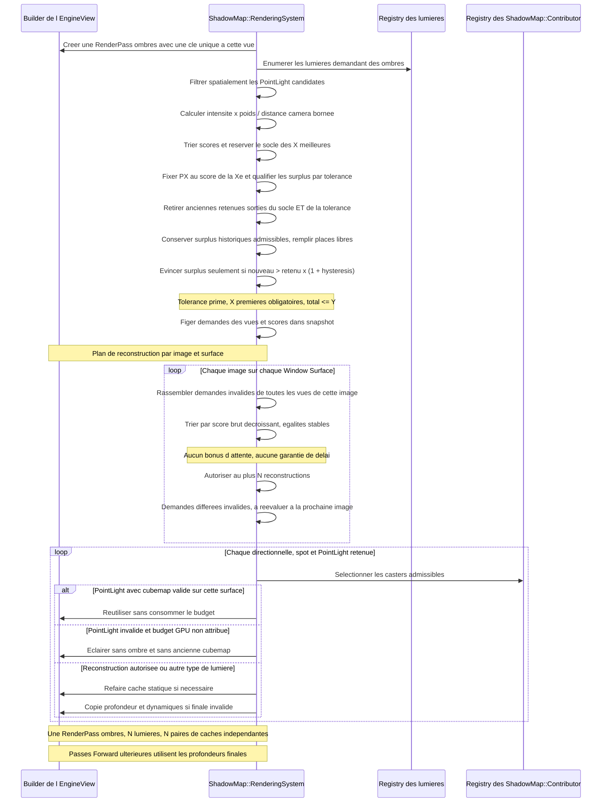

La responsabilité des composants et des systèmes est séparée :

- **`ShadowMap::Contributor`** : représente une source d'ombre sur une Entity, avec ses layers, `ShadowMode { None, Static, Dynamic }`, `ShadowPropagation { SelfOnly, Descendants }` et un **`MeshFilter` intégré** donnant accès au mesh de projection. Un mesh d'ombre peut être différent de celui utilisé pour le rendu visuel ; un cas voxel peut utiliser un mesh greedy-meshé. `ShadowMap::Contributor` n'est **pas une sous-classe de `EngineView::Contributor`** et n'expose pas les callbacks génériques de capture d'une vue. La forme C++ exacte (`Component3D`, handle/possesseur du mesh, setters) sera précisée séparément.
- **`ShadowMap::RenderingSystem`** : recherche les composants déclarés, filtre par état d'activation, layers compatibles avec la `CaptureContext` figée de la vue, `ShadowMode` effectif, géométrie admissible et projection de la lumière, puis ajoute les commandes de **toutes les lumières compatibles dans la seule `RenderPass` d'ombres de cette vue** ; les cibles statique/finale restent individuelles par lumière, sans double émission par la partie voxel. Les casters utiles hors du frustum de la caméra restent considérés.
- **`EngineView::Contributor`** : abstraction **purement générique** pour soumettre des commandes de rendu par vue ; ses propriétés sont les layers et la contribution au Builder. Il **ne porte aucune enum d'ombre, aucune fonction `invalidateShadowMap`, aucun `ContractProvider` lié aux ombres**.
- **`EngineView`** : porte la caméra, les layers, la résolution, la configuration de capture et les sous-snapshots. **Aucune connaissance du concept d'ombre** (ni shadow map, ni source de caster, ni politique de cache) n'est requise dans son API ou sa logique interne. L'intégration se fait par le Builder/les passes génériques : c'est la contribution du `ShadowMap::RenderingSystem` qui construit les passes et les ressources nécessaires. Le mécanisme de mise à disposition de la carte finale à l'éclairage reste à spécifier sans introduire de dépendance `EngineView → ShadowMap::RenderingSystem`.

**Registry et parenté sont indépendants.** Le Registry permet de découvrir les `ShadowMap::Contributor` ; il **ne constitue jamais un lien parent/enfant**, même lorsque tous les composants sont parcourus par le `ShadowMap::RenderingSystem`. `InherenceTrait` conserve la **parenté unique** des Entities et permet la propagation de leurs paramètres d'ombres vers les descendants, sans ajouter de données d'ombre à `sparkle::core`. Le choix C antérieur — considérer les relations de collecte graphique **explicitement établies** en plus de cette hiérarchie — reste identifié, mais l'inscription d'un composant dans le Registry ne crée **aucune** relation de collecte graphique. Le traitement des doubles chemins, s'il en existe réellement, reste à cadrer ; `InherenceTrait` seul n'a pas de parents multiples.

**Invalidation indépendante des vues.** Modifier le mode ou la politique d'un `ShadowMap::Contributor` via son setter provoque automatiquement une **invalidation complète** des caches d'ombres logiquement concernés, diffusée par le mécanisme RAII/notifications **propre au sous-système d'ombres**. Celui-ci gère ses caches par combinaison `EngineView` × lumière × `Window::Surface`, mais ils ne sont **pas possédés ou invalidés par les EngineView**. Les changements du `MeshFilter`, des transformations et des liens de parenté demandent également une invalidation correcte ; les règles de notification précises restent ouvertes. Les snapshots GPU déjà publiés restent immuables et le setter ne lance pas de dessin GPU.

```mermaid
flowchart LR
  Entity["Entity3D et InherenceTrait"] --> Visual["Composants visuels"]
  Entity --> ShadowComp["ShadowMap::Contributor"]
  M["ShadowMap : passe logique"] --> ShadowComp
  M --> SR
  M --> PassKey["Une cle par Builder de vue : cle statique commune possible"]
  ShadowComp --> ShadowMode["ShadowMode et ShadowPropagation"]
  ShadowComp --> Filter["MeshFilter integre : mesh d ombre"]
  Visual --> VR["VoxelRenderingSystem : rendu visuel"]
  VR --> Scene["Passes opaques et WBOIT"]
  ShadowComp --> Registry["Registry des casters"]
  Registry --> SR["ShadowMap::RenderingSystem"]
  Filter --> SR
  SR --> Score["PointLight : intensite x poids / distance bornee"]
  Score --> Target["Cible X : score de la Xe lumiere"]
  Target --> Tolerance["Admissibles en surplus si score >= PX x (1 - tolerance)"]
  Tolerance --> Remove["Ecarter anciennes retenues hors tolerance"]
  Remove --> Keep["Hysteresis seulement entre surplus admissibles"]
  Keep --> Max["Maximum absolu Y, socle X obligatoire"]
  Max --> RP["Une RenderPass ombres par EngineView"]
  Max --> Removed["PointLight sortie : caches actifs retires"]
  Removed --> Retire["Anciennes versions conservees par snapshots et GPU"]
  Max --> Pending["Demandes de reconstruction PointLight des vues"]
  Pending --> SurfaceBudget["Budget global par image et Window Surface"]
  SurfaceBudget --> Priority["Score brut decroissant seulement, sans bonus d attente"]
  Priority --> RP
  RP -->|"Pour chaque lumiere compatible"| Checks["Layers + activation + mode effectif"]
  Checks --> SM["Cache statique individuel de la lumiere"]
  SM -->|"Copie si finale invalide"| FM["Carte finale individuelle de la lumiere"]
  Checks --> FM
  FM --> Scene
  View["EngineView : donnees generiques de capture"] --> Builder["RenderingEngine : Builder de sous-snapshot"]
  Builder --> VR
  Builder --> SR
```

### Caméras et lumières : composants 3D de l'Engine

Les **caméras et les lumières sont représentées par des composants spécialisés dérivant de `spk::Component3D`**, attachés aux `Entity3D` existantes. Leur position et leur orientation dans le monde proviennent des **`Transform3D` des entités qui les portent** : il n'existe pas de seconde hiérarchie de transformations dédiée aux caméras ou aux lumières. Ces composants appartiennent à l'Engine concerné et sont découvrables par ses mécanismes de Registry, comme les autres composants du moteur.

**Types de lumières requis en V0.1.4 :** l'infrastructure de rendu 3D générique prendra en charge les trois catégories suivantes, représentées par des composants spécialisés de l'Engine :

- **Directionnelle** : une direction d'éclairage globale, sans atténuation liée à la distance, adaptée notamment au soleil ; sa direction est issue de l'orientation de l'Entity3D porteuse. **Peut projeter des ombres.**
- **Ponctuelle** : une source située à la position de son Entity3D, émettant dans toutes les directions, avec une portée et une atténuation à définir dans son contrat d’éclairage. **Peut également projeter des ombres en V0.1.4** grâce à une projection omnidirectionnelle par cubemap de profondeur. La projection reste activable/désactivable pour chaque lumière ; **les ombres des PointLight sont désactivées par défaut** puis activables individuellement, sous un budget configurable par vue.
- **Spot** : une source positionnée et orientée par son Entity3D, dont l'émission est limitée à un cône, avec des paramètres de portée et d'ouverture à définir. **Peut projeter des ombres.**

Les noms d'API `CameraComponent`, `DirectionalLightComponent`, `PointLightComponent` et `SpotLightComponent` restent **illustratifs**, mais la prise en charge des **trois catégories de lumières** est requise. Les paramètres de caméra (projection, plans proche/lointain, etc.) et de lumière (couleur, intensité, portée, cône selon le type) appartiendront à leurs composants respectifs ; les matrices et données graphiques nécessaires seront préparées par le système de rendu générique, puis capturées dans les commandes et snapshots concernés. **Contrat de projection d'ombres actualisé :** les lumières **directionnelles, spots et ponctuelles** sont toutes capables de projeter des ombres en V0.1.4, de façon **activable/désactivable explicitement sur chaque composant lumière** (nom d'API indicatif : `castShadows`, distinct du `ShadowMode` des casters). Les ombres restent activées **par défaut** sur les nouvelles lumières directionnelles et spots, conformément au choix précédent ; **les ombres des nouvelles lumières ponctuelles sont désactivées par défaut**, puis activables explicitement sous réserve du budget de leur vue. Lorsque les ombres sont désactivées sur une lumière, elle continue d'éclairer via Forward+ mais n'ajoute aucune opération ni ressource de shadow map. Les réglages de portée, résolution, biais et qualité, ainsi que la sélection des lumières à recalculer en grand nombre, seront définis dans le sous-système graphique d'ombres. L'activation d'ombres sur une lumière ponctuelle **n'impose pas** de redessiner tous les casters de l'Engine : le `ShadowMap::RenderingSystem` filtre les `ShadowMap::Contributor` selon leurs layers et état, la sphère d'influence de cette lumière et, au besoin, le frustum de chaque face. Le classement Forward+ des lumières pour l'éclairage n'effectue pas ce culling des casters. 

**Projection omnidirectionnelle des lumières ponctuelles — nouveau choix validé.** Une `PointLightComponent` autorisée à projeter des ombres dispose pour chaque vue de **deux cubemaps de profondeur logiques à six faces chacune** : cache statique et carte finale, indépendants des autres lumières et réalisés par `Window::Surface`. Les six faces couvrent l'ensemble des directions, avec six orientations et une projection perspective carrée à **90° par face**, bornée par les plans proche/lointain adaptés à la portée de la lumière. Le `ShadowMap::RenderingSystem` choisit les seuls casters opaques qui peuvent influencer cette lumière (intersection avec son volume d'influence, puis culling facultatif par face), classe leur mode effectif `Static`/`Dynamic`, et écrit les commandes de profondeur nécessaires aux faces dans **la seule RenderPass d'ombres de la vue**. Il ne parcourt pas ni ne dessine systématiquement la totalité des Entities pour chaque point light.

**Cache et consommation des cubemaps.** Le cache statique cubemap est reconstruit si invalide, puis copié **face par face** dans la cubemap finale avant le rendu des casters dynamiques lorsque la finale doit être actualisée ; une invalidation statique impose également la finale. Une invalidation dynamique ne reconstruit que la finale, en réutilisant les six faces statiques encore valides. La portée de l'invalidation peut rester **globale aux six faces de la lumière** en V0.1.4 : optimisation par face non obligatoire. L'éclairage Forward+ échantillonne uniquement la **cubemap finale**, avec une comparaison de profondeur cohérente avec la distance à la source et ses paramètres proche/lointain. Les cas spécifiques de filtrage/PCF, de couture entre faces, de biais, de résolution, de profondeur encodée et d'exécution GPU (six dessins ou rendu layered) restent à préciser ; **ne pas imposer un geometry shader** avant de mesurer les coûts.

**Budget ponctuel souple par EngineView — choix A validé, remplace le plafond strict unique.** Les `PointLightComponent` ont les ombres **désactivées par défaut**, puis activables individuellement. Le sous-système `ShadowMap` associe à chaque `EngineView`, **sans étendre l'API générique d'EngineView aux ombres**, trois paramètres configurables :

- `targetShadowCount` (`X`) : **nombre cible** de lumières ponctuelles retenues, prioritaires par leur score.
- `maxShadowCount` (`Y`) : **limite supérieure absolue**, incluant toutes les lumières supplémentaires acceptées au voisinage du seuil. La contrainte `0 <= X <= Y` doit être validée explicitement, et les valeurs entières sont non négatives.
- `shadowPriorityTolerance` (`epsilon`) : **tolérance relative** sur le score de la **Xe lumière du classement brut**, exprimée comme fraction comprise dans `[0, 1]`. Par exemple `0.10` autorise des lumières supplémentaires jusqu'à **10 % sous** le score de référence ; le score est supposé fini et non négatif.

Les valeurs numériques par défaut et les noms exacts des méthodes de configuration restent à spécifier. `X = 0` signifie **aucune ombre ponctuelle sélectionnée**, même si `Y > 0` : en l'absence de Xe lumière, il n'existe pas de seuil de tolérance. `Y = X` reproduit un budget strict ; `epsilon = 0` autorise seulement des supplémentaires de **score égal** à la Xe. Une contrainte de `Y` n'est jamais transgressée, même lorsqu'il existe plus de lumières de score proche. Ce budget **ne limite toujours pas** le nombre de mises à jour de cubemaps par image et ne concerne pas les directionnelles/spots.

**Sélection spatiale et priorité — règle de score maintenue.** Lors de la capture de chaque vue, `ShadowMap::RenderingSystem` examine les lumières ponctuelles actives ayant **demandé** les ombres et filtre celles dont le volume d'influence peut atteindre les récepteurs pertinents de la vue. Le centre d'une lumière peut être **hors du frustum** tout en éclairant un objet visible : la sélection de candidats ne se fonde pas seulement sur sa position. Les candidates sont ensuite classées par score **décroissant**, avec départage déterministe à score égal, puis soumises au **budget cible/tolérance/max**. Le score reste une **heuristique de sélection des ombres**, indépendante de l'atténuation physique et de l'intensité appliquée dans Forward+ :

```text
shadowPriority = intensity * shadowPriorityWeight / max(distanceCamera, minShadowDistance)
```

- `intensity` : intensité non négative du composant lumière, dans les unités de son contrat d'éclairage ; ne pas modifier le calcul d'éclairage pour classer les ombres.
- `shadowPriorityWeight` : **coefficient propre à chaque `PointLightComponent`, égal à `1.0f` par défaut** ; une valeur supérieure favorise la lumière et une valeur inférieure la défavorise, **sans modifier sa luminosité**. Il ne s'agit pas d'une propriété du `ShadowMap::Contributor` ni de l'`EngineView`.
- `distanceCamera` : distance euclidienne **de la lumière à la caméra associée à l'EngineView courante**, dans un même repère, lors de la capture.
- `minShadowDistance` : valeur **strictement positive** dans les mêmes unités que la distance, évitant les divisions par zéro et les scores arbitrairement élevés lorsque la caméra est très proche. Elle appartient à la configuration du classement des ombres ; **sa valeur numérique reste à définir**, de même que celle du budget par défaut. Les paramètres négatifs ou non finis ne sont pas valides ; un poids égal à zéro ramène le score à zéro sans désactiver l'éclairage ni la demande d'ombres.

**Sélection théorique sans historique — budget souple A validé.** Pour `n` candidates spatialement admissibles et triées par score brut décroissant, choisir d'abord `min(X, n)` meilleures. Si `n >= X > 0`, noter `P_X` le score de la **Xe du classement complet**, puis considérer **les suivantes dans cet ordre**. Tant que `score(candidate) >= P_X * (1 - epsilon)` et que le total retenu reste strictement inférieur à `Y`, accepter la candidate supplémentaire. Dès qu'une candidate est sous ce seuil, les suivantes du classement décroissant le sont aussi : arrêter. **Toujours comparer au score de la Xe**, jamais à celui de la dernière supplémentaire, afin d'éviter un effet de chaîne. Si `n < X`, toutes les candidates sont retenues (aucune Xe à utiliser comme référence) ; si `X = 0`, aucune n'est retenue. Les égalités de score sont départagées de manière stable, y compris lorsque le seuil et le maximum `Y` coupent un groupe d'ex æquo.

```text
target = min(targetShadowCount, eligibleCount)
referenceScore = score(sortedCandidates[targetShadowCount - 1])  // si eligibleCount >= X > 0
extraThreshold = referenceScore * (1 - shadowPriorityTolerance)
acceptExtra = score(candidate) >= extraThreshold && selectedCount < maxShadowCount
```

**Tolérance prioritaire, hystérésis interne — choix A validé.** L'ensemble des lumières **admissibles** est déterminé **avant toute hystérésis** : il comprend toujours les `min(X, n)` meilleures candidates spatialement éligibles (**socle cible**) et, seulement si `n >= X > 0`, les suivantes dont le score brut vérifie `score >= P_X * (1 - epsilon)` (**supplémentaires admissibles**). La tolérance est un **critère strict d'admission** pour les supplémentaires : une lumière précédemment retenue, mais sortie de cette plage, perd **immédiatement** son droit à une shadow map, même si l'hystérésis aurait empêché son remplacement. Aucune source hors de l'ensemble admissible ne peut être protégée par l'hystérésis. Le maximum absolu `Y` demeure intangible.

Le sous-système `ShadowMap` conserve **par EngineView** l'ensemble de `PointLight` retenues lors de la précédente capture ; la mémoire d'hystérésis **n'appartient pas à `EngineView`**. **Les X meilleures candidates admissibles sont toujours retenues**, sans être bloquées par une ancienne lumière supplémentaire : la cible demeure prioritaire. L'hystérésis ne concerne **que les remplacements entre lumières supplémentaires encore admissibles** lorsque les places au-delà des X premières sont pleines (jusqu'à `Y-X`). Une lumière supplémentaire nouvelle ne peut évincer une supplémentaire précédente toujours admissible que si son score dépasse **strictement** celui de la retenue selon le seuil proportionnel configurable :

```text
score(candidate) > score(incumbent) * (1 + shadowSelectionHysteresis)
```

- `shadowSelectionHysteresis` est un **taux fractionnaire** configurable pour la sélection d'ombres ponctuelles de la vue (par exemple `0.10` représente **10 %** d'avance requis) ; il est **fini et supérieur ou égal à zéro**. **Sa valeur par défaut et sa forme d'API restent à décider.** Un taux nul supprime la marge proportionnelle mais laisse l'obligation de dépasser strictement le score pour évincer une lumière encore éligible.
- **Ordre du calcul :** classer par score brut décroissant (égalité départagée par identité stable), construire le socle des X meilleures, calculer `P_X`, puis déterminer **toutes** les supplémentaires admissibles par le seuil fixe (sans troncature préalable à `Y`). Éliminer immédiatement les retenues précédentes sorties de cet ensemble, qu'elles soient désactivées, supprimées, hors d'influence ou passées sous le seuil de tolérance. Les retenues historiques désormais entrées dans les X meilleures appartiennent directement au socle.
- **Premier classement ou places supplémentaires libres :** retenir obligatoirement le socle des X meilleures, conserver les **supplémentaires précédemment retenues encore admissibles** tant que le maximum le permet, puis remplir les places libres avec les meilleures nouvelles supplémentaires, **sans appliquer l'hystérésis aux places vacantes**. Il est inutile de refuser une nouvelle supplémentaire si une place libre existe sous `Y`.
- **Plafond `Y` atteint :** une candidate supplémentaire **elle-même admissible** peut remplacer la **moins bien classée des seules supplémentaires retenues**, pas une des X lumières du socle, si et seulement si son score vérifie l'inégalité stricte d'hystérésis. Répéter cette comparaison dans l'ordre des nouvelles candidates décroissantes, en gardant `Y` absolu. Les supplémentaires sorties de la tolérance ne sont **jamais comparées** : elles ont déjà perdu leur place. Lorsque `X = Y`, aucune place supplémentaire n'existe ; le socle des X meilleures est sélectionné sans hystérésis.
- **Cas limites :** pour un score retenu nul, seule une nouvelle supplémentaire de score strictement positif peut l'évincer ; deux scores nuls ne provoquent aucun échange par hystérésis. Si `P_X = 0`, le seuil supplémentaire vaut zéro : les scores nuls sont admissibles, mais leur remplacement historique exige toujours un **dépassement strict**. Si `X = 0`, ne sélectionner aucune lumière ponctuelle ; si `n < X`, sélectionner les `n` candidates ; si `X = Y`, ne sélectionner que le socle, sans marge supplémentaire. Si les paramètres `X`, `Y` ou `epsilon` changent, **recalculer d'abord l'admissibilité** : supprimer les retenues devenues interdites, puis appliquer l'hystérésis uniquement entre les supplémentaires toujours admissibles. Lorsque `Y` baisse, garder le socle et retirer en priorité les supplémentaires aux plus faibles scores (égalité stable). Les scores/coefficients et taux doivent respecter leurs contraintes de finitude et de signe.

**Précédence définitivement résolue.** La tolérance **délimite l'admissibilité** et prime toujours l'hystérésis. Une ancienne supplémentaire passée sous le seuil `P_X * (1 - epsilon)` est retirée **à la capture suivante** sans protection historique, même si son score reste proche de celui d'une autre supplémentaire ; elle continue d'éclairer via Forward+ **sans ombres**. À l'inverse, une ancienne supplémentaire toujours dans la plage admissible peut résister à une nouvelle supplémentaire marginalement mieux classée **si les places supplémentaires sont pleines**, sans jamais dépasser `Y`. Cette stabilité de l'historique n'empêche pas l'admission obligatoire des X meilleures. L'absence de place sous `Y` ne permet aucun dépassement, même si beaucoup de lumières ont exactement le score `P_X`.

**Portée et diagnostic.** L'hystérésis limite **les changements de membership**, et non le classement ou les intensités des sources d'éclairage Forward+ ; une `PointLight` moins bien classée mais conservée grâce à l'hystérésis continue à projeter une ombre valide. Une candidate bloquée par le seuil de tolérance, le maximum `Y` ou l'hystérésis reste **observable** comme `ombres demandées mais non sélectionnées`, avec une raison distinguant `hors tolérance`, `plafond atteint`, `remplacement évité par hystérésis` et `ombres désactivées explicitement`. Toute capture encode la sélection et les références de cartes d'ombres de façon **immuable** ; aucun changement de sélection n'est fait par le thread de rendu GPU. Les mêmes données d'entrée **et le même état antérieur de sélection** entraînent le même résultat ; l'hystérésis signifie qu'une sélection peut dépendre intentionnellement de l'historique. Le culling des `ShadowMap::Contributor` reste distinct du classement Forward+.

**Éviction immédiate des caches ponctuels — choix A validé.** Dès qu'une `PointLight` **sort de l'ensemble retenu pour une `EngineView`** après classement, tolérance et hystérésis, le `ShadowMap::RenderingSystem` **retire immédiatement de son registre de caches actifs la paire logique statique/finale associée à cette vue et à cette lumière**, y compris ses réalisations par `Window::Surface`. Cette éviction vise aussi les sorties par désactivation des ombres, disparition de la lumière, exclusion spatiale ou abaissement de `X/Y` ; elle concerne la **perte de sélection pour une vue**, et non la simple attente d'une reconstruction GPU pour une lumière **encore retenue**. Une même `PointLight` retenue dans une autre vue garde **indépendamment** ses caches pour cette autre vue. Une variation temporaire de score ne doit pas laisser un cache invisible dans le système actif.

**Durée de vie des snapshots et GPU.** Le retrait est **logique et immédiat à la réconciliation de sélection / capture CPU**, pas une destruction forcée de textures OpenGL au milieu d'un rendu. Les snapshots déjà publiés qui possèdent des **handles forts/versions immuables** vers l'ancienne paire conservent leurs ressources utilisables selon leur propre contexte capturé ; les commandes GPU déjà envoyées doivent aussi avoir achevé leur utilisation **avant** destruction physique. Chaque réalisation `Window::Surface` est libérée **de manière différée lorsque plus aucun snapshot en vol ne peut la référencer et lorsque son usage GPU est terminé**, sur le contexte/thread OpenGL approprié. La mécanique précise de détection de fin GPU et de libération différée demeure à spécifier ; une simple suppression de la référence dans le cache courant ne rend pas un handle GPU recyclable. Les anciennes versions ne doivent être ni écrasées, ni remappées vers la nouvelle vue, ni effacées prématurément. Le `ShadowMap::RenderingSystem` ne conserve **aucun cache dormants** des lumières exclues pour les réutiliser ensuite.

**Réadmission et budgets.** Une `PointLight` revenant dans la sélection de la vue est traitée **comme une première admission pour les ombres de cette combinaison** : elle crée une **nouvelle paire logique statique/finale**, avec **générations distinctes**, et les réalisations GPU nécessaires par surface sont invalides jusqu'à reconstruction complète. La nouvelle paire **ne réutilise jamais** l'ancienne paire retirée, même si ses textures sont encore physiquement vivantes dans un snapshot antérieur. Sa reconstruction consomme **une unité du budget par image et par `Window::Surface`** suivant la priorité stricte validée, que la précédente paire ait été entièrement statique ou non ; si le budget est épuisé, la lumière éclaire sans ombre jusqu'à actualisation. Les valeurs `targetShadowCount/maxShadowCount/shadowPriorityTolerance`, l'hystérésis de sélection et le score restent inchangés par cette règle d'éviction. Une destruction/recréation de `EngineView` ou de `PointLight` ne peut pas ressusciter des caches rattachés à une ancienne identité.

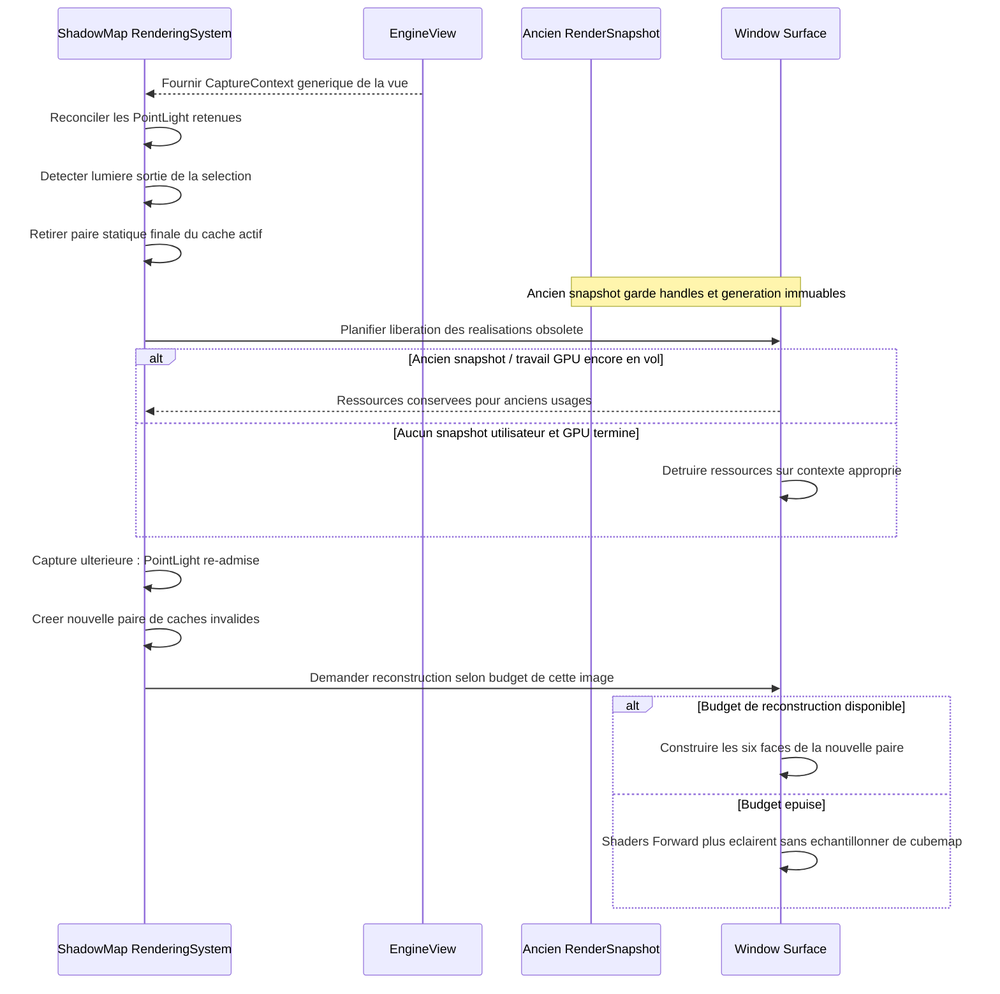


**Éclairage et observabilité.** Les lumières ponctuelles **écartées par le budget cible, la tolérance, le plafond absolu ou l'hystérésis continuent d'éclairer via Forward+ sans ombre**. Seules les lumières sélectionnées ajoutent des opérations de cubemap à l'**unique `RenderPass` d'ombres de la vue**. L'éclairage ne doit jamais échantillonner une carte périmée d'une lumière non sélectionnée, même si la ressource GPU existe encore. L'exclusion `ombres demandées mais refusées par budget` doit être **observable** (statut par vue/lumière et raison ou diagnostic équivalent) et distincte de `ombres désactivées explicitement`. Pas de journalisation répétée par lumière et par frame non sollicitée.

**Caches et frontières.** Les vues peuvent retenir des ensembles de lumières ponctuelles différents, avec un nombre compris entre `min(X, n)` et le maximum absolu `Y` : le socle des X meilleures est toujours retenu et seules les supplémentaires admissibles peuvent utiliser les places restantes, avec hystérésis interne. Chaque lumière retenue possède une paire **statique/finale** pour la vue et les matérialise indépendamment dans chaque `Window::Surface`. **Une lumière sortie de la sélection voit sa paire retirée des caches actifs immédiatement ; la destruction GPU des anciennes versions attend la fin de tout snapshot et usage GPU en vol. Sa réadmission crée des cartes invalides nouvelles, reconstruites sous le budget de cette surface, sans réutiliser l'ancien cache.** Deux budgets indépendants sont validés : sélection **par EngineView** (`X/Y/epsilon`), et **reconstructions par image et par `Window::Surface`**. Les spots et directionnelles ne sont concernés par **aucun** de ces budgets ponctuels.

**Budget de reconstructions de cubemaps — choix B validé.** Le sous-système autonome `ShadowMap::RenderingSystem` expose une configuration **non négative** limitant, pour chaque **image rendue sur une `Window::Surface`**, le nombre d'**instances de cubemap ponctuelle à reconstruire** (nom indicatif : `maxPointShadowRebuildsPerImage`). Il s'agit d'un **compteur unique à la surface et à l'image**, partagé entre **toutes les `EngineView` effectivement dessinées dans cette image sur cette surface** ; ce n'est ni un compteur par EngineView, ni une modification de `targetShadowCount`/`maxShadowCount`. Les fenêtres/surfaces indépendantes possèdent des compteurs distincts ; un snapshot CPU ne consomme pas le budget tant qu'il n'est pas exécuté. La valeur numérique par défaut et le mode précis de configuration restent à définir, sans créer d'API d'ombres dans `EngineView`.

**Unité atomique de reconstruction.** Une unité du budget correspond à **une paire logique statique/finale pour une combinaison (EngineView, PointLight) sur la surface**, lorsqu'au moins une carte doit être mise à jour. Si seule la finale est invalide, la reconstruction de la finale et ses six faces coûte **une unité** ; si la statique et la finale sont invalides, reconstruire la statique, copier chaque face puis reconstruire la finale constitue **une unique unité**. Les **six faces** ne sont pas comptées individuellement et aucune carte finale **partiellement remise à jour** ne peut être publiée comme valide. Une paire entièrement valide ne coûte **aucune unité** et sa shadow map demeure disponible, même si le budget de reconstructions est épuisé. Les images où le budget vaut zéro peuvent donc continuer à afficher **les ombres déjà valides** sans aucune reconstruction.

**Priorisation stricte, sans vieillissement — choix A validé.** Le système considère uniquement les `PointLight` **déjà retenues** par le budget souple propre à chaque vue. Il examine leur validité **spécifique à la surface** et classe **toutes les reconstructions nécessaires par le score brut de priorité déjà validé** (`intensity * shadowPriorityWeight / max(distanceCamera, minShadowDistance)`), **strictement décroissant**, pour chaque image et chaque surface. Pour un même score, le départage est **déterministe** par identité stable de la vue puis de la lumière (ou clef équivalente), jamais selon l'ordre accidentel du Registry. **Aucun bonus lié à l'attente**, aucune ancienneté de demande, priorité croissante avec les frames différées, rotation round-robin, quota de rattrapage ni garantie de délai maximal de reconstruction : une demande moins prioritaire peut légitimement **rester différée indéfiniment** si des demandes plus prioritaires occupent le budget à chaque image. Ce comportement est voulu et observable, sans changement du score utilisé pour choisir les lumières ombrées par `EngineView`.

**Réévaluation à chaque image.** Les demandes dont les caches restent invalides et qui ont été différées **tant que leur PointLight reste sélectionnée** sont **réévaluées à la prochaine image réellement rendue sur cette surface**, avec le score de cette image et la nouvelle validité de leurs caches ; aucune file FIFO ni compteur d'attente persistants ne sont nécessaires. Une lumière perdant sa place est évincée de la liste des demandes et du cache actif, plutôt que maintenue en attente. Les lumières désormais valides n'entrent plus dans la liste de reconstructions ; celles dont l'intensité, le poids ou la distance caméra ont changé peuvent changer de rang immédiatement. La liste des demandes de **toutes les vues dessinées sur cette surface** est classée **avant** d'accorder les unités du budget commun, y compris si une vue à plus haute priorité est rendue plus tard dans l'ordre des vues établi. Le plan utilise les captures immuables et l'état de ressources propre à la surface, **sans modifier l'ordre des vues ni introduire un ordonnanceur de passes général**, sans accéder aux Entities mutables sur le thread GPU. Une paire (vue, lumière, surface) reconstruite une fois dans l'image ne consomme pas deux unités lors de son éventuelle réexécution. Les détails de synchronisation inter-vues et inter-snapshots restent à préciser, mais **aucune équité implicite entre vues** ne doit renverser le score brut. La même lumière peut être prioritaire pour une vue et moins prioritaire pour une autre en raison de leurs caméras distinctes.

**Non-sélection et diagnostic.** Après répartition des unités, une demande dont la cubemap est toujours invalide **éclaire sans ombres** pendant cette image, ne consomme aucune unité et reste candidate au rendu suivant si elle est toujours sélectionnée. L'outil de diagnostic du `ShadowMap::RenderingSystem` peut distinguer `reconstruction différée pour priorité inférieure` d'une exclusion du budget X/Y/tolérance, sans produire de journaux répétitifs par image. Aucune lecture d'une cubemap invalidée n'est tolérée, même après une très longue attente. Les spots et directionnelles ne sont pas concernés par ce budget de reconstructions ponctuelles.

**Règle anti-obsolescence.** Si une `PointLight` est sélectionnée et sa paire de cubemaps est **valide pour les générations du snapshot et de la surface**, elle projette ses ombres sans consommer de reconstruction. Si l'une des cartes requises est **invalide** et que sa demande n'est **pas retenue dans le budget de l'image**, elle continue d'éclairer par Forward+ **sans aucune ombre** pour cette vue et cette surface pendant cette image. **Ne jamais échantillonner une ancienne cubemap simplement parce qu'elle est encore allouée.** Si la reconstruction est autorisée, les sorties ne deviennent utilisables qu'une fois la chaîne statique/finale cohérente achevée. Les demandes non satisfaites restent invalides et sont réévaluées à l'image suivante selon leur **score brut actualisé, sans bonus d'attente ni date limite de traitement** : pas de publication de texture périmée ni de travail GPU masqué. Les diagnostics distinguent `hors sélection X/Y/epsilon`, `hystérésis`, et `retenue mais reconstruction différée faute de budget GPU` ; éviter tout journal répétitif non demandé.

**Autres lumières et sécurité d'exécution.** Les ombres des **spots et directionnelles** suivent leur politique de cache déjà établie et ne consomment pas les unités du budget réservé aux cubemaps ponctuelles. Le budget est consommé **au rendu effectif d'une image par surface**, pas lors de `refreshRenderSnapshot()`, avec génération/validité vérifiées à l'exécution GPU sur la surface, tout en conservant les captures et les handles des `RenderSnapshot` immuables. Les snapshots anciens encore en vol doivent rester exécutables sans état mutable de gameplay ni altération des ressources qu'ils référencent : réutilisation de caches obsolètes, recomptage abusif d'une même paire et état de budget partagé par erreur entre surfaces sont interdits. Le nombre de faces actualisées par unité n'est pas un paramètre supplémentaire de cette décision.

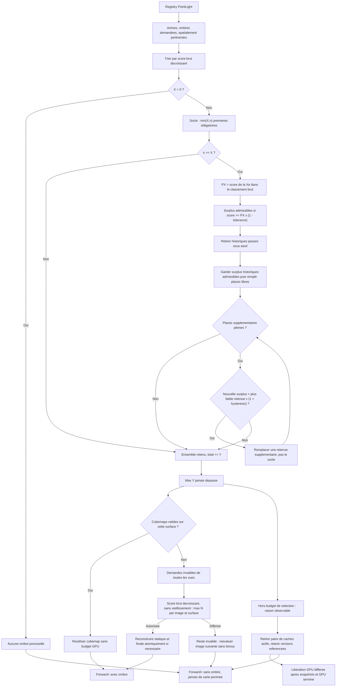

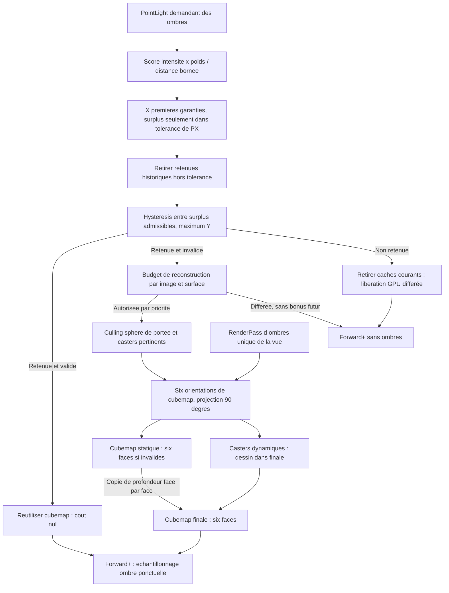

**Projection des ombres directionnelles :** chaque lumière directionnelle ayant les ombres activées utilise **une seule shadow map de profondeur pour le rendu concerné**, représentant une région pertinente pour celui-ci. Il n'y a **ni Cascaded Shadow Maps (CSM), ni subdivision obligatoire du frustum en plusieurs cascades**, ni atlas de cascades pour une même lumière directionnelle dans V0.1.4. Cela n'interdit pas plusieurs lumières directionnelles, chacune avec sa propre carte pour un rendu donné. En présence de plusieurs EngineView, aucune mutualisation des shadow maps n'est exigée en V0.1.4 : chaque vue peut préparer les siennes indépendamment. Le choix d'une seule carte par lumière directionnelle dans une vue n'impose aucune cache inter-vues. La définition de la région couverte, des matrices de projection d'ombre, de la résolution, du biais et de la fréquence de rafraîchissement reste à finaliser ; ne pas inventer de couverture mondiale infinie ni de mécanisme de sélection automatique des cascades. Le contrat des ombres des spots sera précisé séparément.


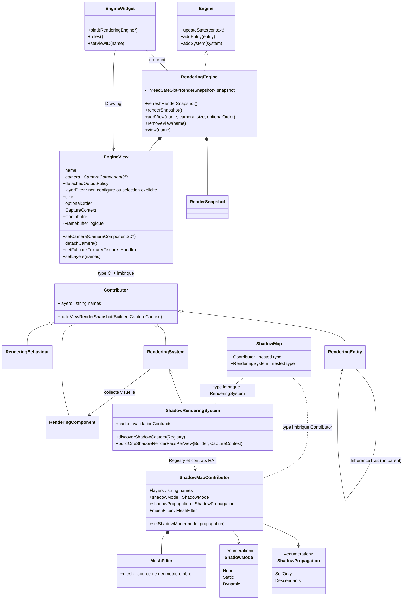

Dans ce diagramme, `Contributor` est **`EngineView::Contributor`** : le lien pointillé indique l'imbrication du **type**, pas la possession d'une instance. Un même contributeur peut participer au rendu de plusieurs vues lorsque les **layers de ces vues le sélectionnent**. Les classes `RenderingComponent`, `RenderingBehaviour`, `RenderingEntity` et `RenderingSystem` conservent leurs noms et variantes 2D/3D.

**Frontière des bibliothèques.** `spk::Engine` reste un moteur logique et headless de `sparkle::core`, responsable des entités, systèmes, événements et `updateState(UpdateContext&)`. `spk::RenderingEngine : public spk::Engine` se trouve dans `sparkle::sparkle` et ajoute les capacités graphiques : `EngineView`, contribution des objets graphiques, construction du `RenderSnapshot` moteur et publication via `ThreadSafeSlot<RenderSnapshot>`. Un serveur peut instancier `Engine` seul ; une application graphique instancie directement `RenderingEngine`. La conversion d'un Engine existant en RenderingEngine n'est pas prévue. L'héritage impose de rendre virtuel le destructeur de `Engine`. L'ancien `RenderingEngine` adaptateur possédant un `Engine*` et les événements/input qu'il propage devront être refactorisés, sans perdre ces fonctionnalités.

**Propriété des vues.** Chaque `RenderingEngine` possède une collection de `spk::EngineView`, identifiées par une chaîne unique **et immuable**. Une vue désigne une `CameraComponent` explicite **ou aucune caméra lorsqu'elle est détachée**, sa résolution choisie par le jeu et, facultativement, un ordre numérique de capture. Une caméra peut être utilisée dans plusieurs vues. `EngineView` et `CameraComponent` relèvent désormais du module graphique et non de `sparkle::core` ; la caméra reste un `Component3D` positionné par son `Entity3D/Transform3D` habituel. Aucune caméra, vue, résolution, projection ou hiérarchie alternative n'est créée implicitement. Le nom `"main"` est uniquement la sélection par défaut du rôle `Drawing` d'un EngineWidget.

**Nom immuable (choix A validé).** Le nom d'une `EngineView` est attribué lors de sa création et **ne peut jamais être modifié** pendant sa durée de vie. La collection du `RenderingEngine` garantit son unicité et refuse toute tentative de création avec un nom déjà utilisé via `spk::Exception`. Aucune méthode de renommage, propagation de noms vers les widgets, alias automatique ou registre de dépendances n'est introduit. Les recherches `renderingEngine.view(name)`, les identifiants sélectionnés dans les `EngineWidget` et les références logiques du jeu conservent ainsi un identifiant stable. La caméra, la résolution, l'ordre facultatif et la politique de sortie restent modifiables suivant leurs propres contrats ; elles n'affectent pas le nom. La destruction d'une vue peut libérer le nom pour une nouvelle vue, **sans rétablir la validité des anciennes références non propriétaires** ou modifier les snapshots déjà publiés.

**Suppression explicite et immédiate des vues — choix A validé.** Le jeu peut appeler `RenderingEngine::removeView(name)` (signature indicative) pour **retirer et détruire immédiatement** une `EngineView` possédée par le moteur, sans attendre la destruction du `RenderingEngine`. Cette suppression retire la vue de l'ordonnancement et de la recherche par nom dès l'opération ; aucun nouveau snapshot construit ensuite ne capture son rendu. Un nom inconnu demandé à `removeView` est une opération invalide, signalée par `spk::Exception`, conformément à la politique générale des API. La suppression libère son nom et, si elle était explicitement ordonnée, sa priorité numérique, sans modifier l'ordre de création relatif des autres vues non ordonnées. Réutiliser ensuite le nom pour créer une autre vue ne restaure **aucune référence** à la vue détruite et n'effectue aucun rebinding automatique.

La responsabilité des références non propriétaires reste **explicitement celle du développeur** : avant suppression, il doit cesser d'utiliser la vue depuis les Materials, widgets et autres détenteurs de références ou identifiants de vue qui ne seraient plus valides. Sparkle n'introduit ni comptage de références de vues, ni suppression différée, ni mise à jour automatique des consumers. Les `RenderSnapshot` **déjà publiés** restent immuables et peuvent conserver leurs handles de textures, framebuffers, SSBO et autres ressources concrètes capturées jusqu'à leur fin de vie ; le retrait d'une vue n'annule pas ni ne reconstruit automatiquement ces snapshots et ne prolonge pas la vie de son objet logique.

**Ordre facultatif, sans numérotation automatique (décision validée).** Une `EngineView` peut être créée **avec ou sans ordre numérique explicite**. Les vues dotées d'un ordre explicite sont toutes exécutées **en premier**, dans l'ordre croissant de cette valeur. Leurs ordres numériques doivent être uniques dans le même `RenderingEngine` ; tout conflit à la création ou lors d'un changement d'ordre déclenche une `spk::Exception` descriptive sans laisser la configuration dans un état invalide. Les vues **sans ordre explicite** sont toujours exécutées **après toutes les vues ordonnées**, dans **leur ordre de création**, sans recevoir de priorité numérique automatique. Deux vues sans ordre ne sont **pas** en conflit : l'unicité ne s'applique qu'aux valeurs explicitement fournies. Ainsi, l'ajout ultérieur d'une vue ordonnée la place avant toutes les vues sans ordre, même si celles-ci ont été créées précédemment.

La construction du snapshot moteur produit d'abord cette séquence complète de vues (priorités explicites puis vues non ordonnées en ordre de création) et y place les commandes de délégation dans le même ordre. Comme le `RenderSnapshot::Builder` existant ne trie les `RenderPass::Key` que par valeur numérique, l'encodage interne doit **respecter cette séquence**, y compris si une priorité explicite vaut la borne maximale du type numérique. Il ne doit pas reposer sur une valeur sentinelle « après toutes les priorités » susceptible d'entrer en collision ; les priorités publiques n'ont pas à être réutilisées telles quelles comme ordres des passes internes. Cela préserve le mécanisme existant de Builder sans ordonnanceur supplémentaire.

**Caméra remplaçable ou détachable (choix C validé).** Après la création d'une `EngineView`, le jeu peut **modifier explicitement sa caméra** ou la **détacher** (API indicative : `setCamera(CameraComponent3D*)`, avec `nullptr` pour détacher ; la forme finale peut inclure `detachCamera()`). La vue conserve son identité, son nom, son ordre de capture, sa résolution choisie par le jeu et ses ressources graphiques logiques : changer ou détacher la caméra **ne détruit ni ne recrée la vue**, et ne redimensionne pas ses cibles. Une modification de caméra prend effet à la **prochaine construction du snapshot moteur**, sans modifier les commandes déjà publiées, dont les matrices et les handles de rendu sont figés. Plusieurs vues peuvent continuer de partager une caméra.

**Vue détachée à la capture.** Une vue sans caméra reste enregistrée dans son `RenderingEngine` et reste accessible par son nom, mais `refreshRenderSnapshot()` **ne construit aucune commande produisant un nouveau rendu pour cette vue** : pas de collecte de Contributors ni de passes shadow/opaque/WBOIT/composition ni d'effacement implicite de sa texture. Les autres vues continuent de se construire et de se rendre normalement, suivant leur ordre habituel. Aucun rendu alternatif, caméra par défaut ou exception de capture n'est créé par l'absence volontaire de caméra. La visibilité de la sortie dépend de la **politique explicite de la vue**, décrite ci-dessous ; elle ne modifie pas l'interdiction d'un nouveau rendu de scène pendant le détachement.

**Durée de vie de la caméra.** La liaison d'une `EngineView` vers sa `CameraComponent` est **non propriétaire**. Une caméra détruite sans que la vue en soit auparavant détachée reste une référence pendante, soumise au contrat de durée de vie habituel : Sparkle ne promet ni détection automatique ni exception garantie. Le jeu doit détacher ou remplacer la caméra avant sa destruction. Lorsqu'une vue est détachée, la recherche `camera.view(name)` sur une autre caméra ne la considère pas comme liée à celle-ci ; `renderingEngine.view(name)` continue de fonctionner. Les matériaux qui empruntent l'identité de la vue restent liés à cette **même vue**, et les snapshots déjà publiés restent immuables et valides suivant leurs handles capturés. La consultation de sa texture détachée dépend de la politique explicite de sortie décrite ci-dessous.

**Accès aux vues depuis l'Engine ou la caméra.** `renderingEngine.view("monitor")` retrouve une vue par son nom et lance `spk::Exception` si absente. `surveillanceCamera.view("monitor")` est également prévu : il utilise le contexte `Engine*` déjà transmis aux composants pour retrouver le `RenderingEngine`, puis vérifie que la vue demandée désigne bien cette caméra. Absence de moteur graphique, nom inconnu ou mauvaise caméra : `spk::Exception`. Cela ne demande **aucun registre inverse** dans la caméra. Signatures et noms secondaires restent illustratifs.

**Resize sous contrôle du jeu.** Redimensionner la fenêtre ou un widget ne change **ni la résolution d'une EngineView ni la projection de la caméra**. Le jeu ajuste chacune explicitement. L'affichage peut simplement étirer la texture existante. Une vue dont la résolution change crée une **nouvelle version des cibles logiques** ; les handles déjà publiés ne doivent pas être modifiés rétroactivement. Le `Framebuffer::resize()` actuel, qui modifie les States de ses attachments sur place, n'est donc pas le mécanisme à employer sur une cible encore référencée par des snapshots.

**Politique explicite de sortie lorsque la caméra est détachée — trois modes validés.** Chaque `EngineView` expose une politique configurable, représentée par un **enum C++ explicite** (noms indicatifs : `DetachedOutputPolicy::KeepLastFrame`, `DetachedOutputPolicy::Invalid`, `DetachedOutputPolicy::DefaultTexture`). **La valeur initiale est `DetachedOutputPolicy::Invalid`** pour toute nouvelle `EngineView` ; le jeu peut la modifier explicitement ensuite. Elle détermine **la source de texture disponible aux consommateurs** lorsque la vue n'a pas de caméra. Elle n'entraîne dans aucun des trois modes un nouveau rendu 3D, un clear ou une mise à jour des sous-snapshots de cette vue.

- **`KeepLastFrame`** : les widgets `Drawing` et les `Material` empruntant cette vue utilisent la **dernière image produite sur la cible logique courante de la `Window::Surface` concernée**. Les dernières images restent **indépendantes par surface** ; aucun transfert ou rendu de rattrapage n'est effectué. Si aucune image valide n'existe pour cette cible/surface (vue jamais rendue, cible remplacée après un resize, etc.), **l'utilisation de cette sortie lève une `spk::Exception`** au lieu de lire silencieusement des pixels non initialisés.
- **`Invalid`** : la sortie de la vue est explicitement **invalide** lorsqu'elle est détachée ; aucun nouveau consommateur ne peut la résoudre comme une texture valide. **Toute tentative d'utilisation** depuis un widget ou un Material déclenche une `spk::Exception` descriptive. La vue reste enregistrée et ses anciennes ressources GPU ne sont pas nécessairement effacées.
- **`DefaultTexture`** : en l'absence de caméra, les nouveaux consommateurs utilisent une **texture de remplacement fournie explicitement par le développeur**, via une liaison configurable sur la vue (API indicative : `setFallbackTexture(const Texture&)` ou `Texture::Handle`). Aucun visuel par défaut interne, aucune texture « missing » automatique et aucun nouveau rendu de la scène ne sont fabriqués. Si la texture de remplacement **n'est pas configurée ou est invalide**, son utilisation déclenche une `spk::Exception` descriptive.

**Validation en deux étapes — choix B validé.** Une demande de sortie de vue est contrôlée à deux frontières distinctes, sans contourner l'immuabilité d'un `RenderSnapshot` publié :

1. **Construction CPU du snapshot :** vérifier les contraintes logiques qui sont déjà déterminables indépendamment d'une surface OpenGL : vue accessible, référence logique valide selon le contrat de durée de vie, état de la caméra, politique `DetachedOutputPolicy` capturée, validité structurelle du `Texture::Handle` de remplacement, et impossibilité d'utiliser une source déclarée `Invalid`. Une telle erreur lève immédiatement une `spk::Exception`, sans publier de nouveau snapshot partiel. Le Builder capture le **handle logique et les paramètres de la source sélectionnée**, pas une supposition sur les pixels disponibles dans toutes les fenêtres.
2. **Exécution GPU sur `RenderContext::targetSurface` :** juste avant d'utiliser la texture, vérifier l'existence et la **disponibilité effective de son contenu dans la `GPUResourceCollection` propre à cette surface**. Une cible peut devenir disponible au cours de **la même exécution** lorsqu'une EngineView précédente termine sa passe de composition. Le suivi d'initialisation/production est donc propre à la **version de cible et à la surface**, et distingue la simple allocation GL d'une texture de la production de son image valide. Si cette image est absente, invalidée ou non encore produite pour la surface/version courante, la commande qui tente de la consommer lève une `spk::Exception` descriptive.

**Contrat d'erreur commun.** L'utilisation d'une texture invalide ou absente lève toujours une `spk::Exception` **au premier contrôle pouvant établir l'erreur** ; aucune image de secours implicite, omission silencieuse du dessin ni lecture de pixels non initialisés. La simple présence d'une EngineView détachée ne déclenche pas d'erreur. Les `RenderCommand` ne relisent ni la caméra, ni la politique mutable, ni les autres objets du jeu pendant `execute()` : elles utilisent les décisions CPU déjà capturées et ne consultent que les ressources et leur disponibilité propres au `RenderContext`. Une erreur GPU n'annule pas rétroactivement les dessins déjà exécutés, et ne modifie pas le snapshot CPU publié.

Le `Material` conserve la **référence logique non propriétaire** à l'EngineView et ne change pas d'identité de façon permanente lorsque la politique passe en mode `DefaultTexture`. Une nouvelle capture sélectionne explicitement la source appropriée (sortie de vue, dernière image ou fallback) et ses **handles logiques** ; les commandes construites conservent ces références de ressources immuables, résolues et vérifiées dans le contexte GPU de chaque fenêtre selon le contrat de validation en deux étapes. Les **snapshots déjà publiés** restent immuables et valables selon leurs handles capturés, même si la politique ou la caméra change ultérieurement.

Un rattachement de caméra rend à nouveau possible une capture normale de la vue ; la prochaine capture effectivement exécutée met à jour la sortie de la surface concernée. Le **resize explicite** produit une nouvelle version de cible : ni `KeepLastFrame` ni `DefaultTexture` ne copient automatiquement l'ancienne image vers la nouvelle cible. `DefaultTexture` peut cependant continuer d'exposer la texture de remplacement configurée, indépendamment de la cible de la vue. Le **mode initial est fixé à `DetachedOutputPolicy::Invalid`** : tant qu'aucune autre politique n'a été sélectionnée explicitement, l'utilisation de la sortie d'une vue sans caméra déclenche une `spk::Exception` descriptive, sans invalider la vue ni les snapshots déjà publiés.

**Scénario multifenêtre de validation.** Le snapshot moteur contient `surveillance` (vue exécutée en premier) puis `main` (qui échantillonne la sortie de `surveillance`). La capture CPU accepte cette source logiquement valide, même si la `Window::Surface` B n'a jamais rendu la surveillance. Sur B, l'exécution GPU de `surveillance` produit/valide son image locale avant l'échantillonnage par `main` : aucune erreur prématurée. En revanche, une utilisation de la même texture sur B **sans production préalable** (ni image précédente valide sur sa cible courante) déclenche une `spk::Exception` à l'étape GPU. L'image existante sur la surface A ne rend pas valide la source sur B.

**Un framebuffer logique, plusieurs réalisations OpenGL.** `spk::Framebuffer` dérive déjà de `GPUResource` ; ses attachments de couleur sont des `Texture`, elles-mêmes `GPUResource`. `GPUResource::activate(context)` passe par la `GPUResourceCollection` de `context.targetSurface` et matérialise une instance OpenGL **par Window::Surface**. Une `EngineView` peut donc décrire un framebuffer logique, réalisé indépendamment en fenêtre A et B, sans ajout d'une map `(Window, Engine, ViewID)` à l'API des vues. Il s'agit d'images **locales et distinctes** : rendre A ne copie ni ne met à jour les pixels de B. La dernière image rendue dans B reste disponible tant que sa cible locale n'est pas remplacée. Pour une cible locale jamais rendue (ou nouvellement remplacée), les pixels ne sont pas garantis ; aucune image n'est créée ni transférée automatiquement. **Lorsqu'un consommateur demande effectivement cette sortie alors qu'aucune texture valide n'est disponible, une `spk::Exception` doit être déclenchée**, conformément au contrat de politique de sortie ci-dessus. La texture de remplacement est utilisée exclusivement lorsque le développeur sélectionne et configure explicitement `DefaultTexture`.

**Durées de vie.** Les vues sont possédées par `RenderingEngine` et peuvent être supprimées immédiatement par `removeView(name)`. Toutes les références vers une `EngineView`, y compris celles éventuellement détenues par des matériaux, sont **non propriétaires** et deviennent invalides lorsque la vue disparaît. Une vue volontairement détachée de sa caméra est valide et simplement non rendue ; à l'inverse, une vue qui référence une caméra **détruite sans détachement préalable** possède une référence pendante et devient impropre à l'utilisation : le développeur doit détacher ou remplacer la caméra avant de la détruire. Utiliser une référence C++ pendante peut être un comportement indéfini, pas une exception garantie. Une vue supprimée ne doit pas laisser une texture accessible aux **nouveaux rendus**. En revanche, les `RenderSnapshot` **déjà construits** peuvent conserver les `Framebuffer::Handle` et `Texture::Handle` concrets jusqu'à leur fin d'utilisation, sans prolonger la vie logique de la vue.

**API de contribution par EngineView.** L'ancienne base `RenderingObjectTrait` laisse place à `EngineView::Contributor`, qui fournit les capacités d'événements, de mise à jour par DeviceContext et de contribution graphique propre à une vue. Le trait générique `RenderSnapshotContributorTrait` demeure inchangé et reste utilisé par les widgets : il n'est plus une base des objets graphiques du moteur. Le nouveau `EngineView::CaptureContext` est transmis explicitement pendant la construction CPU des sous-snapshots, sans caméra courante mutable ni propriété d'une vue par le Contributor.

**Deux opérations distinctes.** `Engine::updateState(context)` fait avancer le monde, les entités et systèmes ; **ne construit et ne publie aucun snapshot**. `RenderingEngine::refreshRenderSnapshot()` lit les contributeurs et les `EngineView`, prépare les commandes des vues, construit le `RenderSnapshot` moteur puis le publie dans un `ThreadSafeSlot<RenderSnapshot>` propre au moteur. Une construction échouée ne publie pas de snapshot partiel et laisse le précédent en place. Les `RenderCommand` publiées ne lisent plus les `Transform3D`, `Assembly`, caméras ou lumières mutables. Le slot fournit des `shared_ptr<const RenderSnapshot>`, chacun utilisable par plusieurs consommateurs. Aucune exécution OpenGL n'a lieu durant les deux opérations.

**Rafraîchissement au rythme des fenêtres.** La boucle Update de l'Application continue d'appeler les mises à jour des widgets. La construction du `RenderSnapshot` **de fenêtre** reste **sur demande**, comme dans Sparkle actuel : un rendu précédent peut demander la prochaine capture. Ce n'est que lors de cette construction qu'un `EngineWidget` ayant le rôle `Render` appelle `refreshRenderSnapshot()`. Publier un nouveau snapshot moteur **ne déclenche pas** automatiquement le rafraîchissement des autres fenêtres. Chaque demande `Render` est indépendante, sans déduplication automatique : plusieurs widgets peuvent reconstruire le snapshot moteur successivement, à la charge du développeur.

**Un seul `EngineWidget`, trois rôles combinables.** `bind(RenderingEngine*)` installe une liaison **non propriétaire**. Un `spk::Flags<EngineWidget::Role>` (syntaxe indicative) distingue :

- `Update` : appelle `Engine::updateState()` et utilise la propagation existante des événements et du device, selon le contrat de focus ;
- `Render` : sur demande de snapshot de **sa fenêtre**, appelle `refreshRenderSnapshot()` et ajoute la commande d'exécution du snapshot moteur dans cette fenêtre ;
- `Drawing` : affiche dans sa géométrie la **texture locale** d'une vue sélectionnée, sans provoquer update ni capture.

Les rôles peuvent être combinés : `Update|Render|Drawing` pour une fenêtre principale, `Render|Drawing` pour une fenêtre secondaire, `Drawing` pour un écran de contrôle affichant le résultat courant, ou `Update` sans vue affichée. Il n'existe plus de `EngineViewWidget` séparé. Deux widgets avec rôle `Update` peuvent faire deux mises à jour, sans garde-fou ni association automatique. Les rôles `Render` et `Drawing` sont également indépendants ; le second ne relance jamais le premier.

```cpp
// Exemple conceptuel (constructeurs/Flags et noms secondaires à finaliser).
spk::RenderingEngine engine;
engine.addView("surveillance", surveillanceCamera, {640, 360}, 0);
engine.addView("main", playerCamera, {1280, 720}, 1);
engine.addView("debug", debugCamera, {320, 240}); // Sans ordre : exécutée après toutes les vues ordonnées.

mainWidget.bind(&engine);
mainWidget.setRoles(Role::Update | Role::Render | Role::Drawing);
mainWidget.setViewID("main");

secondaryWidget.bind(&engine);
secondaryWidget.setRoles(Role::Render | Role::Drawing);
secondaryWidget.setViewID("surveillance");

// Une autre vue est retrouvable depuis sa propre CameraComponent :
spk::EngineView& monitor = surveillanceCamera.view("surveillance");
// Changer de caméra sans recréer la vue :
monitor.setCamera(&otherCamera);
// Suspendre le rendu de la vue, sans la supprimer :
monitor.setCamera(nullptr);

// Un matériau de surveillance emprunte la source logique de la vue.
// Surcharge indicative à finaliser ; le Material ne possède pas la vue.
spk::Material::Builder builder;
builder.setTexture("albedo", monitor);
spk::Material screenMaterial = builder.build();
```

**Deux niveaux de snapshots, sans seconde boucle GPU.** Le `RenderingEngine` possède son slot de snapshot moteur, commun à toutes les fenêtres. L'`Application` conserve son slot de `RenderSnapshot` **par fenêtre**, contenant UI et commandes de ses widgets. Le widget `Render` insère, dans le snapshot de cette fenêtre, une `RenderCommand` qui **capture le `shared_ptr<const RenderSnapshot>` moteur sélectionné**, puis exécute `engineSnapshot->execute(renderContext)` sur le thread de rendu de la fenêtre. Ainsi une publication ultérieure du slot moteur ne change pas le snapshot déjà capturé par A, même si B en choisit un plus récent.

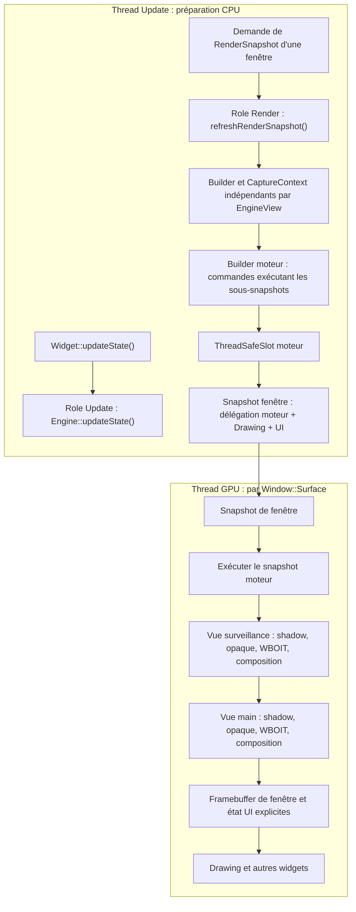

L'ordre surveillance puis main illustre une configuration demandée par le jeu. Les cibles graphiques de chaque vue sont matérialisées localement dans la `GPUResourceCollection` de chaque surface.

**Rendu partagé, réentrance obligatoire.** Un snapshot moteur est une **description de commandes immuable**. Il doit être possible de l'exécuter sur deux `RenderContext` distincts, éventuellement simultanément, sans écrire dans l'état mutable partagé des commandes. Les allocations et synchronisations OpenGL sont locales à la `Window::Surface`. Le `ThreadSafeSlot` garantit la durée de vie de l'objet snapshot, mais **n'assure pas** à lui seul la réentrance des commandes personnalisées ni la synchronisation de mutations concurrentes durant la capture CPU. Les mutations de `Engine` / caméra / Assemblies et `refreshRenderSnapshot()` doivent être coordonnées sur le thread Update, ou synchronisées explicitement par l'appelant.

**Cas de l'écran de surveillance.** La vue `surveillance` d'ordre 0 doit être **complètement** rendue (ombres, opaque, WBOIT, composition, texture finale) avant que la vue `main` d'ordre 1 utilise sa texture comme matériau de son écran 3D. Le jeu fixe l'ordre des vues ; Sparkle ne déduit pas de dépendances automatiquement d'un Material. **Le choix est désormais fixé :** les vues sont exécutées intégralement et successivement via leurs sous-snapshots indépendants (section 7.1), avec préparation GPU par `RenderCommand` typées et restauration explicite de la présentation.

**Une source de texture EngineView dans un Material.** Le `Material` statique existant capture un `Texture::Handle`. Pour représenter un écran de surveillance dont la source survit aux changements de résolution **mais pas à la destruction de la vue**, une variante de source doit référencer **non propriétaire** la `EngineView`. Lors de la construction d'un snapshot, Sparkle sélectionne sa source selon l'état de la caméra et la politique explicite de la vue (cible courante ou dernière image locale, source invalide, ou texture de remplacement configurée), puis capture **les handles logiques** dans les commandes lorsque cette source est logiquement valide. Une `spk::Exception` est levée à la capture pour une invalidité logique connue et, à l'exécution GPU, pour une texture qui n'est pas effectivement disponible sur la surface courante. Ainsi une vue rendue plus tôt dans le même snapshot peut fournir la texture requise, y compris dans une fenêtre qui ne l'avait jamais produite auparavant. Le `Material` lui-même ne conserve pas des handles GPU pérennes pour cette source ; il n'empêche pas la destruction de la vue. Ceci ne copie pas les pixels entre fenêtres : un handle de sortie de vue se réalise localement selon `RenderContext::targetSurface`. Le type exact de liaison et les règles d'unicité d'atlas voxel pour les sources dynamiques restent à définir.

**Rendu ou dessin seul.** `Render` produit les vues du moteur dans la surface courante sans nécessairement en afficher aucune ; `Drawing` dessine la vue sélectionnée sans forcément déclencher une nouvelle capture. Lorsque sa caméra est liée, il utilise la dernière sortie **locale** de cette vue, si elle existe. Lorsqu'elle est détachée, `Drawing` respecte sa politique explicite à trois modes (`KeepLastFrame`, `Invalid` ou `DefaultTexture`), comme les Materials qui l'empruntent. Une source invalide ou absente déclenche une `spk::Exception` lors de son utilisation. Un widget ne doit pas supposer que la dernière exécution du snapshot moteur dans une autre fenêtre a mis à jour ses propres textures.

**Séquence multifenêtre et publication indépendante.**

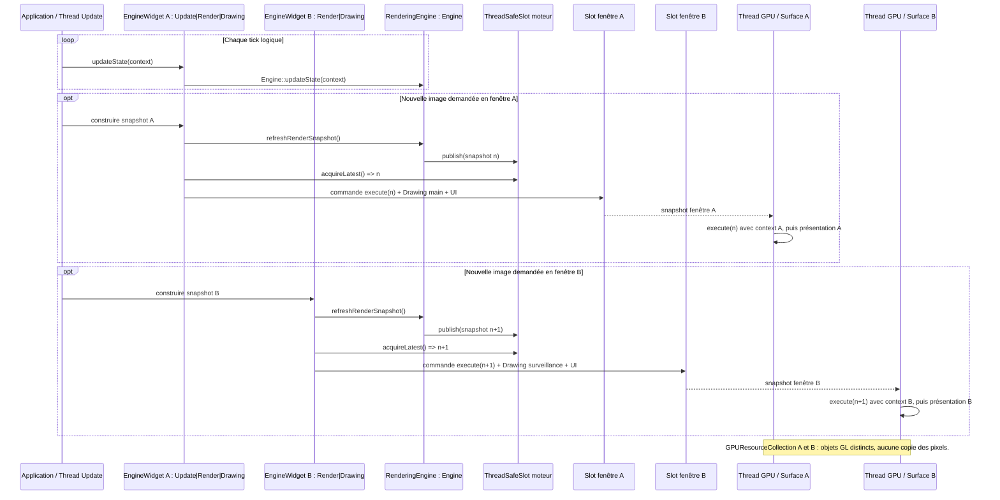

### 7.1 Architecture validée : sous-snapshot par vue et états GPU explicites

**Orchestration A — un sous-`RenderSnapshot` indépendant par `EngineView` dotée d'une caméra.** À chaque `RenderingEngine::refreshRenderSnapshot()`, le moteur **réconcilie d'abord les abonnements de chaque vue** au regard des Contributors présents dans le Registry et des layers, même si sa caméra est détachée. Il crée ensuite un `RenderSnapshot::Builder` neuf pour chaque **vue ayant une caméra liée à l'instant de la capture** ; il ignore pour ce nouveau rendu les vues volontairement détachées. Les `EngineView::Contributor` actifs **admis par le filtre de layers de la vue** contribuent au **même Builder de cette vue**, à l'aide d'un `EngineView::CaptureContext` explicite (caméra, matrices, résolution, identifiant de vue, lumières pertinentes et handles de cibles logiques). Le moteur prépare les passes standard avant de solliciter les contributeurs.

Le sous-snapshot de chaque vue est construit puis **détenu par valeur** par une commande de délégation (nom illustratif : `ExecuteViewSnapshotCommand`). Le Builder du snapshot moteur contient une passe par vue, de nom unique, dont l'ordre **interne** respecte la séquence calculée à partir des vues à priorité explicite, puis des vues non ordonnées dans leur ordre de création (voir règle ci-dessus). L'exécution d'une passe du moteur appelle `subSnapshot.execute(renderContext)` : **toutes** les phases de `surveillance` (ombres, opaque, WBOIT, composition) sont exécutées avant la première phase de `main`, lorsque leurs ordres explicites sont 0 et 1. Toute vue sans ordre est exécutée après ces deux vues. Les noms et ordres des passes **internes aux sous-snapshots** sont isolés entre vues. Aucun second ordonnanceur, tri de dépendances des Materials ou encodage global des phases n'est introduit.

**Pas de mutualisation inter-vues pour V0.1.4.** Chaque vue recalcule indépendamment ses transforms, sa visibilité, ses buckets, ses SSBO d'instances et ses commandes. Les ressources sources préexistantes (meshes, matériaux, textures, handles) demeurent réutilisables ; aucun cache ou objet de capture partagé entre vues n'est exigé. La mutualisation est une optimisation future éventuelle, seulement après mesures. La simulation `Engine::updateState()` n'est pas répétée pour chaque vue.

```mermaid
sequenceDiagram
  participant G as Jeu
  participant E as RenderingEngine
  participant C as EngineView::Contributor
  participant V as Builder par vue
  participant M as Builder moteur
  participant S as Slot moteur
  participant R as RenderContext GPU
  G->>E: updateState() (simulation)
  G->>E: refreshRenderSnapshot()
  loop Pour chaque EngineView dans l'ordre
    E->>E: comparer Registry + layers aux contrats RAII actuels
    alt Ensemble admissible modifie
      E->>E: ajouter / resilier les abonnements
      E->>E: invalider les cartes d'ombres de cette vue
    end
    alt Camera liee
      E->>E: capturer EngineView::CaptureContext
      E->>V: creer Builder et initialiser passes GPU
      E->>E: filtre non configure : tous ; filtre vide : aucun ; sinon intersection non vide
      E->>C: buildViewRenderSnapshot(V, CaptureContext) pour les Contributors admis
      C->>C: pour chaque composant graphique interne : isLayerCompatible(component.layers)
      C->>C: systemes visuels dessinent ; systeme ombres decouvre ses propres casters
      C->>V: commandes de passes generiques, dont les ombres du systeme dedie
      E->>V: finaliser les phases de la vue
      V-->>E: sous-RenderSnapshot immuable
      E->>M: ajouter passe de vue + ExecuteViewSnapshotCommand
    else Camera detachee
      E->>E: ne pas construire de rendu pour cette vue
    end
  end
  M-->>E: RenderSnapshot moteur
  E->>S: publish(snapshot moteur)
  S-->>R: snapshot immuable capture par la fenetre
  R->>R: executer chaque sous-snapshot complet dans son ordre
  R->>R: retablir framebuffer de presentation et etat UI
```

**Contribution graphique générique.** `EngineView::Contributor` remplace `RenderingObjectTrait` pour les classes graphiques visibles (`RenderingComponent`, `RenderingBehaviour`, `RenderingEntity`, `RenderingSystem`). Les widgets gardent `RenderSnapshotContributorTrait`. Le Contributor construit des commandes via `RenderSnapshot::Builder&` et `const EngineView::CaptureContext&` pour chaque vue admise par layers, sans propriété de scène, caméra globale mutable ni API d'ombres. **Les enums `ShadowMode`/`ShadowPropagation`, le `MeshFilter`, les notifications d'ombres et les caches appartiennent exclusivement à `ShadowMap::Contributor` et au `ShadowMap::RenderingSystem`**. Ce dernier est un `RenderingSystem` participant au Builder au même titre que les autres, sans que `EngineView` connaisse le sens des passes qu'il ajoute.

**Filtrage des Contributors par layers — choix de principe confirmé.** Les layers sont des **identifiants textuels** portés par les `EngineView::Contributor` (un ou plusieurs noms de layer ; représentation C++ finale `std::string` ou collection de chaînes à définir). Chaque `EngineView` expose une sélection explicite de layers (API illustrative : `setLayers({"layerA", "layerB"})`). Le rendu reste celui du **RenderingEngine entier**, restreint par ce **filtre d'admission**, et non par une liste de scènes, d'entités ou de Contributors assignés manuellement à la vue. Un Contributor correspondant au filtre est sollicité normalement pour construire le sous-snapshot de cette vue. Un Contributor exclu n'ajoute **aucune commande graphique** à cette vue, **y compris dans ses passes shadow maps** ; un caster situé hors champ caméra mais admis par layers doit néanmoins pouvoir projeter une ombre.

**Sémantique explicite des layers — choix A validé (la dernière décision remplace l'option B proposée précédemment).** Une `EngineView` distingue impérativement **un filtre non configuré** d'**un filtre configuré contenant une liste vide**. `setLayers({})` configure un filtre explicitement **vide**, qui n'admet **aucun Contributor**, même ceux sans layer ; ce n'est jamais un raccourci pour désactiver le filtre. Une `EngineView` nouvellement créée a un filtre **non configuré**, qui admet **tous** les Contributors du RenderingEngine, y compris ceux sans layer. Le moyen public exact de **revenir** à cet état depuis un filtre configuré reste un détail d'API à définir explicitement ; il doit exister sans réinterpréter `setLayers({})` comme « tout accepter ».

Un Contributor (ou composant graphique filtré explicitement dans un RenderingSystem) avec une collection **de layers vide/non définie** n'est compatible **que si la vue n'a aucun filtre configuré**. Il ne représente **pas** un objet global visible dans toutes les vues filtrées. Avec `setLayers({"layerA", "layerB"})`, seuls les Contributors possédant **au moins un layer commun** (intersection non vide) sont admis ; ceux seulement sur `"layerC"` et ceux sans layer sont exclus. La même règle, **sans autre exception**, est appliquée par `CaptureContext::isLayerCompatible(component.layers())` aux composants sélectionnés volontairement par un RenderingSystem. Aucune sélection wildcard implicite, layer par défaut ajouté, héritage des layers de l'Entity ou traitement spécial des composants voxel n'est créé.

| Filtre de l'EngineView | Layers du Contributor/composant | Admis ? |
| --- | --- | --- |
| Non configuré | Tous, y compris aucun layer | Oui |
| `setLayers({})` | Tous, y compris aucun layer | Non |
| `setLayers({"layerA", "layerB"})` | `{"layerA"}` ou `{"layerB", "layerC"}` | Oui |
| `setLayers({"layerA", "layerB"})` | `{"layerC"}` ou aucun layer | Non |

L'état **« non configuré »** doit rester distinct d'une liste vide et être figé dans le `CaptureContext`. La sélection des `EngineView::Contributor` (notamment les systèmes visuels et `ShadowMap::RenderingSystem`) est recalculée sur le Registry à chaque `RenderingEngine::refreshRenderSnapshot()` ; une nouvelle capture utilise l'ensemble admissible sans modifier les snapshots déjà publiés. **EngineView ne détient aucun contrat d'abonnement aux shadow casters et n'invalide aucune shadow map.** Son filtre reste générique, et les vues à caméra détachée restent recensées mais n'émettent pas de passes de scène.

**Réconciliation des casters par le sous-système d'ombres.** Le `ShadowMap::RenderingSystem` découvre ses `ShadowMap::Contributor` dans leur Registry, filtre leurs layers au moyen du `CaptureContext` figé, et surveille par contrats RAII les invalidations qu'ils produisent. Un changement de casters admissibles (ajout, retrait, layers, activation, parenté, source de mesh ou projection lumineuse) doit rendre périmées les ressources d'ombre nécessaires **dans le sous-système d'ombres** : pour prévenir les anciennes silhouettes, un changement de membership peut invalider les deux cartes conservativement. La synchronisation pendant les captures, le remplacement des ressources et la reprise d'une vue détachée devront garantir qu'aucune invalidation n'est perdue ; **ce n'est pas la vue qui réconcilie un tableau de contrats d'ombres**. Le système calcule un état logique d'ombres par vue/lumière, avec matérialisation GPU distincte par surface ; aucune exécution GPU immédiate lors d'un changement de layers ou de Registry.

**Filtrage interne des RenderingSystem — choix A validé.** L'admission automatique par Sparkle reste **au niveau du Contributor dans son ensemble** : chaque `EngineView` sélectionne les Contributors selon les layers qu'ils déclarent, sans posséder leurs objets ou gérer une scène. **Un `RenderingSystem` admis reste entièrement responsable du choix des objets qu'il dessine à l'intérieur de sa contribution**, y compris lorsque ceux-ci portent des layers différents. Pour garantir une règle unique sans imposer de connaissance de la structure des entités à la vue, `EngineView::CaptureContext` expose un helper de comparaison des layers (signature illustrative `bool isLayerCompatible(const LayerCollection&) const`). Le helper compare les layers fournis au **filtre de la vue figé lors de la capture CPU** ; il ne reçoit pas de `Entity*` ou de `Component*`, ne lit pas une EngineView mutable et ne filtre **jamais automatiquement** les éléments d'un `RenderingSystem`.

**Cas voxel — responsabilité visuelle exclusive.** Les `AssemblyRenderingComponent` fournissent les meshes visibles des voxels ainsi que leurs layers de scène. `VoxelRenderingSystem`, s'il passe le filtre externe de la vue, filtre ses composants avec `CaptureContext::isLayerCompatible(component.layers())` et produit uniquement les dessins visibles. Il n'interprète ni `ShadowMode`, ni `ShadowPropagation`, ne soumet aucun caster et ne transmet aucune invalidation liée à un mesh d'ombre.

**Cas d'ombre voxel séparé.** Une `Entity3D` hébergeant un modèle ou assemblage voxel peut aussi posséder un `ShadowMap::Contributor`, dont le `MeshFilter` fournit un mesh de projection distinct — éventuellement issu d'un greedy meshing. `ShadowMap::RenderingSystem` découvre cette source via Registry et vérifie activation, layers, mode effectif (y compris propagations), opacité de la géométrie et projection lumineuse. Les deux systèmes peuvent considérer une même Entity tout en produisant **des commandes différentes** ; la présence du mesh visible n'implique pas automatiquement la présence ou la création d'un mesh d'ombre.

```cpp
// API conceptuelle, signatures finales à vérifier durant l'implémentation.
void VoxelRenderingSystem::contribute(
    RenderSnapshot::Builder& builder,
    const EngineView::CaptureContext& captureContext)
{
    for (const auto& component : _components)
    {
        if (!captureContext.isLayerCompatible(component.layers()))
            continue;

        // Ajouter uniquement les commandes de rendu visuel du composant admis.
    }
}
```

**Responsabilité explicite du développeur.** Le filtrage des layers reste indépendant des ombres : `EngineView` fournit un helper générique, que chacun des systèmes utilise pour ses propres sources. Le `VoxelRenderingSystem` n'élargit pas le filtre de la vue, ne devient pas une scène et ne s'occupe pas de la projection des ombres. Le `ShadowMap::RenderingSystem` filtre les `ShadowMap::Contributor` et calcule leur mode effectif via les liens d'Entities/`InherenceTrait` et les relations graphiques explicites réellement définies, sans inférer de parenté du simple Registry. Modifier `ShadowMode` ou `ShadowPropagation` sur `ShadowMap::Contributor` notifie automatiquement le système d'ombres ; modifier une géométrie ou des layers exige les notifications appropriées sur la source d'ombres, jamais sur `VoxelRenderingSystem`.

**Limites déjà fixées.** Le helper applique strictement le choix A : filtre non configuré = tout accepter ; filtre `setLayers({})` = tout exclure ; layers non définis/vides d'un composant = accepté uniquement si le filtre de vue est non configuré. Aucun héritage implicite de layer Entity → composant ni surcharge automatique des layers du Contributor par ceux du composant n'est introduit. Les layers ne remplacent pas le culling spatial : un caster admis mais hors frustum caméra peut encore projeter des ombres.

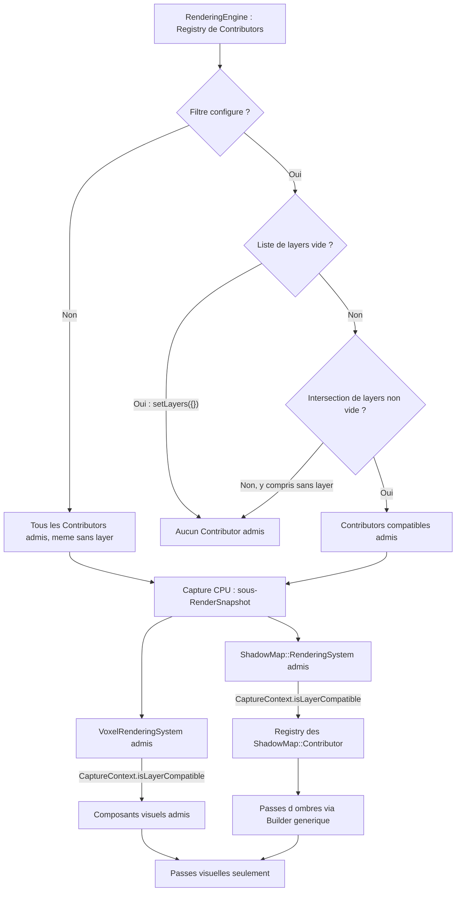

**Initialisation des passes et transitions GPU.** Sparkle emploie déjà ce principe pour `RootWidget` : les passes `sparkle.Background`, `sparkle.Overlay`, `sparkle.Popup` et `sparkle.Tooltip` reçoivent des commandes de viewport, scissor ou clear avant les dessins. De même, `RenderingEngine` ajoute les commandes d'état en **début de chaque passe standard de chaque vue**, puis les Contributors enrichissent ces passes. Les phases shadow, opaque, WBOIT et composition établissent chacune leurs états d'entrée (framebuffer, viewport, scissor, blending, profondeur, culling et masques d'écriture), sans supposer ceux de la phase précédente. Les clear tiennent compte des masques d'écriture actifs.

Les nouvelles `RenderCommand` sont **génériques à Sparkle, par famille d'état OpenGL** et configurables avec des types/enums C++ : `BlendRenderCommand` (activation, facteurs, équations et configuration par attachment pour WBOIT), `DepthRenderCommand` (test, comparaison, depth mask), `CullFaceRenderCommand` (activation, face et winding), `ColorMaskRenderCommand` (écritures couleur) et `FramebufferRenderCommand` (cible logique ou framebuffer de présentation). Les commandes existantes `ViewportRenderCommand` et `ScissorRenderCommand` sont réutilisées ou étendues pour les cibles offscreen et pour activer/désactiver le scissor. Les noms et signatures restent indicatifs. Aucune commande monolithique de sauvegarde/restauration de tout l'état GL n'est nécessaire.

**Frontière EngineWidget/fenêtre — décision B validée.** Le **snapshot moteur ne restaure pas lui-même l'état de présentation** : il ne connaît pas les exigences graphiques de l'interface et se limite à ses vues et à leurs passes. Dans le **snapshot de fenêtre**, la commande de délégation qui exécute le snapshot moteur est suivie **immédiatement, avant toute commande ultérieure de dessin UI**, des `RenderCommand` génériques et typées qui rétablissent le framebuffer de présentation de la `Window::Surface`, le viewport/scissor de fenêtre et les autres états OpenGL nécessaires aux widgets (profondeur, blending, culling, masques d'écriture selon leur contrat). Cette transition appartient à la frontière `EngineWidget`/fenêtre, pas à une passe finale du `RenderingEngine` ; elle doit rester vraie même si les commandes de délégation et de dessin appartiennent à un même `RenderPass` de fenêtre. Chaque passe UI conserve la responsabilité de préparer ses propres états d'entrée et ne dépend pas d'un état global laissé par le moteur. Un `EngineWidget` avec rôle `Drawing` seul n'exécute aucune délégation moteur ; il dessine dans le cadre des passes UI, avec leur état de présentation explicitement préparé. Si plusieurs widgets demandent des rendus, chaque délégation doit respecter cette transition indépendamment, sans garde-fou de déduplication. L'emplacement concret et les clés de passes nécessaires pour préserver cet ordre dans tous les agencements de widgets restent à finaliser, sans déplacer la responsabilité de la transition.

Les configurations de rendu jusqu'ici fixées uniquement dans `Window::Surface::initializeRenderState()` doivent être exprimées dans les passes appropriées ; l'initialisation effective du contexte OpenGL reste dans `Window::Surface`. Les commandes sont construites sur CPU sans appel GL, puis exécutées dans le `RenderContext` de chaque surface, sans état CPU mutable partagé.

**Extension par passes personnalisées — décision B validée.** Les `EngineView::Contributor` peuvent contribuer aux passes standard initialisées par `RenderingEngine` **et** créer leurs propres `RenderPass`, en utilisant le `RenderSnapshot::Builder` existant et des `RenderPass::Key` à ordre numérique explicite. `RenderingEngine` réserve les identifiants de ses passes système et des bornes/plages d'ordonnancement pour les étapes qu'il doit garantir (notamment la composition finale et les transitions de cibles). Une passe ajoutée par un Contributor doit respecter ces réservations et ne peut pas intercaler ses commandes à l'intérieur d'une étape réservée ni déplacer la finalisation. Les passes personnalisées restent **locales au sous-snapshot de l'EngineView concernée** : elles ne peuvent pas réordonner deux vues, et elles doivent préparer explicitement les états OpenGL dont elles dépendent. Aucune nouvelle interface de scheduling ou ordonnanceur de dépendances n'est introduit. Les clés et limites numériques exactes ainsi que le contrôle des collisions seront finalisés dans le contrat des passes avant implémentation ; ne pas inventer de valeurs fixes dans la présente spécification.

**À préciser sans réouvrir ces décisions :** encodage interne des clés des passes de délégation après calcul de la séquence des vues (sans priorité automatique pour les vues non ordonnées), valeurs exactes des bornes réservées, **clears/blending, poids, fonction de comparaison profondeur et composition de la passe MRT WBOIT (`RGBA16F` + `R8` et depth attachment partagé fixés)**, **clés/positionnement concret de la transition EngineWidget/fenêtre désormais validée**, réentrance effective des commandes existantes (dont les UBO partagés), et qualification des mesures Profiler lors de l'exécution imbriquée. Une construction incomplète ne publie pas de snapshot partiel et conserve la précédente publication.


### 7.2 SSBO d'instances

Pour **chaque bucket non vide produit dans une vue et un RenderSnapshot**, le système crée un **nouveau `spk::ShaderStorageBuffer` d'instances**, écrit la totalité de ses données compactes et appelle sa validation (`validate()`) conformément au fonctionnement existant des ressources Sparkle.

Les occurrences d'un bucket sont toujours **contiguës et sans trous**. La disparition d'une instance à la frame suivante revient simplement à ne pas la recollecter. Aucun stockage persistant `InstanceID → offset`, swap-and-pop entre frames, dirty range, update partiel de buffer, commande de mise à jour d'une occurrence ou double buffering explicite de SSBO n'est requis.

Chaque commande conserve le **handle du SSBO propre à son snapshot** : un snapshot plus récent ne peut pas altérer le contenu des buffers d'un snapshot encore exploité. Le coût d'allocation et d'upload intégral, même en l'absence de changement, est accepté comme compromis de simplicité. Cette politique **ne rebake jamais** un Model chaque frame.

### 7.3 SSBO de matériaux par couple Model/Palette

La palette publique ne contient **aucun état GPU mutable**. Pour chaque couple `Model`/`VoxelPalette` réellement employé par le snapshot, le rendu construit un SSBO de matériaux **dans l'ordre des slots sémantiques du Model**.

La correspondance entre les **noms de slots** du Model et ceux de la palette est résolue **sur CPU**. Le shader peut ensuite accéder directement à son matériau par `MeshVertex::materialIndex`, **sans table d'indirection GPU**. Les slots supplémentaires de la palette n'ont pas à être encodés dans le SSBO adapté au Model. Les slots du Model sans triangles visibles restent pris en compte dans l'ordre et la validation du couple.

Les commandes utilisant le **même couple compatible** à l'intérieur d'un même snapshot, **y compris dans plusieurs vues de la même fenêtre**, peuvent partager ce SSBO si les paramètres de matériaux restent identiques. La table temporaire de mutualisation disparaît après la préparation du snapshot ; **aucun SSBO de matériaux n'est réutilisé entre deux snapshots**. Une même palette employée avec des Models différents peut nécessiter des dispositions de SSBO différentes. Deux palettes distinctes d'un même Model ne sont pas fusionnées dans un draw si leurs `materialIndex` auraient des interprétations différentes.

### 7.4 Buckets et commandes de dessin

Le `BucketKey` distingue toutes les ressources ou états qui doivent rester identiques au cours d'un dessin instancié : **vue et passe de rendu**, mesh, atlas `albedo`, représentation de matériaux adaptée, et éventuels autres bindings nécessaires au pipeline réel. La caméra, la profondeur et la destination GPU d'une vue ne doivent jamais être confondues avec celles d'une autre. Des géométries de Models différents ne sont **pas fusionnées automatiquement** parce qu'elles utilisent le même atlas.

Un `DrawVoxelBucketCommand` est un `RenderCommand` qui conserve les handles/ressources de mesh, de SSBO d'instances, de SSBO de matériaux et de textures nécessaires à l'exécution. Il n'emprunte aucune donnée d'Assembly mutable pendant son `execute(RenderContext&) const`. La gestion existante des ressources GPU de Sparkle assure que les handles capturés sont utilisables jusqu'à la fin effective de leur usage GPU, sans réutilisation anticipée d'un State appartenant à un ancien snapshot.

Une association compatible emploie au plus **un atlas `albedo` par mesh/passe**, permettant **un draw instancié par mesh non vide et par bucket compatible**, hors éventuelles passes graphiques complémentaires. Les occurrences présentant des mappings ou états de rendu incompatibles restent séparées.

### 7.5 Pipeline opaque, translucence et éclairage

**Architecture retenue : Forward+ — choix B validé.** Le rendu 3D générique conserve le *Forward shading* : l'éclairage est calculé dans les shaders de chaque surface opaque ou translucide, **sans G-buffer** ni éclairage différé. En revanche, une **étape GPU de sélection des lumières par tiles ou clusters** prépare, pour chaque vue, des listes de sources lumineuses pertinentes. Les shaders ne parcourent plus systématiquement toutes les lumières de l'Engine pour chaque fragment. La forme définitive (*tiled Forward+* ou *clustered Forward*), la dimension des zones et les structures de listes restent à préciser : **la décision B valide la sélection GPU**, sans choisir prématurément le découpage.

**Culling de l'éclairage.** Les lumières du Registry sont capturées sous forme de données **CPU immuables** (positions/directions, portée, cône, intensité et activation). Le classement GPU restreint les lumières locales : **ponctuelles** (volume d'influence/portée), **spots** (volume de cône/portée). Les **directionnelles** sont des contributions potentiellement globales, sans intersection locale inutile. Les buffers GPU de listes et d'indices des sources sélectionnées sont ensuite consommés par les shaders opaques et translucides. **Ce culling de lumières pour l'éclairage est distinct du culling des `ShadowMap::Contributor` effectué par `ShadowMap::RenderingSystem` pour fabriquer les ombres.** Sélectionner une lumière pour un fragment n'impose ni shadow map ni dessin de caster.

**Orchestration et ressources.** Dans chaque sous-snapshot d'`EngineView`, la préparation des données de lumière et la classification GPU des tiles/clusters sont programmées **avant les dessins qui utilisent ces listes**, avec `RenderCommand`/passes génériques ordonnés et barrières mémoire GPU appropriées. Les ressources de sélection sont logiques dans les snapshots et réalisées **par `Window::Surface`** dans sa `GPUResourceCollection` ; les commandes demeurent réentrantes entre surfaces et ne lisent aucun objet mutable du moteur au moment GPU. Le partage de profondeur et les décisions existantes sur les caches d'ombres restent indépendants.

**Compatibilité WBOIT.** La sélection des lumières doit couvrir **les fragments translucides**, même lorsqu'ils sont devant ou derrière la première surface opaque : un culling fondé uniquement sur la plage des profondeurs opaques ne doit jamais perdre des lumières nécessaires à la transparence. Les shaders translucides utilisent eux aussi les listes Forward+, dans **l'unique passe géométrique WBOIT** prévue et sans nouveau dessin de translucides. Les ressources GPU doivent avoir une politique explicite pour les tiles/clusters contenant trop de lumières ; aucune source ne doit disparaître silencieusement lors d'un dépassement.

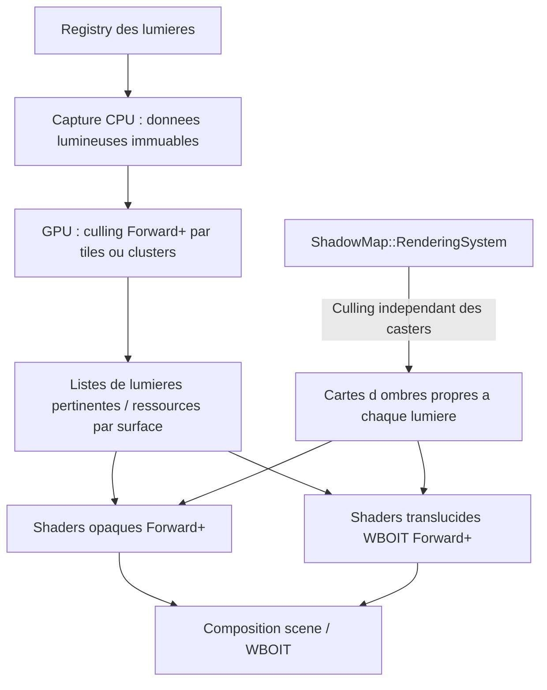

La passe **opaque** calcule la couleur éclairée directement à partir des listes **Forward+** pertinentes, avec les tests de profondeur appropriés. La transparence reste un traitement **WBOIT distinct** : les shaders translucides consultent également leurs listes **Forward+ valides**, puis écrivent la couleur éclairée dans les buffers d'accumulation/révélation prévus avant la composition finale.

**WBOIT — architecture MRT validée (choix A).** Pour chaque `EngineView` rendue, la géométrie translucide est parcourue **une seule fois dans une passe de dessin translucide**. Les fragments de cette passe alimentent **simultanément deux attachments couleur (Multiple Render Targets)** du framebuffer logique de la vue : l'un pour **l'accumulation pondérée** (couleur et poids), l'autre pour la **révélation** (transmittance résiduelle). La passe utilise un **blending indépendant par attachment**, configuré explicitement avec les `BlendRenderCommand` typées prévues dans la section 7.1. Les attachments sont initialisés avec leurs valeurs de clear appropriées avant tout dessin translucide. Une **passe distincte de composition** combine ensuite opaque, accumulation et révélation pour produire la texture finale. Il n'existe pas en V0.1.4 de seconde passe redessinant la même géométrie pour la révélation, ni de stratégie alternative configurable entre MRT et double dessin.

L'initialisation du framebuffer et des états est indépendante de la passe de dessin proprement dite : la règle « une seule passe de géométrie translucide » n'interdit ni commandes de préparation/clear ni composition. Le matériel et les commandes restent génériques à Sparkle et non spécifiques au voxel. Le rendu exige les capacités OpenGL permettant plusieurs sorties couleur et **des facteurs/équations de blending distincts par attachment** ; leur disponibilité doit être vérifiée explicitement et un contexte incompatible doit être rejeté par `spk::Exception`, sans fallback implicite à une stratégie à deux passes. **Formats fixes validés (choix A) :** l'attachment d'**accumulation utilise `RGBA16F`** (quatre canaux flottants 16 bits) et l'attachment de **révélation utilise `R8`** (un canal normalisé non signé 8 bits). Ces deux formats sont imposés par le pipeline WBOIT générique V0.1.4, sans option de précision supplémentaire, variante `R16F` ni fallback automatique. L'API `Texture::Format` et la matérialisation GPU doivent supporter ces formats ; une surface/context OpenGL incapable de les créer en attachments rendables, ou incapable du blending indépendant, est rejeté avec une `spk::Exception` descriptive. **Restent à fixer et tester :** clear values des attachments couleur, facteurs et équations de blending par attachment, fonction de poids, comparaison du depth test et équation de composition. **Le partage de profondeur entre opaque et translucide est déjà décidé** (voir contrat ci-dessous). La quantification de la révélation en `R8` doit être couverte par les tests graphiques. Les shadow maps, passes de profondeur préalables éventuellement nécessaires et composition de transparence sont **compatibles** avec le Forward Rendering : exclure le Deferred n'interdit pas ces passes auxiliaires. Aucune architecture privée d'éclairage voxel n'est introduite.

**Projection et réception des ombres — choix A validé.** En V0.1.4, **seules les surfaces opaques participent au rendu des shadow maps** des lumières directionnelles, spots et ponctuelles. Une surface **translucide ne projette jamais d'ombre**, quel que soit son alpha ; ni seuil d'alpha pour des ombres binaires translucides, ni atténuation/ombres colorées de transmission ne sont requis. Les surfaces translucides **peuvent en revanche recevoir les ombres** déjà calculées par les objets opaques et les prendre en compte dans leur éclairage Forward, avant d'écrire l'accumulation/révélation WBOIT. Les surfaces opaques continuent également à recevoir les ombres.

La sélection des contributeurs aux shadow maps respecte la séparation **opaque/translucide** : pour les voxels, une géométrie de profondeur **explicitement fournie par le `MeshFilter` du `ShadowMap::Contributor`** est la source des éventuels casters ; elle peut être différente du mesh visuel opaque. Le rendu translucide du `VoxelRenderingSystem` ne contribue jamais directement à une passe d’ombres. La source d’ombre doit respecter la règle de projection opaque, sans transmission translucide en V0.1.4. L'infrastructure d'ombres reste **générique Sparkle** et ne doit pas traiter différemment les voxels et les autres géométries classées opaques/translucides. Le contrat particulier des mécanismes de *cutout* non voxel préexistants reste distinct et n'est pas redéfini par cette décision. Le moteur ne doit pas fabriquer de stratégie d'ombres translucides implicite. Les points lumineux restent sans ombres, conformément au périmètre déjà validé.

**Classification et source d'ombres — architecture séparée validée.** Le `ShadowMap::Contributor` est un **composant graphique spécialisé de caster**, distinct de `EngineView::Contributor`. Il porte `ShadowMode { None, Static, Dynamic }`, `ShadowPropagation { SelfOnly, Descendants }`, ses layers et un **`MeshFilter` intégré** qui référence ou fournit la géométrie de profondeur des ombres. L'identité exacte du type C++, la possession du mesh, et la façon de relier un mesh de rendu existant restent à décider. Le `ShadowMap::RenderingSystem` seul lit ces données et émet les passes d'ombres.

- `None` interdit la projection pour le caster concerné, `Static` le classe dans le cache statique, `Dynamic` dans la partie dynamique de la carte finale. Seules les contributions opaques sont susceptibles de projeter des ombres ; les translucides n'en projettent pas, mais peuvent en recevoir lors de l'éclairage Forward. `ShadowMode` n'est ni un booléen `castShadow` ni un tag de Contributor générique.
- `SelfOnly` ne concerne que le `ShadowMap::Contributor` lui-même ; `Descendants` **override temporairement et non destructivement** le `ShadowMode` effectif de toute la descendance, pour les **trois modes**, sans modifier les valeurs stockées des descendants. Retirer l'override restaure leurs propres valeurs, sous réserve des autres overrides applicables.
- La descendance suit la parenté des Entities fournie par **`InherenceTrait` (un seul parent par Entity)** et, conformément au choix C, les **relations de collecte graphique explicitement déclarées** si elles constituent une vraie relation parent/enfant. La découverte par `Registry` et le simple fait d'être dessiné par `ShadowMap::RenderingSystem` ne créent **aucune** parenté. L'existence de chemins supplémentaires dans l'union de ces relations, leur résolution et la priorité entre overrides de plusieurs ancêtres demeurent ouvertes ; aucun doublon de dessin ni modification récursive des propriétés n'est permis.
- Les layers de `ShadowMap::Contributor` sont testés **par le `ShadowMap::RenderingSystem`** via le filtre générique figé de la vue. Ils ne sont pas lus implicitement depuis les layers du mesh visuel. Le choix d'une éventuelle valeur/fallback des layers, et de l'interaction avec l'activation de l'Entity, doit conserver les règles d'admission validées.

**Setter et notifications automatiques.** `ShadowMap::Contributor::setShadowMode(mode, propagation)` compare les deux valeurs. Si le mode **ou** la politique change, il enregistre le nouveau couple et notifie son **`ContractProvider` propre aux ombres** ; sinon il ne notifie rien. `ShadowMap::RenderingSystem` souscrit par contrats RAII à ses `ShadowMap::Contributor` connus ; à la réception, il marque **ses caches statique et final** logiquement invalides pour les vues/lumières concernées. Aucun appel manuel à `invalidateShadowMap()` n'est exigé après le setter, et aucune copie de l'ancienne catégorie n'est requise. Les événements de transformation, de reparenting, de modification de la géométrie `MeshFilter`, des layers ou de la disponibilité d'une source demandent également une invalidation, selon des mécanismes précis encore à finaliser.

**Propriété des shadow maps et intégration.** Le `ShadowMap::RenderingSystem` gère ses cibles et générations d'ombres **indexées par vue et lumière**, avec des instances GPU locales à chaque `Window::Surface`. `EngineView` n'a **aucun callback d'ombre**, ne possède pas ses caches et ne transmet pas leurs invalidations : il fournit seulement un contexte de capture générique (caméra, layers, résolution) et un Builder. Le système d'ombres utilise ces informations pour fournir ses propres passes et des sorties de texture consultables par le pipeline d'éclairage via les mécanismes génériques de ressources et commandes ; la liaison concrète à l'éclairage reste à définir. Une vue détachée et des captures en vol ne doivent pas perdre les changements d'invalidation. Aucun callback ne reconstruit de texture GPU ; aucun snapshot publié n'est modifié.

**Admission et prévention du double rendu.** `ShadowMap::RenderingSystem` découvre uniquement les sources du Registry de `ShadowMap::Contributor`; chaque source est traitée **au plus une fois pour chaque passe de shadow map admissible**, même si une propagation hiérarchique peut la joindre de plusieurs façons. `VoxelRenderingSystem` et les autres systèmes de rendu visuel ne produisent **aucun caster en parallèle**. Une contribution hors frustum caméra peut continuer à projeter sur les objets visibles si elle est pertinente pour la projection lumineuse.

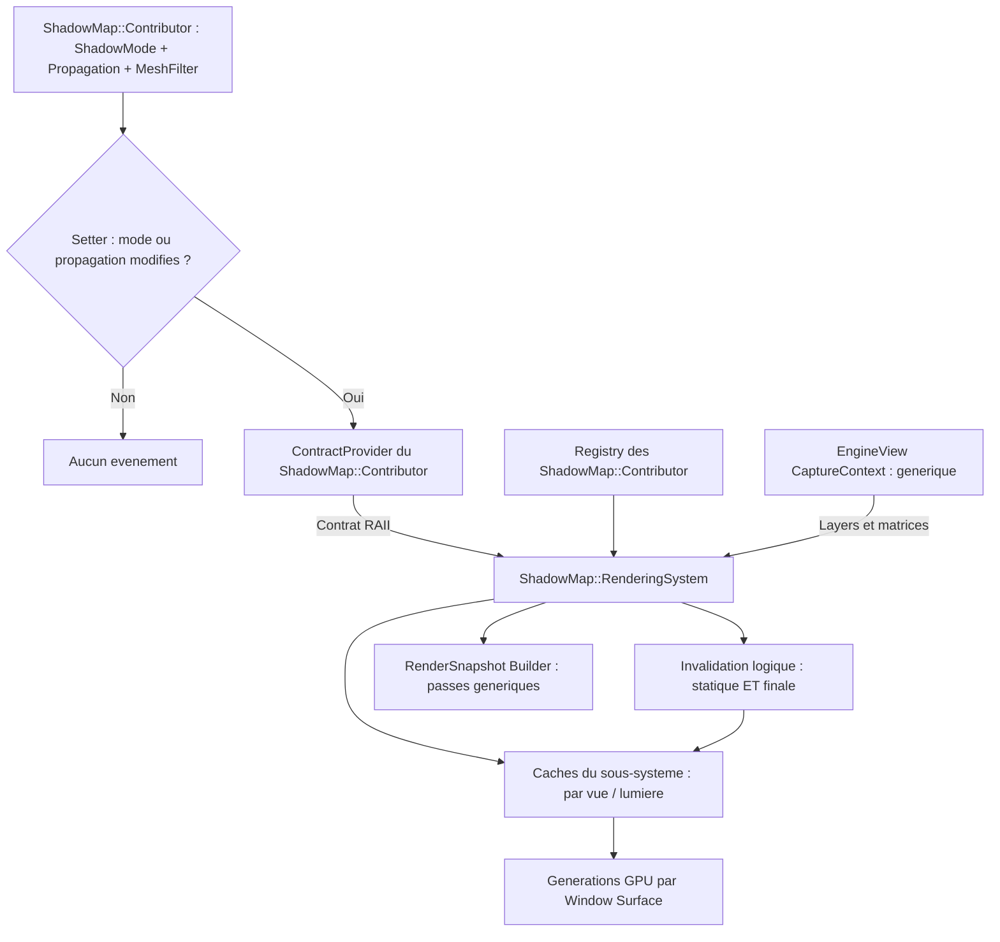

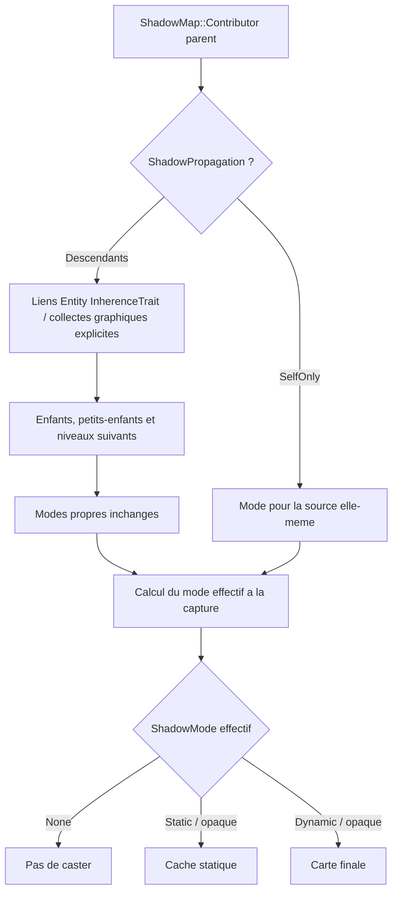

**Cache d'ombres statiques et carte finale — choix B validé.** Pour chaque combinaison **`EngineView` × lumière projetant des ombres**, l'infrastructure graphique distingue **un cache statique** (caster opaques classés statiques) et **une carte finale** (utilisée par l'éclairage Forward+). Les deux ressources ont la même topologie : **deux textures de profondeur 2D** pour une directionnelle ou un spot ; **deux cubemaps de profondeur à six faces chacune** pour une ponctuelle. Ces cibles ne sont jamais partagées entre lumières. Les géométries opaques classées dynamiques ne sont pas dessinées dans le cache statique. Ces deux catégories sont des **politiques de mise à jour des ombres**, et non une nouvelle classification de transparence ; les translucides ne projettent toujours pas d'ombres. **La classification dépend du mode effectif de chaque `ShadowMap::Contributor`, après application éventuelle de `Descendants` sans mutation de ses propriétés propres.** Les notifications vont de la source de caster au **`ShadowMap::RenderingSystem` par contrat RAII**, et celui-ci invalide **ses propres caches** par vue/lumière ; aucune invalidation ne transite par `EngineView`. Aucun identifiant persistant par groupe n'est requis. La portée exacte des événements, les règles d'appartenance vue/Contributor et le suivi des générations restent à préciser ; aucune détection implicite du mouvement.

**Actualisation à la demande, par invalidation :**
- **Tout changement effectif du couple `ShadowMode` / `ShadowPropagation` sur `ShadowMap::Contributor` invalide automatiquement statique + finale par notification directe au `ShadowMap::RenderingSystem`.** Une valeur inchangée ne notifie pas ; le dessin GPU intervient ultérieurement, jamais dans le setter.
- Lorsqu'une contribution **statique** change ou lorsque la carte statique n'a encore jamais été construite, la partie statique est invalidée. Au prochain rendu **autorisé par le budget de reconstructions lorsqu'il s'agit d'une PointLight**, Sparkle redessine **uniquement les casters statiques** dans la carte statique, puis invalide et reconstruit la carte finale. Si aucune unité de budget n'est attribuée, la PointLight éclaire temporairement sans ombre et ses cartes demeurent invalides.
- Lorsqu'une contribution **dynamique** change (ajout, retrait, position, géométrie ou toute modification affectant sa projection), seule la **carte finale** doit être reconstruite : **copie de la profondeur statique valide dans la carte finale, puis dessin des casters dynamiques** avec depth test et depth write activés. Les casters statiques ne sont pas redessinés pour ce changement.
- Une modification de la **lumière ou de sa projection**, de la région couverte ou de la définition/version des cibles qui affecte les deux cartes invalide **les deux**. La carte statique est reconstruite en premier, puis la finale.
- Tant que les cartes restent valides, **aucune copie ni nouveau dessin d'ombres n'est exigé** pour cette combinaison vue/lumière/surface. Une image finale valide demeure consultable par les dessins opaques et translucides de la vue.

**Combinaison de profondeur.** Les deux ressources d'une lumière utilisent **la même projection** (pour une ponctuelle, le même ensemble des six projections) et des dimensions, formats de profondeur et conventions compatibles. Pour une cubemap, la copie et les tests de profondeur sont réalisés pour chaque face, sans copie entre faces ou lumières. La reconstruction finale **copie la profondeur** du cache statique vers la cible finale (opération GPU de copie/blit adaptée), puis rend les objets dynamiques dans cette cible. Le test de profondeur réalise alors l'occlusion par le plus proche fragment opaque des deux catégories. **Les shaders d'éclairage Forward+ n'échantillonnent que la carte finale, 2D pour un spot/directionnelle ou cubemap pour une ponctuelle** : aucun second échantillonnage statique/dynamique ni atlas d'ombres regroupant plusieurs lumières n'est prescrit. Le support d'une copie de profondeur compatible doit être vérifié ; aucune copie entre fenêtres n'est autorisée et un contexte/cible incompatibles déclenchent `spk::Exception` plutôt qu'un fallback silencieux.

**Surfaces et snapshots.** Les versions d'ombres **effectivement rendues** sont suivies **séparément dans chaque `Window::Surface`** ; une sortie de sélection de PointLight retire la paire de caches actifs de la vue et ses versions GPU de l'espace de recherche courant, mais **ne détruit ni ne réaffecte les instances encore référencées par des snapshots en vol**, ni celles dont les commandes GPU ne sont pas terminées. une construction réussie dans la fenêtre A ne rend pas le cache ou la carte finale de B à jour. L'état logique d'invalidation doit pouvoir provenir des modifications des lumières et des contributeurs, sans obliger le thread GPU à lire leurs objets mutables. Les commandes publiées dans les `RenderSnapshot` restent **immuables, réentrantes entre surfaces et propriétaires de leurs handles capturés** ; les ressources d'ombre mises en cache ou reconstruites ne doivent pas être modifiées/réutilisées d'une manière qui altérerait l'exécution d'un ancien snapshot encore utilisé. Le suivi concret des générations, les frontières de reconstruction CPU/GPU, **la sûreté des durées de vie et de la synchronisation pendant la réconciliation à chaque capture désormais validée**, la portée statique/dynamique des notifications, la synchronisation des contrats et l'éventuelle gestion de plusieurs snapshots en vol restent à finaliser avant implémentation.

**Profondeur opaque/WBOIT partagée — choix A validé.** Pour chaque `EngineView` et chaque `Window::Surface`, la passe opaque et la passe translucide WBOIT utilisent **le même attachment de profondeur logique et la même instance GPU locale**, associés aux framebuffers des phases correspondantes. La profondeur est initialisée pour le rendu opaque ; l'opaque effectue ses tests et ses écritures habituels. La passe WBOIT réutilise ensuite **sans copie ni recalcul** les profondeurs opaques : **depth test activé, depth write mask désactivé** pendant tous les dessins translucides. Le WBOIT ne doit ni effacer ni écraser le depth buffer de l'opaque. Les fragments translucides derrière une surface opaque sont ainsi écartés par ce test ; la transparence entre fragments translucides reste gérée par l'accumulation WBOIT, sans depth write.

Les `DepthRenderCommand` et `FramebufferRenderCommand` typées établissent cet état **explicitement à l'entrée de la passe**, sans dépendre de l'état GL résiduel des phases précédentes. Les attachments couleur MRT (`RGBA16F` et `R8`) sont propres au WBOIT, mais leur framebuffer doit référencer **le même depth attachment** que celui de l'opaque, et non une copie ou une texture différente. La compatibilité des dimensions, des échantillons et la complétude des framebuffers doivent être validées lors de leur matérialisation sur chaque surface ; toute incompatibilité déclenche `spk::Exception`. Le depth buffer possède la même règle de **versionnement des cibles immuables** lors du resize explicite : un nouveau snapshot ne modifie pas rétroactivement le depth attachment capturé par un snapshot antérieur. La fonction de comparaison exacte reste à choisir dans le contrat de profondeur du pipeline.

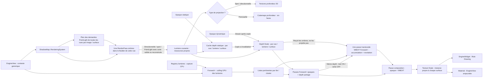

**L'éclairage Forward+ avec culling GPU par tiles/clusters, les ombres et le pipeline WBOIT ne sont pas encore implémentés dans Sparkle : ils font partie des fonctionnalités à créer en V0.1.4 comme infrastructure graphique 3D générique.** Le système voxel doit s'y intégrer, sans en posséder une implémentation privée. Le mesh opaque visible participera au rendu opaque/profondeur avec éclairage **sans générer de commandes de shadow maps** ; le `ShadowMap::Contributor::MeshFilter` fournira séparément la géométrie de projection au `ShadowMap::RenderingSystem` ; le mesh translucide visible passera par **une seule passe géométrique MRT Weighted Blended OIT à deux attachments et blending indépendant**, puis par une **passe de composition**. L'alpha est calculé et les pixels d'alpha exactement nul écartés dans les deux shaders, conformément à la section sur les Materials. L'orchestration utilise les RenderPass ordonnées déjà disponibles, avec une éventuelle passe `.init` avant une passe de dessin ; le nom ne détermine jamais leur ordre. Les clés exactes de passes et les valeurs des nouvelles commandes d'état GPU typées, les sources lumineuses, **les paramètres numériques des deux attachments MRT WBOIT aux formats fixes `RGBA16F` + `R8`** et l'équation de composition restent à préciser dans cette architecture commune (section 7.1). Les cibles sont décrites par les framebuffers logiques des EngineView et réalisées, via GPUResourceCollection, en instances propres à chaque Window::Surface ; leur résolution n'est modifiée que par le jeu. Les ombres sont disponibles pour les lumières directionnelles, spots **et ponctuelles** : chaque lumière ponctuelle dont les ombres sont activées contribue à la passe commune de sa vue avec des cubemaps de profondeur à six faces. Elle reste éclairante via Forward+ même quand ses ombres sont désactivées. Les ombres directionnelles utilisent **une projection de lumière par vue/lumière**, réalisée par **un cache de profondeur statique et une carte de profondeur finale** (alimentée par copie de la statique puis rendu dynamique si invalidée) ; il n'y a pas de Cascaded Shadow Maps dans cette version et aucune mutualisation des cartes entre vues n'est requise en V0.1.4. **Seules les surfaces opaques alimentent ces shadow maps ; les translucides en reçoivent les effets lors de leur éclairage Forward mais ne projettent aucune ombre.**

L'infrastructure 3D non voxel peut conserver ses mécanismes existants, y compris ses usages spécifiques du cutout ; ce document ne change pas son contrat général.

## 8. Garanties transversales et frontières des interfaces

### 8.1 Propriété des données

| Ressource | Propriétaire / représentation | Relation vers les utilisateurs |
|---|---|---|
| `Shape`, `Definition`, `Volume`, `Model` | Données immuables, copies légères et partage interne | Réutilisables indépendamment du Builder d'origine |
| `OcclusionCache` | Propriété de l'application ; table protégée | Mesher lié par pointeur **non propriétaire** |
| `OcclusionResult` | Valeur immuable à données partagées | Survit à `OcclusionCache::clear()` si une copie existe |
| `Material` | Valeur immuable : handles statiques ou source EngineView empruntée | Aucune propriété d'une EngineView ; handles GPU capturés par les snapshots |
| `VoxelPalette` | Valeur immuable, association de Materials | Aucune ressource GPU propre à la palette |
| `AssetManager` | Possède les objets `T` du cache | `load<T>()` retourne `T&` emprunté ; `clear()` invalide |
| `Assembly` | Possède sa hiérarchie mutable ; partage Models/Palettes immuables | Les composants empruntent l'Assembly |
| `Engine` | Moteur logique dans `sparkle::core` | Ne possède ni EngineView ni RenderSnapshot |
| `RenderingEngine : Engine` | Moteur logique + graphiques dans `sparkle::sparkle` | Possède les EngineView et le slot du snapshot moteur |
| `EngineView` | Vue logique/graphique possédée par RenderingEngine | Références non propriétaires ; framebuffer logique avec instances par surface |
| `EngineView::Contributor` | Type imbriqué hérité par RenderingComponent/Behaviour/Entity/System | Contributions aux vues admises par layers via `CaptureContext`, sans possession de vue ni logique d’ombre |
| `ShadowMap` | Abstraction graphique de passe logique d’ombre | Expose Contributor et RenderingSystem imbriqués ; une seule RenderPass par Builder de vue ; clé statique commune envisageable mais non imposée |
| `ShadowMap::Contributor` | Composant graphique attachable aux Entity3D | Porte ShadowMode, ShadowPropagation, layers et MeshFilter ; découvert par Registry |
| `ShadowMap::RenderingSystem` | RenderingSystem spécialisé | Construit les passes d’ombres, souscrit aux Contributors et conserve les caches par vue/lumière |
| `CameraComponent` | Component3D graphique lié à une Entity | Accès à ses vues par `camera.view(name)` contrôlé |
| `Window::Surface` / `GPUResourceCollection` | Propriété de l'Application, propre à la fenêtre | Instance OpenGL par State de framebuffer ou texture |
| `EngineWidget` | Widget avec rôles `Update`, `Render`, `Drawing` | `bind(RenderingEngine*)`, non propriétaire ; aucune classe d'affichage secondaire |
| Slot moteur | ThreadSafeSlot de RenderingEngine | Snapshot partagé entre fenêtres via `shared_ptr<const RenderSnapshot>` |
| Slot de fenêtre | ThreadSafeSlot de l'Application par fenêtre | Snapshot UI, capture du snapshot moteur et Drawing |
| Material à source de vue | Material immuable, référence logique empruntée (API à préciser) | Ne maintient pas la vue en vie ; capture de handles uniquement dans les snapshots |
| `RenderSnapshot` et commandes | Conservent les handles de ressources graphiques nécessaires | Aucun accès aux transforms mutables après publication |

### 8.2 Règles d'erreur et de publication

Les opérations publiques invalides, les incompatibilités de slots, les violations des invariants géométriques, les cycles d'assets et les appels de liaison interdits déclenchent des **`spk::Exception` descriptives**. Les opérations de Builder garantissant un état inchangé après échec doivent préserver cette propriété même lors d'une exception technique ; ne pas transformer systématiquement les exceptions d'allocation en `spk::Exception` si cela détruit leur cause.

Aucune Shape, Volume, Model, VoxelPalette ou entrée AssetManager **partiellement construite** ne doit être publiée. Les avertissements d'UV hors `[0,1]` sont, au contraire, **non bloquants** et émis au niveau de la géométrie source, sans répétition par pixel ou par frame.

### 8.3 Niveau de précision des exemples

Les **responsabilités, données, règles de propriété, classifications, algorithmes et comportements décrits ci-dessus** constituent l'architecture à produire. Les exemples illustrent des interfaces possibles, sans obliger à employer un nom secondaire, un emplacement précis de classe, un conteneur particulier, un algorithme de triangulation spécifique ou une nouvelle abstraction de façade lorsque Sparkle dispose déjà du mécanisme nécessaire.

En particulier, l'intégration finale doit s'appuyer sur les vrais `spk::Mesh<TVertex>`, `ShaderStorageBuffer`, `Texture::Handle`, `Registry`, `RenderingSystem`, `RenderSnapshot` et `RenderCommand` disponibles dans la bibliothèque. `EngineView`, `EngineView::Contributor`, les sous-snapshots par vue, les commandes OpenGL typées, la source Material fondée sur une vue et l'héritage `RenderingEngine : Engine` sont des **capacités à introduire ou refactoriser**. `ThreadSafeSlot`, `GPUResourceCollection` et `Framebuffer` existent déjà ; `EngineWidget` existe mais doit adopter les trois rôles configurables. Les détails numériques du clipping, les signatures définitives des Builders et des bindings de textures nommées, les types d'identifiants de Part et les bindings GPU exacts doivent respecter les contrats décrits sans ajouter de comportements implicites.

Le présent texte est **la description de l'architecture souhaitée pour Sparkle V0.1.4**. Il ne constitue pas une autorisation de développement, de fusion ou de modification du code existant.

Les **arbitrages architecturaux et précisions techniques encore nécessaires** sont regroupés dans un [document complémentaire de points à clarifier](voxel-engine-v0.1.4-points-a-clarifier.md). Ce document distinct ne modifie pas les contrats présentés ici tant qu'aucune décision nouvelle n'a été validée.
