# Sparkle V0.1.4 — Architecture cible du moteur voxel

> **Spécification d'architecture, préalable à l'implémentation.** Ce document décrit le comportement et les responsabilités attendus de la bibliothèque, indépendamment de l'ordre dans lequel les décisions ont été prises. Les exemples C++ représentent l'intention de l'API ; une signature illustrative ne constitue pas, à elle seule, une interface définitive. Aucune implémentation de ces nouveaux modules n'est présumée existante.
>
> **Objectif :** offrir au sein de Sparkle une infrastructure voxel publique, générique, utilisable pour des objets, personnages articulés et volumes de cellules, sans introduire de dépendance à un jeu, à un terrain, à Erelia ou à un catalogue global.

## 1. Vue d'ensemble

Un programme décrit des géométries élémentaires indépendantes de toute texture, les assemble en cellules d'un volume, puis construit un modèle maillé. Il choisit séparément les matériaux à utiliser et les associations de palettes. Les modèles peuvent être affichés directement ou composés en hiérarchies articulées. Le système de rendu rassemble les occurrences actives pour créer des commandes graphiques instanciées.

```mermaid
flowchart LR
  subgraph G["Données voxel et bake"]
    S["Shape"]
    D["Definition"]
    V["Volume"]
    M["VoxelMesher"]
    O["OcclusionCache (facultatif)"]
    Model["Model : 2 meshes visuels + mesh ombre"]
    S --> D --> V --> M --> Model
    O -. "accélère" .-> M
  end
  subgraph A["Apparence"]
    AM["AssetManager"]
    Mat["Material"]
    Palette["VoxelPalette"]
    AM --> Mat --> Palette
  end
  subgraph R["Moteur logique et orchestration graphique"]
    Assembly["Assembly"]
    Components["Composants 3D"]
    Engine["Engine : core headless"]
    Render["RenderingEngine : hérite d'Engine"]
    Views["EngineView nommées"]
    Sys["VoxelRenderingSystem : rendu visuel uniquement"]
    ShadowMapClass["ShadowMap : passe logique autonome"]
    ShadowSys["ShadowMap::RenderingSystem : une RenderPass par vue"]
    ShadowOutput["Light::ShadowResult : sortie logique par vue et lumiere"]
    ShadowSource["ShadowMap::Contributor : collection de MeshInstance"]
    ShadowRegistry["Registry des sources d ombre"]
    ViewSnap["Sous-RenderSnapshot indépendant par EngineView"]
    EngineSnap["RenderSnapshot moteur : délégation ordonnée"]
    Slot["ThreadSafeSlot du snapshot moteur"]
    Window["Snapshot de fenêtre + EngineWidget à rôles"]
    GPU["GPUResourceCollection : cibles par surface"]
    Engine --> Render --> Views --> ViewSnap --> EngineSnap --> Slot
    Assembly --> Components
    Components -->|"Layers, meshes de scene"| Sys
    Components -.->|"ShadowMap::Contributor attache a Entity"| ShadowSource
    ShadowMapClass --> ShadowSource
    ShadowMapClass --> ShadowSys
    ShadowSource --> ShadowRegistry --> ShadowSys
    ShadowSys -->|"Sorties capturees sans resoudre GPU"| ShadowOutput
    ShadowOutput -->|"Commandes Forward+ opaques et WBOIT, disponibilite par surface"| ForwardConsumer["Eclairage Forward+ : consommateur generique"]
    ForwardConsumer --> ViewSnap
    Views -->|"Layers filtres"| Sys
    Views -->|"CaptureContext generique"| ShadowSys
    Sys -->|"Commandes visuelles uniquement"| ViewSnap
    ShadowSys -->|"Une passe ombres : toutes les lumieres compatibles"| ViewSnap
    LightCull["Tiled Forward+ : culling GPU par tiles 2D"]
    Views -->|"Capture des lumieres"| LightCull
    LightCull -->|"Listes pertinentes pour dessin visuel"| Sys
    Slot --> Window --> GPU
  end
  Model --> Assembly
  Model --> Components
  Model -->|"bind(collection, matrice Assembly) explicite"| ShadowSource
  Palette --> Assembly
  Palette --> Components
```

Les frontières sont intentionnelles :

- **Géométrie et meshing :** aucune lecture de pixels, aucun atlas et aucune émission directe de commande OpenGL. La visibilité entre cellules est déterminée uniquement à partir des surfaces, de leur orientation et de l'opacité déclarée par les slots de géométrie. **Shape, Definition, Cell et Volume** restent indépendants d'OpenGL ; en revanche, **Model/Mesh** réutilisent le vrai `spk::Mesh<TVertex>`, dont le `LayoutBuffer` dépend déjà des types graphiques de Sparkle. Le bake ne doit pas être décrit comme un module intégralement headless.
- **Apparence :** `spk::Material` est générique et possède des rôles de textures nommés ; `spk::VoxelPalette` relie ces matériaux aux slots d'un modèle voxel. Une palette différente ne nécessite pas de remailler.
- **Scène :** `Voxel::Assembly` compose des modèles et des transformations locales, sans créer une Entity par partie.
- **Graphisme :** `VoxelRenderingSystem` collecte les composants graphiques voxel et produit **uniquement les passes visuelles** (opaque et translucide), pour chaque vue dont les layers admettent le système et ses composants. Il **ne génère aucune commande de shadow map**. Un **`ShadowMap::RenderingSystem` distinct et générique** est exclusivement responsable de la capture des casters et de la construction des passes des shadow maps, à partir d’un Registry de **`ShadowMap::Contributor` spécialisés**. Chaque `ShadowMap::Contributor` porte son propre `ShadowMode` et les layers utiles au filtrage et un **`MeshFilter` intégré** désignant la géométrie d'ombre, qui peut différer du mesh visible (par exemple un mesh voxel greedy-meshé). Ce composant est graphique et distinct de `EngineView::Contributor` : ce dernier ne connaît plus ni ombres, ni `ShadowMode`, ni invalidation de shadow maps. Le `MeshFilter` conserve une **collection de `ShadowMap::MeshInstance`** explicitement liés, chacun avec un mesh partagé par copie légère et une matrice locale par valeur, **ainsi qu'une matrice commune `Matrix4x4`** (identité par défaut). `bind(collection, matrix)` associe à toute la collection la transformation de son Assembly dans le repère de l'Entity ; chaque matrice finale compose Entity × Assembly × Part. Chaque `bind()` remplace toute la collection et sa matrice commune. Aucun fallback automatique vers le mesh visuel n'est autorisé. L’admission par layers et les modes d’ombres effectifs restent vérifiés pour chaque objet par le système chargé des ombres. `Engine` reste headless ; `RenderingEngine : Engine` possède les vues et le slot de snapshot partagé. `GPUResourceCollection` réalise les framebuffers et textures séparément pour chaque fenêtre ; un `EngineWidget` associe librement les rôles `Update`, `Render` et `Drawing`.
- **Chargement :** `spk::AssetManager` est un utilitaire générique de Sparkle, pas un sous-système réservé aux voxels. Il partage les assets chargés selon une clé comprenant type, identifiant et configuration JSON.

Le `Voxel::Model` produit **au maximum deux meshes visuels** (opaque et translucide) et un **`ShadowMap::Mesh` de profondeur supplémentaire**, extrait des surfaces opaques lors du bake. Ce troisième mesh n'est ni une troisième catégorie visuelle ni un mesh « cutout » ; il n'est utilisé pour les ombres que si l'application le lie explicitement à un Contributor. Chaque mesh **visuel** non vide peut être dessiné avec un seul atlas `albedo` pour une association `Model`/`VoxelPalette` compatible, même si plusieurs slots choisissent des régions différentes de cet atlas.

### Exemple de parcours utilisateur

```cpp
// Exemple conceptuel : noms secondaires et signatures à finaliser.
spk::Voxel::Shape shape = makeShape();
spk::Voxel::Definition stone = makeDefinition(shape);

spk::Voxel::Volume::Builder volumeBuilder({16, 16, 16});
volumeBuilder.set({2, 4, 1}, spk::Voxel::Cell{stone, orientation});
spk::Voxel::Volume volume = std::move(volumeBuilder).build();

spk::Voxel::VoxelMesher mesher;
spk::Voxel::Model model = mesher.bake(volume);

spk::Material material = makeMaterial(texture);
spk::VoxelPalette palette = makePalette(model, material);

spk::Voxel::Assembly character;
auto torso = character.addPart("torso", model, palette);
auto arm = character.addPart("arm", armModel, armPalette, torso);
character.setLocalTransform(arm, armLocalTransform);
character.invalidate();

// Un composant lié à l'Entity3D expose l'Assembly au système de rendu.
// Le VoxelRenderingSystem produira les commandes du prochain snapshot.
```

## 2. Modèle de données voxel


### 2.1 `spk::Voxel::Shape` : géométrie locale réutilisable

Une `Shape` représente les surfaces d'une cellule dans le **cube local `[0,1]³`**. Elle ne connaît ni matériaux concrets, ni volume, ni Engine.

Chaque polygone :

- possède au moins trois sommets, de positions flottantes dans le cube unité ; il est **plan et convexe**. Une forme globalement concave est représentée par plusieurs polygones ;
- est **simple face**. Son ordre de sommets est CCW vu du côté avant, et sa normale géométrique est orientée par `(v1 - v0) × (v2 - v0)` pour des sommets initiaux non colinéaires ;
- peut porter des UV arbitraires et des normales d'éclairage par sommet. La normale géométrique est utilisée par défaut pour l'éclairage, mais les normales personnalisées ne modifient jamais l'orientation géométrique ou l'occlusion ;
- référence un **slot géométrique local** déclaré par son nom dans la Shape. Ce slot porte `opacity`, un flottant de `[0,1]`, de valeur `1.0` par défaut.

Pour afficher une feuille ou une pancarte des deux côtés, l'application fournit **deux polygones explicites** de windings opposés. Il n'existe pas de propriété `doubleSided` ni de duplication implicite. Des polygones coplanaires de même winding peuvent se recouvrir, même totalement ; leur existence séparée est conservée. Une Shape de **zéro polygone** est valide.

Les surfaces sont réparties selon leur position :

- `outerShell` : polygones dont tous les sommets sont situés sur l'un des six plans de frontière (`x`, `y` ou `z` égal à `0` ou `1`), identifiables par face et par slot local ;
- `innerShell` : autres polygones, notamment les surfaces inclinées ou internes, qui ne sont jamais projetés artificiellement sur une frontière.

Les positions et les UV ne sont pas confondus : les **positions** doivent être dans `[0,1]³`, mais les **UV** peuvent être hors `[0,1]`. Dans ce dernier cas, la construction/validation CPU de la Shape émet un `Warning` non bloquant via `spk::Logger`. Aucun clamp ou modulo de sprite n'est ajouté automatiquement et cet avertissement n'est jamais répété à chaque frame.

#### Construction et immutabilité

`Shape::Builder` recueille des slots et des polygones, les valide **au moment de leur ajout** et publie une Shape immuable par `build()`. Toute géométrie invalide provoque une `spk::Exception` descriptive à l'ajout. Un ajout qui échoue, quelle qu'en soit la cause, laisse le Builder **strictement inchangé**. Un `build()` échoué laisse également son état entièrement intact, autorisant une nouvelle tentative. **Seul un build réussi consomme le Builder** ; il ne peut plus être exploité pour une nouvelle construction.

Une Shape publiée conserve un bloc `shared_ptr<const Data>` interne : les copies sont légères et partagent les mêmes données et la même identité. Deux Shapes construites indépendamment peuvent avoir des données géométriquement identiques mais des **identités de Data distinctes**. Cette identité est notamment utilisée par le cache d'occlusion. La représentation propriétaire n'est pas exposée dans les API publiques.

### 2.2 `spk::Voxel::Definition` : sens des slots

Une `Definition` immuable associe une `Shape` à une correspondance **slot géométrique de Shape → nom de slot sémantique** destiné au Model. Elle ne contient pas de `Material` et n'ajoute ni catégorie de rendu, ni règle d'occlusion indépendante à l'opacité déclarée dans la Shape.

`Definition` utilise également des données immuables partagées (`shared_ptr<const Data>`) et conserve la durée de vie de sa Shape. Copier une Definition est léger. Une même Shape peut être réutilisée dans différentes Definitions pour produire des noms de slots sémantiques différents.

Sparkle fournit une **Definition Air prédéfinie**. Elle représente une vraie cellule d'air, sans surface occultante ni slot de matériau supplémentaire présumé. Elle est créée automatiquement dans les Volumes ; l'application n'a pas à la fabriquer pour initialiser une grille vide.

### 2.3 `spk::Voxel::Cell` et orientations

L'API publique représente une Cell **par valeur**, contenant sa Definition (copie légère) et une orientation discrète. Les orientations disponibles comprennent les quatre rotations de 90° autour de Y et une possibilité d'inversion verticale, soit **huit orientations**.

L'orientation transforme correctement la géométrie, les UV et les normales. Un flip qui modifie la parité doit également préserver la **face avant physique voulue** par adaptation appropriée du winding/des indices, afin d'éviter qu'une surface visible ou occultante ne se retourne accidentellement.

Une cellule d'air est une Cell valide, et non `null`, un `optional` vide ou un indicateur « absence ».

### 2.4 `spk::Voxel::Volume` : snapshot dense immuable

Un Volume représente une grille **dense et contiguë** de cellules, d'extensions fixes. Chaque position a une entrée, y compris l'air. Pour éviter un `shared_ptr` complet par cellule, le stockage interne repose sur :

1. une **table locale de Definitions** partageant leurs blocs Data ;
2. une grille compacte d'indices vers cette table, avec l'orientation de chaque cellule.

L'index interne `0` est **toujours réservé à Air**. Une Cell d'air référence l'entrée `0`, jamais un sentinel d'absence.

La table locale déduplique une Definition **par identité de `Definition::Data`**, pas par comparaison profonde de contenu. Deux copies d'une même Definition partagent donc un index ; deux Definitions indépendantes au contenu identique peuvent occuper deux entrées. La lecture publique `cell(position)` reconstitue une **Cell par valeur** et n'expose pas les indices ni une référence vers le stockage compact. Ne pas promettre un `span<const Cell>` vers la grille.

`Volume::Builder` peut être initialisé depuis les dimensions d'une nouvelle grille entièrement remplie d'air ou depuis un `const Volume&` existant. Il propose des opérations de remplacement `set(position, Cell)` et de remise à l'air `erase(position)` ; les noms exacts peuvent être ajustés. **Ses dimensions ne changent jamais** : pas de `resize()` ni d'expansion implicite. Les accès hors limites sont invalides. Le produit des dimensions, les tailles d'indices et les allocations doivent être vérifiés avant tout débordement.

Un build réussi publie un **nouveau snapshot immuable**, à copies légères, sans modifier d'anciens Volumes, puis consomme le Builder. Toute exception pendant `build()` laisse l'intégralité de son état inchangé et réutilisable. L'implémentation peut partager des données entre snapshots seulement si cela ne permet aucune mutation rétroactive.

Les classes Shape, Definition, Cell et Volume fonctionnent **sans Engine ni OpenGL**.

## 3. Meshing, visibilité et occlusion

### 3.1 `spk::Voxel::VoxelMesher`

Le Mesher transforme un `Volume` immuable en un **nouveau `Model` immuable** par un **bake synchrone et complet**. Le programme peut lancer le bake dans le thread de son choix, gérer les priorités et choisir d'utiliser ou non le résultat, mais Sparkle n'impose aucun ordonnanceur ni rebake incrémental. Changer des cellules ou des données voisines nécessite un nouveau bake pour modifier le résultat du Model.

Son travail est indépendant des matériaux concrets et des pixels de texture. Il peut, de manière facultative, emprunter un `OcclusionCache` externe :

```cpp
spk::Voxel::VoxelMesher mesher;
spk::Voxel::OcclusionCache cache;

mesher.bind(&cache);
auto model = mesher.bake(volume);
mesher.unbind();
```

`bind(OcclusionCache*)` est un emprunt non propriétaire ; le cache doit rester vivant tant qu'il est lié et utilisé. La liaison est facultative : sans cache, le même algorithme de visibilité s'exécute sans mémorisation de ses résultats. Une nouvelle liaison à cible unique exige normalement un `unbind()` préalable ; le type exact du Mesher et ses méthodes secondaires restent à finaliser.

La tolérance de clipping est un seul paramètre configurable du Mesher, **`1e-5` par défaut** dans les unités locales du cube. Toute valeur non finie ou non strictement positive est rejetée par `spk::Exception`. Cette tolérance contribue à la clé du cache. La détermination des longueurs, aires et seuils de dégénérescence doit rester dimensionnellement cohérente : ne pas comparer une aire directement à une longueur.

### 3.2 Voisinage et cellules extérieures

Pour les positions internes au Volume, chaque voisin existe toujours, éventuellement comme Cell Air. Pour une position **extérieure**, une spécialisation du Mesher peut fournir un état de voisin :

```cpp
struct OutsideCell
{
    enum class State { Empty, Occupied, Unknown };
    State state;
    // Cell associée lorsque Occupied.
};
```

- `Empty` signifie que l'application déclare l'extérieur vide : les surfaces de la cellule courante restent exposées.
- `Occupied` fournit une vraie Cell extérieure, y compris éventuellement Air. Le Mesher étudie **sa géométrie effective**, pas simplement son caractère « occupé ».
- `Unknown` représente une donnée indisponible : elle ne constitue **jamais une preuve d'occultation**. Le programme effectuera un nouveau bake lorsque cette donnée deviendra connue.

Le Mesher ne conserve pas ces cellules extérieures dans le Volume. Aucun composant de gestion de chunks ni dépendance à un terrain n'est imposé.

### 3.3 Clipping polygonal exact selon le contrat flottant

La visibilité entre deux cellules adjacentes est calculée en géométrie flottante, à partir des polygones réellement présents sur leurs frontières opposées. Le Mesher peut effectuer des rejets rapides par AABB, mais une AABB ou une rasterisation discrète **ne remplace jamais** le calcul des intersections, unions et différences polygonales pour les recouvrements partiels.

Pour une face de la cellule A, la couverture de la cellule B n'est occultante que pour ses polygones qui remplissent **simultanément** ces conditions :

1. le polygone appartient à `outerShell` sur la frontière correspondante ;
2. son **slot local de Shape** possède `opacity == 1.0` ;
3. sa **face avant géométrique** est tournée vers la cellule A.

Le canal alpha de `albedo`, les normales personnalisées d'éclairage, et les faces `innerShell` n'entrent jamais dans cette décision. Une texture trouée peut donc afficher visuellement un trou alors que son slot d'opacité 1 a été traité comme occultant : il appartient à l'auteur de la géométrie et des matériaux de ne pas introduire cette incohérence.

Plusieurs polygones opaques frontaux peuvent conjointement fermer une frontière. Leur **union géométrique** est prise en compte, y compris s'ils se chevauchent : ni addition d'aires, ni XOR, ni double comptage, ni modification des polygones sources.

Le clipping préserve **positions, slots locaux, UV et normales**. Un nouveau sommet hérite de ses UV par interpolation des UV de la surface source, **pas** par reprojection automatique sur un plan. Pour un polygone convexe à plus de trois sommets dont les UV sont arbitraires, une triangulation **déterministe** fixe le domaine d'interpolation affine, triangle par triangle. Les fragments qui traversent plusieurs triangles doivent conserver ce mapping ; les normales d'éclairage interpolées sont renormalisées. Les triangles GPU émis respectent le winding CCW et les flips d'orientation.

Les fragments/triangles dégénérés selon la tolérance du Mesher sont écartés, sans supprimer artificiellement une couverture opaque légitime ou déclarer une frontière entièrement fermée par erreur. Aucun triangle GPU dégénéré ne doit être émis.

### 3.4 Règle d'émission des `innerShell`

Les surfaces intérieures ont une règle volontairement globale par cellule :

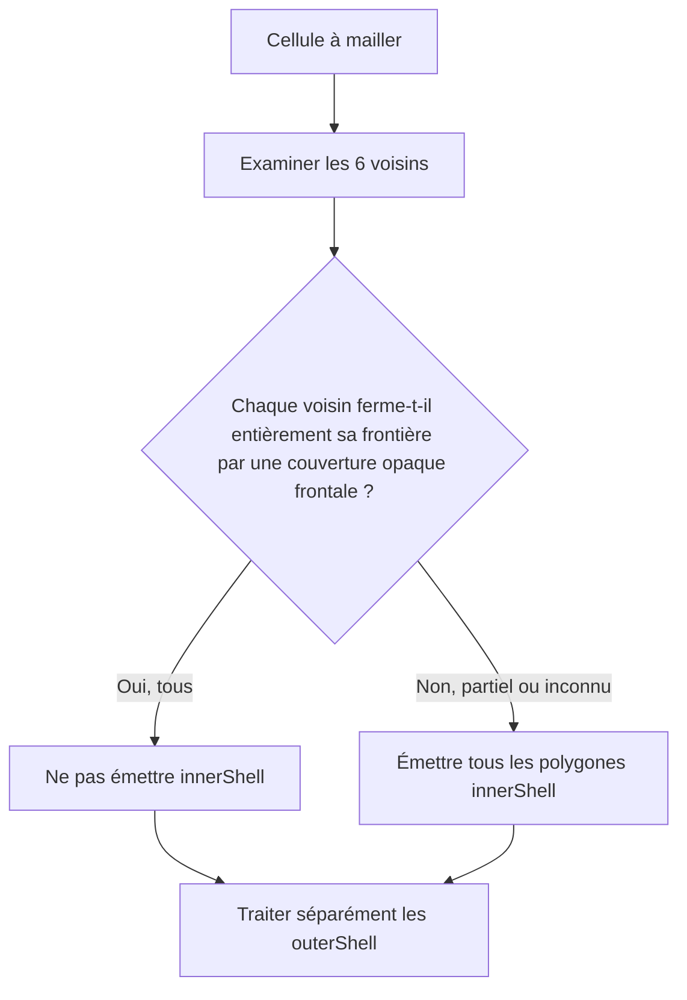

Chaque direction est **fermée** seulement si les polygones occultants du voisin couvrent **l'intégralité du carré `[0,1]²`** de sa frontière en vis-à-vis. La fermeture ne dépend pas des `outerShell` de la cellule courante. Si les six directions sont fermées, aucun `innerShell` de cette cellule n'est émis. Si au moins une direction est ouverte, partiellement couverte ou inconnue, **tous ses `innerShell`** sont émis, sans culling individuel supplémentaire par cette règle.

Les `outerShell` continuent à être traités par clipping directionnel indépendamment des `innerShell`.

**Limite fonctionnelle assumée :** cette optimisation ne prend pas en charge une caméra placée **à l'intérieur d'un espace entièrement enfermé** dont les surfaces intérieures ont été éliminées. Le moteur ne conserve pas ces faces de manière préventive et n'effectue aucun rebake automatique lié à la position de la caméra. L'application doit éviter ce scénario si elle veut garantir le rendu de ses surfaces intérieures.

### 3.5 `spk::Voxel::OcclusionCache`

Le cache est une ressource autonome **facultative** et indépendante des Meshers, des palettes et du GPU. Plusieurs Meshers peuvent l'utiliser.

Une entrée représente **une requête directionnelle A → B** : quels fragments de l'`outerShell` de A restent visibles après occultation par B ? Le sens **B → A** constitue une autre requête, une autre clé et éventuellement un autre résultat. Une valeur valide contenant zéro fragment signifie **occlusion totale**, tandis que l'absence d'entrée est représentée par `std::nullopt`.

La clé identifie les blocs immuables `Shape::Data` des deux cellules, leurs orientations, la direction du voisinage, les contrats géométriques d'opacité pertinents et la tolérance de clipping. L'identité de Shape vient du Data partagé, **pas d'un hash de contenu ni d'un identifiant artificiel**. Les clés conservent une propriété partagée suffisante sur ces Data pour empêcher le recyclage d'adresse de créer de fausses correspondances. Les slots sémantiques de Model et les matériaux concrets n'entrent pas dans l'identité d'un résultat si les contrats géométriques sont équivalents.

`OcclusionResult` est une valeur immuable, à copie légère, contenant les **fragments visibles de A dans le repère local de la Shape A**, leurs UV, leurs attributs et leurs **slots géométriques locaux**. Il ne contient ni indices des slots du Model ni pointeurs vers une palette. Après lecture du cache, le Mesher applique le mapping de la Definition, l'orientation et le placement dans le Volume.

`OcclusionCache` protège sa table par un `spk::ProtectedData<Data>` **privé** :

- `find(key)` copie légèrement un `std::optional<OcclusionResult>` sous verrou de lecture, puis libère le verrou avant de rendre la main ; aucun emprunt sur la table ne s'échappe ;
- `store(key, result)` publie une entrée complète sous verrou d'écriture ; deux Meshers peuvent calculer la même clé simultanément et n'en conserver qu'un résultat valide ;
- `clear()` supprime, sous verrou d'écriture, **les entrées présentes à cet instant**. Il n'annule pas un clipping déjà commencé hors verrou : un `store()` ultérieur peut réinsérer un résultat calculé avant la purge.

Le clipping lui-même s'effectue **hors verrou**. Les copies immuables d'`OcclusionResult` récupérées avant une purge restent valides. Les entrées du cache et les références aux Shapes restent détenues **jusqu'à `clear()` ou destruction** : aucune éviction automatique, aucun LRU et aucun budget de mémoire obligatoire.

Un cache partagé peut être interrogé simultanément ; en revanche, sa **destruction** et la modification de son binding pendant un bake actif ne sont pas rendues sûres par la seule synchronisation de `find/store/clear`.

### 3.6 `spk::Voxel::Model` : résultat immuable

Le Model contient ou conserve de manière sûre les données issues du Volume, **deux meshes visuels immuables** (opaque et translucide, éventuellement vides), **un `ShadowMap::Mesh` de profondeur immuable** (éventuellement vide) et la table complète des slots sémantiques déclarés par les Definitions effectivement utilisées. Le mesh d'ombre reprend les triangles opaques résultant du bake, leurs positions, indices et winding, sans UV, normales ni références de palette ; il ne représente pas nécessairement une enveloppe fermée.

Chaque polygone d'opacité **égale à 1** alimente le mesh opaque, et tout polygone d'opacité **inférieure à 1** alimente le mesh translucide. Il n'existe pas de catégorie `cutout` distincte. La texture ne modifie pas cette classification.

Tous les slots sémantiques **référencés par les Definitions des cellules du Volume** sont conservés, même si leurs triangles sont totalement occultés ou si leur Shape est vide. Une Definition qui reste dans une table interne mais n'est référencée par aucune Cell n'ajoute pas ses slots au Model.

Deux déclarations de slot portant le **même nom et la même opacité** sont fusionnées. Si elles portent le **même nom et des opacités différentes**, `bake()` échoue avec une `spk::Exception` descriptive ; aucune promotion implicite de catégories n'est tentée. Une fois fusionnés, les slots sont triés par **ordre lexicographique déterministe de leurs noms**, indépendamment de l'ordre de visite des cellules ou du culling.

Le sommet voxel comporte au minimum :

```cpp
struct MeshVertex
{
    spk::Vector3 position;
    spk::Vector3 normal;
    spk::Vector2 uv;
    std::uint32_t materialIndex; // Index dans la table triée du Model
};
```

Les meshes visuels et d'ombre réutilisent **l'infrastructure `spk::Mesh<TVertex>` existante** et ses buffers/layouts GPU ; pas de nouveau framework de maillage. `materialIndex` n'est jamais réattribué selon les seuls triangles visibles. Remplacer une palette ou déplacer un Assembly ne change pas les meshes du Model.

## 4. Matériaux, textures et palettes


### 4.1 `spk::Material` : ressource générique

`spk::Material` est un **type générique Sparkle**, sans spécialisation `VoxelMaterial`. Il est construit via `Material::Builder`, puis devient **immuable**. Il peut associer zéro, une ou plusieurs textures à des **noms de rôles libres** (`albedo`, ou tout autre nom choisi par le programme). Seul le système voxel donne une signification au rôle `albedo`. Le Builder générique ne valide pas les conventions propres aux voxels.

Chaque liaison à une texture conserve un **`spk::Texture::Handle`** obtenu depuis la `const spk::Texture&` fournie lors du binding, ainsi qu'une région UV normalisée (`Texture::Section`, exprimable en `anchor` et `size`). Le Material conserve le **handle de l'état exact choisi** et non un pointeur brut vers l'objet Texture, une copie complète de Texture ou un pointeur vers l'AssetManager.

Un handle conserve l'état GPU partagé de la Texture après destruction du wrapper Texture initial. Il ne conserve toutefois **ni la grille du SpriteSheet, ni à lui seul son ensemble de résolutions**. Le Material final n'a pas besoin de la grille : la conversion d'un sprite en `Texture::Section` est réalisée **avant** sa construction.

La résolution effectivement capturée est celle de la Texture explicitement passée au Builder. Il n'existe **aucune sélection automatique de résolution** dans Material ou dans le rendu voxel. Changer de résolution implique de fournir la nouvelle Texture choisie à un **nouveau Material**, puis de choisir la nouvelle palette correspondante. Les mipmaps standards du State GPU restent possibles.

**Extension pour les textures de vues :** la source statique conserve le contrat `Texture::Handle` ci-dessus. Une liaison à une `EngineView` est une **source non propriétaire**, dont l'identité reste fixe dans le Material immuable. **La construction CPU du nouveau snapshot** sélectionne et capture la **version logique courante de la texture** (ou la texture de remplacement explicite), avec vérification des erreurs logiques déjà connues ; **l'exécution GPU** matérialise ce handle pour chaque `Window::Surface` et contrôle la disponibilité de son image au moment de l'utilisation. Le Material ne prolonge pas la vie de la vue et ne conserve pas durablement les handles de sa sortie ; les commandes déjà publiées peuvent conserver les handles logiques capturés. L'API exacte de liaison et la compatibilité avec les règles d'atlas voxel restent à finaliser. Les JSON d'assets ne recherchent pas implicitement des vues.

Les **propriétés et l'identité des handles** d'un Material sont immuables. Les **pixels de l'état Texture partagé** peuvent évoluer selon les API graphiques existantes, avec validation et synchronisation CPU/GPU adaptées : les Materials qui partagent ce même State verront son contenu actualisé. Si une opération détache/remplace le State d'une Texture source, un handle déjà capturé continue de référencer **l'ancien State** : il ne suit pas automatiquement cette substitution. Les paramètres du Material et les anciennes palettes restent inchangés.

### 4.2 Texture simple, SpriteSheet et région d'atlas

La configuration JSON d'une texture peut représenter une simple image :

```json
{
  "Texture": { "path": "terrain.png" },
  "UV": {
    "anchor": { "x": 0.25, "y": 0.5 },
    "size": { "x": 0.125, "y": 0.125 }
  }
}
```

Elle peut également demander un `spk::SpriteSheet`, en donnant une **grille de nombres de sprites**, et sélectionner une cellule de la grille :

```json
{
  "Texture": {
    "path": "terrain.png",
    "size": { "x": 16, "y": 16 }
  },
  "UV": {
    "sprite": { "x": 3, "y": 5 }
  }
}
```

Ici, `Texture.size` signifie **16 sprites en largeur et 16 en hauteur**, **pas une résolution en pixels**. `SpriteSheet::sprite(Vector2UInt)` retourne une `Texture::Section` normalisée. Des UV explicites (`anchor`/`size`) restent utilisables **même avec un SpriteSheet**. La syntaxe `sprite` exige une grille valide et des coordonnées de sprite valides.

Ces exemples illustrent le **bloc de description d'une texture**, pas nécessairement la structure complète d'un Material à rôles multiples ; les noms et l'organisation des rôles restent génériques. Le chargement JSON et la construction manuelle doivent aboutir à la **même représentation Material : handle + section UV**.

La Shape conserve des UV locaux ; le shader applique le rectangle du Material :

```text
uvFinal = material.anchor + shapeUV * material.size
```

Plusieurs Materials peuvent donc référencer le **même atlas** avec des rectangles UV distincts, sans rebake. Un UV local hors `[0,1]` est utilisé tel quel, sans répétition forcée dans la région ni clamp automatique. Le résultat visuel et la maîtrise des bords du sprite sont sous la responsabilité de l'appelant.

### 4.3 `Material::Builder` et l'AssetManager

Le Builder peut fonctionner **sans AssetManager** lorsque le programme lui passe directement des Textures existantes. En revanche, un chargement JSON qui doit résoudre un chemin ou un asset requiert un AssetManager préalablement lié :

```cpp
spk::Material::Builder builder;
builder.bind(&assets);  // Liaison non propriétaire
// Construction depuis un JSON de matériau.
```

`void bind(spk::AssetManager*)` est la forme retenue. **`bind(nullptr)` provoque immédiatement une `spk::Exception`.** Une liaison à cible unique n'est pas implicitement remplacée sans détachement préalable, selon les conventions Sparkle. Le Material obtenu ne conserve aucune référence au gestionnaire.

### 4.4 `spk::VoxelPalette` : association des slots aux matériaux

Une `VoxelPalette` associe des **noms de slots sémantiques et leurs contrats d'opacité** à des valeurs `spk::Material`. C'est une valeur immuable, à copies légères partageant un bloc de données internes ; elle ne contient **aucun SSBO** et n'hérite d'aucun objet GPU.

Son Builder mutable peut être initialisé à partir d'un Model, de plusieurs Models, d'un Assembly (union de leurs besoins) ou d'une palette existante pour en créer une variante. Les collisions de **même nom avec des opacités différentes** entre sources sont rejetées explicitement. Construire une nouvelle palette n'altère pas l'ancienne, ses Materials ou les snapshots existants.

**Chaque slot déclaré** doit recevoir un Material compatible, **même s'il n'a aucun triangle visible**. Le Builder valide que chaque Material affecté possède au moins la texture nommée exactement **`albedo`**, avec exception descriptive sur absence. Le système voxel ne requiert, n'examine ni n'utilise d'autres noms de textures dans cette version. La présence d'autres rôles sur un Material reste autorisée.

Un Model peut être associé à une palette contenant **plus de slots** que lui. L'association est compatible seulement si tous ses noms et opacités requis sont présents. `Model::isCompatible(palette)` est la forme d'API envisagée pour vérifier ce contrat, y compris la limite d'atlas par passe décrite ci-dessous. La palette n'est pas obligée d'être identique au Model, et une même palette peut servir à plusieurs Models.

**Textures issues d'une EngineView.** L'identité d'une source de vue est logique et non celle d'un `Texture::Handle` permanent : après un resize explicite, une nouvelle capture résout la nouvelle version de texture. La compatibilité d'atlas des sources dynamiques reste un contrat à préciser ; les contraintes ci-dessous portent sur les sources statiques.

**Contrainte des atlas :** pour chaque association **Model + VoxelPalette**, les Materials des slots **opaques** requis par ce Model doivent tous référencer **un unique `albedo` `Texture::Handle` au maximum** ; la même règle s'applique, indépendamment, aux slots **translucides**. Cette vérification concerne **tous les slots déclarés par le Model, même sans triangles émis**, pas l'intégralité des slots supplémentaires de la palette. Les passes opaque et translucide peuvent utiliser le même atlas ou deux atlas différents.

Une palette peut donc contenir arbitrairement plusieurs atlas pour répondre aux besoins de divers Models ; elle n'est pas rejetée globalement pour cette raison. C'est une **association** qui est refusée explicitement lorsqu'elle demanderait deux atlas différents dans une même passe. Aucun remaillage silencieux ni découpage des meshes en sous-meshes par texture n'est prévu.

### 4.5 Alpha, opacité et visibilité

La classification géométrique reste celle de la Shape :

- `slot.opacity == 1.0` : triangles dans le mesh opaque ;
- `slot.opacity < 1.0` : triangles dans le mesh translucide (WBOIT).

Dans les **deux** fragment shaders :

```glsl
float alphaFinal = texture(albedo, uvFinal).a * slotOpacity;
if (alphaFinal == 0.0)
    discard;
```

Le mesh opaque est dessiné sans blending de translucence. Une texture contenant de l'alpha intermédiaire sur un slot d'opacité 1 **ne déclenche donc pas automatiquement** un passage translucide ; c'est un choix explicite de l'auteur. Le mesh translucide utilise Weighted Blended Order-Independent Transparency (WBOIT).

L'alpha des pixels n'a **jamais** d'incidence sur la décision de culling effectuée au bake. Il n'existe ni troisième mesh voxel cutout, ni booléen transparent supplémentaire, ni contrat d'occlusion indépendant.

## 5. AssetManager générique

Le gestionnaire d'assets appartient à Sparkle, indépendamment de l'API voxel. Il gère la création et la possession d'objets de types variés, sans leur imposer de méthode `fromJSON()` ou `toJSON()` universelle.

### 5.1 API de chargement et identité de cache

```cpp
spk::AssetManager assets;

auto& first = assets.load<spk::SpriteSheet>("terrain", config16);
auto& same  = assets.load<spk::SpriteSheet>("terrain", config16);
auto& other = assets.load<spk::SpriteSheet>("terrain", config8);

// &first == &same ; &first != &other
```

Le cache distingue les assets par le **triplet `(type C++ T, identifiant, valeur structurelle de spk::JSON::Value)`**. Le même identifiant peut désigner plusieurs configurations : ce sont alors des ressources distinctes. L'identifiant est une chaîne libre ; l'AssetManager ne l'interprète pas automatiquement comme un chemin.

L'égalité des JSON est **structurelle** : l'ordre textuel des propriétés d'un objet JSON n'altère pas la clé. La configuration est conservée par valeur dans l'identité du cache, et non par pointeur vers l'argument. Deux appels pour un même triplet rendent **la même instance** sans réexécuter la factory.

La configuration peut être omise :

```cpp
auto& a = assets.load<MyAsset>("simple");
auto& b = assets.load<MyAsset>(
    "simple", spk::JSON::Value::object()
);
// &a == &b
```

La forme à un seul argument signifie **exactement un objet JSON vide**, obtenu par `spk::JSON::Value::object()`. Un `spk::JSON::Value{}` est en revanche **Null** dans l'API actuelle et demeure une clé **différente**. Ne jamais confondre objet vide et Null.

### 5.2 Factories statiques par type

Lorsqu'une clé est absente, le gestionnaire appelle une **factory spécialisée statiquement pour T**. Aucune inscription de factory par instance, aucun `registerFactory<T>()` et aucun registre dynamique de constructeurs ne sont requis.

L'interface conceptuelle est :

```cpp
template <>
struct spk::AssetFactory<MyAsset>
{
    static MyAsset create(
        spk::AssetManager& assets,
        const std::string& id,
        const spk::JSON::Value& config
    );
};
```

La factory reçoit **explicitement** le gestionnaire, l'identifiant original et la configuration. Elle peut appeler `assets.load<U>()` pour résoudre des dépendances et décider elle-même comment interpréter son identifiant ou le JSON (nom logique, fichier, options métier, etc.). Une spécialisation applicative est possible pour tout type d'asset pris en charge. Le nom exact de la spécialisation, le type de paramètre de chaîne et certaines contraintes de compilation sont encore des détails d'interface.

**La factory retourne `T` par valeur.** Elle ne retourne pas un `unique_ptr`, un `shared_ptr` ou un handle de possession et n'a pas à connaître la structure du cache. Une absence de factory pour un type demandé doit être signalée explicitement au niveau compilation/contrat, sans fallback arbitraire. Un chargement ne suppose aucune sérialisation JSON du type lui-même.

### 5.3 Possession, adresses stables et construction directe

`AssetManager::load<T>()` retourne **`T&`**, emprunt non propriétaire sur un asset que **l'AssetManager possède**. Tant que l'entrée est conservée, son adresse **ne change pas**, même lorsque de nouvelles entrées sont insérées, que des conteneurs sont réalloués ou qu'une table de hachage est réorganisée. Le gestionnaire peut utiliser des allocations dédiées et des pointeurs propriétaires **strictement internes** pour garantir cette stabilité.

Pour des types non copiables ou non déplaçables, C++23 permet de construire directement l'objet dans son emplacement final à partir d'une prvalue de `T` retournée par la factory :

```cpp
// Pseudo-implémentation interne : unique_ptr reste invisible de la factory.
auto owned = std::unique_ptr<T>(
    new T(spk::AssetFactory<T>::create(*this, id, config))
);
cache.emplace(key, std::move(owned));
```

L'élision obligatoire des copies fonctionne avec un retour direct de type `return T(args...);`. La forme `return local;` dépend, elle, d'une NRVO non garantie ; et `std::make_unique<T>(AssetFactory<T>::create(...))` peut demander une opération de déplacement. **Ni `unique_ptr` ni `new` ne constituent une obligation de l'API publique** : seuls comptent le retour par valeur de la factory, le retour `T&` du gestionnaire et l'adresse stable de l'objet stocké.

### 5.4 Dépendances et détection des cycles

Une factory peut effectuer des chargements imbriqués dans **le même AssetManager et le même thread**. Si elle redemande un asset **déjà en cours de construction dans la chaîne active**, le gestionnaire détecte ce cycle, direct ou indirect, et lance une **`spk::Exception` descriptive**.

La comparaison utilise le triplet **complet** `(type, id, JSON structurel)` ; deux configurations différentes du même nom ne sont pas un cycle à elles seules. Un asset déjà **terminé et publié** dans le cache est simplement réutilisé. Le message d'erreur doit permettre d'identifier la chaîne de dépendances en cause.

Une factory échouée **ne publie aucune entrée partiellement initialisée**. L'état provisoire de détection des cycles est nettoyé en cas de succès comme d'exception, permettant une nouvelle tentative ultérieure. Les dépendances qui ont été **chargées avec succès** avant cet échec restent dans le cache : il n'existe pas de transaction globale ou rollback de toutes les dépendances.

**Séquence de chargement, de dépendances et de publication.** La factory est exécutée seulement pour une identité absente ; la pile de construction active détecte les cycles, et seule une construction terminée entre dans le cache.

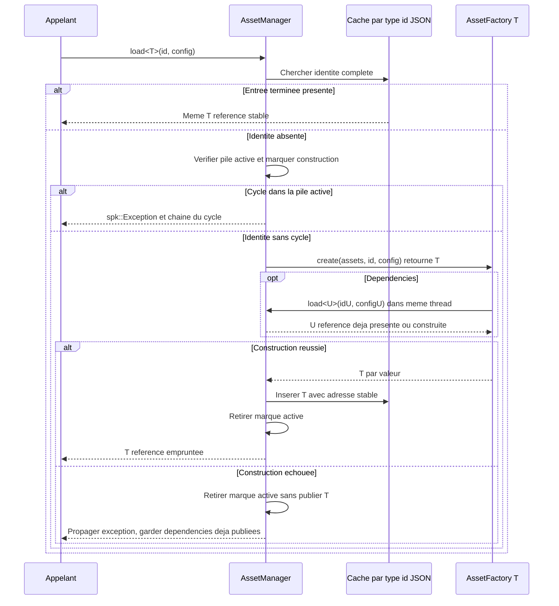

### 5.5 Synchronisation et durée de vie

**L'AssetManager n'est pas intrinsèquement thread-safe.** Tous les accès concurrents à **une même instance**, même pour des clés différentes, relèvent de la synchronisation de l'application. Les appels imbriqués depuis une factory **dans le même thread** restent autorisés ; une synchronisation externe doit tenir compte de cette réentrance séquentielle. L'AssetManager n'introduit ni verrou de coordination automatique ni attente implicite entre factories de threads différents.

Le gestionnaire garde tous ses assets jusqu'à :

- la destruction de l'AssetManager ;
- ou l'appel explicite à **`void AssetManager::clear()`**.

Il n'existe **aucune éviction automatique**, aucun LRU ni nettoyage des seules entrées prétendument inutilisées. `clear()` détruit **tous les objets appartenant au gestionnaire**, puis laisse celui-ci réutilisable pour de nouveaux chargements. Tous les `T&` et pointeurs empruntés deviennent invalides après la purge ; un chargement ultérieur de même clé crée un **nouvel asset** et ne restaure jamais la validité des anciennes références.

Les mécanismes propriétaires propres aux assets restent distincts de la vie du wrapper `T` : notamment, un `Texture::Handle` déjà capturé par un Material peut conserver son état graphique après `clear()`, sans conserver la grille SpriteSheet ni un Font d'origine. Des widgets détenant un `Font*` doivent cesser de l'utiliser avant la destruction de l'asset correspondant.

`clear()` suit les mêmes contraintes de synchronisation externe que `load<T>()`. La purge au milieu d'une factory ou d'une chaîne de chargements active n'est **pas un scénario pris en charge**. Aucun `unload<T>()` par clé, rechargement ciblé ou surveillance automatique des emprunts n'est ajouté dans cette version.

## 6. Assembly, composants et scène

### 6.1 `spk::Voxel::Assembly`

Une Assembly est une **hiérarchie mutable de parties** sans Entity propre pour chaque membre. Chaque Part possède un identifiant stable au sein de son Assembly, un nom, éventuellement un parent, une transformation locale et éventuellement une copie légère de `Model` **avec sa propre association à une `VoxelPalette`**. Un point d'attache nommé peut ne contenir aucun mesh ; il peut servir à composer des modèles ou sous-assemblages.

Les opérations couvrent ajout, accès, transformation locale, changement de parent et retrait de parties, avec **refus des cycles**. La forme exacte des identifiants et des signatures est une question d'API, pas une raison d'introduire un deuxième système hiérarchique.

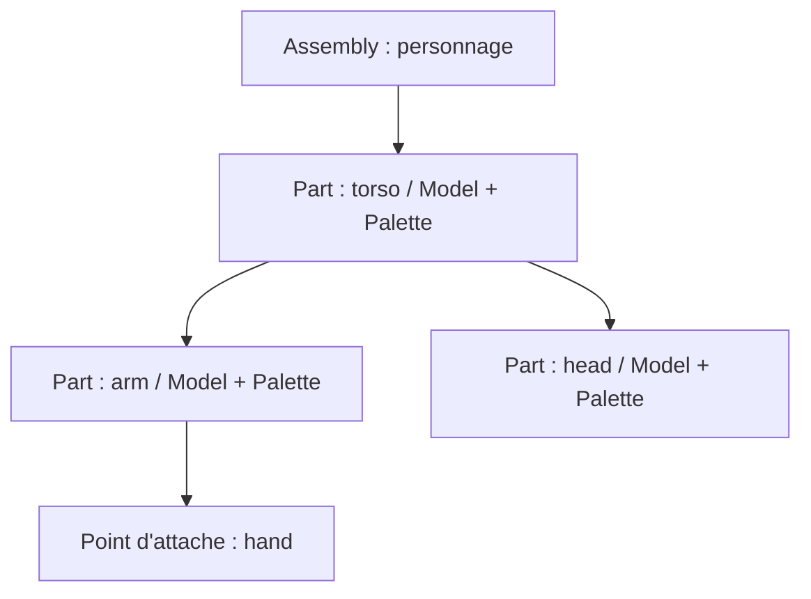

Les transformations locales sont indépendantes de `spk::Transform3D`, qui est déjà un Component3D. Une copie d'Assembly est **autonome pour sa hiérarchie et ses transformations**, tout en réutilisant les données immuables des Models et Palettes. L'Assembly copié démarre avec son **propre VersionedTrait, à version 1**, et non une copie des abonnés ou du compteur de version source. Les évolutions générales de `VersionedTrait` doivent rester compatibles avec cette propriété.

L'animation demeure **externe** à la bibliothèque voxel : un système de jeu peut modifier les transforms des parties, puis appeler `invalidate()` sur l'Assembly. Le rendu ne s'appuie toutefois sur **aucun cache de version** pour ses occurrences : il recalcule les transformations visibles à chaque RenderSnapshot.

**Adaptation des Assemblies aux ombres (A1, clos, complément matrice commune).** Aucun `ShadowMap::Contributor` n'est créé par `Assembly` ou par son composant de rendu. Le jeu construit explicitement une collection de `ShadowMap::MeshInstance`, avec pour chaque Part éligible son mesh de profondeur immuable et la matrice **locale cumulée par rapport au repère de l'Assembly** (composition des ancêtres de la Part, sans y incorporer une seconde fois la pose de l'Assembly). Il soumet **`bind(collection, assemblyMatrix)`**, où `assemblyMatrix` est la transformation de l'Assembly **dans le repère de l'Entity3D** porteuse du Contributor. Cette matrice commune s'applique à toutes les instances, puis chaque matrice locale de Part ; pour les positions, `M_world = M_entityWorld * M_assembly * M_partAccumulated`. Toute évolution de la pose des Parts **ou de la matrice commune d'Assembly** demande un nouveau `bind(collection, assemblyMatrix)` ; `Assembly::invalidate()` ne notifie pas automatiquement les ombres. Les matrices changent sans rebake de Model ni fusion de meshes. Une évolution de `Transform3D` de l'Entity est indépendante et ne demande pas de nouveau bind. Le jeu doit choisir un repère cohérent : **ne jamais fournir une matrice monde d'Assembly déjà multipliée par `M_entityWorld`**, sinon le déplacement de l'Entity serait appliqué deux fois.

### 6.2 `ModelRenderingComponent` et `AssemblyRenderingComponent`

Les deux composants sont des **composants de données** liés à une Entity3D et exposés au système de rendu par les mécanismes de Registry du moteur. Ils ne génèrent jamais eux-mêmes de `RenderCommand`.

- `ModelRenderingComponent` emprunte un `Model` et une `VoxelPalette` compatibles, sans transférer leur propriété ;
- `AssemblyRenderingComponent` emprunte une `Assembly`, sans la posséder. **Les layers individuels utilisés par le filtrage de `VoxelRenderingSystem` sont portés par ce composant graphique**, et non par l'Entity3D propriétaire ; l'API concrète des layers reprend le contrat générique des Contributors graphiques et du helper `CaptureContext::isLayerCompatible(...)`.

Leurs méthodes de liaison (`bind` / `unbind`, signatures à finaliser) utilisent des **pointeurs non propriétaires**, conformément aux usages Sparkle. Le programme doit conserver les objets liés en vie jusqu'à leur détachement et pendant tout accès nécessaire à la préparation d'un snapshot. Une liaison à cible unique n'est pas implicitement remplacée.

Les composants actifs sont trouvés **par Engine**, au moyen de `spk::Registry<T, Engine*>` ou de l'inscription typée réellement disponible. L'héritage Registry des composants spécialisés est à adapter à l'API existante et ne doit pas être inventé indépendamment de sa construction/contexte.

## 7. Systèmes de rendu visuel, d’ombres et commandes GPU

Le module graphique fournit une orchestration par vues, des systèmes de rendu visuel et d'ombres distincts, des ressources OpenGL par surface et des commandes indépendantes de l'état mutable de la simulation. Les types et comportements ci-dessous constituent le contrat cible ; les exemples de signatures expressément indicatifs ne fixent pas une API non arbitrée.

### 7.1 `RenderingEngine`, `EngineView` et `EngineWidget`

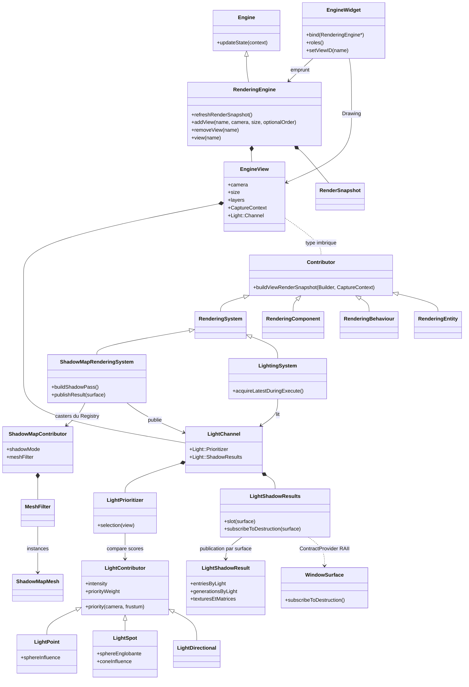

Dans ce diagramme, `Contributor` désigne **`EngineView::Contributor`** : le lien pointillé correspond à l'imbrication du type, sans possession. Un contributeur peut participer à plusieurs vues selon les layers. Le Channel appartient à la vue ; le système ShadowMap produit ses résultats et le système Lighting les lit, sans gestion d'ombres dans `Window::State` ou `Window::Surface`.

**Frontière des bibliothèques.** `spk::Engine` reste un moteur logique et headless de `sparkle::core`, responsable des entités, systèmes, événements et `updateState(UpdateContext&)`. `spk::RenderingEngine : public spk::Engine` se trouve dans `sparkle::sparkle` et ajoute les capacités graphiques : `EngineView`, contribution des objets graphiques, construction du `RenderSnapshot` moteur et publication via `ThreadSafeSlot<RenderSnapshot>`. Un serveur peut instancier `Engine` seul ; une application graphique instancie directement `RenderingEngine`. La conversion d'un Engine existant en RenderingEngine n'est pas prévue. L'héritage impose de rendre virtuel le destructeur de `Engine`. Le `RenderingEngine` adaptateur actuel fondé sur un `Engine*` est remplacé par l'héritage ; les capacités existantes de propagation des événements et d'input doivent être conservées.

**Propriété des vues.** Chaque `RenderingEngine` possède une collection de `spk::EngineView`, identifiées par une chaîne unique **et immuable**. Une vue désigne une `CameraComponent` explicite **ou aucune caméra lorsqu'elle est détachée**, sa résolution choisie par le jeu et, facultativement, un ordre numérique de capture. Une caméra peut être utilisée dans plusieurs vues. `EngineView` et `CameraComponent` relèvent désormais du module graphique et non de `sparkle::core` ; la caméra reste un `Component3D` positionné par son `Entity3D/Transform3D` habituel. Aucune caméra, vue, résolution, projection ou hiérarchie alternative n'est créée implicitement. Le nom `"main"` est uniquement la sélection par défaut du rôle `Drawing` d'un EngineWidget.

**Contexte lumineux de la vue.** Chaque `EngineView` possède un `spk::Light::Channel` comportant un `Light::Prioritizer` et un `Light::ShadowResults`. La caméra et les layers désignent ce qui peut être dessiné ; le Channel représente les lumières que la vue sélectionne et les shadow maps qu'elle peut exploiter. La vue ne sélectionne pas les casters, ne calcule pas l'éclairage et ne crée pas d'objets OpenGL. Le `CaptureContext` reçoit lors de sa construction une liaison au Channel, dont la durée de vie reste garantie pour toutes les commandes publiées. Les commandes ne lisent pas la vue mutable durant leur `execute()`, mais consultent les slots du Channel au rendu sur la surface courante. Le Channel peut donc être partagé logiquement entre plusieurs fenêtres, tout en conservant des textures GPU indépendantes par surface.

**Identité immuable de la vue.** Le nom d'une `EngineView` est attribué lors de sa création et **ne peut jamais être modifié** pendant sa durée de vie. La collection du `RenderingEngine` garantit son unicité et refuse toute tentative de création avec un nom déjà utilisé via `spk::Exception`. Aucune méthode de renommage, propagation de noms vers les widgets, alias automatique ou registre de dépendances n'est introduit. Les recherches `renderingEngine.view(name)`, les identifiants sélectionnés dans les `EngineWidget` et les références logiques du jeu conservent ainsi un identifiant stable. La caméra, la résolution, l'ordre facultatif et la politique de sortie restent modifiables suivant leurs propres contrats ; elles n'affectent pas le nom. La destruction d'une vue peut libérer le nom pour une nouvelle vue, **sans rétablir la validité des anciennes références non propriétaires** ou modifier les snapshots déjà publiés.

**Suppression des vues.** Le jeu peut appeler `RenderingEngine::removeView(name)` (signature indicative) pour **retirer et détruire immédiatement** une `EngineView` possédée par le moteur, sans attendre la destruction du `RenderingEngine`. Cette suppression retire la vue de l'ordonnancement et de la recherche par nom dès l'opération ; aucun nouveau snapshot construit ensuite ne capture son rendu. Un nom inconnu demandé à `removeView` est une opération invalide, signalée par `spk::Exception`, conformément à la politique générale des API. La suppression libère son nom et, si elle était explicitement ordonnée, sa priorité numérique, sans modifier l'ordre de création relatif des autres vues non ordonnées. Réutiliser ensuite le nom pour créer une autre vue ne restaure **aucune référence** à la vue détruite et n'effectue aucun rebinding automatique.

La responsabilité des références non propriétaires reste **explicitement celle du développeur** : avant suppression, il doit cesser d'utiliser la vue depuis les Materials, widgets et autres détenteurs de références ou identifiants de vue qui ne seraient plus valides. Sparkle n'introduit ni comptage de références de vues, ni suppression différée, ni mise à jour automatique des consumers. Les `RenderSnapshot` **déjà publiés** restent immuables et peuvent conserver leurs handles de textures, framebuffers, SSBO et autres ressources concrètes capturées jusqu'à leur fin de vie ; le retrait d'une vue n'annule pas ni ne reconstruit automatiquement ces snapshots et ne prolonge pas la vie de son objet logique.

**Ordre de capture des vues.** Une `EngineView` peut être créée **avec ou sans ordre numérique explicite**. Les vues dotées d'un ordre explicite sont toutes exécutées **en premier**, dans l'ordre croissant de cette valeur. Leurs ordres numériques doivent être uniques dans le même `RenderingEngine` ; tout conflit à la création ou lors d'un changement d'ordre déclenche une `spk::Exception` descriptive sans laisser la configuration dans un état invalide. Les vues **sans ordre explicite** sont toujours exécutées **après toutes les vues ordonnées**, dans **leur ordre de création**, sans recevoir de priorité numérique automatique. Deux vues sans ordre ne sont **pas** en conflit : l'unicité ne s'applique qu'aux valeurs explicitement fournies. Ainsi, l'ajout ultérieur d'une vue ordonnée la place avant toutes les vues sans ordre, même si celles-ci ont été créées précédemment.

La construction du snapshot moteur produit d'abord cette séquence complète de vues (priorités explicites puis vues non ordonnées en ordre de création) et y place les commandes de délégation dans le même ordre. Comme le `RenderSnapshot::Builder` existant ne trie les `RenderPass::Key` que par valeur numérique, l'encodage interne doit **respecter cette séquence**, y compris si une priorité explicite vaut la borne maximale du type numérique. Il ne doit pas reposer sur une valeur sentinelle « après toutes les priorités » susceptible d'entrer en collision ; les priorités publiques n'ont pas à être réutilisées telles quelles comme ordres des passes internes. Cela préserve le mécanisme existant de Builder sans ordonnanceur supplémentaire.

**Association et détachement de caméra.** Après la création d'une `EngineView`, le jeu peut **modifier explicitement sa caméra** ou la **détacher** (API indicative : `setCamera(CameraComponent3D*)`, avec `nullptr` pour détacher ; la forme finale peut inclure `detachCamera()`). La vue conserve son identité, son nom, son ordre de capture, sa résolution choisie par le jeu et ses ressources graphiques logiques : changer ou détacher la caméra **ne détruit ni ne recrée la vue**, et ne redimensionne pas ses cibles. Une modification de caméra prend effet à la **prochaine construction du snapshot moteur**, sans modifier les commandes déjà publiées, dont les matrices et les handles de rendu sont figés. Plusieurs vues peuvent continuer de partager une caméra.

**Vue détachée à la capture.** Une vue sans caméra reste enregistrée dans son `RenderingEngine` et reste accessible par son nom, mais `refreshRenderSnapshot()` **ne construit aucune commande produisant un nouveau rendu pour cette vue** : pas de collecte de Contributors ni de passes shadow/opaque/WBOIT/composition ni d'effacement implicite de sa texture. Les autres vues continuent de se construire et de se rendre normalement, suivant leur ordre habituel. Aucun rendu alternatif, caméra par défaut ou exception de capture n'est créé par l'absence volontaire de caméra. La visibilité de la sortie dépend de la **politique explicite de la vue**, décrite ci-dessous ; elle ne modifie pas l'interdiction d'un nouveau rendu de scène pendant le détachement.

**Durée de vie de la caméra.** La liaison d'une `EngineView` vers sa `CameraComponent` est **non propriétaire**. Une caméra détruite sans que la vue en soit auparavant détachée reste une référence pendante, soumise au contrat de durée de vie habituel : Sparkle ne promet ni détection automatique ni exception garantie. Le jeu doit détacher ou remplacer la caméra avant sa destruction. Lorsqu'une vue est détachée, la recherche `camera.view(name)` sur une autre caméra ne la considère pas comme liée à celle-ci ; `renderingEngine.view(name)` continue de fonctionner. Les matériaux qui empruntent l'identité de la vue restent liés à cette **même vue**, et les snapshots déjà publiés restent immuables et valides suivant leurs handles capturés. La consultation de sa texture détachée dépend de la politique explicite de sortie décrite ci-dessous.

**Accès aux vues depuis l'Engine ou la caméra.** `renderingEngine.view("monitor")` retrouve une vue par son nom et lance `spk::Exception` si absente. `surveillanceCamera.view("monitor")` est également prévu : il utilise le contexte `Engine*` déjà transmis aux composants pour retrouver le `RenderingEngine`, puis vérifie que la vue demandée désigne bien cette caméra. Absence de moteur graphique, nom inconnu ou mauvaise caméra : `spk::Exception`. Cela ne demande **aucun registre inverse** dans la caméra. Signatures et noms secondaires restent illustratifs.

**Resize sous contrôle du jeu.** Redimensionner la fenêtre ou un widget ne change **ni la résolution d'une EngineView ni la projection de la caméra**. Le jeu ajuste chacune explicitement. L'affichage peut simplement étirer la texture existante. Une vue dont la résolution change crée une **nouvelle version des cibles logiques** ; les handles déjà publiés ne doivent pas être modifiés rétroactivement. Le `Framebuffer::resize()` actuel, qui modifie les States de ses attachments sur place, n'est donc pas le mécanisme à employer sur une cible encore référencée par des snapshots.

**Politique de sortie d'une vue sans caméra.** Chaque `EngineView` expose une politique configurable, représentée par un **enum C++ explicite** (noms indicatifs : `DetachedOutputPolicy::KeepLastFrame`, `DetachedOutputPolicy::Invalid`, `DetachedOutputPolicy::DefaultTexture`). **La valeur initiale est `DetachedOutputPolicy::Invalid`** pour toute nouvelle `EngineView` ; le jeu peut la modifier explicitement ensuite. Elle détermine **la source de texture disponible aux consommateurs** lorsque la vue n'a pas de caméra. Elle n'entraîne dans aucun des trois modes un nouveau rendu 3D, un clear ou une mise à jour des sous-snapshots de cette vue.

- **`KeepLastFrame`** : les widgets `Drawing` et les `Material` empruntant cette vue utilisent la **dernière image produite sur la cible logique courante de la `Window::Surface` concernée**. Les dernières images restent **indépendantes par surface** ; aucun transfert ou rendu de rattrapage n'est effectué. Si aucune image valide n'existe pour cette cible/surface (vue jamais rendue, cible remplacée après un resize, etc.), **l'utilisation de cette sortie lève une `spk::Exception`** au lieu de lire silencieusement des pixels non initialisés.
- **`Invalid`** : la sortie de la vue est explicitement **invalide** lorsqu'elle est détachée ; aucun nouveau consommateur ne peut la résoudre comme une texture valide. **Toute tentative d'utilisation** depuis un widget ou un Material déclenche une `spk::Exception` descriptive. La vue reste enregistrée et ses anciennes ressources GPU ne sont pas nécessairement effacées.
- **`DefaultTexture`** : en l'absence de caméra, les nouveaux consommateurs utilisent une **texture de remplacement fournie explicitement par le développeur**, via une liaison configurable sur la vue (API indicative : `setFallbackTexture(const Texture&)` ou `Texture::Handle`). Aucun visuel par défaut interne, aucune texture « missing » automatique et aucun nouveau rendu de la scène ne sont fabriqués. Si la texture de remplacement **n'est pas configurée ou est invalide**, son utilisation déclenche une `spk::Exception` descriptive.

**Contrôles CPU puis GPU de la disponibilité d'une sortie de vue.** Une demande de sortie de vue est contrôlée à deux frontières distinctes, sans contourner l'immuabilité d'un `RenderSnapshot` publié :

1. **Construction CPU du snapshot :** vérifier les contraintes logiques qui sont déjà déterminables indépendamment d'une surface OpenGL : vue accessible, référence logique valide selon le contrat de durée de vie, état de la caméra, politique `DetachedOutputPolicy` capturée, validité structurelle du `Texture::Handle` de remplacement, et impossibilité d'utiliser une source déclarée `Invalid`. Une telle erreur lève immédiatement une `spk::Exception`, sans publier de nouveau snapshot partiel. Le Builder capture le **handle logique et les paramètres de la source sélectionnée**, pas une supposition sur les pixels disponibles dans toutes les fenêtres.
2. **Exécution GPU sur `RenderContext::targetSurface` :** juste avant d'utiliser la texture, vérifier l'existence et la **disponibilité effective de son contenu dans la `GPUResourceCollection` propre à cette surface**. Une cible peut devenir disponible au cours de **la même exécution** lorsqu'une EngineView précédente termine sa passe de composition. Le suivi d'initialisation/production est donc propre à la **version de cible et à la surface**, et distingue la simple allocation GL d'une texture de la production de son image valide. Si cette image est absente, invalidée ou non encore produite pour la surface/version courante, la commande qui tente de la consommer lève une `spk::Exception` descriptive.

**Contrat d'erreur commun.** L'utilisation d'une texture invalide ou absente lève toujours une `spk::Exception` **au premier contrôle pouvant établir l'erreur** ; aucune image de secours implicite, omission silencieuse du dessin ni lecture de pixels non initialisés. La simple présence d'une EngineView détachée ne déclenche pas d'erreur. Les `RenderCommand` ne relisent ni la caméra, ni la politique mutable, ni les autres objets du jeu pendant `execute()` : elles utilisent les décisions CPU déjà capturées et ne consultent que les ressources et leur disponibilité propres au `RenderContext`. Une erreur GPU n'annule pas rétroactivement les dessins déjà exécutés, et ne modifie pas le snapshot CPU publié.

Le `Material` conserve la **référence logique non propriétaire** à l'EngineView et ne change pas d'identité de façon permanente lorsque la politique passe en mode `DefaultTexture`. Une nouvelle capture sélectionne explicitement la source appropriée (sortie de vue, dernière image ou fallback) et ses **handles logiques** ; les commandes construites conservent ces références de ressources immuables, résolues et vérifiées dans le contexte GPU de chaque fenêtre selon le contrat de validation en deux étapes. Les **snapshots déjà publiés** restent immuables et valables selon leurs handles capturés, même si la politique ou la caméra change ultérieurement.

Un rattachement de caméra rend à nouveau possible une capture normale de la vue ; la prochaine capture effectivement exécutée met à jour la sortie de la surface concernée. Le **resize explicite** produit une nouvelle version de cible : ni `KeepLastFrame` ni `DefaultTexture` ne copient automatiquement l'ancienne image vers la nouvelle cible. `DefaultTexture` peut cependant continuer d'exposer la texture de remplacement configurée, indépendamment de la cible de la vue. Le **mode initial est fixé à `DetachedOutputPolicy::Invalid`** : tant qu'aucune autre politique n'a été sélectionnée explicitement, l'utilisation de la sortie d'une vue sans caméra déclenche une `spk::Exception` descriptive, sans invalider la vue ni les snapshots déjà publiés.

**Scénario multifenêtre de validation.** Le snapshot moteur contient `surveillance` (vue exécutée en premier) puis `main` (qui échantillonne la sortie de `surveillance`). La capture CPU accepte cette source logiquement valide, même si la `Window::Surface` B n'a jamais rendu la surveillance. Sur B, l'exécution GPU de `surveillance` produit/valide son image locale avant l'échantillonnage par `main` : aucune erreur prématurée. En revanche, une utilisation de la même texture sur B **sans production préalable** (ni image précédente valide sur sa cible courante) déclenche une `spk::Exception` à l'étape GPU. L'image existante sur la surface A ne rend pas valide la source sur B.

**Un framebuffer logique, plusieurs réalisations OpenGL.** `spk::Framebuffer` dérive déjà de `GPUResource` ; ses attachments de couleur sont des `Texture`, elles-mêmes `GPUResource`. `GPUResource::activate(context)` passe par la `GPUResourceCollection` de `context.targetSurface` et matérialise une instance OpenGL **par Window::Surface**. Une `EngineView` peut donc décrire un framebuffer logique, réalisé indépendamment en fenêtre A et B, sans ajout d'une map `(Window, Engine, ViewID)` à l'API des vues. Il s'agit d'images **locales et distinctes** : rendre A ne copie ni ne met à jour les pixels de B. La dernière image rendue dans B reste disponible tant que sa cible locale n'est pas remplacée. Pour une cible locale jamais rendue (ou nouvellement remplacée), les pixels ne sont pas garantis ; aucune image n'est créée ni transférée automatiquement. **Lorsqu'un consommateur demande effectivement cette sortie alors qu'aucune texture valide n'est disponible, une `spk::Exception` doit être déclenchée**, conformément au contrat de politique de sortie ci-dessus. La texture de remplacement est utilisée exclusivement lorsque le développeur sélectionne et configure explicitement `DefaultTexture`.

**Durées de vie.** Les vues sont possédées par `RenderingEngine` et peuvent être supprimées immédiatement par `removeView(name)`. Toutes les références vers une `EngineView`, y compris celles éventuellement détenues par des matériaux, sont **non propriétaires** et deviennent invalides lorsque la vue disparaît. Une vue volontairement détachée de sa caméra est valide et simplement non rendue ; à l'inverse, une vue qui référence une caméra **détruite sans détachement préalable** possède une référence pendante et devient impropre à l'utilisation : le développeur doit détacher ou remplacer la caméra avant de la détruire. Utiliser une référence C++ pendante peut être un comportement indéfini, pas une exception garantie. Une vue supprimée ne doit pas laisser une texture accessible aux **nouveaux rendus**. En revanche, les `RenderSnapshot` **déjà construits** peuvent conserver les `Framebuffer::Handle` et `Texture::Handle` concrets jusqu'à leur fin d'utilisation, sans prolonger la vie logique de la vue.

**API de contribution par EngineView.** `EngineView::Contributor` remplace `RenderingObjectTrait` et fournit les capacités d'événements, de mise à jour par DeviceContext et de contribution graphique propre à une vue. Le trait générique `RenderSnapshotContributorTrait` demeure inchangé et reste utilisé par les widgets : il n'est plus une base des objets graphiques du moteur. Le nouveau `EngineView::CaptureContext` est transmis explicitement pendant la construction CPU des sous-snapshots, sans caméra courante mutable ni propriété d'une vue par le Contributor.

**Deux opérations distinctes.** `Engine::updateState(context)` fait avancer le monde, les entités et systèmes ; **ne construit et ne publie aucun snapshot**. `RenderingEngine::refreshRenderSnapshot()` lit les contributeurs et les `EngineView`, prépare les commandes des vues, construit le `RenderSnapshot` moteur puis le publie dans un `ThreadSafeSlot<RenderSnapshot>` propre au moteur. Une construction échouée ne publie pas de snapshot partiel et laisse le précédent en place. Les `RenderCommand` publiées ne lisent plus les `Transform3D`, `Assembly`, caméras ou lumières mutables. Le slot fournit des `shared_ptr<const RenderSnapshot>`, chacun utilisable par plusieurs consommateurs. Aucune exécution OpenGL n'a lieu durant les deux opérations.

**Rafraîchissement au rythme des fenêtres.** La boucle Update de l'Application continue d'appeler les mises à jour des widgets. La construction du `RenderSnapshot` **de fenêtre** reste **sur demande**, comme dans Sparkle actuel : un rendu précédent peut demander la prochaine capture. Ce n'est que lors de cette construction qu'un `EngineWidget` ayant le rôle `Render` appelle `refreshRenderSnapshot()`. Publier un nouveau snapshot moteur **ne déclenche pas** automatiquement le rafraîchissement des autres fenêtres. Chaque demande `Render` est indépendante, sans déduplication automatique : plusieurs widgets peuvent reconstruire le snapshot moteur successivement, à la charge du développeur.

**Un seul `EngineWidget`, trois rôles combinables.** `bind(RenderingEngine*)` installe une liaison **non propriétaire**. Un `spk::Flags<EngineWidget::Role>` (syntaxe indicative) distingue :

- `Update` : appelle `Engine::updateState()` et utilise la propagation existante des événements et du device, selon le contrat de focus ;
- `Render` : sur demande de snapshot de **sa fenêtre**, appelle `refreshRenderSnapshot()` et ajoute la commande d'exécution du snapshot moteur dans cette fenêtre ;
- `Drawing` : affiche dans sa géométrie la **texture locale** d'une vue sélectionnée, sans provoquer update ni capture.

Les rôles peuvent être combinés : `Update|Render|Drawing` pour une fenêtre principale, `Render|Drawing` pour une fenêtre secondaire, `Drawing` pour un écran de contrôle affichant le résultat courant, ou `Update` sans vue affichée. Il n'existe plus de `EngineViewWidget` séparé. Deux widgets avec rôle `Update` peuvent faire deux mises à jour, sans garde-fou ni association automatique. Les rôles `Render` et `Drawing` sont également indépendants ; le second ne relance jamais le premier.

```cpp
// Exemple conceptuel (constructeurs/Flags et noms secondaires à finaliser).
spk::RenderingEngine engine;
engine.addView("surveillance", surveillanceCamera, {640, 360}, 0);
engine.addView("main", playerCamera, {1280, 720}, 1);
engine.addView("debug", debugCamera, {320, 240}); // Sans ordre : exécutée après toutes les vues ordonnées.

mainWidget.bind(&engine);
mainWidget.setRoles(Role::Update | Role::Render | Role::Drawing);
mainWidget.setViewID("main");

secondaryWidget.bind(&engine);
secondaryWidget.setRoles(Role::Render | Role::Drawing);
secondaryWidget.setViewID("surveillance");

// Une autre vue est retrouvable depuis sa propre CameraComponent :
spk::EngineView& monitor = surveillanceCamera.view("surveillance");
// Changer de caméra sans recréer la vue :
monitor.setCamera(&otherCamera);
// Suspendre le rendu de la vue, sans la supprimer :
monitor.setCamera(nullptr);

// Un matériau de surveillance emprunte la source logique de la vue.
// Surcharge indicative à finaliser ; le Material ne possède pas la vue.
spk::Material::Builder builder;
builder.setTexture("albedo", monitor);
spk::Material screenMaterial = builder.build();
```

**Deux niveaux de snapshots, sans seconde boucle GPU.** Le `RenderingEngine` possède son slot de snapshot moteur, commun à toutes les fenêtres. L'`Application` conserve son slot de `RenderSnapshot` **par fenêtre**, contenant UI et commandes de ses widgets. Le widget `Render` insère, dans le snapshot de cette fenêtre, une `RenderCommand` qui **capture le `shared_ptr<const RenderSnapshot>` moteur sélectionné**, puis exécute `engineSnapshot->execute(renderContext)` sur le thread de rendu de la fenêtre. Ainsi une publication ultérieure du slot moteur ne change pas le snapshot déjà capturé par A, même si B en choisit un plus récent.

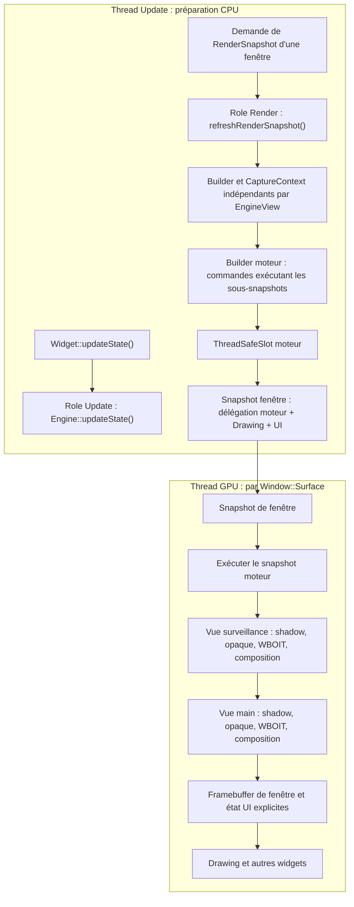

L'ordre surveillance puis main illustre une configuration demandée par le jeu. Les cibles graphiques de chaque vue sont matérialisées localement dans la `GPUResourceCollection` de chaque surface.

**Réentrance des snapshots de rendu.** Un snapshot moteur est une **description de commandes immuable**. Il doit être possible de l'exécuter sur deux `RenderContext` distincts, éventuellement simultanément, sans écrire dans l'état mutable partagé des commandes. Les allocations et synchronisations OpenGL sont locales à la `Window::Surface`. Le `ThreadSafeSlot` garantit la durée de vie de l'objet snapshot, mais **n'assure pas** à lui seul la réentrance des commandes personnalisées ni la synchronisation de mutations concurrentes durant la capture CPU. Les mutations de `Engine` / caméra / Assemblies et `refreshRenderSnapshot()` doivent être coordonnées sur le thread Update, ou synchronisées explicitement par l'appelant.

**Cas de l'écran de surveillance.** La vue `surveillance` d'ordre 0 doit être **complètement** rendue (ombres, opaque, WBOIT, composition, texture finale) avant que la vue `main` d'ordre 1 utilise sa texture comme matériau de son écran 3D. Le jeu fixe l'ordre des vues ; Sparkle ne déduit pas de dépendances automatiquement d'un Material. Les vues sont exécutées intégralement et successivement via leurs sous-snapshots indépendants (section 7.1), avec préparation GPU par `RenderCommand` typées et restauration explicite de la présentation.

**Une source de texture EngineView dans un Material.** Le `Material` statique existant capture un `Texture::Handle`. Pour représenter un écran de surveillance dont la source survit aux changements de résolution **mais pas à la destruction de la vue**, une variante de source doit référencer **non propriétaire** la `EngineView`. Lors de la construction d'un snapshot, Sparkle sélectionne sa source selon l'état de la caméra et la politique explicite de la vue (cible courante ou dernière image locale, source invalide, ou texture de remplacement configurée), puis capture **les handles logiques** dans les commandes lorsque cette source est logiquement valide. Une `spk::Exception` est levée à la capture pour une invalidité logique connue et, à l'exécution GPU, pour une texture qui n'est pas effectivement disponible sur la surface courante. Ainsi une vue rendue plus tôt dans le même snapshot peut fournir la texture requise, y compris dans une fenêtre qui ne l'avait jamais produite auparavant. Le `Material` lui-même ne conserve pas des handles GPU pérennes pour cette source ; il n'empêche pas la destruction de la vue. Ceci ne copie pas les pixels entre fenêtres : un handle de sortie de vue se réalise localement selon `RenderContext::targetSurface`. Le type exact de liaison et les règles d'unicité d'atlas voxel pour les sources dynamiques restent à définir.

**Rendu ou dessin seul.** `Render` produit les vues du moteur dans la surface courante sans nécessairement en afficher aucune ; `Drawing` dessine la vue sélectionnée sans forcément déclencher une nouvelle capture. Lorsque sa caméra est liée, il utilise la dernière sortie **locale** de cette vue, si elle existe. Lorsqu'elle est détachée, `Drawing` respecte sa politique explicite à trois modes (`KeepLastFrame`, `Invalid` ou `DefaultTexture`), comme les Materials qui l'empruntent. Une source invalide ou absente déclenche une `spk::Exception` lors de son utilisation. Un widget ne doit pas supposer que la dernière exécution du snapshot moteur dans une autre fenêtre a mis à jour ses propres textures.

**Séquence multifenêtre et publication indépendante.**

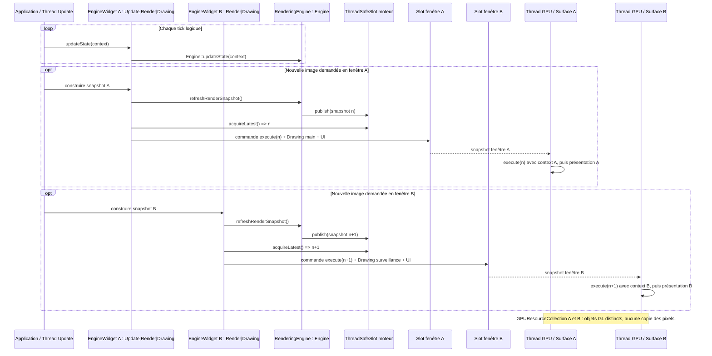

### 7.2 Captures, Contributors, layers et `RenderPass`

**Liaison au Channel dans le contexte de capture.** Le `EngineView::CaptureContext` contient les valeurs immuables de caméra, frustum, résolution et layers ainsi qu'une liaison vers le `Light::Channel` de cette même vue. Les commandes de `ShadowMap::RenderingSystem` et de `Lighting::System` obtiennent ainsi le même contexte, sans s'appeler directement. La liaison est créée avec la capture et demeure vivante pour les snapshots encore en vol. L'identité de `Window::Surface` est prise dans le `RenderContext` de l'exécution GPU, et non dans les données de simulation.

**Sous-snapshot propre à chaque EngineView.** À chaque `RenderingEngine::refreshRenderSnapshot()`, le moteur **réconcilie d'abord les abonnements de chaque vue** au regard des Contributors présents dans le Registry et des layers, même si sa caméra est détachée. Il crée ensuite un `RenderSnapshot::Builder` neuf pour chaque **vue ayant une caméra liée à l'instant de la capture** ; il ignore pour ce nouveau rendu les vues volontairement détachées. Les `EngineView::Contributor` actifs **admis par le filtre de layers de la vue** contribuent au **même Builder de cette vue**, à l'aide d'un `EngineView::CaptureContext` explicite (caméra, matrices, résolution, identifiant de vue, lumières pertinentes et handles de cibles logiques). Le moteur prépare les passes standard avant de solliciter les contributeurs.

Le sous-snapshot de chaque vue est construit puis **détenu par valeur** par une commande de délégation (nom illustratif : `ExecuteViewSnapshotCommand`). Le Builder du snapshot moteur contient une passe par vue, de nom unique, dont l'ordre **interne** respecte la séquence calculée à partir des vues à priorité explicite, puis des vues non ordonnées dans leur ordre de création (voir règle ci-dessus). L'exécution d'une passe du moteur appelle `subSnapshot.execute(renderContext)` : **toutes** les phases de `surveillance` (ombres, opaque, WBOIT, composition) sont exécutées avant la première phase de `main`, lorsque leurs ordres explicites sont 0 et 1. Toute vue sans ordre est exécutée après ces deux vues. Les noms et ordres des passes **internes aux sous-snapshots** sont isolés entre vues. Aucun second ordonnanceur, tri de dépendances des Materials ou encodage global des phases n'est introduit.

**Pas de mutualisation inter-vues pour V0.1.4.** Chaque vue recalcule indépendamment ses transforms, sa visibilité, ses buckets, ses SSBO d'instances et ses commandes. Les ressources sources préexistantes (meshes, matériaux, textures, handles) demeurent réutilisables ; aucun cache ou objet de capture partagé entre vues n'est exigé. La mutualisation est une optimisation future éventuelle, seulement après mesures. La simulation `Engine::updateState()` n'est pas répétée pour chaque vue.

```mermaid
sequenceDiagram
  participant G as Jeu
  participant E as RenderingEngine
  participant C as EngineView::Contributor
  participant SH as ShadowMap RenderingSystem
  participant V as Builder par vue
  participant M as Builder moteur
  participant S as Slot moteur
  participant R as RenderContext GPU
  G->>E: updateState() (simulation)
  G->>E: refreshRenderSnapshot()
  loop Pour chaque EngineView dans l'ordre
    E->>E: reconcilier les Contributors visuels selon Registry et layers
    alt Ensemble admissible modifie
      E->>E: ajouter ou resilier les contrats des Contributors visuels
    end
    alt Camera liee
      E->>E: capturer EngineView::CaptureContext
      E->>V: creer Builder et initialiser passes GPU
      E->>E: filtre non configure : tous ; filtre vide : aucun ; sinon intersection non vide
      E->>C: buildViewRenderSnapshot(V, CaptureContext) pour les Contributors admis
      C->>C: pour chaque composant graphique interne : isLayerCompatible(component.layers)
      C->>V: commandes visuelles et passes generiques
      SH->>SH: filtrer casters et reconcilier contrats d ombre
      SH->>V: commandes de la RenderPass d ombres unique
      E->>V: finaliser les phases de la vue
      V-->>E: sous-RenderSnapshot immuable
      E->>M: ajouter passe de vue + ExecuteViewSnapshotCommand
    else Camera detachee
      E->>E: ne pas construire de rendu pour cette vue
    end
  end
  M-->>E: RenderSnapshot moteur
  E->>S: publish(snapshot moteur)
  S-->>R: snapshot immuable capture par la fenetre
  R->>R: executer chaque sous-snapshot complet dans son ordre
  R->>R: retablir framebuffer de presentation et etat UI
```

**Contribution graphique générique.** `EngineView::Contributor` remplace `RenderingObjectTrait` pour les classes graphiques visibles (`RenderingComponent`, `RenderingBehaviour`, `RenderingEntity`, `RenderingSystem`). Les widgets gardent `RenderSnapshotContributorTrait`. Le Contributor construit des commandes via `RenderSnapshot::Builder&` et `const EngineView::CaptureContext&` pour chaque vue admise par layers, sans propriété de scène, caméra globale mutable ni API d'ombres. **L'enum `ShadowMode`, le `MeshFilter`, les notifications d'ombres et les caches appartiennent exclusivement à `ShadowMap::Contributor` et au `ShadowMap::RenderingSystem`**. Ce dernier est un `RenderingSystem` participant au Builder au même titre que les autres, sans que `EngineView` connaisse le sens des passes qu'il ajoute.

**Filtrage des Contributors par layers.** Les layers sont des **identifiants textuels** portés par les `EngineView::Contributor` (un ou plusieurs noms de layer ; représentation C++ finale `std::string` ou collection de chaînes à définir). Chaque `EngineView` expose une sélection explicite de layers (API illustrative : `setLayers({"layerA", "layerB"})`). Le rendu reste celui du **RenderingEngine entier**, restreint par ce **filtre d'admission**, et non par une liste de scènes, d'entités ou de Contributors assignés manuellement à la vue. Un Contributor correspondant au filtre est sollicité normalement pour construire le sous-snapshot de cette vue. Un Contributor exclu n'ajoute **aucune commande graphique** à cette vue, **y compris dans ses passes shadow maps** ; un caster situé hors champ caméra mais admis par layers doit néanmoins pouvoir projeter une ombre.

**Sémantique des filtres de layers.** Une `EngineView` distingue impérativement **un filtre non configuré** d'**un filtre configuré contenant une liste vide**. `setLayers({})` configure un filtre explicitement **vide**, qui n'admet **aucun Contributor**, même ceux sans layer ; ce n'est jamais un raccourci pour désactiver le filtre. Une `EngineView` nouvellement créée a un filtre **non configuré**, qui admet **tous** les Contributors du RenderingEngine, y compris ceux sans layer. Le moyen public exact de **revenir** à cet état depuis un filtre configuré reste un détail d'API à définir explicitement ; il doit exister sans réinterpréter `setLayers({})` comme « tout accepter ».

Un Contributor (ou composant graphique filtré explicitement dans un RenderingSystem) avec une collection **de layers vide/non définie** n'est compatible **que si la vue n'a aucun filtre configuré**. Il ne représente **pas** un objet global visible dans toutes les vues filtrées. Avec `setLayers({"layerA", "layerB"})`, seuls les Contributors possédant **au moins un layer commun** (intersection non vide) sont admis ; ceux seulement sur `"layerC"` et ceux sans layer sont exclus. La même règle, **sans autre exception**, est appliquée par `CaptureContext::isLayerCompatible(component.layers())` aux composants sélectionnés volontairement par un RenderingSystem. Aucune sélection wildcard implicite, layer par défaut ajouté, héritage des layers de l'Entity ou traitement spécial des composants voxel n'est créé.

| Filtre de l'EngineView | Layers du Contributor/composant | Admis ? |
| --- | --- | --- |
| Non configuré | Tous, y compris aucun layer | Oui |
| `setLayers({})` | Tous, y compris aucun layer | Non |
| `setLayers({"layerA", "layerB"})` | `{"layerA"}` ou `{"layerB", "layerC"}` | Oui |
| `setLayers({"layerA", "layerB"})` | `{"layerC"}` ou aucun layer | Non |

L'état **« non configuré »** doit rester distinct d'une liste vide et être figé dans le `CaptureContext`. La sélection des `EngineView::Contributor` (notamment les systèmes visuels et `ShadowMap::RenderingSystem`) est recalculée sur le Registry à chaque `RenderingEngine::refreshRenderSnapshot()` ; une nouvelle capture utilise l'ensemble admissible sans modifier les snapshots déjà publiés. **EngineView ne détient aucun contrat d'abonnement aux shadow casters et n'invalide aucune shadow map.** Son filtre reste générique, et les vues à caméra détachée restent recensées mais n'émettent pas de passes de scène.

**Réconciliation des casters par le sous-système d'ombres.** Le `ShadowMap::RenderingSystem` découvre ses `ShadowMap::Contributor` dans leur Registry, filtre leurs layers au moyen du `CaptureContext` figé, et surveille par contrats RAII les invalidations qu'ils produisent. Un changement de casters admissibles (ajout, retrait, layers, activation, parenté, collection d'instances ou projection lumineuse) doit rendre périmées les ressources d'ombre nécessaires **dans le sous-système d'ombres** : une modification purement dynamique n'invalide que la carte finale ; les changements de casters statiques, de classification ou de projection invalident également la statique. La synchronisation pendant les captures, le remplacement des ressources et la reprise d'une vue détachée devront garantir qu'aucune invalidation n'est perdue ; **ce n'est pas la vue qui réconcilie un tableau de contrats d'ombres**. Le système calcule un état logique d'ombres par vue/lumière, avec matérialisation GPU distincte par surface ; aucune exécution GPU immédiate lors d'un changement de layers ou de Registry.

**Filtrage interne des RenderingSystem.** L'admission automatique par Sparkle reste **au niveau du Contributor dans son ensemble** : chaque `EngineView` sélectionne les Contributors selon les layers qu'ils déclarent, sans posséder leurs objets ou gérer une scène. **Un `RenderingSystem` admis reste entièrement responsable du choix des objets qu'il dessine à l'intérieur de sa contribution**, y compris lorsque ceux-ci portent des layers différents. Pour garantir une règle unique sans imposer de connaissance de la structure des entités à la vue, `EngineView::CaptureContext` expose un helper de comparaison des layers (signature illustrative `bool isLayerCompatible(const LayerCollection&) const`). Le helper compare les layers fournis au **filtre de la vue figé lors de la capture CPU** ; il ne reçoit pas de `Entity*` ou de `Component*`, ne lit pas une EngineView mutable et ne filtre **jamais automatiquement** les éléments d'un `RenderingSystem`.

**Cas voxel — responsabilité visuelle exclusive.** Les `AssemblyRenderingComponent` fournissent les meshes visibles des voxels ainsi que leurs layers de scène. `VoxelRenderingSystem`, s'il passe le filtre externe de la vue, filtre ses composants avec `CaptureContext::isLayerCompatible(component.layers())` et produit uniquement les dessins visibles. Il n'interprète pas `ShadowMode`, ne soumet aucun caster et ne transmet aucune invalidation liée à un mesh d'ombre.

**Cas d'ombre voxel séparé.** Une `Entity3D` hébergeant un modèle ou assemblage voxel peut posséder **un seul `ShadowMap::Contributor` avec plusieurs `MeshInstance`**. Chaque instance conserve son mesh de profondeur par copie légère et la matrice cumulée de sa Part **dans le repère de l'Assembly**. Le jeu lie explicitement `bind(collection, assemblyMatrix)` avec une **matrice commune d'Assembly relative à l'Entity**, puis renouvelle cette liaison après changement de pose des Parts ou de l'Assembly, sans rebake et sans introspection d'Assembly par le système d'ombres. Le `Voxel::Model` expose son mesh de profondeur au sortir du bake, sans créer ni lier automatiquement de Contributor. `ShadowMap::RenderingSystem` découvre cette source via Registry et vérifie activation, layers, `ShadowMode` propre au Contributor, présence de triangles et projection lumineuse. La classification opaque de la géométrie est **garantie par le producteur du mesh** : un `ShadowMap::Mesh` ne contient ni alpha, ni matériau et le système d'ombres ne peut pas les déduire de positions seules. Les deux systèmes peuvent considérer une même Entity tout en produisant **des commandes différentes** ; la présence du mesh visible n'implique pas automatiquement la présence ou la création d'un mesh d'ombre.

```cpp
// API conceptuelle, signatures finales à vérifier durant l'implémentation.
void VoxelRenderingSystem::contribute(
    RenderSnapshot::Builder& builder,
    const EngineView::CaptureContext& captureContext)
{
    for (const auto& component : _components)
    {
        if (!captureContext.isLayerCompatible(component.layers()))
            continue;

        // Ajouter uniquement les commandes de rendu visuel du composant admis.
    }
}
```

**Responsabilité explicite du développeur.** Le filtrage des layers reste indépendant des ombres : `EngineView` fournit un helper générique, que chacun des systèmes utilise pour ses propres sources. Le `VoxelRenderingSystem` n'élargit pas le filtre de la vue, ne devient pas une scène et ne s'occupe pas de la projection des ombres. Le `ShadowMap::RenderingSystem` filtre les `ShadowMap::Contributor` et lit directement **leur `ShadowMode` propre**, sans remonter la hiérarchie des Entities ni interpréter les regroupements graphiques. Modifier `ShadowMode` via `setShadowMode(mode)` notifie automatiquement le système d'ombres ; modifier une géométrie ou des layers exige les notifications appropriées sur la source d'ombres, jamais sur `VoxelRenderingSystem`. Le déplacement d'une Entity par son parent reste pris en compte via la transformation monde et ses invalidations, **sans transmission du mode d'ombre**.

**Règles de filtrage.** Le helper applique la règle suivante : filtre non configuré = tout accepter ; filtre `setLayers({})` = tout exclure ; layers non définis/vides d'un composant = accepté uniquement si le filtre de vue est non configuré. Aucun héritage implicite de layer Entity → composant ni surcharge automatique des layers du Contributor par ceux du composant n'est introduit. Les layers ne remplacent pas le culling spatial : un caster admis mais hors frustum caméra peut encore projeter des ombres.

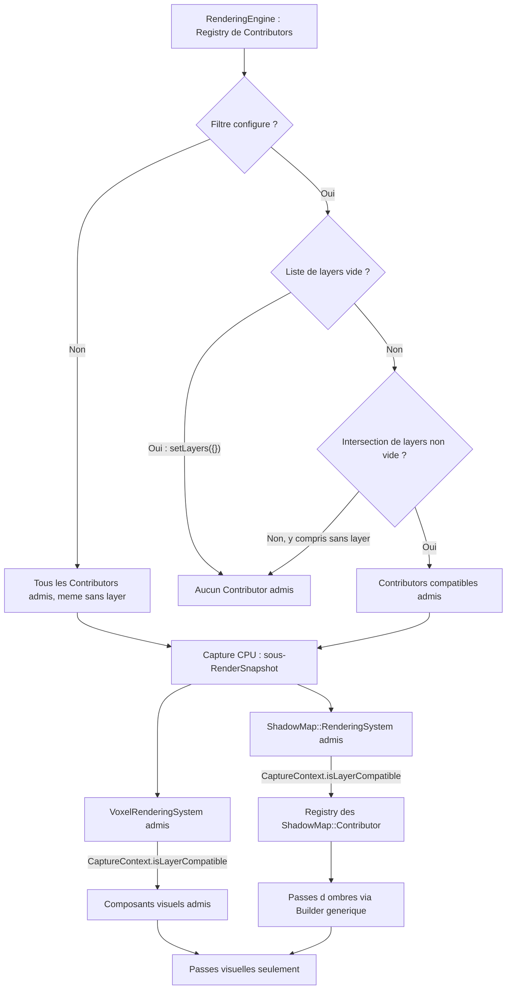

**Initialisation des passes et transitions GPU.** Sparkle emploie déjà ce principe pour `RootWidget` : les passes `sparkle.Background`, `sparkle.Overlay`, `sparkle.Popup` et `sparkle.Tooltip` reçoivent des commandes de viewport, scissor ou clear avant les dessins. De même, `RenderingEngine` ajoute les commandes d'état en **début de chaque passe standard de chaque vue**, puis les Contributors enrichissent ces passes. Les phases shadow, opaque, WBOIT et composition établissent chacune leurs états d'entrée (framebuffer, viewport, scissor, blending, profondeur, culling et masques d'écriture), sans supposer ceux de la phase précédente. Les clear tiennent compte des masques d'écriture actifs.

Les nouvelles `RenderCommand` sont **génériques à Sparkle, par famille d'état OpenGL** et configurables avec des types/enums C++ : `BlendRenderCommand` (activation, facteurs, équations et configuration par attachment pour WBOIT), `DepthRenderCommand` (test, comparaison, depth mask), `CullFaceRenderCommand` (activation, face et winding), `ColorMaskRenderCommand` (écritures couleur) et `FramebufferRenderCommand` (cible logique ou framebuffer de présentation). Les commandes existantes `ViewportRenderCommand` et `ScissorRenderCommand` sont réutilisées ou étendues pour les cibles offscreen et pour activer/désactiver le scissor. Les noms et signatures restent indicatifs. Aucune commande monolithique de sauvegarde/restauration de tout l'état GL n'est nécessaire.

**Restauration des états GPU à la frontière EngineWidget/fenêtre.** Le **snapshot moteur ne restaure pas lui-même l'état de présentation** : il ne connaît pas les exigences graphiques de l'interface et se limite à ses vues et à leurs passes. Dans le **snapshot de fenêtre**, la commande de délégation qui exécute le snapshot moteur est suivie **immédiatement, avant toute commande ultérieure de dessin UI**, des `RenderCommand` génériques et typées qui rétablissent le framebuffer de présentation de la `Window::Surface`, le viewport/scissor de fenêtre et les autres états OpenGL nécessaires aux widgets (profondeur, blending, culling, masques d'écriture selon leur contrat). Cette transition appartient à la frontière `EngineWidget`/fenêtre, pas à une passe finale du `RenderingEngine` ; elle doit rester vraie même si les commandes de délégation et de dessin appartiennent à un même `RenderPass` de fenêtre. Chaque passe UI conserve la responsabilité de préparer ses propres états d'entrée et ne dépend pas d'un état global laissé par le moteur. Un `EngineWidget` avec rôle `Drawing` seul n'exécute aucune délégation moteur ; il dessine dans le cadre des passes UI, avec leur état de présentation explicitement préparé. Si plusieurs widgets demandent des rendus, chaque délégation doit respecter cette transition indépendamment, sans garde-fou de déduplication. L'emplacement concret et les clés de passes nécessaires pour préserver cet ordre dans tous les agencements de widgets restent à finaliser, sans déplacer la responsabilité de la transition.

Les configurations de rendu jusqu'ici fixées uniquement dans `Window::Surface::initializeRenderState()` doivent être exprimées dans les passes appropriées ; l'initialisation effective du contexte OpenGL reste dans `Window::Surface`. Les commandes sont construites sur CPU sans appel GL, puis exécutées dans le `RenderContext` de chaque surface, sans état CPU mutable partagé.

**Passes personnalisées des Contributors.** Les `EngineView::Contributor` peuvent contribuer aux passes standard initialisées par `RenderingEngine` **et** créer leurs propres `RenderPass`, en utilisant le `RenderSnapshot::Builder` existant et des `RenderPass::Key` à ordre numérique explicite. `RenderingEngine` réserve les identifiants de ses passes système et des bornes/plages d'ordonnancement pour les étapes qu'il doit garantir (notamment la composition finale et les transitions de cibles). Une passe ajoutée par un Contributor doit respecter ces réservations et ne peut pas intercaler ses commandes à l'intérieur d'une étape réservée ni déplacer la finalisation. Les passes personnalisées restent **locales au sous-snapshot de l'EngineView concernée** : elles ne peuvent pas réordonner deux vues, et elles doivent préparer explicitement les états OpenGL dont elles dépendent. Aucune nouvelle interface de scheduling ou ordonnanceur de dépendances n'est introduit. Les clés et limites numériques exactes ainsi que le contrôle des collisions seront finalisés dans le contrat des passes avant implémentation ; ne pas inventer de valeurs fixes dans la présente spécification.

**Contraintes de construction et de réentrance.** L'encodage des clés de délégation respecte l'ordre explicite des vues puis leur ordre de création, sans attribuer de priorité numérique cachée aux vues non ordonnées. La transition `EngineWidget`/fenêtre intervient avant toute commande UI ultérieure. Les `RenderCommand` existantes, y compris celles utilisant des UBO, doivent être réentrantes entre plusieurs `RenderContext` ; le `Profiler` doit décrire correctement l'exécution de sous-snapshots imbriqués. Une construction incomplète conserve le snapshot précédemment publié. Les bornes numériques des clés et les coefficients WBOIT non spécifiés figurent dans le document complémentaire.

### 7.3 `ShadowMap` : contributeurs, invalidation et caches

**Séparation des responsabilités.** `VoxelRenderingSystem` produit **exclusivement** les passes visibles des voxels (opaque, WBOIT translucide, matériaux et SSBO). Il ne génère **aucune commande** de shadow map, n'observe aucun mode d'ombre de ses composants et ne gère aucune souscription RAII de cache d'ombres.

**Producteur et consommateur indépendants.** `spk::ShadowMap` est une abstraction de profondeur comprenant `ShadowMap::Contributor` (géométrie des casters et mode `None/Static/Dynamic`) et `ShadowMap::RenderingSystem` (découverte des casters, cache statique/final et reconstruction GPU). `spk::Lighting::System` est le consommateur Forward+ : il prépare les données de lumière pour les objets opaques et WBOIT et utilise les cartes finalisées. Les deux systèmes sont indépendants et accèdent à `Light::Channel`, sans dépendance de `Lighting` vers `ShadowMap`.

**Passe d'ombres unique par vue.** Le `ShadowMap::RenderingSystem` inscrit au plus une `RenderPass` d'ombres dans le sous-snapshot de la vue, avant les passes de lumière. Cette passe regroupe les reconstructions de toutes les lumières sélectionnées, avec cibles statiques et finales propres à chaque lumière et à chaque surface. Les six faces d'une cubemap `Point` sont entièrement rendues avant que la carte puisse être publiée. Un budget de reconstruction ponctuelle par image/surface arbitre les demandes de toutes les vues de cette image selon leur score décroissant, sans bonus d'attente, indépendamment de l'ordre dans lequel les vues seront exécutées.

**Réutilisation et publication.** Une carte complète précédemment produite reste exploitable durant l'attente ou la reconstruction d'une nouvelle génération, avec **ses propres matrices et paramètres d'origine**, si la lumière reste sélectionnée et ses ombres activées. Une reconstruction opère dans de **nouvelles ressources GPU logiques** sans modifier les textures antérieures. Aussitôt une carte complète obtenue, le système publie un nouveau `Light::ShadowResult` immuable dans le slot de la surface. Une commande d'éclairage ultérieure de **la même image** peut donc l'utiliser sans attendre l'image suivante. Si aucune carte n'existe ou si la lumière est désélectionnée/désactivée, elle éclaire sans ombre. `GPUResourceCollection` assure le recyclage/la libération des ressources après extinction des références.

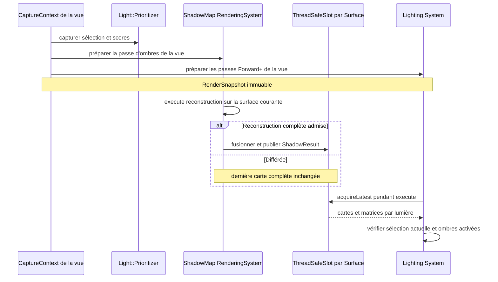

**Répartition des responsabilités.** `ShadowMap::Contributor` fournit les meshes de profondeur via le `MeshFilter`, sans porter de lumière ni participer comme `EngineView::Contributor`. Le `ShadowMap::RenderingSystem` souscrit aux casters et gère les invalidations de ses caches, sans transférer cette responsabilité à l'`EngineView`. Le `Light::Prioritizer` consulte les scores propres aux composants `Light` et sélectionne les lumières sans produire de shadow map. La `EngineView` détient le Channel mais ne connaît pas la politique des casters.


**A2 — aucune propagation des modes d'ombres en V0.1.4.** Chaque `ShadowMap::Contributor` porte **son seul `ShadowMode`** : `None`, `Static` ou `Dynamic`. La relation parent/enfant de `InherenceTrait` **ne transmet jamais** ce mode ; le parent ne peut donc ni activer, ni désactiver, ni reclassifier les ombres d'un descendant. Un regroupement graphique ou une inscription dans `Registry` ne modifie pas davantage les modes. `Registry` sert exclusivement à **découvrir** les Contributors, pas à établir des priorités ou des héritages. Aucune enum `ShadowPropagation`, aucune surcharge de `setShadowMode` acceptant une politique et aucun mécanisme d'override `Descendants` ne sont introduits dans cette version. Les relations de parenté restent pertinentes pour **calculer la transformation monde** d'une Entity et invalider ses caches si elle bouge avec son parent, sans propagation de configuration d'ombre. Un développeur voulant changer les ombres de plusieurs Entities modifie explicitement chaque Contributor concerné ; il n'existe pas de modification récursive automatique.

**Invalidations du sous-système d'ombres.** Les notifications `ContractProvider` des casters (mode, matrices, geometries, layers), des transforms et des lumières rendent les caches de production statique/finale obsolètes sans déclencher immédiatement une commande GPU. L'ancienne carte finale complète et ses anciennes matrices restent lisibles tant que la lumière est toujours sélectionnée et que les ombres restent activées. La désélection et l'extinction des ombres interdisent immédiatement son échantillonnage, même si des snapshots en vol détiennent encore ses handles. Les `EngineView` ne possèdent aucun contrat d'invalidation des casters.

```mermaid
flowchart LR
  Entity["Entity3D et InherenceTrait"] --> Visual["Composants visuels"]
  Entity --> ShadowComp["ShadowMap::Contributor"]
  M["ShadowMap : passe logique"] --> ShadowComp
  M --> SR
  M --> PassKey["Une cle par Builder de vue : cle statique commune possible"]
  ShadowComp --> ShadowMode["ShadowMode propre : None, Static, Dynamic"]
  ShadowComp --> Filter["MeshFilter : collection de MeshInstance"]
  SourceMesh["spk::Mesh de TVertex"] -->|"extracteur Vector3 + indices"| Converted["ShadowMap::Mesh"]
  Converted -->|"copie legere"| Instance["MeshInstance : mesh + matrice locale"]
  AssemblyPose["Assembly : matrices cumulees des Parts relatives a Assembly"] -->|"valeurs explicites"| Instance
  AssemblyMatrix["Matrice Assembly relative a Entity"] -->|"bind(collection, assemblyMatrix)"| Filter
  Instance -->|"bind(collection, assemblyMatrix) : remplace tout"| Filter
  Visual --> VR["VoxelRenderingSystem : rendu visuel"]
  VR --> Scene["Passes opaques et WBOIT"]
  ShadowComp --> Registry["Registry des casters"]
  Registry --> SR["ShadowMap::RenderingSystem"]
  Filter --> SR
  SR --> Score["PointLight : intensite x poids / distance bornee"]
  Score --> Target["Cible X : score de la Xe lumiere"]
  Target --> Tolerance["Admissibles en surplus si score >= PX x (1 - tolerance)"]
  Tolerance --> Remove["Ecarter anciennes retenues hors tolerance"]
  Remove --> Keep["Hysteresis seulement entre surplus admissibles"]
  Keep --> Max["Maximum absolu Y, socle X obligatoire"]
  Max --> RP["Une RenderPass ombres par EngineView"]
  Max --> Removed["PointLight sortie : caches actifs retires"]
  Removed --> Retire["Anciennes versions conservees par snapshots et GPU"]
  Max --> Pending["Demandes de reconstruction PointLight des vues"]
  Pending --> SurfaceBudget["Budget global par image et Window Surface"]
  SurfaceBudget --> Priority["Score brut decroissant seulement, sans bonus d attente"]
  Priority --> RP
  RP -->|"Pour chaque lumiere compatible"| Checks["Layers + activation + mode propre"]
  Checks --> SM["Cache statique individuel de la lumiere"]
  SM -->|"Copie si finale invalide"| FM["Carte finale individuelle de la lumiere"]
  Checks --> FM
  FM --> Scene
  View["EngineView : donnees generiques de capture"] --> Builder["RenderingEngine : Builder de sous-snapshot"]
  Builder --> VR
  Builder --> SR
```

**Sources d'ombres et mode propre.** Le `ShadowMap::Contributor` est un **composant graphique spécialisé de caster**, distinct de `EngineView::Contributor`. Il porte **son seul** `ShadowMode { None, Static, Dynamic }`, ses layers et un **`MeshFilter` intégré contenant une collection de `MeshInstance`**, chaque entrée ayant son mesh partagé et sa matrice locale par valeur. La source doit être liée explicitement par l'application, sans recherche automatique d'un mesh visuel. Le `ShadowMap::RenderingSystem` seul lit ces données et émet les passes d'ombres.

**`ShadowMap::Mesh` : géométrie de profondeur (A1, validé).** `ShadowMap::Mesh` est une **classe** dérivant de `spk::Mesh<spk::Vector3>`, et non un alias. Elle dispose d'un Builder dont l'unique attribut de sommet est une position `Vector3`. Une factory **statique générique** (nom indicatif `from`) accepte `const spk::Mesh<TVertex>&` et un extracteur invocable avec un `const TVertex&` et retournant `spk::Vector3`. Cette fonction n'est pas un prédicat booléen. La factory applique l'extracteur à chaque sommet et recopie les indices dans leur ordre d'origine, préservant triangles, winding et sommets partagés. Elle ne calcule ni volume fermé, ni enveloppe convexe, ni simplification, ni matériaux, et ne fait aucun rendu GPU. Le développeur choisit explicitement le mesh d'origine : opaque, proxy simplifié ou autre géométrie de projection **composée exclusivement des surfaces que l'application considère comme opaques**. Le format de position seule ne permet pas de contrôler l'opacité d'un mesh arbitraire ; cette sélection relève du producteur, pas d'une analyse de matériaux par la factory. La conversion CPU peut employer `source.layout().vertexBuffer().cast<TVertex>()` et `source.layout().indexBuffer().cast<std::uint32_t>()`, disponibles dans Sparkle ; elle ne requiert aucun contexte OpenGL. Les entrées triangulaires malformées (indices invalides, nombre d'indices non multiple de trois, positions non finies) sont refusées avec une `spk::Exception` descriptive sans publier de résultat partiel ; un mesh source vide donne un mesh d'ombre vide.

**`ShadowMap::MeshInstance` et transformations locales (A1, complément matrice commune).** Une `MeshInstance` est une structure publique contenant un `ShadowMap::Mesh mesh` et une `spk::Matrix4x4 localTransform`. La copie de `mesh` est **légère** : elle partage les données immuables de `spk::Mesh`. La matrice est détenue **par valeur**, sans pointeur, abonnement ni dépendance à un autre `Transform3D`. Elle exprime la pose du mesh **dans le repère local de la collection**, par exemple le repère d'une `Voxel::Assembly`, et non le monde. Le `MeshFilter` conserve également **une seule `spk::Matrix4x4 baseTransform` commune à toutes les instances**, exprimée dans le repère de l'`Entity3D` porteuse ; à défaut elle est identité. Pour chaque position, la matrice complète est `M_world = M_entityWorld * M_base * M_instanceLocal`, appliquée au sommet du mesh, selon la convention algébrique de Sparkle. `M_base` peut être la matrice de l'Assembly : chaque descendant conserve sa propre matrice cumulée **relative à l'Assembly**, sans incorporer `M_base` une seconde fois. Plusieurs instances peuvent partager le même mesh avec des matrices différentes ; elles n'ont pas d'identifiant ni de cycle de vie indépendant. Le système peut composer les matrices à la capture CPU sans modifier ni prétransformer les buffers des meshes.

**API de liaison, remplacement intégral et état atomique (A1, complément matrice commune).** Le `MeshFilter` intégré au Contributor contient **une collection ordonnée** de `MeshInstance` **et une matrice commune `baseTransform`**. Les signatures conceptuelles sont `bind(const ShadowMap::Mesh&)`, `bind(const ShadowMap::Mesh&, const spk::Matrix4x4&)`, `bind(collection<MeshInstance>)` et **`bind(collection<MeshInstance>, const spk::Matrix4x4& baseMatrix)`**. Pour un mesh unique, `bind(mesh, matrix)` équivaut à une collection d'une entrée avec `localTransform = identité` et `baseTransform = matrix` ; pour une collection sans second argument, `baseTransform = identité`. **Toutes les surcharges remplacent intégralement et atomiquement le couple `(instances, baseTransform)`**, sans ajout incrémental ni conservation cachée de l'ancienne matrice commune. Une collection vide supprime toutes les instances, remet la matrice commune à l'identité ; `unbind()` peut être un raccourci explicite à cette remise à zéro. Il n'existe ni `add(mesh, transform)`, ni `remove(id)`, ni `setTransform(id)` ni identifiants pérennes d'entrée. Les wrappers des meshes immuables sont copiés légèrement ; toutes les matrices (instance et base) sont copiées par valeur. La destruction des wrappers, du Model ou de l'Assembly de départ ne rend pas les copies invalides. Une matrice non finie, qu'elle soit commune ou particulière, est refusée par `spk::Exception`, et toute erreur de validation laisse **collection et matrice commune anciennes intactes**.

**Invalidation des bindings et capture sûre (A1, clos).** Le Contributor prépare sa nouvelle collection avant de remplacer la précédente. Chaque **appel `bind()` réussi**, même si le contenu est identique, effectue un remplacement logique puis émet **une notification unique** via son `ContractProvider`, quel que soit le nombre de meshes ou matrices changés ; il n'existe aucune notification par entrée ni comparaison profonde implicite. Le système d'ombres invalide les caches selon le **mode propre du Contributor** : un changement purement `Dynamic` n'invalide que la **carte finale**, tandis qu'un changement `Static` invalide **statique et finale**. Un changement de `ShadowMode` conserve sa propre invalidation statique + finale déjà spécifiée. La notification unique d'un `bind()` suffit à déclencher cette logique de classification. Pour actualiser la pose d'une `Voxel::Assembly`, le jeu recalcule les matrices locales **cumulées par rapport à l'Assembly** des Parts et rappelle `bind(collection, assemblyMatrix)` ; pour déplacer l'Assembly entière relativement à l'Entity, il peut réutiliser la même collection et fournir **une nouvelle matrice commune**, sans rebake, ni fusion géométrique, ni suivi automatique d'Assembly. Un mouvement global de l'Entity ne nécessite pas de nouveau bind local, mais sa notification de transformation demeure nécessaire au système d'ombres. Lors de la capture CPU, chaque entrée admise est transformée par `M_entityWorld * M_base * M_instanceLocal` ; les **commandes du snapshot copient/capturent les matrices finales, buffers et handles**. `execute(RenderContext&) const` n'accède jamais au conteneur du Contributor, à l'Entity mutable ou à une Part d'Assembly. Les snapshots publiés avant le bind continuent d'utiliser leurs anciennes versions.

**État initial et absence de sources (A1, clos).** Un `ShadowMap::Contributor` est **facultatif** sur une Entity ; aucun composant visuel ne le crée automatiquement. À la construction : `ShadowMode = None`, collection de `MeshInstance` **vide**, `baseTransform = identité`, et **aucun layer** (collection de noms vide). `None` évite toute projection implicite ; l'application demande explicitement `Static` ou `Dynamic` **sur ce Contributor**. Aucun mesh, une collection vide ou des meshes vides ne produisent de triangles d'ombre et ne déclenchent pas d'exception. Le Contributor ne transmet aucun mode d'ombre aux descendants, même s'il n'a lui-même aucune géométrie. Les layers ne s'héritent ni de l'Entity ni du visuel : selon §7.2, une liste vide est admise par une vue **sans filtre configuré**, et exclue d'une vue **avec filtre explicite**, même si la liste de filtre est vide. Aucune liaison implicite au premier mesh visuel n'est autorisée. Le producteur garantit l'opacité des triangles fournis ; le mesh position-seule ne peut pas vérifier l'alpha.

**Exemple d'utilisation conceptuel :**

```cpp
std::vector<spk::ShadowMap::MeshInstance> instances;
instances.push_back({bodyShadowMesh, bodyLocalMatrix});
instances.push_back({armShadowMesh, armAccumulatedLocalMatrix});
shadowContributor.bind(instances, assemblyLocalMatrix); // M_assembly sur toutes les Parts ; remplace TOUT.
shadowContributor.setShadowMode(ShadowMode::Dynamic);
// Nouvelle pose : recalculer les matrices des Parts, puis bind(instances, assemblyLocalMatrix).
// Deplacement de toute l Assembly : bind(instances, nouvelleAssemblyLocalMatrix).
// Cas simple : shadowContributor.bind(modelShadowMesh); // Matrice identite.
```

Les noms secondaires et la qualification exacte des enums sont illustratifs ; le contrat de possession, de remplacement et de capture est normatif.


- `None` interdit la projection pour le caster concerné, `Static` le classe dans le cache statique, `Dynamic` dans la partie dynamique de la carte finale. Seules les contributions opaques sont susceptibles de projeter des ombres ; les translucides n'en projettent pas, mais peuvent en recevoir lors de l'éclairage Forward. `ShadowMode` n'est ni un booléen `castShadow` ni un tag de Contributor générique.
- **A2 : pas de `ShadowPropagation`.** `ShadowMode` s'applique exclusivement aux `MeshInstance` du Contributor qui le porte. Aucune relation de parenté (`InherenceTrait`, Entity, Assembly ou collecte graphique) ne l'étend à un autre Contributor. Une Entity parent en mode `None` n'interdit pas les ombres d'une Entity enfant en mode `Dynamic` ; inversement un parent `Dynamic` n'active pas un enfant `None`. Les valeurs des autres Contributors ne changent jamais lorsque le parent change de mode.
- Les layers de `ShadowMap::Contributor` sont testés **par le `ShadowMap::RenderingSystem`** via le filtre générique figé de la vue. Ils ne sont pas lus implicitement depuis les layers du mesh visuel : **initialement vides**, ils ne permettent l'admission que dans une vue dont le filtre est non configuré, selon §7.2. L'activation de l'Entity reste une condition indépendante.

**Setter et notifications automatiques (A2).** `ShadowMap::Contributor::setShadowMode(mode)` compare uniquement le nouveau `ShadowMode` à la valeur stockée. Si le mode change, il l'enregistre et notifie son **`ContractProvider` propre aux ombres** ; sinon il ne notifie rien. Aucune politique de propagation, ni mise à jour des composants parents ou enfants, n'est effectuée. `ShadowMap::RenderingSystem` souscrit par contrats RAII à ses `ShadowMap::Contributor` connus ; à la réception, il marque **ses caches statique et final** logiquement invalides pour les vues/lumières concernées. Aucun appel manuel à `invalidateShadowMap()` n'est exigé après le setter, et aucune copie de l'ancienne catégorie n'est requise. Les événements de transformation (y compris un reparenting qui change une transformation monde), de modification de la géométrie `MeshFilter`, des layers ou de la disponibilité d'une source demandent également une invalidation, selon des mécanismes précis encore à finaliser. Le reparenting ne modifie **aucun** `ShadowMode`.

**Séquence de liaison d'une Assembly animée (A1, matrice commune).** Le jeu calcule les matrices des Parts relatives au repère de l'Assembly et sa matrice commune relative à l'Entity, puis soumet l'ensemble atomiquement. Le système graphique n'extrait pas de Parts depuis l'Assembly et la thread GPU ne consulte pas les objets mutables.

```mermaid
sequenceDiagram
  participant Jeu as Jeu/animation
  participant Assembly as Voxel::Assembly
  participant C as ShadowMap::Contributor
  participant Sh as ShadowMap::RenderingSystem
  participant B as Builder de vue
  participant GPU as RenderContext
  Jeu->>Assembly: modifier poses des Parts
  Jeu->>Assembly: invalidate() pour chemin visuel
  Jeu->>Assembly: lire meshes et matrices Parts relatives a Assembly
  Assembly-->>Jeu: collection de MeshInstance (valeurs)
  Jeu->>Jeu: preparer M_base = matrice Assembly dans repere Entity
  Jeu->>C: bind(collection, M_base) (remplacement entier)
  C->>C: copier Mesh partages + matrices Parts + M_base, valider
  alt Erreur de validation
    C-->>Jeu: Exception ; collection et M_base precedentes intactes
  else Liaison acceptee
    C->>C: substituer ensemble collection et M_base
    C-->>Sh: ContractProvider : un evenement
    Sh->>Sh: invalider caches des ombres concernes
  end
  Jeu->>Sh: capture vue suivante via RenderingEngine
  Sh->>C: lire collection et Entity world matrix sur thread capture
  C-->>Sh: MeshInstance[], M_base et M_entityWorld
  loop Chaque MeshInstance et lumiere admissible
    Sh->>Sh: M_world = M_entityWorld * M_base * M_instanceLocal
    Sh->>B: commandes profondeur avec mesh et matrice captures
  end
  B-->>GPU: snapshot immuable publie et execute plus tard
  Note over GPU: Aucune lecture de Contributor, Entity ou Assembly mutable
```

**`Light::ShadowResult` : résultat immuable par surface.** Une publication représente les **shadow maps finales** déjà produites pour une `EngineView` sur une `Window::Surface` particulière. Elle contient des entrées par lumière, chacune avec identité logique, génération individuelle, texture de profondeur finale (2D pour Spot/Directional, cubemap pour Point), projections et matrices correspondantes, et paramètres d'échantillonnage. Les caches statiques restent internes à `ShadowMap::RenderingSystem`. Un `ShadowResult` ne contient pas un framebuffer de production, ni des copies de pixels CPU, ni des références aux Entities mutables.

**`Light::ShadowResults` et le Channel.** Un `Light::Channel` par vue possède un `Light::Prioritizer` et une collection `Light::ShadowResults`. Cette dernière est un dictionnaire d'instances vivantes de `Window::Surface` vers des `ThreadSafeSlot<Light::ShadowResult>`, avec un slot indépendant par surface. `ThreadSafeSlot` fournit un `shared_ptr<const Light::ShadowResult>` : le consommateur garde cette version pendant son dessin. Deux fenêtres affichant la même vue partagent la sélection logique mais pas leurs instances OpenGL, puisque Sparkle V0.1.4 n'utilise pas de groupe de partage des contextes.

**Fermeture des surfaces.** `Window::Surface` expose un abonnement de destruction fondé sur `ContractProvider` (nom indicatif `subscribeToDestruction()`). `Light::ShadowResults` s'abonne aux surfaces dont il possède un slot et efface l'entrée et le contrat à leur fermeture effective, en synchronisant les accès concurrentiels au dictionnaire. Le signal est émis une seule fois, alors qu'aucune nouvelle commande de rendu ne peut débuter sur cette surface. `GPUResourceCollection` reste seule responsable de libérer les instances OpenGL avant destruction de leur contexte. Ni `Window::State` ni `Window::Surface` ne stockent de caches d'ombres. Les identifiants textuels de fenêtre et handles `HGLRC` pouvant être réutilisés, une fenêtre recréée ne doit jamais voir des résultats de l'ancien contexte.

**Reconstruction non destructive.** Le système produit chaque carte remplacée dans de **nouvelles ressources GPU logiques**, sans réécrire la profondeur de la carte antérieure. Cette dernière et les matrices/projections de sa propre génération demeurent cohérentes et consultables pendant l'attente si la lumière est encore sélectionnée et projette toujours des ombres. Une nouvelle reconstruction complète peut être publiée même si la simulation a évolué depuis la capture CPU. Cependant, une génération plus ancienne ne peut jamais écraser une génération plus récente de la même lumière. Une cubemap `Point` est publiée uniquement après les six faces cohérentes, jamais partiellement.

**Publication incrémentale par lumière.** Aussitôt la reconstruction complète d'une lumière, `ShadowMap::RenderingSystem` publie dans le slot correspondant à sa surface **un nouvel état complet de `Light::ShadowResult`** qui remplace uniquement l'entrée de cette lumière et conserve les entrées, générations et handles des autres. Le contrôle anti-régression, la fusion et la publication sont atomiques/serialisés afin qu'une mise à jour concurrente d'une autre lumière ne soit pas perdue. L'ancienne valeur immuable reste disponible aux `shared_ptr` déjà acquis. Les générations sont monotones par lumière et par contexte logique de vue, sans ressusciter les caches après désélection ou destruction/recréation.

**Consommation au rendu.** Les commandes de `Lighting::System` capturent une liaison sûre au Channel mais appellent `acquireLatest()` dans leur `execute(RenderContext&) const`, après la passe d'ombres de la vue. Elles utilisent donc les résultats déjà terminés **dans la même image**. Aucune attente de reconstruction GPU n'est ajoutée ; une carte antérieure toujours éligible peut être échantillonnée avec ses anciennes matrices. L'éligibilité des lumières et l'activation des ombres sont vérifiées séparément de la simple présence d'une texture. Un résultat absent, incomplet ou appartenant à un ancien contexte est indisponible et la lumière continue à éclairer sans ombre. L'exécution ne lit aucune `Entity`, caméra, lumière ou vue mutable.

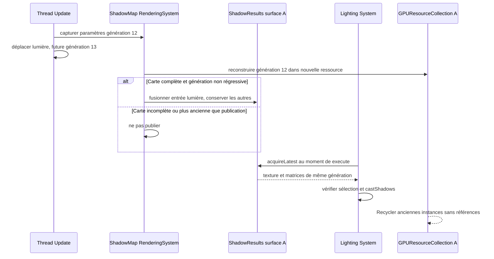


**Admission et prévention du double rendu.** `ShadowMap::RenderingSystem` découvre uniquement les sources du Registry de `ShadowMap::Contributor`; chaque source est traitée **une seule fois par parcours de casters pour chaque lumière/cible admissible**, indépendamment de l'arborescence des Entities et des éventuels regroupements graphiques. `VoxelRenderingSystem` et les autres systèmes de rendu visuel ne produisent **aucun caster en parallèle**. Une contribution hors frustum caméra peut continuer à projeter sur les objets visibles si elle est pertinente pour la projection lumineuse.

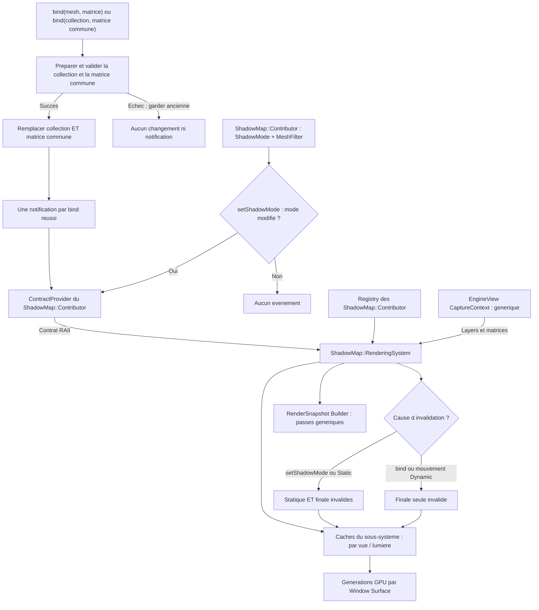

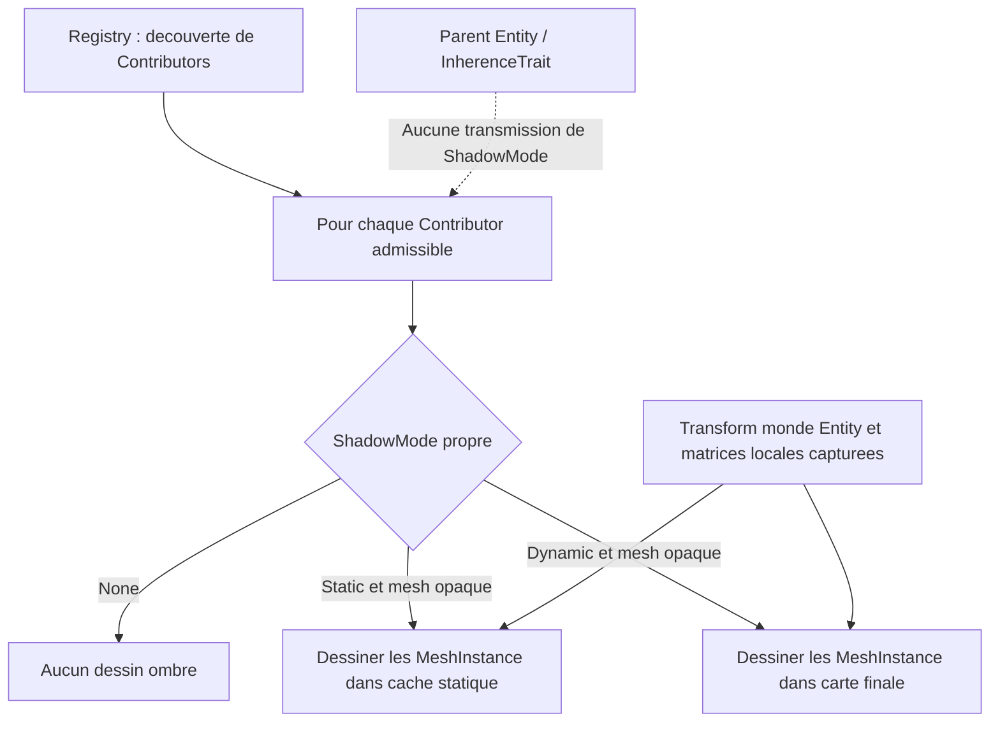
**Cache de profondeur statique et carte finale.** Pour chaque combinaison **`EngineView` × lumière projetant des ombres**, l'infrastructure graphique distingue **un cache statique** (caster opaques classés statiques) et **une carte finale** (utilisée par l'éclairage Forward+). Les deux ressources ont la même topologie : **deux textures de profondeur 2D** pour une directionnelle ou un spot ; **deux cubemaps de profondeur à six faces chacune** pour une ponctuelle. Ces cibles ne sont jamais partagées entre lumières. Les géométries opaques classées dynamiques ne sont pas dessinées dans le cache statique. Ces deux catégories sont des **politiques de mise à jour des ombres**, et non une nouvelle classification de transparence ; les translucides ne projettent toujours pas d'ombres. **La classification dépend exclusivement du `ShadowMode` propre de chaque `ShadowMap::Contributor`, sans recherche ni priorité d'ancêtres.** Les notifications vont de la source de caster au **`ShadowMap::RenderingSystem` par contrat RAII**, et celui-ci invalide **ses propres caches** par vue/lumière ; aucune invalidation ne transite par `EngineView`. Aucun identifiant persistant par groupe n'est requis. La portée exacte des événements, les règles d'appartenance vue/Contributor et le suivi des générations restent à préciser ; aucune détection implicite du mouvement.

**Actualisation à la demande, par invalidation :**
- **Tout changement effectif de `ShadowMode` sur `ShadowMap::Contributor` invalide automatiquement statique + finale par notification directe au `ShadowMap::RenderingSystem`.** Une valeur inchangée ne notifie pas ; le dessin GPU intervient ultérieurement, jamais dans le setter.
- Lorsqu'une contribution **statique** change ou lorsque la carte statique n'a encore jamais été construite, la partie statique est invalidée. Au prochain rendu **autorisé par le budget de reconstructions lorsqu'il s'agit d'une PointLight**, Sparkle redessine **uniquement les casters statiques** dans la carte statique, puis invalide et reconstruit la carte finale. Si aucune unité de budget n'est attribuée, la PointLight peut réutiliser la dernière carte finale complète et ses matrices tant qu'elle est sélectionnée et que ses ombres sont activées ; sans carte complète, elle éclaire sans ombre.
- Lorsqu'une contribution **dynamique** change (ajout, retrait, position, géométrie ou toute modification affectant sa projection), seule la **carte finale** doit être reconstruite : **copie de la profondeur statique valide dans la carte finale, puis dessin des casters dynamiques** avec depth test et depth write activés. Les casters statiques ne sont pas redessinés pour ce changement.
- Une modification de la **lumière ou de sa projection**, de la région couverte ou de la définition/version des cibles qui affecte les deux cartes invalide **les deux**. La carte statique est reconstruite en premier, puis la finale.
- Tant que les cartes restent valides, **aucune copie ni nouveau dessin d'ombres n'est exigé** pour cette combinaison vue/lumière/surface. Une image finale valide demeure consultable par les dessins opaques et translucides de la vue.

**Combinaison de profondeur.** Les deux ressources d'une lumière utilisent **la même projection** (pour une ponctuelle, le même ensemble des six projections) et des dimensions, formats de profondeur et conventions compatibles. Pour une cubemap, la copie et les tests de profondeur sont réalisés pour chaque face, sans copie entre faces ou lumières. La reconstruction finale **copie la profondeur** du cache statique vers la cible finale (opération GPU de copie/blit adaptée), puis rend les objets dynamiques dans cette cible. Le test de profondeur réalise alors l'occlusion par le plus proche fragment opaque des deux catégories. **Les shaders d'éclairage Forward+ n'échantillonnent que la carte finale, 2D pour un spot/directionnelle ou cubemap pour une ponctuelle** : aucun second échantillonnage statique/dynamique ni atlas d'ombres regroupant plusieurs lumières n'est prescrit. Le support d'une copie de profondeur compatible doit être vérifié ; aucune copie entre fenêtres n'est autorisée et un contexte/cible incompatibles déclenchent `spk::Exception` plutôt qu'un fallback silencieux.

**Isolation des surfaces et des snapshots.** Les `Light::ShadowResult` sont publiés séparément pour chaque surface dans le Channel de la vue. Une reconstruction sur la surface A ne met jamais à jour la carte sur B. Les `RenderSnapshot` sont immuables et peuvent être exécutés sur deux surfaces ; le slot est acquis au moment du dessin. Les ressources GPU logiques référencées survivent à la publication suivante selon les mécanismes existants de `GPUResourceCollection` ; la fermeture de surface invalide les publications locales. Une ancienne génération peut éclairer avec ses **anciennes matrices** tant que la sélection et `castShadows` l'autorisent.

### 7.4 Composants lumineux, cubemaps et budgets

Les **caméras et les lumières sont représentées par des composants spécialisés dérivant de `spk::Component3D`**, attachés aux `Entity3D` existantes. Leur position et leur orientation dans le monde proviennent des **`Transform3D` des entités qui les portent** : il n'existe pas de seconde hiérarchie de transformations dédiée aux caméras ou aux lumières. Ces composants appartiennent à l'Engine concerné et sont découvrables par ses mécanismes de Registry, comme les autres composants du moteur.

**Types et paramètres lumineux.** `spk::Light::Contributor` est un composant 3D attachable portant couleur, intensité, poids de priorité individuel, activation des ombres et notifications. `spk::Light::Point`, `spk::Light::Spot` et `spk::Light::Directional` l'étendent. Les Transform3D des Entity3D parentes déterminent leurs positions et axes ; aucune hiérarchie de transform spécifique aux lumières n'est créée. `Directional` est une direction globale sans atténuation de distance. `Point` émet omnidirectionnellement, `Spot` dans un cône fini. Les ombres de Point sont initialement désactivées et activables explicitement ; celles de Spot et Directional sont activées par défaut et désactivables. Le mode d'un caster `ShadowMap::Contributor` reste indépendant des paramètres de la lumière.

**Seuil unique d'influence lumineuse.** Sparkle définit une **unique constante `E_min` strictement positive** correspondant au seuil minimal d'éclairement retenu pour les lumières locales. Sa valeur numérique n'est pas fixée. Avec une loi d'atténuation `1/d²` et des unités compatibles, le rayon de portée vaut `R = sqrt(intensity / E_min)`. Si une autre loi d'atténuation est retenue, son inverse donnera la portée correspondante. Le poids de priorité n'influence pas ce rayon et ne modifie pas l'intensité effectivement utilisée dans les shaders.

**Volumes précalculés.** `Light::Point` conserve une sphère décrite par centre et rayon : le rayon est calculé à la construction et **uniquement lors d'un changement d'intensité ou de paramètres d'atténuation** ; le mouvement de l'Entity ne change que le centre monde. `Light::Spot` conserve de même la portée, l'ouverture et la géométrie locale du cône, ainsi qu'une **sphère englobante conservative**. Le rayon et les paramètres de cette sphère sont recalculés à la construction puis aux changements d'intensité, d'ouverture ou de portée, et non pendant chaque classement ; une translation/rotation met à jour seulement la position et direction monde.

**Frustum et test sphère.** Les six plans normalisés du frustum caméra sont calculés à la capture de la vue, sans recalcul par lumière. Pour un plan de normale unitaire `n` orientée vers le volume intérieur et de constante `D`, une sphère de centre `C` et rayon `R` est exclue si `dot(n,C) + D < -R`. Il suffit qu'un seul plan rejette la sphère pour donner un score nul. Les faux positifs conservateurs sont admis ; un volume réellement intersectant n'est jamais rejeté.

**Frustum et test cône du Spot.** Le spot applique d'abord **le test de sa sphère englobante**, plus léger ; seul un candidat survivant subit le test de son **cône fini**. Pour chaque plan unitaire `(n,D)`, un cône de sommet `A`, d'axe unitaire `u`, longueur `L` et rayon de base `r` est entièrement exclu lorsque `dot(n,A)+D+max(0,L*dot(n,u)+r*sqrt(max(0,1-dot(n,u)^2))) < 0`. Les deux tests rejettent au premier plan excluant entièrement le volume. Ils représentent un pré-filtrage conservateur, sans calculer le volume d'intersection ni un coefficient de recouvrement. La sphère est moins chère par plan, mais le gain réel du filtrage en deux étapes dépend des scènes et doit être mesurable.

**Formules de priorité par type.** Chaque spécialisation de `Light::Contributor` calcule son score à partir de ses paramètres et du frustum/caméra capturés. Pour `Point` et `Spot`, le score vaut `0` si le volume est rejeté ; sinon `P = intensity * priorityWeight / max(distanceCamera,minLightDistance)`. La borne `minLightDistance` est strictement positive, et sa valeur reste à fixer. Le poids initial vaut 1 et affecte uniquement le classement, jamais l'éclairage physique ni le rayon. Les scores sont finis, non négatifs et comparables entre types. Les `Directional` sont hors Top-N local et n'emploient pas cette distance.

**`spk::Light::Prioritizer`.** Le Prioritizer possédé par le Channel **compare les scores calculés par les types de lumières** ; il ne reproduit aucune formule géométrique. Il classe les `Point` et `Spot` à score positif dans un **Top-N partagé**, avec départage stable, et considère les `Directional` séparément. Il fournit une `shared_ptr<const Light::Selection>` immuable, conservée en cache et recalculée paresseusement après invalidation. Un mutex protège la reconstruction unique contre les appels simultanés ; les lecteurs attendent puis partagent le même résultat. Ses souscriptions RAII au Registry, aux lumières et à leurs Transforms invalident la sélection sans tri immédiat. Un changement de caméra/projection invalide la sélection de la vue concernée, tandis qu'un changement de source/Registry invalide les sélections dépendantes.

**Sélection des cartes d'ombres.** Les budgets souples X/Y/tolérance/hystérésis de cartes ponctuelles décrits plus bas s'appliquent comme une sous-sélection aux `Point` admissibles demandant des ombres. Le `ShadowMap::RenderingSystem` consomme cette sélection et les scores déjà calculés au lieu d'implémenter lui-même la formule. Cette sélection des ombres est distincte du culling GPU conservateur Tiled Forward+ par tiles.


**Projection omnidirectionnelle des PointLight.** Une `PointLightComponent` autorisée à projeter des ombres dispose pour chaque vue de **deux cubemaps de profondeur logiques à six faces chacune** : cache statique et carte finale, indépendants des autres lumières et réalisés par `Window::Surface`. Les six faces couvrent l'ensemble des directions, avec six orientations et une projection perspective carrée à **90° par face**, bornée par les plans proche/lointain adaptés à la portée de la lumière. Le `ShadowMap::RenderingSystem` choisit les seuls casters opaques qui peuvent influencer cette lumière (intersection avec son volume d'influence, puis culling facultatif par face), classe leur mode propre `Static`/`Dynamic`, et écrit les commandes de profondeur nécessaires aux faces dans **la seule RenderPass d'ombres de la vue**. Il ne parcourt pas ni ne dessine systématiquement la totalité des Entities pour chaque point light.

**Cache et consommation des cubemaps.** Le cache statique cubemap est reconstruit si invalide, puis copié **face par face** dans la cubemap finale avant le rendu des casters dynamiques lorsque la finale doit être actualisée ; une invalidation statique impose également la finale. Une invalidation dynamique ne reconstruit que la finale, en réutilisant les six faces statiques encore valides. La portée de l'invalidation peut rester **globale aux six faces de la lumière** en V0.1.4 : optimisation par face non obligatoire. L'éclairage Forward+ échantillonne uniquement la **cubemap finale**, avec une comparaison de profondeur cohérente avec la distance à la source et ses paramètres proche/lointain. Les cas spécifiques de filtrage/PCF, de couture entre faces, de biais, de résolution et de profondeur encodée restent à préciser ; **pour V0.1.4, chaque face doit pouvoir être attachée et rendue explicitement**, sans imposer de geometry shader ni de rendu layered.

**Extension de `Texture` pour les cubemaps.** Le type `Texture::Target::TextureCubeMap` existe déjà, mais `Texture::State::_synchronize()` ne sait actuellement synchroniser que `Texture2D`. Compléter **`Texture`**, sans créer de classe `ShadowCubeMap` ni de nouveau gestionnaire de ressources : une texture de cible cubemap doit pouvoir allouer et synchroniser **ses six faces carrées** en format de profondeur déjà pris en charge, sous une identité logique `GPUResource::State` et avec une instance OpenGL distincte par `Window::Surface`. Le recyclage des instances reste dans `GPUResourceCollection`, avec compatibilité de cible et resynchronisation obligatoire après réutilisation ; une ancienne profondeur recyclée n'est jamais considérée comme valide.

**Attachement de faces dans `Framebuffer`.** `Framebuffer` doit permettre de désigner explicitement **une face d'une cubemap de profondeur** comme attachment `GL_DEPTH_ATTACHMENT`, au lieu de limiter cette opération à une `Texture2D`. La face ciblée est sélectionnée par les commandes de rendu de profondeur de la lumière, et non devinée à partir d'un état global. Une cible depth-only reste valide sans attachment couleur (draw/read buffers désactivés) si le framebuffer est complet. L'API précise des opérations d'attachement reste à consolider avec les autres `RenderCommand` typées ; **aucune classe, cache ou file GPU spécifique aux cubemaps d'ombres** n'est introduit. L'extension est générique pour les usages futurs de cubemaps.

**Snapshots, générations et budget inchangés.** Lors de la construction d'un snapshot, capturer les handles forts vers les deux cubemaps et les paramètres immuables de face/projection ; une nouvelle paire après éviction ou reconstruction ne modifie jamais les textures ou attachments encore référencés par un ancien snapshot. Sur chaque surface, l'exécution OpenGL prépare/attache explicitement chaque face avant de reconstruire la profondeur correspondante, puis consomme seulement la cubemap finale valide. Les six faces forment **une unique reconstruction au regard du budget existant** (statique et finale si nécessaire). Cette extension n'ajoute ni nouveau propriétaire GPU ni mécanisme de libération différée.

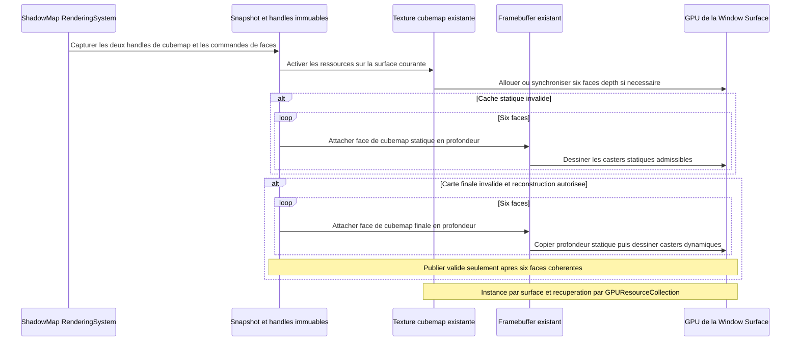


**Budget souple de sélection des ombres ponctuelles par EngineView.** Le `Light::Channel` de la vue conserve une politique X/Y/tolérance/hystérésis complémentaire au Prioritizer pour les cartes des `Light::Point` demandant des ombres. Le `ShadowMap::RenderingSystem` consomme la sélection résultante. Trois paramètres configurables structurent son budget souple :

- `targetShadowCount` (`X`) : **nombre cible** de lumières ponctuelles retenues, prioritaires par leur score.
- `maxShadowCount` (`Y`) : **limite supérieure absolue**, incluant toutes les lumières supplémentaires acceptées au voisinage du seuil. La contrainte `0 <= X <= Y` doit être validée explicitement, et les valeurs entières sont non négatives.
- `shadowPriorityTolerance` (`epsilon`) : **tolérance relative** sur le score de la **Xe lumière du classement brut**, exprimée comme fraction comprise dans `[0, 1]`. Par exemple `0.10` autorise des lumières supplémentaires jusqu'à **10 % sous** le score de référence ; le score est supposé fini et non négatif.

Les valeurs numériques par défaut et les signatures précises sont non spécifiées. `X = 0` signifie **aucune ombre ponctuelle sélectionnée**, même si `Y > 0` : en l'absence de Xe lumière, il n'existe pas de seuil de tolérance. `Y = X` reproduit un budget strict ; `epsilon = 0` autorise seulement des supplémentaires de **score égal** à la Xe. Une contrainte de `Y` n'est jamais transgressée, même lorsqu'il existe plus de lumières de score proche. Ce budget **ne limite toujours pas** le nombre de mises à jour de cubemaps par image et ne concerne pas les directionnelles/spots.

**Filtrage spatial et classement.** Les candidates sont les `Light::Point` encore sélectionnées par `Light::Prioritizer`, actives et demandant des ombres. Leur score et leur éligibilité géométrique ont déjà été calculés par `Light::Point` : sphère d'influence contre six plans, puis `intensity * priorityWeight / max(distanceCamera,minLightDistance)` pour les candidates non rejetées. `ShadowMap::RenderingSystem` n'utilise donc aucune formule propre aux lumières ; il applique la politique d'ombres complémentaires X/Y/tolérance/hystérésis aux scores déjà obtenus. Seules les candidates à score strictement positif participent.


**Sélection initiale à partir des scores.** Pour `n` candidates spatialement admissibles et triées par score brut décroissant, choisir d'abord `min(X, n)` meilleures. Si `n >= X > 0`, noter `P_X` le score de la **Xe du classement complet**, puis considérer **les suivantes dans cet ordre**. Tant que `score(candidate) >= P_X * (1 - epsilon)` et que le total retenu reste strictement inférieur à `Y`, accepter la candidate supplémentaire. Dès qu'une candidate est sous ce seuil, les suivantes du classement décroissant le sont aussi : arrêter. **Toujours comparer au score de la Xe**, jamais à celui de la dernière supplémentaire, afin d'éviter un effet de chaîne. Si `n < X`, toutes les candidates sont retenues (aucune Xe à utiliser comme référence) ; si `X = 0`, aucune n'est retenue. Les égalités de score sont départagées de manière stable, y compris lorsque le seuil et le maximum `Y` coupent un groupe d'ex æquo.

```text
target = min(targetShadowCount, eligibleCount)
referenceScore = score(sortedCandidates[targetShadowCount - 1])  // si eligibleCount >= X > 0
extraThreshold = referenceScore * (1 - shadowPriorityTolerance)
acceptExtra = score(candidate) >= extraThreshold && selectedCount < maxShadowCount
```

**Admissibilité et hystérésis.** L'ensemble des lumières **admissibles** est déterminé **avant toute hystérésis** : il comprend toujours les `min(X, n)` meilleures candidates spatialement éligibles (**socle cible**) et, seulement si `n >= X > 0`, les suivantes dont le score brut vérifie `score >= P_X * (1 - epsilon)` (**supplémentaires admissibles**). La tolérance est un **critère strict d'admission** pour les supplémentaires : une lumière précédemment retenue, mais sortie de cette plage, perd **immédiatement** son droit à une shadow map, même si l'hystérésis aurait empêché son remplacement. Aucune source hors de l'ensemble admissible ne peut être protégée par l'hystérésis. Le maximum absolu `Y` demeure intangible.

La politique de sélection d'ombres ponctuelles du `Light::Channel` conserve, **pour cette EngineView**, l'ensemble des `Light::Point` retenues lors de la précédente capture ; la mémoire d'hystérésis appartient au Channel, pas à `ShadowMap::RenderingSystem` ni directement à la vue. **Les X meilleures candidates admissibles sont toujours retenues**, sans être bloquées par une ancienne lumière supplémentaire : la cible demeure prioritaire. L'hystérésis ne concerne **que les remplacements entre lumières supplémentaires encore admissibles** lorsque les places au-delà des X premières sont pleines (jusqu'à `Y-X`). Une lumière supplémentaire nouvelle ne peut évincer une supplémentaire précédente toujours admissible que si son score dépasse **strictement** celui de la retenue selon le seuil proportionnel configurable :

```text
score(candidate) > score(incumbent) * (1 + shadowSelectionHysteresis)
```

- `shadowSelectionHysteresis` est un **taux fractionnaire** configurable pour la sélection d'ombres ponctuelles de la vue (par exemple `0.10` représente **10 %** d'avance requis) ; il est **fini et supérieur ou égal à zéro**. **Sa valeur par défaut et sa forme d'API restent à décider.** Un taux nul supprime la marge proportionnelle mais laisse l'obligation de dépasser strictement le score pour évincer une lumière encore éligible.
- **Ordre du calcul :** classer par score brut décroissant (égalité départagée par identité stable), construire le socle des X meilleures, calculer `P_X`, puis déterminer **toutes** les supplémentaires admissibles par le seuil fixe (sans troncature préalable à `Y`). Éliminer immédiatement les retenues précédentes sorties de cet ensemble, qu'elles soient désactivées, supprimées, hors d'influence ou passées sous le seuil de tolérance. Les retenues historiques désormais entrées dans les X meilleures appartiennent directement au socle.
- **Premier classement ou places supplémentaires libres :** retenir obligatoirement le socle des X meilleures, conserver les **supplémentaires précédemment retenues encore admissibles** tant que le maximum le permet, puis remplir les places libres avec les meilleures nouvelles supplémentaires, **sans appliquer l'hystérésis aux places vacantes**. Il est inutile de refuser une nouvelle supplémentaire si une place libre existe sous `Y`.
- **Plafond `Y` atteint :** une candidate supplémentaire **elle-même admissible** peut remplacer la **moins bien classée des seules supplémentaires retenues**, pas une des X lumières du socle, si et seulement si son score vérifie l'inégalité stricte d'hystérésis. Répéter cette comparaison dans l'ordre des nouvelles candidates décroissantes, en gardant `Y` absolu. Les supplémentaires sorties de la tolérance ne sont **jamais comparées** : elles ont déjà perdu leur place. Lorsque `X = Y`, aucune place supplémentaire n'existe ; le socle des X meilleures est sélectionné sans hystérésis.
- **Cas limites :** pour un score retenu nul, seule une nouvelle supplémentaire de score strictement positif peut l'évincer ; deux scores nuls ne provoquent aucun échange par hystérésis. Les scores nuls sont éliminés avant ce budget : si une Xe candidate existe, son score de référence est strictement positif. Si `X = 0`, ne sélectionner aucune lumière ponctuelle ; si `n < X`, sélectionner les `n` candidates ; si `X = Y`, ne sélectionner que le socle, sans marge supplémentaire. Si les paramètres `X`, `Y` ou `epsilon` changent, **recalculer d'abord l'admissibilité** : supprimer les retenues devenues interdites, puis appliquer l'hystérésis uniquement entre les supplémentaires toujours admissibles. Lorsque `Y` baisse, garder le socle et retirer en priorité les supplémentaires aux plus faibles scores (égalité stable). Les scores/coefficients et taux doivent respecter leurs contraintes de finitude et de signe.

**Ordre de précédence entre tolérance et hystérésis.** La tolérance **délimite l'admissibilité** et prime toujours l'hystérésis. Une ancienne supplémentaire passée sous le seuil `P_X * (1 - epsilon)` est retirée **à la capture suivante** sans protection historique, même si son score reste proche de celui d'une autre supplémentaire ; elle continue d'éclairer via Forward+ **sans ombres**. À l'inverse, une ancienne supplémentaire toujours dans la plage admissible peut résister à une nouvelle supplémentaire marginalement mieux classée **si les places supplémentaires sont pleines**, sans jamais dépasser `Y`. Cette stabilité de l'historique n'empêche pas l'admission obligatoire des X meilleures. L'absence de place sous `Y` ne permet aucun dépassement, même si beaucoup de lumières ont exactement le score `P_X`.

**Portée et diagnostic.** L'hystérésis limite **les changements de membership**, et non le classement ou les intensités des sources d'éclairage Forward+ ; une `PointLight` moins bien classée mais conservée grâce à l'hystérésis continue à projeter une ombre valide. Une candidate bloquée par le seuil de tolérance, le maximum `Y` ou l'hystérésis reste **observable** comme `ombres demandées mais non sélectionnées`, avec une raison distinguant `hors tolérance`, `plafond atteint`, `remplacement évité par hystérésis` et `ombres désactivées explicitement`. Toute capture encode la sélection et les références de cartes d'ombres de façon **immuable** ; aucun changement de sélection n'est fait par le thread de rendu GPU. Les mêmes données d'entrée **et le même état antérieur de sélection** entraînent le même résultat ; l'hystérésis signifie qu'une sélection peut dépendre intentionnellement de l'historique. Le culling des `ShadowMap::Contributor` reste distinct du classement Forward+.

**Éviction des caches de PointLight.** Dès qu'une `PointLight` **sort de l'ensemble retenu pour une `EngineView`** après classement, tolérance et hystérésis, le `ShadowMap::RenderingSystem` **retire immédiatement de son registre de caches actifs la paire logique statique/finale associée à cette vue et à cette lumière**, y compris ses réalisations par `Window::Surface`. Cette éviction vise aussi les sorties par désactivation des ombres, disparition de la lumière, exclusion spatiale ou abaissement de `X/Y` ; elle concerne la **perte de sélection pour une vue**, et non la simple attente d'une reconstruction GPU pour une lumière **encore retenue**. Une même `PointLight` retenue dans une autre vue garde **indépendamment** ses caches pour cette autre vue. Une variation temporaire de score ne doit pas laisser un cache invisible dans le système actif.

**Cycle de vie des caches d'ombres et des instances GPU.** La sortie d'une PointLight de la sélection retire immédiatement ses caches logiques actifs de `ShadowMap::RenderingSystem`. Le système relâche ses références à la paire statique/finale, sans détruire directement les objets OpenGL. Les `GPUResource::Handle` des `RenderSnapshot` antérieurs conservent par `shared_ptr` les `GPUResource::State` capturées, sans modifier rétroactivement la version de profondeur.

À la disparition du dernier propriétaire d'une `GPUResource::State`, son `LifeTime` signale la libération à la `GPUResourceCollection::ReclamationQueue` des surfaces abonnées. `Application::RenderRuntime::tickOnce()` appelle `reclaimReleased()` ; les instances `Texture`, `Framebuffer` et `Buffer` rejoignent normalement les pools natifs de leur surface, tandis que les instances non recyclables sont détruites. Une instance mise en pool peut **rester allouée en VRAM** ; sa mise en pool n'est pas une conservation de cache d'ombres et elle ne rend pas réutilisable l'ancienne profondeur. À l'activation d'une nouvelle `GPUResource::State`, une instance native compatible peut être recyclée **après resynchronisation**, jamais comme une carte d'ombres valide sans nouveau rendu.

**Contexte OpenGL requis pour la récupération.** Le runtime de rendu garantit le contexte courant de la bonne `Window::Surface` avant toute récupération/destruction native, **même lors d'un tick sans nouveau rendu** et lorsque plusieurs surfaces sont utilisées. L'implémentation existante de `tickOnce()` appelle `reclaimReleased()` après un chemin de rendu conditionnel ; ce contrat doit être assuré dans le runtime graphique générique. La fermeture de surface vide les instances de la collection avec son contexte valide. Aucune file d'éviction `ShadowMap` supplémentaire, aucun pool de cartes dormantes, aucun LRU d'ombres et aucun `GLsync` dédié ne découlent de ce contrat ; les dépendances de commandes GPU restent correctement ordonnées sur chaque contexte.

**Réadmission et budgets.** Une `PointLight` revenant dans la sélection de la vue est traitée **comme une première admission pour les ombres de cette combinaison** : elle crée une **nouvelle paire logique statique/finale**, avec **générations distinctes**, et les réalisations GPU nécessaires par surface sont invalides jusqu'à reconstruction complète. La nouvelle paire **ne réutilise jamais l'ancien couple de State/Handle ni les données de profondeur** : elle peut toutefois acquérir **une instance OpenGL native recyclée via GPUResourceCollection** lorsqu'elle est disponible et compatible, après synchronisation avec le nouvel état. Sa reconstruction consomme **une unité du budget par image et par `Window::Surface`** suivant la priorité stricte validée, que la précédente paire ait été entièrement statique ou non ; si le budget est épuisé, la lumière éclaire sans ombre jusqu'à actualisation. Les valeurs `targetShadowCount/maxShadowCount/shadowPriorityTolerance`, l'hystérésis de sélection et le score restent inchangés par cette règle d'éviction. Une destruction/recréation de `EngineView` ou de `PointLight` ne peut pas ressusciter des caches rattachés à une ancienne identité.

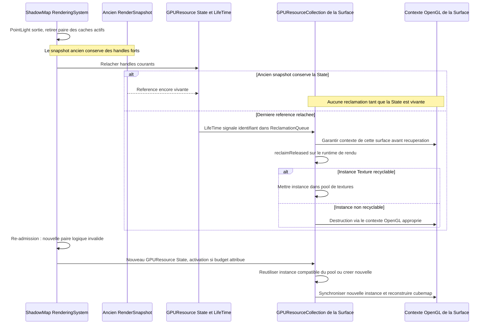


**Éclairage et observabilité.** Les lumières ponctuelles **écartées par le budget cible, la tolérance, le plafond absolu ou l'hystérésis continuent d'éclairer via Forward+ sans ombre**. Seules les lumières sélectionnées ajoutent des opérations de cubemap à l'**unique `RenderPass` d'ombres de la vue**. L'éclairage ne doit jamais échantillonner une carte périmée d'une lumière non sélectionnée, même si la ressource GPU existe encore. L'exclusion `ombres demandées mais refusées par budget` doit être **observable** (statut par vue/lumière et raison ou diagnostic équivalent) et distincte de `ombres désactivées explicitement`. Pas de journalisation répétée par lumière et par frame non sollicitée.


**Budget de reconstruction de cubemaps.** Le sous-système autonome `ShadowMap::RenderingSystem` expose une configuration **non négative** limitant, pour chaque **image rendue sur une `Window::Surface`**, le nombre d'**instances de cubemap ponctuelle à reconstruire** (nom indicatif : `maxPointShadowRebuildsPerImage`). Il s'agit d'un **compteur unique à la surface et à l'image**, partagé entre **toutes les `EngineView` effectivement dessinées dans cette image sur cette surface** ; ce n'est ni un compteur par EngineView, ni une modification de `targetShadowCount`/`maxShadowCount`. Les fenêtres/surfaces indépendantes possèdent des compteurs distincts ; un snapshot CPU ne consomme pas le budget tant qu'il n'est pas exécuté. La valeur numérique par défaut et le mode précis de configuration restent à définir, sans créer d'API d'ombres dans `EngineView`.

**Unité atomique de reconstruction.** Une unité du budget correspond à **une paire logique statique/finale pour une combinaison (EngineView, PointLight) sur la surface**, lorsqu'au moins une carte doit être mise à jour. Si seule la finale est invalide, la reconstruction de la finale et ses six faces coûte **une unité** ; si la statique et la finale sont invalides, reconstruire la statique, copier chaque face puis reconstruire la finale constitue **une unique unité**. Les **six faces** ne sont pas comptées individuellement et aucune carte finale **partiellement remise à jour** ne peut être publiée comme valide. Une paire entièrement valide ne coûte **aucune unité** et sa shadow map demeure disponible, même si le budget de reconstructions est épuisé. Les images où le budget vaut zéro peuvent donc continuer à afficher **les ombres déjà valides** sans aucune reconstruction.

**Priorisation stricte des reconstructions.** Le système considère uniquement les `PointLight` **déjà retenues** par le budget souple propre à chaque vue. Il examine leur validité **spécifique à la surface** et classe **toutes les reconstructions nécessaires par le score brut de priorité déjà validé** (score brut déjà calculé par `Light::Point`), **strictement décroissant**, pour chaque image et chaque surface. Pour un même score, le départage est **déterministe** par identité stable de la vue puis de la lumière (ou clef équivalente), jamais selon l'ordre accidentel du Registry. **Aucun bonus lié à l'attente**, aucune ancienneté de demande, priorité croissante avec les frames différées, rotation round-robin, quota de rattrapage ni garantie de délai maximal de reconstruction : une demande moins prioritaire peut légitimement **rester différée indéfiniment** si des demandes plus prioritaires occupent le budget à chaque image. Ce comportement est voulu et observable, sans changement du score utilisé pour choisir les lumières ombrées par `EngineView`.

**Réévaluation à chaque image.** Les demandes dont les caches restent invalides et qui ont été différées **tant que leur PointLight reste sélectionnée** sont **réévaluées à la prochaine image réellement rendue sur cette surface**, avec le score de cette image et la nouvelle validité de leurs caches ; aucune file FIFO ni compteur d'attente persistants ne sont nécessaires. Une lumière perdant sa place est évincée de la liste des demandes et du cache actif, plutôt que maintenue en attente. Les lumières désormais valides n'entrent plus dans la liste de reconstructions ; celles dont l'intensité, le poids ou la distance caméra ont changé peuvent changer de rang immédiatement. La liste des demandes de **toutes les vues dessinées sur cette surface** est classée **avant** d'accorder les unités du budget commun, y compris si une vue à plus haute priorité est rendue plus tard dans l'ordre des vues établi. Le plan utilise les captures immuables et l'état de ressources propre à la surface, **sans modifier l'ordre des vues ni introduire un ordonnanceur de passes général**, sans accéder aux Entities mutables sur le thread GPU. Une paire (vue, lumière, surface) reconstruite une fois dans l'image ne consomme pas deux unités lors de son éventuelle réexécution. Les détails de synchronisation inter-vues et inter-snapshots restent à préciser, mais **aucune équité implicite entre vues** ne doit renverser le score brut. La même lumière peut être prioritaire pour une vue et moins prioritaire pour une autre en raison de leurs caméras distinctes.

**Report et diagnostic.** Une reconstruction différée par manque de budget reste candidate au rendu suivant, sans bonus d'attente. Tant que la `Point` demeure sélectionnée et que ses ombres restent activées, `Lighting::System` peut continuer à échantillonner **sa dernière carte complète publiée avec ses anciennes matrices** ; si aucune carte n'existe, la lumière éclaire sans ombre. La désélection, la désactivation ou la destruction de la lumière interdit toute réutilisation de cette carte. Les diagnostics distinguent l'exclusion de sélection, le budget différé avec ancienne carte disponible et l'absence de carte utilisable.

**Générations.** Une reconstruction peut être publiée même si sa capture est devenue obsolète, mais jamais si une génération plus récente de cette même lumière est déjà publiée sur cette surface. Le `ShadowResult` est publié par fusion incrémentale, sans remplacer les autres lumières. Les six faces d'une Point sont atomiques. Chaque nouvelle ressource logique GPU garde ses propres matrices et génération ; les anciennes sont recyclées seulement par `GPUResourceCollection`.


**Autres lumières et sécurité d'exécution.** Les ombres des **spots et directionnelles** suivent leur politique de cache déjà établie et ne consomment pas les unités du budget réservé aux cubemaps ponctuelles. Le budget est consommé **au rendu effectif d'une image par surface**, pas lors de `refreshRenderSnapshot()`, avec génération/validité vérifiées à l'exécution GPU sur la surface, tout en conservant les captures et les handles des `RenderSnapshot` immuables. Les snapshots anciens encore en vol doivent rester exécutables sans état mutable de gameplay ni altération des ressources qu'ils référencent : réutilisation de caches obsolètes, recomptage abusif d'une même paire et état de budget partagé par erreur entre surfaces sont interdits. Le nombre de faces actualisées par unité n'est pas un paramètre supplémentaire de cette décision.

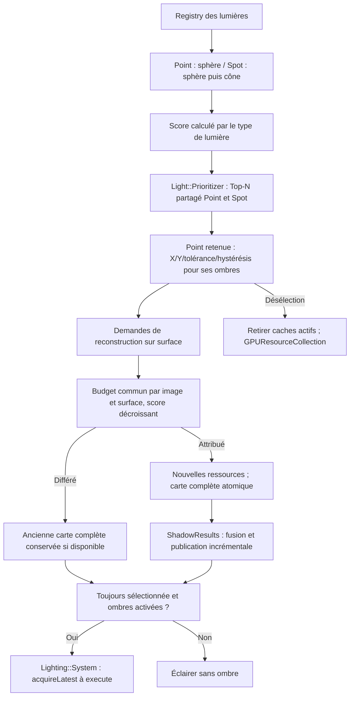


**Projection des ombres directionnelles :** chaque lumière directionnelle ayant les ombres activées utilise **une seule shadow map de profondeur pour le rendu concerné**, représentant une région pertinente pour celui-ci. Il n'y a **ni Cascaded Shadow Maps (CSM), ni subdivision obligatoire du frustum en plusieurs cascades**, ni atlas de cascades pour une même lumière directionnelle dans V0.1.4. Cela n'interdit pas plusieurs lumières directionnelles, chacune avec sa propre carte pour un rendu donné. En présence de plusieurs EngineView, aucune mutualisation des shadow maps n'est exigée en V0.1.4 : chaque vue peut préparer les siennes indépendamment. Le choix d'une seule carte par lumière directionnelle dans une vue n'impose aucune cache inter-vues. La définition de la région couverte, des matrices de projection d'ombre, de la résolution, du biais et de la fréquence de rafraîchissement reste à finaliser ; ne pas inventer de couverture mondiale infinie ni de mécanisme de sélection automatique des cascades. Le contrat des ombres des spots sera précisé séparément.

**Flux complet d'un modèle voxel jusqu'aux commandes par vue.** Les données métier sont créées indépendamment du thread GPU. Le bake sépare les meshes opaques et translucides ; le rendu réunit les composants actifs par vue, tandis que les casters utilisent un chemin de capture distinct.

```mermaid
flowchart TD
    Shape["Voxel::Shape : polygones et slots"] --> Definition["Voxel::Definition : association des slots"]
    Definition --> Volume["Voxel::Volume : Cells orientees et donnees immuables"]
    Volume --> Mesher["VoxelMesher : bake du Volume"]
    Occlusion["OcclusionCache optionnel"] -.-> Mesher
    Mesher --> Model["Voxel::Model : meshes et slots semantiques"]
    Model --> Opaque["Mesh opaque"]
    Model --> Translucent["Mesh translucide"]
    Model --> ShadowDepth["ShadowMap::Mesh : positions + indices"]
    Material["Material : textures nommees et UV"] --> Palette["VoxelPalette : materials par slot"]
    Model --> Assembly["Assembly : parties et transforms locales"]
    Palette --> Assembly
    Model --> ModelComp["ModelRenderingComponent : references empruntees"]
    Palette --> ModelComp
    Assembly --> AssemblyComp["AssemblyRenderingComponent : reference empruntee"]
    ModelComp --> VR["VoxelRenderingSystem : filtrage par vue et layers"]
    AssemblyComp --> VR
    Opaque --> VR
    Translucent --> VR
    VR --> Buckets["Buckets : mesh, atlas et material compatibles"]
    Buckets --> SSBO["SSBO instances et materials du snapshot"]
    SSBO --> Draw["DrawVoxelBucketCommand avec handles captures"]
    Draw --> Forward["Passe opaque Forward+"]
    Draw --> WBOIT["Passe translucide WBOIT"]
    ShadowDepth -->|"copie partagee"| MeshPart["MeshInstance : Mesh + matrice locale"]
    Assembly -->|"Composer matrices Parts relatives a Assembly"| MeshPart
    AssemblyMatrix["Matrice Assembly relative a Entity"] -->|"appliquer avant toutes les Parts"| Caster["ShadowMap::Contributor : MeshFilter"]
    MeshPart -->|"bind(collection, assemblyMatrix) : remplacement complet"| Caster
    Caster --> Shadow["ShadowMap::RenderingSystem : caches ombres"]
    Shadow --> Out["Light::ShadowResults : slot de la surface, entrées par lumière"]
    Out --> SurfaceCheck["Lighting : acquireLatest et filtrage de sélection"]
    SurfaceCheck -->|"Valide ou sans ombre"| Forward
    SurfaceCheck -->|"Valide ou sans ombre"| WBOIT
```

Les liaisons depuis `Model` et ses **meshes visuels** vers le rendu représentent la **géométrie du modèle emprunté**, et non la possession des objets par `VoxelRenderingSystem`. Un `ShadowMap::Contributor` est distinct des composants de rendu visuel ; il n'est jamais créé automatiquement par ce flux. Le mesh d'ombre du Model doit aussi être **lié explicitement** à un Contributor. Le `MeshFilter` détient une collection de `MeshInstance` dont les meshes partagent leurs données immuables et dont les matrices locales sont des valeurs. Pour une `Assembly`, le jeu compose les matrices des Parts **relatives à l'Assembly**, et fournit la **matrice commune de l'Assembly relative à l'Entity** à `bind(collection, assemblyMatrix)` après chaque nouvelle pose ou changement de la matrice commune. Le résultat suit `M_entityWorld * M_assembly * M_partLocal` sans double application des transformations. La matrice commune peut changer sans remailler ou recalculer les transformations locales des Parts ; aucune fusion géométrique ni notification automatique par l'Assembly n'est introduite.

### 7.5 SSBO d'instances

Pour **chaque bucket non vide produit dans une vue et un RenderSnapshot**, le système crée un **nouveau `spk::ShaderStorageBuffer` d'instances**, écrit la totalité de ses données compactes et appelle sa validation (`validate()`) conformément au fonctionnement existant des ressources Sparkle.

Les occurrences d'un bucket sont toujours **contiguës et sans trous**. La disparition d'une instance à la frame suivante revient simplement à ne pas la recollecter. Aucun stockage persistant `InstanceID → offset`, swap-and-pop entre frames, dirty range, update partiel de buffer, commande de mise à jour d'une occurrence ou double buffering explicite de SSBO n'est requis.

Chaque commande conserve le **handle du SSBO propre à son snapshot** : un snapshot plus récent ne peut pas altérer le contenu des buffers d'un snapshot encore exploité. Le coût d'allocation et d'upload intégral, même en l'absence de changement, est accepté comme compromis de simplicité. Cette politique **ne rebake jamais** un Model chaque frame.

### 7.6 SSBO des matériaux par couple `Model`/`VoxelPalette`

La palette publique ne contient **aucun état GPU mutable**. Pour chaque couple `Model`/`VoxelPalette` réellement employé par le snapshot, le rendu construit un SSBO de matériaux **dans l'ordre des slots sémantiques du Model**.

La correspondance entre les **noms de slots** du Model et ceux de la palette est résolue **sur CPU**. Le shader peut ensuite accéder directement à son matériau par `MeshVertex::materialIndex`, **sans table d'indirection GPU**. Les slots supplémentaires de la palette n'ont pas à être encodés dans le SSBO adapté au Model. Les slots du Model sans triangles visibles restent pris en compte dans l'ordre et la validation du couple.

Les commandes utilisant le **même couple compatible** à l'intérieur d'un même snapshot, **y compris dans plusieurs vues de la même fenêtre**, peuvent partager ce SSBO si les paramètres de matériaux restent identiques. La table temporaire de mutualisation disparaît après la préparation du snapshot ; **aucun SSBO de matériaux n'est réutilisé entre deux snapshots**. Une même palette employée avec des Models différents peut nécessiter des dispositions de SSBO différentes. Deux palettes distinctes d'un même Model ne sont pas fusionnées dans un draw si leurs `materialIndex` auraient des interprétations différentes.

### 7.7 Buckets et commandes de dessin

Le `BucketKey` distingue toutes les ressources ou états qui doivent rester identiques au cours d'un dessin instancié : **vue et passe de rendu**, mesh, atlas `albedo`, représentation de matériaux adaptée, et éventuels autres bindings nécessaires au pipeline réel. La caméra, la profondeur et la destination GPU d'une vue ne doivent jamais être confondues avec celles d'une autre. Des géométries de Models différents ne sont **pas fusionnées automatiquement** parce qu'elles utilisent le même atlas.

Un `DrawVoxelBucketCommand` est un `RenderCommand` qui conserve les handles/ressources de mesh, de SSBO d'instances, de SSBO de matériaux et de textures nécessaires à l'exécution. Il n'emprunte aucune donnée d'Assembly mutable pendant son `execute(RenderContext&) const`. La gestion existante des ressources GPU de Sparkle assure que les handles capturés sont utilisables jusqu'à la fin effective de leur usage GPU, sans réutilisation anticipée d'un State appartenant à un ancien snapshot.

Une association compatible emploie au plus **un atlas `albedo` par mesh/passe**, permettant **un draw instancié par mesh non vide et par bucket compatible**, hors éventuelles passes graphiques complémentaires. Les occurrences présentant des mappings ou états de rendu incompatibles restent séparées.

### 7.8 Pipeline Forward+, opaque et WBOIT

**Éclairage Forward+ — A4, choix de découpage validé.** Le rendu 3D générique conserve le *Forward shading* : l'éclairage est calculé dans les shaders de chaque surface opaque ou translucide, **sans G-buffer** ni éclairage différé. La sélection GPU des lumières emploie **Tiled Forward+ : une grille 2D couvrant l'écran de chaque `EngineView`**, sans partitionnement supplémentaire en tranches de profondeur et **sans clustered Forward** en V0.1.4. Chaque tile détient (ou référence) une liste de lumières locales potentiellement pertinentes ; les shaders opaques et translucides réutilisent la **même sélection conservative** pour les pixels de cette tile, sans parcourir systématiquement toutes les lumières de l'Engine. Les dimensions numériques des tiles, la représentation des listes GPU et leur comportement en cas de capacité insuffisante **restent à préciser dans A4** ; ils ne sont pas déduits de cette seule décision de découpage.

**Culling de l'éclairage sur une tile 2D.** Les lumières du Registry sont capturées sous forme de données **CPU immuables** (positions/directions, portée, cône, intensité et activation). Une tile représente une région rectangulaire de l'écran de la vue et **l'ensemble du domaine de profondeur utile de sa caméra**, y compris les profondeurs où aucun fragment opaque n'est dessiné. Le culling GPU retient conservativement les lumières locales dont le volume d'influence **peut** intersecter ce volume 3D de tile : **ponctuelles** (sphère de portée), **spots** (volume/cone de portée). Les approximations d'intersection sont autorisées à conserver trop de lumières, **jamais à exclure une lumière effectivement pertinente** ; aucune restriction aux seuls intervalles min/max de profondeur opaque n'est permise. Les **directionnelles** restent des contributions globales, sans faux culling local. Les listes et indices GPU sont ensuite consommés **sans recalcul de sélection dépendant de la profondeur opaque** par les shaders opaques et translucides. **Ce culling de lumières pour l'éclairage reste distinct du culling des `ShadowMap::Contributor` effectué par `ShadowMap::RenderingSystem`** pour fabriquer les ombres. Sélectionner une lumière pour un fragment n'impose ni shadow map ni dessin de caster.

**Repère de la tile et invariants du découpage (A4).** Chaque `EngineView` détermine une grille 2D à partir de sa résolution de rendu explicitement configurée. La tile d'un fragment est trouvée à partir de **ses coordonnées écran dans cette vue**, jamais d'une fenêtre globale ; la même règle s'applique aux fragments opaques et aux fragments WBOIT. Les dernières tiles peuvent être partielles et ne doivent accéder ni à des pixels ni à des indices de lumière hors des limites de leur vue. Une perspective comme une caméra orthographique utilisent **leur propre volume de couverture caméra** sur toute la plage de profondeur utile représentable pour cette vue ; la description d'une tile doit recouvrir ce volume, sans dépendre de la géométrie opaque. La taille numérique de tile n'est **pas encore approuvée**, de même que la capacité et la politique de dépassement des listes GPU. Modifier explicitement la résolution d'une vue entraîne la reconstruction des paramètres et buffers de grille nécessaires sur chaque surface ; les instances déjà capturées par des snapshots en vol restent intactes. La sélection des lumières locales peut retenir des faux positifs pour faciliter le test d'intersection, sans faux négatif pour les fragments éclairables. Les ombres d'une lumière sont **orthogonales** à la liste de tile : une lumière sélectionnée pour l'éclairage conserve son énergie même si son `Light::ShadowResult` est indisponible.

**Pipeline GPU de la tile (A4).** Le snapshot capture les caractéristiques immuables de la vue, les paramètres des lumières et la liaison au `Light::Channel`. À l'exécution par une `Window::Surface`, les commandes préparent ou réutilisent des buffers GPU **propres à la surface et à la version de la vue**, exécutent le culling 2D, puis appliquent les barrières mémoire nécessaires avant les dessins opaques et translucides. Les deux passes lisent une sélection cohérente pour le même snapshot et la même surface. Le schéma mémoire des listes (fixe ou compact), le dispatch précis, les bindings, les barrières et le comportement lors d'un overflow sont à définir au niveau A4/T7 ; ni un culling au CPU, ni un passage implicite aux clusters 3D, ni la suppression silencieuse d'une lumière ne sont autorisés. Les lumières directionnelles sont prises en compte globalement et leur éventuelle liste spéciale reste une adaptation technique compatible avec le contrat.
**Orchestration et ressources.** Dans chaque sous-snapshot d'`EngineView`, la préparation des données de lumière et le culling GPU des tiles 2D précèdent leurs dessins, avec des commandes ordonnées et des barrières mémoire appropriées. Le GPUResource logique est matérialisé par surface. `Lighting::System` accède au `Light::Channel` propre à la vue puis acquiert `ShadowResult` de la surface **pendant `execute()`**, après la passe de production. Chaque lumière de la liste peut échantillonner sa dernière carte finale complète, **même d'une génération précédente**, avec les matrices correspondantes, si elle demeure sélectionnée et ses ombres actives ; sinon elle reste éclairante sans ombre. Le choix de la tile n'impose ni n'interdit à lui seul la création d'une shadow map.

**Compatibilité WBOIT et couverture conservatrice (A4).** Les tiles 2D couvrent **toute la plage de profondeur utile de la caméra**, et pas uniquement les profondeurs occupées par les objets opaques. Une lumière qui n'éclaire aucun fragment opaque visible peut néanmoins éclairer un fragment translucide : **elle doit rester dans la liste de la tile** si son volume d'influence peut traverser la région correspondante. Aucun min/max dérivé exclusivement du depth opaque ne peut réduire les listes partagées. Les shaders translucides utilisent **les mêmes listes Tiled Forward+** que les opaques, dans **l'unique passe géométrique WBOIT**, sans dessin de transparence supplémentaire. Le dimensionnement du viewport par la vue, la gestion des pixels d'une tile partielle en bordure, la séparation par surface et les barrières GPU font partie de l'exécution de ce contrat. Le choix d'une capacité par tile et le comportement d'overflow restent ouverts : **aucune lumière ne doit être perdue silencieusement**, ni dans le rendu opaque ni dans WBOIT.

```mermaid
flowchart TD
  Registry["Registry des lumieres"] --> Capture["Capture CPU : donnees lumineuses immuables"]
  Capture --> Screen["EngineView : viewport et plage de profondeur camera"]
  Screen --> Tiles["Grille 2D de tiles : couverture de toutes les profondeurs utiles"]
  Capture --> GPU["GPU : culling conservateur des PointLight et SpotLight"]
  Tiles --> GPU
  GPU --> Lists["Listes par tile : memes indices pour opaque et WBOIT / surface"]
  Lists --> Opaque["Shaders opaques Forward+"]
  Lists --> WBOIT["Shaders translucides WBOIT Forward+"]
  Shadow["ShadowMap::RenderingSystem"] -->|"Culling independant des casters"| Maps["Cartes finales logiques propres a chaque lumiere"]
  Shadow -->|"Publication incrémentale"| Output["Light::ShadowResults : slot par surface, générations par lumière"]
  Maps --> Output
  Output --> Surface["Lighting : acquireLatest après la passe ombres"]
  Surface -->|"Disponible : 2D/cube ; sinon lumiere sans ombre"| Opaque
  Surface -->|"Disponible : 2D/cube ; sinon lumiere sans ombre"| WBOIT
  Opaque --> Compose["Composition scene / WBOIT"]
  WBOIT --> Compose
```

**Séquence A4 — sélection Tiled Forward+ par vue et surface.**

```mermaid
sequenceDiagram
  participant V as Capture EngineView
  participant S as Window Surface / RenderContext
  participant G as GPU Tiled Forward+
  participant O as Passe opaque Forward+
  participant T as Passe translucide WBOIT
  V->>V: figer viewport, projection et toutes les lumieres
  V-->>S: RenderSnapshot immuable de la vue
  S->>G: preparer grille 2D selon resolution de cette vue
  G->>G: tester chaque lumiere locale sur toute profondeur utile
  Note over G: Pas de min/max base seulement sur depth opaque
  G->>G: construire listes conservatives par tile
  Note over G: Overflow doit etre resolu sans perte silencieuse - A4 ouvert
  S->>G: barriere memoire avant lectures shaders
  G-->>O: listes de lumieres par tile
  O->>O: shading des fragments opaques
  G-->>T: memes listes par tile
  T->>T: shading WBOIT des fragments translucides
  Note over O,T: ShadowResult lu par surface après les ombres
```

La passe **opaque** calcule la couleur éclairée directement à partir des listes **Forward+** pertinentes, avec les tests de profondeur appropriés. Chaque lumière peut recevoir une entrée du `Light::ShadowResult` **acquis à l’exécution après la passe d’ombres**, y compris la génération précédente si elle demeure éligible, avec ses matrices d’origine. L’état de disponibilité ne vient jamais uniquement d’un booléen calculé lors du snapshot CPU. La transparence reste un traitement **WBOIT distinct** : les shaders translucides consultent également leurs listes **Forward+ valides** et les mêmes sorties d'ombres par lumière, puis écrivent la couleur éclairée dans les buffers d'accumulation/révélation prévus avant la composition finale.

**Translucence WBOIT par MRT.** Pour chaque `EngineView` rendue, la géométrie translucide est parcourue **une seule fois dans une passe de dessin translucide**. Les fragments de cette passe alimentent **simultanément deux attachments couleur (Multiple Render Targets)** du framebuffer logique de la vue : l'un pour **l'accumulation pondérée** (couleur et poids), l'autre pour la **révélation** (transmittance résiduelle). La passe utilise un **blending indépendant par attachment**, configuré explicitement avec les `BlendRenderCommand` typées prévues dans la section 7.1. Les attachments sont initialisés avec leurs valeurs de clear appropriées avant tout dessin translucide. Une **passe distincte de composition** combine ensuite opaque, accumulation et révélation pour produire la texture finale. Il n'existe pas en V0.1.4 de seconde passe redessinant la même géométrie pour la révélation, ni de stratégie alternative configurable entre MRT et double dessin.

L'initialisation du framebuffer et des états est indépendante de la passe de dessin proprement dite : la règle « une seule passe de géométrie translucide » n'interdit ni commandes de préparation/clear ni composition. Le matériel et les commandes restent génériques à Sparkle et non spécifiques au voxel. Le rendu exige les capacités OpenGL permettant plusieurs sorties couleur et **des facteurs/équations de blending distincts par attachment** ; leur disponibilité doit être vérifiée explicitement et un contexte incompatible doit être rejeté par `spk::Exception`, sans fallback implicite à une stratégie à deux passes. **Formats des attachments WBOIT :** l'attachment d'**accumulation utilise `RGBA16F`** (quatre canaux flottants 16 bits) et l'attachment de **révélation utilise `R8`** (un canal normalisé non signé 8 bits). Ces deux formats sont imposés par le pipeline WBOIT générique V0.1.4, sans option de précision supplémentaire, variante `R16F` ni fallback automatique. L'API `Texture::Format` et la matérialisation GPU doivent supporter ces formats ; une surface/context OpenGL incapable de les créer en attachments rendables, ou incapable du blending indépendant, est rejeté avec une `spk::Exception` descriptive. **Restent à fixer et tester :** clear values des attachments couleur, facteurs et équations de blending par attachment, fonction de poids, comparaison du depth test et équation de composition. **La passe translucide réutilise le depth attachment opaque**, selon le contrat ci-dessous. La quantification de la révélation en `R8` doit être couverte par les tests graphiques. Les shadow maps, passes de profondeur préalables éventuellement nécessaires et composition de transparence sont **compatibles** avec le Forward Rendering : exclure le Deferred n'interdit pas ces passes auxiliaires. Aucune architecture privée d'éclairage voxel n'est introduite.

**Projection et réception des ombres.** En V0.1.4, **seules les surfaces opaques participent au rendu des shadow maps** des lumières directionnelles, spots et ponctuelles. Une surface **translucide ne projette jamais d'ombre**, quel que soit son alpha ; ni seuil d'alpha pour des ombres binaires translucides, ni atténuation/ombres colorées de transmission ne sont requis. Les surfaces translucides **peuvent en revanche recevoir les ombres** déjà calculées par les objets opaques et les prendre en compte dans leur éclairage Forward, avant d'écrire l'accumulation/révélation WBOIT. Les surfaces opaques continuent également à recevoir les ombres.

La sélection des contributeurs aux shadow maps respecte la séparation **opaque/translucide** : pour les voxels, une géométrie de profondeur **explicitement fournie par le `MeshFilter` du `ShadowMap::Contributor`** est la source des éventuels casters ; elle peut être différente du mesh visuel opaque. Le rendu translucide du `VoxelRenderingSystem` ne contribue jamais directement à une passe d’ombres. La source d’ombre doit respecter la règle de projection opaque, sans transmission translucide en V0.1.4 : cette précondition incombe au producteur du `ShadowMap::Mesh`, dont le seul attribut est la position, et n'est pas vérifiable par le système d'ombres. L'infrastructure d'ombres reste **générique Sparkle** et ne doit pas traiter différemment les voxels et les autres géométries classées opaques/translucides. Le contrat particulier des mécanismes de *cutout* non voxel préexistants reste distinct et n'est pas redéfini par cette décision. Le moteur ne doit pas fabriquer de stratégie d'ombres translucides implicite. Les lumières ponctuelles peuvent projeter des ombres lorsque leur composant les active explicitement et que les budgets de leur vue et de leur surface les autorisent.

**Profondeur partagée entre opaque et WBOIT.** Pour chaque `EngineView` et chaque `Window::Surface`, la passe opaque et la passe translucide WBOIT utilisent **le même attachment de profondeur logique et la même instance GPU locale**, associés aux framebuffers des phases correspondantes. La profondeur est initialisée pour le rendu opaque ; l'opaque effectue ses tests et ses écritures habituels. La passe WBOIT réutilise ensuite **sans copie ni recalcul** les profondeurs opaques : **depth test activé, depth write mask désactivé** pendant tous les dessins translucides. Le WBOIT ne doit ni effacer ni écraser le depth buffer de l'opaque. Les fragments translucides derrière une surface opaque sont ainsi écartés par ce test ; la transparence entre fragments translucides reste gérée par l'accumulation WBOIT, sans depth write.

Les `DepthRenderCommand` et `FramebufferRenderCommand` typées établissent cet état **explicitement à l'entrée de la passe**, sans dépendre de l'état GL résiduel des phases précédentes. Les attachments couleur MRT (`RGBA16F` et `R8`) sont propres au WBOIT, mais leur framebuffer doit référencer **le même depth attachment** que celui de l'opaque, et non une copie ou une texture différente. La compatibilité des dimensions, des échantillons et la complétude des framebuffers doivent être validées lors de leur matérialisation sur chaque surface ; toute incompatibilité déclenche `spk::Exception`. Le depth buffer possède la même règle de **versionnement des cibles immuables** lors du resize explicite : un nouveau snapshot ne modifie pas rétroactivement le depth attachment capturé par un snapshot antérieur. La fonction de comparaison exacte reste à choisir dans le contrat de profondeur du pipeline.

```mermaid
flowchart LR
  S["EngineView : CaptureContext + Light::Channel"] --> SR["ShadowMap::RenderingSystem"]
  SR --> RP["Une RenderPass ombres dans le Builder de cette vue"]
  SR --> GlobalBudget["Plan des demandes PointLight de toutes les vues par image / surface"]
  GlobalBudget --> RP
  RP -->|"Produire ou reutiliser cible depth propre a la lumiere"| Light["Lumiere courante : ressources logiques propres"]
  Light --> Kind{"Type de projection ?"}
  Kind -->|"Spot / directionnelle"| TwoD["Textures profondeur 2D"]
  Kind -->|"Ponctuelle"| Cube["Cubemaps profondeur : six faces"]
  Light --> StaticShadow["Cache depth statique : par vue / lumiere / surface"]
  Light --> FinalShadow["Depth finale : par vue / lumiere / surface"]
  Light --> Output["Light::ShadowResults : publier nouvelle carte complète par lumière"]
  StaticCasters["Opaque statique"] --> StaticShadow
  StaticShadow -->|"Copie si invalidation"| FinalShadow
  DynamicCasters["Opaque dynamique"] -->|"Dessin après copie"| FinalShadow
  S --> Cull["Forward+ : culling GPU des lumieres"]
  Cull --> Lists["Listes conservatives par tile 2D, toute profondeur"]
  Lists --> Opaque["Passes Forward+ opaques + depth partage"]
  FinalShadow --> Output
  Output --> Resolve["Lighting::System : acquireLatest sur surface et vérifier sélection"]
  Resolve -->|"Valide : shader ombre ; sinon eclairage sans ombre"| Opaque
  Opaque -->|"Meme depth : test ON / write OFF"| Trans["Une passe translucide WBOIT Forward+ : accumulation + revelation"]
  Lists --> Trans
  Resolve -->|"Valide : ombres sur translucides ; sinon sans ombre"| Trans
  Opaque --> Compose["Passe composition : opaque + WBOIT"]
  Trans --> Compose
  Compose --> Tex["Texture finale : instance propre à chaque surface"]
  Tex --> Main["EngineWidget : Role Drawing"]
  Tex --> Other["Material : EngineView empruntée"]
  L["Registry lumieres : capture CPU"] --> Cull
```

**L'éclairage Tiled Forward+** avec culling GPU conservateur par tiles 2D, les ombres et le pipeline WBOIT sont des capacités V0.1.4 à implémenter. L'intégration utilise le `Light::Channel` propre à chaque vue, son Prioritizer partagé et un slot de `Light::ShadowResult` indépendant par surface. `ShadowMap::RenderingSystem` publie les cartes de profondeur complètes ; `Lighting::System` les acquiert pendant l'exécution, après la passe d'ombres, sans accès aux composants mutables. Le pipeline voxel utilise cette infrastructure générique, sans construire lui-même de cartes d'ombres. Son mesh opaque est dessiné en Forward+ ; les casters sont fournis séparément via `ShadowMap::Contributor` ; le mesh translucide passe par une unique passe MRT WBOIT puis composition. Les ombres des directions, spots et points sont possibles selon leur sélection, activation et disponibilité GPU. Les textures finales sont réalisées par `GPUResourceCollection` sur chaque `Window::Surface`, sans partage implicite de contexte.

L'infrastructure 3D non voxel peut conserver ses mécanismes existants, y compris ses usages spécifiques du cutout ; ce document ne change pas son contrat général.

## 8. Garanties transversales et frontières des interfaces

### 8.1 Propriété des données

| Ressource | Propriétaire / représentation | Relation vers les utilisateurs |
|---|---|---|
| `Shape`, `Definition`, `Volume`, `Model` | Données immuables, copies légères et partage interne | Réutilisables indépendamment du Builder d'origine |
| `OcclusionCache` | Propriété de l'application ; table protégée | Mesher lié par pointeur **non propriétaire** |
| `OcclusionResult` | Valeur immuable à données partagées | Survit à `OcclusionCache::clear()` si une copie existe |
| `Material` | Valeur immuable : handles statiques ou source EngineView empruntée | Aucune propriété d'une EngineView ; handles GPU capturés par les snapshots |
| `VoxelPalette` | Valeur immuable, association de Materials | Aucune ressource GPU propre à la palette |
| `AssetManager` | Possède les objets `T` du cache | `load<T>()` retourne `T&` emprunté ; `clear()` invalide |
| `Assembly` | Possède sa hiérarchie mutable ; partage Models/Palettes immuables | Les composants empruntent l'Assembly |
| `Engine` | Moteur logique dans `sparkle::core` | Ne possède ni EngineView ni RenderSnapshot |
| `RenderingEngine : Engine` | Moteur logique + graphiques dans `sparkle::sparkle` | Possède les EngineView et le slot du snapshot moteur |
| `EngineView` | Vue possédée par RenderingEngine | Caméra, layers, framebuffer logique, `Light::Channel` ; instances GL par surface |
| `EngineView::Contributor` | Type imbriqué hérité par RenderingComponent/Behaviour/Entity/System | Contributions aux vues admises par layers via `CaptureContext`, sans possession de vue ni logique d’ombre |
| `ShadowMap` | Abstraction graphique de passe logique d’ombre | Expose Contributor et RenderingSystem imbriqués ; une seule RenderPass par Builder de vue ; clé statique commune envisageable mais non imposée |
| `ShadowMap::Mesh` | Classe de profondeur dérivée de `spk::Mesh<spk::Vector3>` et factory de conversion position-seule | Conversion en nouveau contenu immuable ; copies légères par partage de `Mesh::Content` |
| `ShadowMap::MeshInstance` | Entrée de collection du MeshFilter | Mesh immuable en copie légère et `Matrix4x4` locale détenue par valeur dans le repère de la collection ; `baseTransform` distinct dans MeshFilter |
| `ShadowMap::Contributor` | Composant graphique attachable aux Entity3D | `ShadowMode::None`, layers vides, collection vide et base identité initialement ; **aucune propagation** ; `bind(mesh, matrix)` / `bind(collection, baseMatrix)` remplacent intégralement les données ; découvert par Registry |
| `ShadowMap::RenderingSystem` | RenderingSystem spécialisé | Observe les casters, gère les caches statiques/finals et publie les résultats complets par surface |
| `Light::Channel` / `Prioritizer` | Contexte d'éclairage d'une EngineView | Classement des scores propres à chaque lumière, publication de la sélection immuable |
| `Light::ShadowResults` / `ShadowResult` | Slot par surface et résultat immuable par lumière | Gestion des générations individuelles, des matrices cohérentes et de la fermeture RAII |
| `Lighting::System` | Système Forward+ | AcquireLatest à l'exécution, sélection des cartes éligibles par surface |
| `CameraComponent` | Component3D graphique lié à une Entity | Accès à ses vues par `camera.view(name)` contrôlé |
| `Window::Surface` / `GPUResourceCollection` | Propriété de l'Application, propre à la fenêtre | Instance OpenGL par State ; notification de destruction permettant de nettoyer les slots d'ombres |
| `EngineWidget` | Widget avec rôles `Update`, `Render`, `Drawing` | `bind(RenderingEngine*)`, non propriétaire ; aucune classe d'affichage secondaire |
| Slot moteur | ThreadSafeSlot de RenderingEngine | Snapshot partagé entre fenêtres via `shared_ptr<const RenderSnapshot>` |
| Slot de fenêtre | ThreadSafeSlot de l'Application par fenêtre | Snapshot UI, capture du snapshot moteur et Drawing |
| Material à source de vue | Material immuable, référence logique empruntée (API à préciser) | Ne maintient pas la vue en vie ; capture de handles uniquement dans les snapshots |
| `RenderSnapshot` et commandes | Conservent les handles de ressources graphiques nécessaires | Aucun accès aux transforms mutables après publication |

### 8.2 Règles d'erreur et de publication

Les opérations publiques invalides, les incompatibilités de slots, les violations des invariants géométriques, les cycles d'assets et les appels de liaison interdits déclenchent des **`spk::Exception` descriptives**. Les opérations de Builder garantissant un état inchangé après échec doivent préserver cette propriété même lors d'une exception technique ; ne pas transformer systématiquement les exceptions d'allocation en `spk::Exception` si cela détruit leur cause.

Aucune Shape, Volume, Model, VoxelPalette ou entrée AssetManager **partiellement construite** ne doit être publiée. Les avertissements d'UV hors `[0,1]` sont, au contraire, **non bloquants** et émis au niveau de la géométrie source, sans répétition par pixel ou par frame.

### 8.3 Niveau de précision des exemples

Les **responsabilités, données, règles de propriété, classifications, algorithmes et comportements décrits ci-dessus** constituent l'architecture à produire. Les exemples illustrent des interfaces possibles, sans obliger à employer un nom secondaire, un emplacement précis de classe, un conteneur particulier, un algorithme de triangulation spécifique ou une nouvelle abstraction de façade lorsque Sparkle dispose déjà du mécanisme nécessaire.

En particulier, l'intégration finale doit s'appuyer sur les vrais `spk::Mesh<TVertex>`, `ShaderStorageBuffer`, `Texture::Handle`, `Registry`, `RenderingSystem`, `RenderSnapshot` et `RenderCommand` disponibles dans la bibliothèque. `EngineView`, `EngineView::Contributor`, les sous-snapshots par vue, les commandes OpenGL typées, la source Material fondée sur une vue et l'héritage `RenderingEngine : Engine` sont des **capacités à introduire ou refactoriser**. `ThreadSafeSlot`, `GPUResourceCollection` et `Framebuffer` existent déjà ; `EngineWidget` existe mais doit adopter les trois rôles configurables. Les détails numériques du clipping, les signatures définitives des Builders et des bindings de textures nommées, les types d'identifiants de Part et les bindings GPU exacts doivent respecter les contrats décrits sans ajouter de comportements implicites.

Le présent texte est **la description de l'architecture souhaitée pour Sparkle V0.1.4**. Il ne constitue pas une autorisation de développement, de fusion ou de modification du code existant.

Les **arbitrages architecturaux et précisions techniques encore nécessaires** sont regroupés dans un [document complémentaire de points à clarifier](voxel-engine-v0.1.4-points-a-clarifier.md). Ce document distinct ne modifie pas les contrats présentés ici tant qu'aucune décision nouvelle n'a été validée.

### 8.4 Inventaire des responsabilités d'implémentation

Cet inventaire résume les types et adaptations décrits dans les sections précédentes ; il ne crée pas d'API supplémentaire. Les noms marqués **indicatifs** devront être consolidés dans l'interface C++ avant implémentation.

| Classe ou ensemble | Responsabilité à implémenter ou adapter | Référence |
| --- | --- | --- |
| `spk::Engine` | Rester headless ; destructeur polymorphique ; mise à jour de la simulation indépendante des snapshots | §7.1 |
| `spk::RenderingEngine` | Hériter d'`Engine`, posséder les vues, produire et publier le snapshot moteur | §7.1–7.2 |
| `spk::EngineView` / `CaptureContext` | Caméra, layers, résolution, ordre optionnel, politique de sortie, Builder et sous-snapshot | §7.1–7.2 |
| `EngineView::Contributor` / `RenderingComponent`, `RenderingBehaviour`, `RenderingEntity`, `RenderingSystem` | Contributions visuelles filtrées, sans logique d'ombres | §7.2 |
| `spk::EngineWidget` | Liaison non propriétaire ; rôles `Update`, `Render`, `Drawing` et retour explicite à la présentation UI | §7.1–7.2 |
| `spk::RenderSnapshot` / `RenderPass` / `RenderCommand` | Sous-snapshots immuables, délégation ordonnée, commandes de GPU typées réentrantes | §7.1–7.2 |
| `ExecuteViewSnapshotCommand` (**nom indicatif**) | Capturer par valeur le sous-snapshot d'une vue et l'exécuter intégralement dans l'ordre du snapshot moteur | §7.2 |
| `BlendRenderCommand`, `DepthRenderCommand`, `CullFaceRenderCommand`, `ColorMaskRenderCommand`, `FramebufferRenderCommand` | Configurer explicitement les états et cibles GL, y compris blending MRT distinct et depth sans écriture pour WBOIT | §7.2, §7.8 |
| Commandes `Viewport` / `Scissor` (**noms indicatifs**) | Appliquer les états de cible et la résolution d'une vue et restaurer l'UI par le snapshot de fenêtre | §7.2 |
| `CameraComponent`, `Light::Contributor`, `Light::Point`, `Light::Spot`, `Light::Directional` | Caméra et composants 3D lumineux ; volumes pré-calculés, tests géométriques et priorités propres | §7.4 |
| `ShadowMap::Mesh` / `MeshInstance` / `ShadowMap::Contributor` / `ShadowMap::RenderingSystem` | Lier les meshes de profondeur et les transforms ; notifier les invalidations et reconstruire les caches | §7.3, §7.8 |
| `Light::Channel` / `Prioritizer` / `ShadowResults` / `ShadowResult` / `Lighting::System` | Sélection par score, slots par surface, publications immuables et consommation à l'exécution | §7.3–7.4 |
| `spk::Texture` / `spk::Framebuffer` | Cubemaps de profondeur à six faces ; sélection explicite d'une face depth ; formats et attachments WBOIT | §7.4, §7.8 |
| `spk::GPUResource` / `GPUResourceCollection` / `Window::Surface` | Instances par surface, handles immuables, récupération sur le bon contexte et notification de destruction | §7.3–7.4, §8.1 |
| `spk::Voxel::Shape`, `Definition`, `Cell`, `Volume` | Géométrie, slots et volume dense immuables | §2 |
| `spk::Voxel::VoxelMesher`, `OcclusionCache`, `Model` | Bake complet, clipping/occlusion déterministes, deux meshes visuels au maximum et un mesh de profondeur distinct | §3 |
| `spk::Material`, `SpriteSheet`, `VoxelPalette` | Association matériaux/slots, atlas, alpha et sources de texture de vue | §4, §7.1 |
| `spk::AssetManager` / `AssetFactory<T>` | Identités de chargement, factories, cycle de vie et détection de cycles | §5 |
| `spk::Voxel::Assembly`, `ModelRenderingComponent`, `AssemblyRenderingComponent` | Composition articulée, liaison graphique, layers et transforms capturées | §6 |
| `VoxelRenderingSystem`, SSBO et `DrawVoxelBucketCommand` (**nom indicatif**) | Buckets instanciés, rendu voxel opaque et WBOIT ; jamais de commandes de shadow maps | §7.5–7.8 |
| Pipeline Tiled Forward+ et WBOIT | Grille écran 2D par vue, culling GPU des PointLight/SpotLight conservateur sur toute profondeur utile, listes partagées opaque/translucide, MRT et composition | §7.8 |

**Contrat d'implémentation :** les composants doivent respecter les règles déjà décrites ; les paramètres et signatures explicitement non spécifiés sont suivis dans [les questions ouvertes](voxel-engine-v0.1.4-points-a-clarifier.md) et ne doivent pas être inventés silencieusement.


### 8.5 Scénarios d'acceptation dérivés des décisions validées

Ces scénarios transcrivent les comportements déjà définis dans ce document en résultats vérifiables. Ils ne constituent ni de nouvelles options de conception ni une obligation de modifier immédiatement le code. Les futurs tests devront utiliser les interfaces effectivement consolidées.

**Géométrie, volumes et meshing**

- Construire des Shapes valides (y compris vides), avec polygones plans convexes, winding CCW et slots nommés ; vérifier qu'une opération invalide laisse le Builder inchangé. Un `build()` échoué permet une nouvelle tentative, tandis qu'un build réussi consomme le Builder. Les UV hors de `[0,1]` produisent un Warning non bloquant lors de la construction, sans répétition par image.
- Vérifier les huit orientations des Cells, y compris le flip vertical, avec winding, normales et UV corrects. Vérifier le stockage dense des Volumes, l'index Air réservé, la lecture par valeur et l'absence de modification d'un ancien snapshot par le Builder issu de ce Volume.
- Vérifier le clipping d'occultation partielle, l'union de polygones opaques frontaux se chevauchant, l'absence d'occlusion par une face arrière, translucide ou intérieure, et la conservation des UV/normales interpolées après triangulation. Tester les six voisins, les cas extérieurs `Empty`, `Occupied`, `Unknown`, et l'émission de tous les `innerShell` dès qu'au moins une direction n'est pas complètement fermée.
- Avec et sans `OcclusionCache`, obtenir les mêmes fragments visibles. Contrôler l'asymétrie A vers B / B vers A, la distinction entre absence et résultat vide, les copies qui survivent à `clear()`, la sécurité des lectures concurrentes et l'absence de réutilisation erronée d'identité après destruction d'une Shape.
- Vérifier que chaque Model garde jusqu'à deux meshes visuels, un mesh d'ombre de positions/indices et **tous** ses slots déclarés par les Definitions utilisées, même totalement occultés. Rejeter les collisions de noms avec opacités distinctes ; conserver un ordre lexicographique stable des indices. Rechanger de Palette ne provoque pas de rebake.

**Assets, Materials, Palettes et Assemblies**

- Deux `AssetManager::load<T>(id, config)` avec type, identifiant et JSON structurel identiques retournent la même référence, indépendamment de l'ordre textuel des clés JSON ; une configuration 16×16 et une 8×8 donnent deux assets distincts. L'absence de configuration équivaut à un **objet JSON vide**, et non à `Null`.
- Tester la construction d'assets non copiables/non déplaçables, le chargement imbriqué, les cycles directs/indirects (erreur descriptive), la possibilité de réessayer après échec, les dépendances déjà chargées qui restent disponibles, la stabilité d'adresse et `clear()` invalidant les emprunts. Aucun accès concurrent non synchronisé n'est présumé sûr.
- Vérifier `SpriteSheet::sprite(coord)`, les UV normalisés, le rôle `albedo` requis par la palette voxel, la possibilité de slots supplémentaires et le rejet d'une association Model/Palette qui demande plusieurs atlas différents **dans la même passe**. Les meshes opaques et translucides peuvent employer deux atlas distincts.
- Vérifier que l'alpha final est `alphaTexture × slotOpacity`, que l'alpha nul écarte le fragment et que l'alpha d'une texture ne change jamais la classification de meshing. Une Palette ou un Assembly copié reste indépendant de l'original pour ses mutations ; le contenu immuable des Models/Materials demeure partageable.

**EngineView, snapshots, layers et multi-fenêtres**

- Créer les vues `surveillance` d'ordre 0 et `main` d'ordre 1 : chacune exécute **son pipeline complet** dans son sous-snapshot avant la suivante. Une vue sans ordre explicite vient après toutes les vues ordonnées, dans son ordre de création. Rejeter les noms et priorités explicites dupliqués.
- Deux surfaces A/B exécutent des snapshots moteurs immuables, éventuellement différents, avec des instances OpenGL et des textures de sortie propres. Une vue produite plus tôt dans **le même snapshot sur B** peut être utilisée par une vue suivante sur B ; une texture seulement produite sur A ne compte pas comme image disponible sur B.
- Après détachement explicite de la caméra, aucune commande de nouveau rendu 3D n'est créée pour cette vue : `KeepLastFrame` conserve l'image locale valide si elle existe, `Invalid` lève une exception à l'utilisation, et `DefaultTexture` emploie la texture configurée ou lève une exception si elle est absente/invalide. Le mode initial est `Invalid`. Un resize explicite ne recycle pas les pixels de l'ancienne cible dans la nouvelle.
- Vérifier que `removeView(name)` supprime la vue de la recherche et des captures futures sans invalider les handles déjà capturés par d'anciens snapshots ; les emprunts C++ vers la vue détruite restent sous la responsabilité de l'appelant. Une construction de snapshot échouée laisse en place la précédente publication.
- Filtre de layers non configuré : tout admettre, même sans layer. `setLayers({})` : n'admettre **aucun** Contributor/composant, y compris sans layer. Avec `{"layerA","layerB"}`, admettre `{"layerA"}` et `{"layerB","layerC"}`, rejeter `{"layerC"}` et une liste vide. Repasser à l'état non configuré doit restaurer l'admission aux captures suivantes et invalider les résultats d'ombres concernés sans changer les anciens snapshots.
- Une commande d'exécution du snapshot moteur dans une fenêtre est immédiatement suivie de la transition explicite aux états GPU de présentation avant dessin des widgets UI. Tester les rôles `Update`, `Render`, `Drawing` indépendamment et combinés, sans supposer une déduplication automatique.

**Ombres, cubemaps, sélection et budgets**

- **Slots d'ombres par surface.** Deux fenêtres sur la même vue partagent le `Light::Prioritizer`, mais disposent de slots `Light::ShadowResult` et de GPUResource natives distincts. Les publications incrémentales remplacent une seule entrée de lumière et gardent les autres générations intactes.
- **Consommation dans la même image.** Reconstruire A en génération 12 dans la passe d'ombres, puis observer cette nouvelle version pendant `Lighting::System::execute()` grâce à `acquireLatest()`, sans changer le `RenderSnapshot`. Une reconstruction de B en parallèle ne doit ni perdre la mise à jour A ni régresser en génération.
- **Conservation des anciennes générations.** Invalider la carte après mouvement de la lumière ou d'un caster ; différer la reconstruction faute de budget : l'ancienne carte complète reste utilisable avec **ses matrices d'origine** si la lumière reste sélectionnée et `castShadows` est actif. Elle ne l'est plus après exclusion, suppression, désactivation, ou fermeture de sa surface ; une lumière jamais reconstruite éclaire sans ombre.
- **Atomicité cubemap.** Pour une PointLight, publier les six faces comme une seule carte cohérente. Construire de **nouvelles ressources GPU logiques** sans réécrire l'ancienne carte, dont les références peuvent subsister ; laisser `GPUResourceCollection` assurer le recyclage.
- **Fermeture des fenêtres.** La notification `Window::Surface::subscribeToDestruction()` retire du dictionnaire `ShadowResults` le slot de cette surface. Recréer une fenêtre avec le même nom ne doit pas réutiliser une ancienne publication.
- **Culling préalable au score.** Un `Point` rejette sa sphère contre les six plans du frustum ; un `Spot` commence par une sphère englobante puis son cône fini. Le rayon et la géométrie locale sont pré-calculés lors de la création et au changement de leurs paramètres. Les deux types retournent score zéro en cas de rejet, sinon un score comparable, et le `Light::Prioritizer` compare uniquement ces scores. Le seuil `E_min` reste une seule constante de Sparkle, valeur numérique à fixer.

- **A2, contrat public :** aucune déclaration C++ de `ShadowPropagation`, aucune surcharge à deux arguments de `setShadowMode`, aucun parcours récursif des modes d'ombres, aucun override d'ancêtre et aucun traitement des relations de collecte graphique pour sélectionner le mode. Les callbacks de modification d'un mode n'invalident que les caches dépendant de ce Contributor ; le lien parent/enfant continue uniquement d'affecter les matrices monde et leur suivi d'invalidation.

- Un `ShadowMap::Contributor` et un `VoxelRenderingSystem` attachés à la même Entity fournissent respectivement géométrie d'ombre et rendu visible, sans commande d'ombre générée par le système voxel. Plusieurs sources et plusieurs lumières dans une vue produisent **une seule RenderPass d'ombres par vue**, mais une paire statique/finale indépendante pour chaque lumière.
- Tester la factory de `ShadowMap::Mesh` depuis plusieurs types de vertices : extraction des positions, conservation de l'ordre des indices, winding, triangles et sommets partagés ; rejeter indice invalide, index count non multiple de trois et position non finie ; accepter un mesh source vide. Aucun contexte GL n'est requis pendant la conversion et le mesh source reste inchangé.
- Tester un `Voxel::Model` après bake : deux meshes visuels au maximum, plus le mesh de profondeur position-seule issu des seuls triangles opaques ; ni palette ni Contributor automatique. Après `bind(shadowMesh)` ou `bind(shadowMesh, matrix)`, destruction des wrappers et du Model original : les meshes des `MeshInstance` conservent leurs données. Après `bind(collection, baseMatrix)`, `bind(collection)`, `bind(collection vide)` ou `unbind()` : remplacement intégral de la collection **et** de la matrice commune, notification unique et invalidation des caches concernés ; pas de fallback visuel ; anciens snapshots et leurs handles/matrices inchangés. Sans instances ou avec seulement des meshes vides, aucun triangle d'ombre n'est soumis et aucune exception n'est produite.
- Valeurs initiales : Contributor facultatif, `ShadowMode::None`, aucun layer, collection vide et matrice commune identité. Avec une vue sans filtre, admission par layers mais aucune projection ; avec une vue à filtre explicite, Contributor sans layer exclu. Ajouter une instance sans sélectionner explicitement `Static` ou `Dynamic` sur **ce même Contributor** ne crée aucune ombre. Aucun parent Entity ou regroupement graphique ne peut changer ce mode.
- `bind(mesh, matrix)` remplace une collection antérieure de plusieurs entrées par une **seule** instance ; `bind(mesh)` utilise une matrice identité ; `bind(collection)` préserve exactement le nombre et l'ordre des instances, y compris un même mesh utilisé plusieurs fois avec différentes matrices, **et remet la matrice commune à l'identité**. `bind(collection, baseMatrix)` conserve les instances et applique la même `baseMatrix` à toutes. `bind(collection vide)`/`unbind()` efface tout et remet la matrice commune à l'identité. Ni add/remove/ID ni fusion CPU des meshes.
- Une `Voxel::Assembly` avec Parent/Enfant articulés est rendue par un Contributor et plusieurs `MeshInstance` dont les matrices locales contiennent **toute la chaîne de Parts depuis le repère de l'Assembly**, sans inclure sa matrice commune ; vérifier `M_entityWorld * M_assembly * M_partAccumulated`, sur des transformations non triviales (rotation et translation de l'Assembly), au changement de rotation d'un parent, au changement de pose d'un enfant et au déplacement de l'Entity. Vérifier l'absence de double application de la matrice d'Entity ou d'Assembly. Une nouvelle pose **ou un déplacement de l'Assembly relativement à l'Entity** nécessite un rebind explicite ; un déplacement global de l'Entity ne rebind ni la collection ni la matrice d'Assembly mais invalide les cartes via Transform3D. Les meshes immuables et leurs indices ne changent jamais.
- Un `bind(collection)` réussi ne diffuse qu'**un** événement même avec plusieurs changements de meshes/matrices ; un échec de validation (matrice commune ou matrice enfant invalide) laisse la collection, la matrice commune et le compteur d'invalidation inchangés. Un `bind()` sur Contributor purement `Dynamic` invalide **seulement la finale** ; sur `Static`, statique et finale, sans changer le comportement distinct de `setShadowMode`. Répéter un bind identique émet un événement selon la politique choisie (pas de comparaison profonde). Les snapshots existants gardent anciennes matrices et handles ; la capture suivante utilise uniquement les nouvelles instances, sans jamais accéder à l'Assembly pendant `execute()`.
- Changer **seulement** la matrice commune par `bind(collection, nouvelleBaseMatrix)` doit repositionner toutes les instances sans modifier leurs matrices locales ou le contenu des meshes, avec une seule notification. Les captures précédentes gardent les anciennes matrices ; un `bind(collection)` ultérieur remet la matrice commune à identité. Vérifier avec plusieurs Parts différentes et une transformation d'Entity non identité.
- Deux instances de même mesh avec matrices différentes produisent deux silhouettes dans une carte de lumière (si toutes deux pertinentes) sans admission en double de la **même instance**. Les paramètres **`ShadowMode` et layers** restent communs au Contributor entier, non configurés par entrée ; `Dynamic` et `Static` utilisent leurs caches respectifs, `None` aucun dessin.
- `None` ne projette pas ; `Static` contribue au cache statique ; `Dynamic` à la finale. Tester un parent `None` et un enfant `Dynamic` : **l'enfant projette** ; parent `Dynamic`, enfant `None` : **l'enfant ne projette pas** ; une Entity seule, un reparenting ou un regroupement graphique ne créent aucune propagation de mode. Modifier le parent ne change jamais le mode des Contributors descendants. Le Registry ne fait aucune déduplication basée sur les chemins hiérarchiques : chaque Contributor admis est parcouru exactement une fois et chaque `MeshInstance` pertinente est dessinée une fois par cible. `setShadowMode(mode)` avec valeur inchangée : aucune notification ; changement de mode : notification RAII et invalidation statique + finale pour les lumières/vues concernées.
- Premier rendu d'une lumière : construire statique puis finale. Sans modification : aucune reconstruction. Changement d'un caster dynamique : ne reconstruire que la finale, après copie de la profondeur statique. Changement statique, lumière ou projection : reconstruire les deux. Deux surfaces conservent des validités et générations distinctes.
- Une PointLight nouvellement créée ne projette pas d'ombre par défaut. Activée et retenue, elle possède **deux cubemaps de profondeur à six faces**, chacune carrée et attachable séparément à un framebuffer depth-only complet. Tester les six projections à 90°, la copie de chaque face de statique vers finale, les casters admissibles dans la portée, le sampling omnidirectionnel et l'absence de contamination entre faces/surfaces.
- Budget souple : pour `X=8`, `Y=12`, `epsilon=0,10`, et `P_X=15`, accepter parmi les suppléments les scores `14,8`, `14,5`, `14`, `13,7`, mais exclure `13`. Comparer **toujours** à 15, jamais au dernier supplément. Vérifier également `X=0`, `X=Y`, `n<X`, `epsilon=0`, score nul, ex æquo et paramètres invalides ; les lumières exclues continuent d'éclairer sans ombre.
- Hystérésis et admissibilité : pour `X=2`, `Y=3`, `epsilon=0,10`, `h=0,20`, avec retenues de scores `[20,10,9,5]`, retirer immédiatement la troisième si elle descend à `8,8` (seuil 9), puis admettre une nouvelle supplémentaire à `9,8` dans la place libre. Une ancienne supplémentaire à `9,2` résiste à une nouvelle à `9,7` si `h=0,20`, mais pas si `h=0,05`. Les X premières sont toujours garanties. Avec `h=0,10`, `10,5` ne remplace pas `10` ; `11,1` le remplace si ces deux lumières sont des supplémentaires admissibles.
- Budget GPU de reconstructions : avec limite 1 par image/surface et deux paires invalides de scores 20 et 5, la demande 20 gagne, **même si sa vue est exécutée plus tard**. Si elle est réinvalidée à chaque image, la demande 5 peut rester indéfiniment sans ombre ni bonus d'attente ; lorsque la carte 20 reste valide, 5 devient reconstructible. Une reconstruction de six faces, statique et finale si nécessaire, ne compte qu'**une** unité ; une paire valide coûte zéro. Tester limite zéro, égalités stables, deux vues partageant la limite d'une surface et deux surfaces aux limites indépendantes.
- Sortie de sélection PointLight : retirer immédiatement sa paire des caches actifs **de cette vue**, pas des autres vues. Un ancien snapshot conserve ses `GPUResource::Handle` jusqu'à libération, puis les instances natives peuvent rejoindre le pool générique de la surface. Une réadmission utilise **de nouveaux State/Handle invalides**, même si une instance native compatible est recyclée ; la nouvelle profondeur n'est utilisable qu'après reconstruction dans le budget. Une PointLight toujours sélectionnée mais simplement différée par le budget garde sa paire active invalide.
- Vérifier la récupération des ressources sur le contexte OpenGL courant correct, notamment au tick sans nouveau rendu et après alternance de surfaces ; ne pas prendre la mise en pool pour une libération immédiate de VRAM. Aucun cache dormant ShadowMap, aucune file d'éviction supplémentaire.

**Forward+ et WBOIT**

- **A4 — grille Tiled Forward+.** Pour une vue à résolution arbitraire non multiple de la taille des tiles, vérifier la couverture exacte de tous les pixels, y compris la dernière tile partielle à droite/en bas, sans accès hors buffers. La grille est propre à chaque vue et réalisée sur chaque surface ; une vue explicitement redimensionnée produit la nouvelle grille sans altérer les buffers capturés par un ancien snapshot. La sélection d'une tile dépend uniquement de ses coordonnées **2D** : aucun index de tranche de profondeur ni structure de clustered Forward en V0.1.4.
- **A4 — culling conservateur sur toute profondeur.** Placer une PointLight ou SpotLight dont l'influence traverse une tile **uniquement devant ou derrière** les surfaces opaques échantillonnées, puis y placer un fragment translucide visible : la lumière figure dans la liste de la tile et contribue au shading WBOIT. Répéter avec une tile ne contenant **aucune profondeur opaque**, différentes positions de caméra/projections et une lumière dont le centre est hors du frustum mais dont le volume le traverse. Les faux positifs sont acceptables ; les faux négatifs ne le sont pas. Les lumières directionnelles restent disponibles indépendamment de ces tests de volume.
- **A4 — même sélection pour deux passes.** Sur un snapshot donné, une tile possède la même liste conservative de lumières pour le shader opaque et pour WBOIT ; aucune passe de transparence additionnelle et aucune réduction des listes en fonction d'un min/max calculé seulement avec le depth opaque. La liste GPU est produite avant les deux passes et les barrières GPU garantissent leur lecture. Un `Light::ShadowResult` manquant n'enlève pas la lumière de la tile : elle continue à éclairer sans ombre.
- **A4 — capacité encore ouverte.** Tester une tile avec plus de lumières locales candidates que la capacité GPU initialement prévue. Le test d'acceptation exigera la **contribution de toutes les lumières pertinentes ou une erreur explicite** selon le contrat de dépassement restant à choisir ; **jamais** un résultat visuel tronqué sans indication. Ne pas fixer pour l'instant taille de tile, capacité maximale, structure des listes ni fallback avant la décision correspondante.


- **Indépendance des sélections :** le classement GPU des PointLight/SpotLight pour l'éclairage utilise ses propres listes ; la sélection des ombres et leurs `Light::ShadowResult` n'imposent pas qu'une lumière locale soit incluse dans une tile 2D particulière. Une lumière admise par Forward+ et sans ombre demeure éclairante, aussi bien pour l'opaque que le WBOIT.


- Vérifier que les listes de lumières GPU sont pertinentes pour les fragments opaques **et** translucides, y compris hors de la plage de profondeur opaque, sans perdre silencieusement des lumières en cas de dépassement de capacité. La sélection d'un caster pour une shadow map reste indépendante de celle d'une lumière pour le shading.
- Une seule passe géométrique translucide écrit simultanément l'accumulation `RGBA16F` et la révélation `R8` avec blending indépendant, puis la composition s'effectue séparément. La passe translucent utilise le **même depth attachment** que l'opaque, avec test actif et écritures désactivées. Tester les cas de précision `R8`, les mélanges translucides et l'absence de second dessin de la même géométrie.
- Une surface translucide peut recevoir les ombres des objets opaques mais ne produit elle-même aucune commande de projection d'ombres. Les contextes dépourvus des capacités MRT/blending requises sont rejetés explicitement, sans fallback silencieux.
