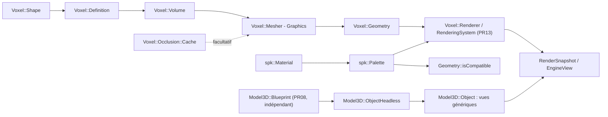

# Sparkle V0.1.4 — Vue d'ensemble

[Sommaire de l'architecture](../voxel-engine-v0.1.4-specification.md)

## 1. Vue d'ensemble

Le rendu 3D utilise le **Forward classique** avec sélection globale de lumières par EngineView. Aucun culling lumineux GPU par tile n’est requis.

Un programme décrit des géométries élémentaires indépendantes de toute texture, les assemble en cellules d'un volume, puis construit un modèle maillé. Il choisit séparément les matériaux et les palettes. **Depuis PR13**, des composants `Voxel::Renderer` sur des `Entity3D` avec parenting ECS composent des objets articulables par transformation ; le système de rendu collecte leurs occurrences en commandes instanciées. `Model3D` PR08 reste une bibliothèque générique distincte.

**Q-TECH-002 — convention des longueurs (option B validée).** Dans la spécification Sparkle, les distances et longueurs spatiales s'expriment en **`U` (« unit », unité de monde générique)**. `1 U` n'a **aucune équivalence imposée** en mètres, centimètres ou autre mesure du monde réel ; chaque application choisit librement son échelle et doit garder ses coordonnées et distances cohérentes. Les translations et positions 3D, dimensions géométriques de meshes, portées lumineuses et distances caméra, plans de projection proche/lointain et paramètres de distance des ombres suivent cette convention. Les indices de cellule d'un volume voxel ne deviennent pas automatiquement des longueurs : seules leurs positions/dimensions spatiales une fois définies dans le monde sont exprimées en `U`. Les angles, facteurs sans dimension, pixels, texels, UV, tailles de buffers et profondeur GPU normalisée **ne se mesurent pas en `U`**. La notation `U` est **documentaire** : aucun nouveau type C++ d'unité ni conversion métrique implicite n'est requis.

**Q-TECH-002 — lumières, couleurs et projections (décisions validées).** Les trois types Point/Spot/Directional utilisent `spk::RGB` linéaire dans `[0,1]` et un `float intensity` non négatif et fini sans plafond artificiel. `spk::Color` (RGBA) est renommé `spk::RGBA` avec `using Color = RGBA;`. Point et Spot possèdent une portée `range` indépendante de l'intensité et une atténuation radiale cubique Smoothstep `A(x)=1-3x²+2x³` où `x=clamp(distance/range,0,1)` ; aucune décroissance inverse du carré ni `d_floor`. `range=0` éteint la lumière locale et empêche la création de shadow map. Spot ajoute un unique angle et une décroissance angulaire Smoothstep. Directional tire son orientation du `Transform3D`, n'a pas de portée et contribue `RGB × intensity`. Le Top-N Point/Spot utilise le score `intensity × range² × priorityWeight / max(distanceCamera,minLightDistance)`, indépendamment de RGB. Les ombres Point/Spot utilisent `near=range×0,001`, `far=range`, un biais automatique à coefficients publics et un PCF Point fixe 3×3 reprojeté entre faces. Voir le [contrat détaillé du §7.4](08-lumieres-et-ombres.md) et les [tests §8.5](10-contrats-et-validation.md). Aucun changement C++ n'est autorisé à ce stade.



**Contrats effectivement livrés :**

- Les `Shape`, `Definition`, `Cell`, `Volume` et l'occlusion vivent dans Core ; le mesher/mesh voxel réside dans Graphics.
- `Voxel::Mesher::bake(volume)` produit une `Voxel::Geometry` sans palette ni RenderCommand. `Geometry::isCompatible(palette)` vérifie ses slots.
- `spk::Material` et `spk::Palette` sont indépendants de la géométrie ; `Voxel::Palette::Builder` vérifie l'albedo et l'atlas partagé.
- `Model3D::Blueprint` décrit la structure immuable ; `ObjectHeadless` anime les attaches ; `Object<TGraphics>` génère les contributions graphiques génériques.
- PR09–12 ont livré EngineView, surfaces et HDR/WBOIT générique. PR13 a livré le rendu voxel opaque texturé instancié avec `Voxel::Renderer`. PR14 a été retirée : aucun binding automatique `Model3D::Blueprint` → `Voxel::Renderer` en v0.1.4.

### Exemple de parcours utilisateur

Exemple utilisant les API existantes ; `stoneDefinition` et `stoneMaterial` sont préparés auparavant.

```cpp
spk::Voxel::Definition::Registry::Builder definitionsBuilder;
definitionsBuilder.add(1, stoneDefinition);
const auto definitions = definitionsBuilder.build();

spk::Voxel::Volume::Builder volumeBuilder({16, 16, 16});
volumeBuilder.bind(definitions);
volumeBuilder.set({2, 4, 1}, 1);
const spk::Voxel::Volume volume = volumeBuilder.build();

spk::Voxel::Mesher mesher;
const spk::Voxel::Geometry geometry = mesher.bake(volume);

spk::Voxel::Palette::Builder paletteBuilder;
paletteBuilder.setMaterial("stone", stoneMaterial);
const spk::Palette palette = paletteBuilder.build();

if (!geometry.isCompatible(palette))
{
    throw spk::Exception("Palette incompatible avec la géométrie");
}
// Le rendu GPU existe depuis PR13 :
// auto &renderer = entity.addComponent<spk::Voxel::Renderer>();
// renderer.bind(geometry);
// renderer.bind(palette);
// Ajouter également spk::Voxel::RenderingSystem à l'Engine graphique.
```
