# Sparkle V0.1.4 — Vue d'ensemble

[Sommaire de l'architecture](../voxel-engine-v0.1.4-specification.md)

## 1. Vue d'ensemble

Le rendu 3D utilise le **Forward classique** avec sélection globale de lumières par EngineView. Aucun culling lumineux GPU par tile n’est requis.

Un programme décrit des géométries élémentaires indépendantes de toute texture, les assemble en cellules d'un volume, puis construit un modèle maillé. Il choisit séparément les matériaux à utiliser et les associations de palettes. Les modèles peuvent être affichés directement ou composés en hiérarchies articulées. Le système de rendu rassemble les occurrences actives pour créer des commandes graphiques instanciées.

**Q-TECH-002 — convention des longueurs (option B validée).** Dans la spécification Sparkle, les distances et longueurs spatiales s'expriment en **`U` (« unit », unité de monde générique)**. `1 U` n'a **aucune équivalence imposée** en mètres, centimètres ou autre mesure du monde réel ; chaque application choisit librement son échelle et doit garder ses coordonnées et distances cohérentes. Les translations et positions 3D, dimensions géométriques de meshes, portées lumineuses et distances caméra, plans de projection proche/lointain et paramètres de distance des ombres suivent cette convention. Les indices de cellule d'un volume voxel ne deviennent pas automatiquement des longueurs : seules leurs positions/dimensions spatiales une fois définies dans le monde sont exprimées en `U`. Les angles, facteurs sans dimension, pixels, texels, UV, tailles de buffers et profondeur GPU normalisée **ne se mesurent pas en `U`**. La notation `U` est **documentaire** : aucun nouveau type C++ d'unité ni conversion métrique implicite n'est requis.

**Q-TECH-002 — couleurs et paramètres de lumières (décision validée).** Les lumières Point, Spot et Directional portent une couleur `spk::RGB` à trois composantes, sans alpha. Le type à quatre composantes actuellement nommé `spk::Color` devient `spk::RGBA` ; `using Color = RGBA;` dans `spk` préserve l'API historique. Point et Spot exposent `range` directement en `U`, sans intensité `LU` ni seuil minimal d'éclairement `E_min` : la portée est l'unique frontière géométrique d'influence. Directional dérive sa direction du `Transform3D`, sans portée ni intensité séparée ; sa couleur RGB module directement l'éclairage. L'atténuation locale en inverse du carré conserve un garde-fou commun `d_floor = 0,01 U`, indépendant de `minLightDistance` du Top-N. La forme exacte de l'extinction au bord de `range` et le profil pour les portées inférieures à `0,01 U` restent à définir (Q-TECH-002). Aucun changement C++ n'est autorisé à ce stade.

```mermaid
flowchart LR
  subgraph G["Données voxel et bake"]
    S["Shape"]
    D["Definition"]
    V["Volume"]
    M["VoxelMesher"]
    O["OcclusionCache (facultatif)"]
    Model["Model : 2 meshes visuels + mesh ombre"]
    S --> D --> V --> M --> Model
    O -. "accélère" .-> M
  end
  subgraph A["Apparence"]
    AM["AssetManager"]
    Mat["Material"]
    Palette["VoxelPalette"]
    AM --> Mat --> Palette
  end
  subgraph R["Moteur logique et orchestration graphique"]
    Assembly["Assembly"]
    Components["Composants 3D"]
    Engine["Engine : core headless"]
    Render["RenderingEngine : hérite d'Engine"]
    Views["EngineView nommées"]
    Sys["VoxelRenderingSystem : rendu visuel uniquement"]
    ShadowMapClass["ShadowMap : passe logique autonome"]
    ShadowSys["ShadowMap::RenderingSystem : une RenderPass par vue"]
    ShadowOutput["Light::ShadowResult : sortie logique par vue et lumiere"]
    ShadowSource["ShadowMap::Contributor : collection de MeshInstance"]
    ShadowRegistry["Registry des sources d ombre"]
    ViewSnap["Sous-RenderSnapshot indépendant par EngineView"]
    EngineSnap["RenderSnapshot moteur : délégation ordonnée"]
    Slot["ThreadSafeSlot du snapshot moteur"]
    Window["Snapshot de fenêtre + EngineWidget à rôles"]
    GPU["GPUResourceCollection : cibles par surface"]
    Engine --> Render --> Views --> ViewSnap --> EngineSnap --> Slot
    Assembly --> Components
    Components -->|"Layers, meshes de scene"| Sys
    Components -.->|"ShadowMap::Contributor attache a Entity"| ShadowSource
    ShadowMapClass --> ShadowSource
    ShadowMapClass --> ShadowSys
    ShadowSource --> ShadowRegistry --> ShadowSys
    ShadowSys -->|"Sorties capturees sans resoudre GPU"| ShadowOutput
    ShadowOutput -->|"Commandes Forward opaques et WBOIT, disponibilite par surface"| ForwardConsumer["Eclairage Forward : consommateur generique"]
    ForwardConsumer --> ViewSnap
    Views -->|"Layers filtres"| Sys
    Views -->|"CaptureContext generique"| ShadowSys
    Sys -->|"Commandes visuelles uniquement"| ViewSnap
    ShadowSys -->|"Une passe ombres : toutes les lumieres compatibles"| ViewSnap
    LightCull["Light::Prioritizer : selection Top-N globale par EngineView"]
    Views -->|"Capture des lumieres"| LightCull
    LightCull -->|"Selection commune opaque / WBOIT"| Sys
    Slot --> Window --> GPU
  end
  Model --> Assembly
  Model --> Components
  Model -->|"bind(collection, matrice Assembly) explicite"| ShadowSource
  Palette --> Assembly
  Palette --> Components
```



Les frontières sont intentionnelles :

- **Géométrie et meshing :** aucune lecture de pixels, aucun atlas et aucune émission directe de commande OpenGL. La visibilité entre cellules est déterminée uniquement à partir des surfaces, de leur orientation et de l'opacité déclarée par les slots de géométrie. **Shape, Definition, Cell et Volume** restent indépendants d'OpenGL ; en revanche, **Model/Mesh** réutilisent le vrai `spk::Mesh<TVertex>`, dont le `LayoutBuffer` dépend déjà des types graphiques de Sparkle. Le bake ne doit pas être décrit comme un module intégralement headless.
- **Apparence :** `spk::Material` est générique et possède des rôles de textures nommés ; `spk::VoxelPalette` relie ces matériaux aux slots d'un modèle voxel. Une palette différente ne nécessite pas de remailler.
- **Scène :** `Voxel::Assembly` compose des modèles et des transformations locales, sans créer une Entity par partie.
- **Graphisme :** `VoxelRenderingSystem` collecte les composants graphiques voxel et produit **uniquement les passes visuelles** (opaque et translucide), pour chaque vue dont les layers admettent le système et ses composants. Il **ne génère aucune commande de shadow map**. Un **`ShadowMap::RenderingSystem` distinct et générique** est exclusivement responsable de la capture des casters et de la construction des passes des shadow maps, à partir d’un Registry de **`ShadowMap::Contributor` spécialisés**. Chaque `ShadowMap::Contributor` porte son propre `ShadowMode` et les layers utiles au filtrage et un **`MeshFilter` intégré** désignant la géométrie d'ombre, qui peut différer du mesh visible (par exemple un mesh voxel greedy-meshé). Ce composant est graphique et distinct de `EngineView::Contributor` : ce dernier ne connaît plus ni ombres, ni `ShadowMode`, ni invalidation de shadow maps. Le `MeshFilter` conserve une **collection de `ShadowMap::MeshInstance`** explicitement liés, chacun avec un mesh partagé par copie légère et une matrice locale par valeur, **ainsi qu'une matrice commune `Matrix4x4`** (identité par défaut). `bind(collection, matrix)` associe à toute la collection la transformation de son Assembly dans le repère de l'Entity ; chaque matrice finale compose Entity × Assembly × Part. Chaque `bind()` remplace toute la collection et sa matrice commune. Aucun fallback automatique vers le mesh visuel n'est autorisé. L’admission par layers et les modes d’ombres effectifs restent vérifiés pour chaque objet par le système chargé des ombres. `Engine` reste headless ; `RenderingEngine : Engine` possède les vues et le slot de snapshot partagé. `GPUResourceCollection` réalise les framebuffers et textures séparément pour chaque fenêtre ; un `EngineWidget` associe librement les rôles `Update`, `Render` et `Drawing`.
- **Chargement :** `spk::AssetManager` est un utilitaire générique de Sparkle, pas un sous-système réservé aux voxels. Il partage les assets chargés selon une clé comprenant type, identifiant et configuration JSON.

Le `Voxel::Model` produit **au maximum deux meshes visuels** (opaque et translucide) et un **`ShadowMap::Mesh` de profondeur supplémentaire**, extrait des surfaces opaques lors du bake. Ce troisième mesh n'est ni une troisième catégorie visuelle ni un mesh « cutout » ; il n'est utilisé pour les ombres que si l'application le lie explicitement à un Contributor. Chaque mesh **visuel** non vide peut être dessiné avec un seul atlas `albedo` pour une association `Model`/`VoxelPalette` compatible, même si plusieurs slots choisissent des régions différentes de cet atlas.

### Exemple de parcours utilisateur

```cpp
// Exemple conceptuel : noms secondaires et signatures à finaliser.
spk::Voxel::Shape shape = makeShape();
spk::Voxel::Definition stone = makeDefinition(shape);

spk::Voxel::Volume::Builder volumeBuilder({16, 16, 16});
volumeBuilder.set({2, 4, 1}, spk::Voxel::Cell{stone, orientation});
spk::Voxel::Volume volume = std::move(volumeBuilder).build();

spk::Voxel::VoxelMesher mesher;
spk::Voxel::Model model = mesher.bake(volume);

spk::Material material = makeMaterial(texture);
spk::VoxelPalette palette = makePalette(model, material);

spk::Voxel::Assembly character;
auto torso = character.addPart("torso", model, palette);
auto arm = character.addPart("arm", armModel, armPalette, torso);
character.setLocalTransform(arm, armLocalTransform);
character.invalidate();

// Un composant lié à l'Entity3D expose l'Assembly au système de rendu.
// Le VoxelRenderingSystem produira les commandes du prochain snapshot.
```
