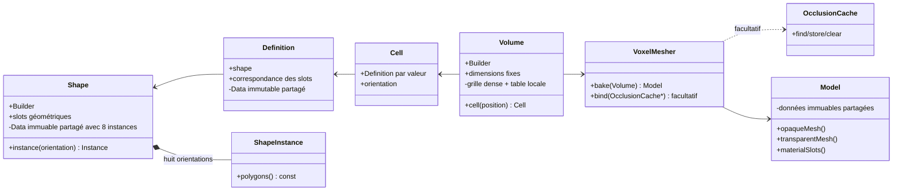

# Sparkle V0.1.4 — Modèle de données voxel

[Sommaire de l'architecture](../voxel-engine-v0.1.4-specification.md)

## 2. Modèle de données voxel



### 2.1 `spk::Voxel::Shape` : géométrie locale réutilisable

Une `Shape` représente les surfaces d'une cellule dans le **cube local `[0,1]³`**. Elle ne connaît ni matériaux concrets, ni volume, ni Engine.

Chaque polygone :

- possède au moins trois sommets, de positions flottantes dans le cube unité ; il est **plan et convexe**. Une forme globalement concave est représentée par plusieurs polygones ;
- est **simple face**. Son ordre de sommets est CCW vu du côté avant, et sa normale géométrique est orientée par `(v1 - v0) × (v2 - v0)` pour des sommets initiaux non colinéaires ;
- peut porter des UV arbitraires et des normales d'éclairage par sommet. La normale géométrique est utilisée par défaut pour l'éclairage, mais les normales personnalisées ne modifient jamais l'orientation géométrique ou l'occlusion ;
- référence un **slot géométrique local** déclaré par son nom dans la Shape. Ce slot porte `opacity`, un flottant de `[0,1]`, de valeur `1.0` par défaut.

Pour afficher une feuille ou une pancarte des deux côtés, l'application fournit **deux polygones explicites** de windings opposés. Il n'existe pas de propriété `doubleSided` ni de duplication implicite. Des polygones coplanaires de même winding peuvent se recouvrir, même totalement ; leur existence séparée est conservée. Une Shape de **zéro polygone** est valide.

Les surfaces sont réparties selon leur position :

- `outerShell` : polygones dont tous les sommets sont situés sur l'un des six plans de frontière (`x`, `y` ou `z` égal à `0` ou `1`), identifiables par face et par slot local ;
- `innerShell` : autres polygones, notamment les surfaces inclinées ou internes, qui ne sont jamais projetés artificiellement sur une frontière.

Les positions et les UV ne sont pas confondus : les **positions** doivent être dans `[0,1]³`, mais les **UV** peuvent être hors `[0,1]`. Dans ce dernier cas, la construction/validation CPU de la Shape émet un `Warning` non bloquant via `spk::Logger`. Aucun clamp ou modulo de sprite n'est ajouté automatiquement et cet avertissement n'est jamais répété à chaque frame.

#### Construction et immutabilité

`Shape::Builder` recueille des slots et des polygones, les valide **au moment de leur ajout** et publie une Shape immuable par `build()`. Toute géométrie invalide provoque une `spk::Exception` descriptive à l'ajout. Un ajout qui échoue, quelle qu'en soit la cause, laisse le Builder **strictement inchangé**. Un `build()` échoué laisse également son état entièrement intact, autorisant une nouvelle tentative. **Un build réussi ne consomme pas le Builder** : il reste réutilisable pour publier d'autres Shapes distinctes, sans modifier celles déjà publiées.

Une Shape publiée conserve un bloc `shared_ptr<const Data>` interne : les copies sont légères et partagent les mêmes données et la même identité. Deux Shapes construites indépendamment peuvent avoir des données géométriquement identiques mais des **identités de Data distinctes**. Cette identité est notamment utilisée par le cache d'occlusion. La représentation propriétaire n'est pas exposée dans les API publiques.

Chaque `Shape::Data` détient **huit `Shape::Instance` immuables** (`std::array<Instance, 8>`), une pour chacun des quatre angles autour de Y et des deux orientations verticales. `Shape::Builder::build()` produit toutes les géométries orientées en une fois : positions, normales géométriques et d'éclairage, winding, frontières et classifications sont transformés ; les UV restent attachés aux sommets et les noms de slots géométriques sont conservés. `Shape::instance(orientation)` renvoie ensuite une référence const à la variante déjà calculée, sans transformation ni allocation supplémentaire. Les copies de Shape réutilisent les mêmes instances ; des Shapes construites indépendamment ne partagent pas leurs instances. Cette représentation interne remplace définitivement le `ShapeTransformationCache` externe.

### 2.2 `spk::Voxel::Definition` : sens des slots

Une `Definition` immuable associe une `Shape` à une correspondance **slot géométrique de Shape → nom de slot sémantique** destiné au Model. Elle ne contient pas de `Material` et n'ajoute ni catégorie de rendu, ni règle d'occlusion indépendante à l'opacité déclarée dans la Shape.

`Definition` utilise également des données immuables partagées (`shared_ptr<const Data>`) et conserve la durée de vie de sa Shape. Copier une Definition est léger. Une même Shape peut être réutilisée dans différentes Definitions pour produire des noms de slots sémantiques différents. Les huit `Shape::Instance` sont alors réellement communes à ces Definitions : le mapping sémantique est appliqué plus tard et ne modifie ni l'identité ni les polygones orientés de la Shape.

Sparkle fournit une **Definition Air prédéfinie**. Elle représente une vraie cellule d'air, sans surface occultante ni slot de matériau supplémentaire présumé. Elle est créée automatiquement dans les Volumes ; l'application n'a pas à la fabriquer pour initialiser une grille vide.

#### Registres de Shapes et de Definitions (PR-02)

`Shape::Registry` associe un **ID texte** (`std::string`) à une `Shape` immuable. `Definition::Registry` associe un **ID numérique non signé sur 29 bits** (`std::uint32_t`, 1 à 2^29 - 1) à une `Definition` immuable ; l'ID numérique **0 est Air**, accessible sans déclaration dans le JSON. Les deux registres héritent de `spk::JSON::Catalog<Element, ID>`, en exploitant son modèle de stockage, ses méthodes `load(file)`, `at`, `operator[]` et la convention `{"elements":[{"id":...,"data":...}]}`. Le type ID explicite est pris en charge par `Catalog` sans rompre les usages existants fondés sur `Element::ID`.

La construction d'une Definition à partir du JSON est assurée par `Definition::Builder` **lié à un `Shape::Registry`**. Le JSON de Definition contient un champ `shape` avec l'ID texte d'une Shape déjà enregistrée et un objet `slots` associant les slots géométriques aux noms sémantiques. Le Builder récupère la Shape par identité (copie légère), valide l'intégralité de la correspondance, puis construit une nouvelle Definition immuable. Plusieurs Definitions réutilisant la même Shape partagent ainsi les instances orientées de cette Shape. Le registre de Definitions doit être lié à un registre de Shapes via son constructeur ou `bind(shapes)` avant le chargement JSON.

Exemple de catalogue de Shapes :

```json
{
  "elements": [
    {
      "id": "surface",
      "data": {
        "slots": { "face": 1.0 },
        "polygons": [
          { "slot": "face", "vertices": [[0,0,0], [1,0,0], [0,1,0]] }
        ]
      }
    }
  ]
}
```

Exemple de catalogue de Definitions utilisant les mêmes Shapes :

```json
{
  "elements": [
    { "id": 10, "data": { "shape": "surface", "slots": { "face": "stone" } } },
    { "id": 20, "data": { "shape": "surface", "slots": { "face": "glass" } } }
  ]
}
```

La correspondance des deux identifiants est **intentionnellement distincte** : une Shape est nommée par chaîne, une Definition est référencée par ID numérique dans les volumes binaires. Les IDs externes restent remappés vers les indices compacts locaux du Volume.

### 2.3 `spk::Voxel::Cell` et orientations

L'API publique représente une Cell **par valeur**, contenant sa Definition (copie légère) et une orientation discrète. Les orientations disponibles comprennent les quatre rotations de 90° autour de Y et une possibilité d'inversion verticale, soit **huit orientations**.

La `Cell` **ne transforme pas la géométrie** et n'expose ni `transformPosition`, ni `transformNormal`, ni `orientedPolygon(s)`, ni accès `friend` au Mesher. La `Cell` utilise les enums d'orientation de `Shape` ; les consommateurs accèdent à la géométrie par `cell.definition().shape().instance(orientation)`. La transformation et la correction du winding sont effectuées **exclusivement à la construction de Shape**, jamais lors d'un bake.

Une cellule d'air est une Cell valide, et non `null`, un `optional` vide ou un indicateur « absence ».

### 2.4 `spk::Voxel::Volume` : snapshot dense immuable

Un Volume représente une grille **dense et contiguë** de cellules, d'extensions fixes. Chaque position a une entrée, y compris l'air. Pour éviter un `shared_ptr` complet par cellule, le stockage interne repose sur :

1. une **table locale de Definitions** partageant leurs blocs Data ;
2. une grille compacte d'indices vers cette table, avec l'orientation de chaque cellule.

**Décision A confirmée lors de la review de PR-02 :** chaque emplacement reste encodé sur **un entier non signé de 32 bits** comprenant **29 bits d'index local de Definition, 2 bits de rotation horizontale et 1 bit d'inversion verticale**. Le Volume ne stocke **pas** directement de `std::vector<Cell>`. L'encodage est regroupé dans `Volume::PackedCell` ; la lecture reconstitue une `Cell` publique complète par valeur. Les IDs externes d'un `Definition::Registry` utilisés lors du chargement d'un fichier packed sont convertis en indices propres au Volume ; ils ne constituent pas des indices universels.

L'index interne `0` est **toujours réservé à Air**. Une Cell d'air référence l'entrée `0`, jamais un sentinel d'absence.

La table locale déduplique une Definition **par identité de `Definition::Data`**, pas par comparaison profonde de contenu. Deux copies d'une même Definition partagent donc un index ; deux Definitions indépendantes au contenu identique peuvent occuper deux entrées. La lecture publique `cell(position)` reconstitue une **Cell par valeur** et n'expose pas les indices ni une référence vers le stockage compact. Ne pas promettre un `span<const Cell>` vers la grille.

`Volume::Builder` peut être initialisé depuis les dimensions d'une nouvelle grille entièrement remplie d'air ou depuis un `const Volume&` existant. Il propose des opérations de remplacement `set(position, Cell)` et de remise à l'air `erase(position)` ; les noms exacts peuvent être ajustés. **Ses dimensions ne changent jamais** : pas de `resize()` ni d'expansion implicite. Les accès hors limites sont invalides. Le produit des dimensions, les tailles d'indices et les allocations doivent être vérifiés avant tout débordement.

Un build réussi publie un **nouveau snapshot immuable**, à copies légères, sans modifier d'anciens Volumes, puis consomme le Builder. Toute exception pendant `build()` laisse l'intégralité de son état inchangé et réutilisable. L'implémentation peut partager des données entre snapshots seulement si cela ne permet aucune mutation rétroactive.

Les classes Shape, Definition, Cell et Volume fonctionnent **sans Engine ni OpenGL**.
