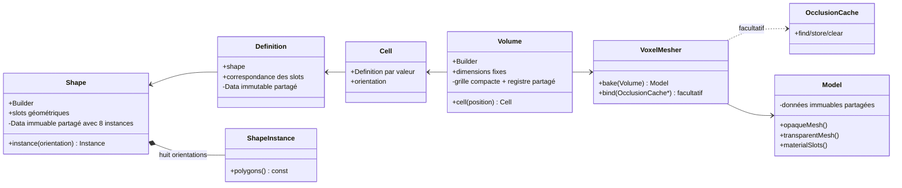

# Sparkle V0.1.4 — Modèle de données voxel

[Sommaire de l'architecture](../voxel-engine-v0.1.4-specification.md)

## 2. Modèle de données voxel



### 2.1 `spk::Voxel::Shape` : géométrie locale réutilisable

Une `Shape` représente les surfaces d'une cellule dans le **cube local `[0,1]³`**. Elle ne connaît ni matériaux concrets, ni volume, ni Engine.

Chaque polygone :

- possède au moins trois sommets, de positions flottantes dans le cube unité ; il est **plan et convexe**. Une forme globalement concave est représentée par plusieurs polygones ;
- est **simple face**. Son ordre de sommets est CCW vu du côté avant, et sa normale géométrique est orientée par `(v1 - v0) × (v2 - v0)` pour des sommets initiaux non colinéaires ;
- peut porter des UV arbitraires et des normales d'éclairage par sommet. La normale géométrique est utilisée par défaut pour l'éclairage, mais les normales personnalisées ne modifient jamais l'orientation géométrique ou l'occlusion ;
- référence un **slot géométrique local** déclaré par son nom dans la Shape. Ce slot porte `opacity`, un flottant de `[0,1]`, de valeur `1.0` par défaut.

Pour afficher une feuille ou une pancarte des deux côtés, l'application fournit **deux polygones explicites** de windings opposés. Il n'existe pas de propriété `doubleSided` ni de duplication implicite. Des polygones coplanaires de même winding peuvent se recouvrir, même totalement ; leur existence séparée est conservée. Une Shape de **zéro polygone** est valide.

Les surfaces sont réparties selon leur position :

- `outerShell` : polygones dont tous les sommets sont situés sur l'un des six plans de frontière (`x`, `y` ou `z` égal à `0` ou `1`), identifiables par face et par slot local ;
- `innerShell` : autres polygones, notamment les surfaces inclinées ou internes, qui ne sont jamais projetés artificiellement sur une frontière.

Les positions et les UV ne sont pas confondus : les **positions** doivent être dans `[0,1]³`, mais les **UV** peuvent être hors `[0,1]`. Dans ce dernier cas, la construction/validation CPU de la Shape émet un `Warning` non bloquant via `spk::Logger`. Aucun clamp ou modulo de sprite n'est ajouté automatiquement et cet avertissement n'est jamais répété à chaque frame.

#### Construction et immutabilité

`Shape::Builder` recueille des slots et des polygones, les valide **au moment de leur ajout** et publie une Shape immuable par `build()`. Toute géométrie invalide provoque une `spk::Exception` descriptive à l'ajout. Un ajout qui échoue, quelle qu'en soit la cause, laisse le Builder **strictement inchangé**. Un `build()` échoué laisse également son état entièrement intact, autorisant une nouvelle tentative. **Un build réussi ne consomme pas le Builder** : il reste réutilisable pour publier d'autres Shapes distinctes, sans modifier celles déjà publiées.

Une Shape publiée conserve un bloc `shared_ptr<const Data>` interne : les copies sont légères et partagent les mêmes données et la même identité. Deux Shapes construites indépendamment peuvent avoir des données géométriquement identiques mais des **identités de Data distinctes**. Cette identité est notamment utilisée par le cache d'occlusion. La représentation propriétaire n'est pas exposée dans les API publiques.

Chaque `Shape::Data` détient **huit `Shape::Instance` immuables** (`std::array<Instance, 8>`), une pour chacun des quatre angles autour de Y et des deux orientations verticales. `Shape::Builder::build()` produit toutes les géométries orientées en une fois : positions, normales géométriques et d'éclairage, winding, frontières et classifications sont transformés ; les UV restent attachés aux sommets et les noms de slots géométriques sont conservés. `Shape::instance(orientation)` renvoie ensuite une référence const à la variante déjà calculée, sans transformation ni allocation supplémentaire. Les copies de Shape réutilisent les mêmes instances ; des Shapes construites indépendamment ne partagent pas leurs instances. Cette représentation interne remplace définitivement le `ShapeTransformationCache` externe.

### 2.2 `spk::Voxel::Definition` : sens des slots

Une `Definition` immuable associe une `Shape` à une correspondance **slot géométrique de Shape → nom de slot sémantique** destiné au Model. Elle ne contient pas de `Material` et n'ajoute ni catégorie de rendu, ni règle d'occlusion indépendante à l'opacité déclarée dans la Shape.

`Definition` utilise également des données immuables partagées (`shared_ptr<const Data>`) et conserve la durée de vie de sa Shape. Copier une Definition est léger. Une même Shape peut être réutilisée dans différentes Definitions pour produire des noms de slots sémantiques différents. Les huit `Shape::Instance` sont alors réellement communes à ces Definitions : le mapping sémantique est appliqué plus tard et ne modifie ni l'identité ni les polygones orientés de la Shape.

Sparkle fournit une **Definition Air prédéfinie**. Elle représente une vraie cellule d'air, sans surface occultante ni slot de matériau supplémentaire présumé. Elle est créée automatiquement dans les Volumes ; l'application n'a pas à la fabriquer pour initialiser une grille vide.

#### Registres de Shapes et de Definitions (PR-02)

Les deux registres sont des **snapshots immuables à copies légères**, chacun possédant son `shared_ptr<const Data>` : `Shape::Registry` associe un ID texte (`std::string`) à une `Shape`, tandis que `Definition::Registry` associe un ID numérique non signé (`std::uint32_t`, de 1 à `2^29-1`) à une `Definition`. L'ID **0 désigne implicitement Air** dans `Definition::Registry`.

Leurs modifications sont exclusivement effectuées par `Shape::Registry::Builder` et `Definition::Registry::Builder`. Ces deux Builders **héritent de `spk::JSON::Catalog<Element, ID>`**, réutilisant `load(file)`, `add(id, value)`, les validations et le format `{"elements":[{"id":...,"data":...}]}`. `build()` publie un nouveau registre immuable, sans modifier les snapshots existants ; un Builder peut être réutilisé. Le paramètre ID explicite du catalogue garde la compatibilité avec `Catalog<Element>` et `Element::ID`.

Le stockage d'un registre publié est un `std::unordered_map<ID, Value>` immuable. Une copie du registre partage exactement son bloc `Data`, à coût constant. L'accès par ID est en moyenne en **O(1)**, sans imposer un tableau dense de taille `2^29` ni ajouter un `std::set` (O(log n)). Aucun cache supplémentaire pour le mesher n'est introduit avant mesure de performances.

`Definition::Builder` est construit **sans paramètre**, puis reçoit un **`Shape::Registry` publié via `bind(const Shape::Registry&)`**, qu'il copie à coût constant. Aucun constructeur prenant un registre ou un registre avec JSON n'est exposé. La construction JSON s'effectue avec `addFromJSON(value)` après `bind`; un accès à une Shape avant liaison lève `spk::Exception`. Une nouvelle liaison invalide la Shape précédemment sélectionnée. Son JSON contient `shape` (l'ID texte d'une Shape existante) et `slots` (mapping des slots géométriques vers des noms sémantiques) : aucune copie de polygones n'est embarquée dans la Definition. `Definition::Registry::Builder` reçoit également le registre de Shapes afin de charger ces descriptions JSON. Toutes les Definitions associées à la même Shape partagent son identité et ses huit variantes orientées.

Exemple de catalogue de Shapes :

```json
{
  "elements": [
    {
      "id": "surface",
      "data": {
        "slots": { "face": 1.0 },
        "polygons": [
          { "slot": "face", "vertices": [[0,0,0], [1,0,0], [0,1,0]] }
        ]
      }
    }
  ]
}
```

Exemple de catalogue de Definitions utilisant les mêmes Shapes :

```json
{
  "elements": [
    { "id": 10, "data": { "shape": "surface", "slots": { "face": "stone" } } },
    { "id": 20, "data": { "shape": "surface", "slots": { "face": "glass" } } }
  ]
}
```

La correspondance des deux identifiants est **intentionnellement distincte** : une Shape est nommée par chaîne, une Definition est référencée par ID numérique dans les volumes binaires. Ces IDs numériques sont conservés **tels quels** dans les cellules compactes ; aucun remappage local n'est effectué.

### 2.3 `spk::Voxel::Cell` et orientations

L'API publique représente une Cell **par valeur**, contenant sa Definition (copie légère) et une orientation discrète. Les orientations disponibles comprennent les quatre rotations de 90° autour de Y et une possibilité d'inversion verticale, soit **huit orientations**.

La `Cell` **ne transforme pas la géométrie** et n'expose ni `transformPosition`, ni `transformNormal`, ni `orientedPolygon(s)`, ni accès `friend` au Mesher. La `Cell` utilise les enums d'orientation de `Shape` ; les consommateurs accèdent à la géométrie par `cell.definition().shape().instance(orientation)`. La transformation et la correction du winding sont effectuées **exclusivement à la construction de Shape**, jamais lors d'un bake.

Une cellule d'air est une Cell valide, et non `null`, un `optional` vide ou un indicateur « absence ».

### 2.4 `spk::Voxel::Volume` : snapshot dense immuable

Un Volume représente une grille **dense et contiguë** de cellules, d'extensions fixes, y compris l'air. Chaque cellule occupe **un entier non signé de 32 bits** : 29 bits pour l'**ID directement attribué par `Definition::Registry`**, 2 bits de rotation horizontale et 1 bit d'inversion verticale. L'ID `0` est toujours Air, jamais un sentinel d'absence. Le codec `Volume::PackedCell` réalise ce stockage ; l'API `cell(position)` reconstruit une `Cell` publique par valeur.

Un Volume contient une **copie légère de `Definition::Registry` immuable**, donc une référence partagée à ses données. Il ne possède **aucune table locale d'indices ou de Definitions**. Plusieurs Volumes utilisant le même registre partagent ses Definitions à coût constant. Des IDs distincts associés à la même Definition gardent leurs IDs distincts dans la grille et conservent la même identité de Definition à la lecture. Il n'existe pas de `span<const Cell>` vers le stockage compact.

`Volume::Builder` accepte des dimensions et un `Definition::Registry` publié (ou uniquement des dimensions pour initialiser un Volume entièrement Air), ou un `const Volume&` existant. La grille est modifiée avec **`set(position, definitionId, horizontal, vertical)`**, dont les paramètres d'orientation ont une valeur par défaut, ou `erase(position)`. **`set(position, Cell)` est supprimé** : une Cell arbitraire ne fournit pas un ID unique, particulièrement si plusieurs IDs pointent vers la même Definition. Tout ID utilisé doit exister dans le registre lié au Builder, sauf Air `0`. Les dimensions ne changent jamais ; les limites, la capacité 29 bits et les allocations sont vérifiées.

Le Builder peut recevoir un nouveau snapshot de registre via `bind(registry)` ; si des IDs non-Air sont déjà utilisés dans sa grille, leur Definition doit conserver **la même identité** dans le nouveau registre, sinon `bind` échoue sans modification de l'état. `Volume::Builder(volume)` reprend directement le registre immuable du Volume existant. Un `build()` réussi publie un nouveau snapshot immuable et consomme le Builder ; toute exception doit le laisser réutilisable.

L'import brut `loadPacked(filename)` ou le constructeur `Builder(dimensions, filename, registry)` lit des mots little-endian de quatre octets, sans en-tête ni dimensions encodées, avec l'ordre X puis Y puis Z. Les **29 bits sont déjà les IDs du registre** : aucune déduplication, aucune création de table locale ni conversion n'est nécessaire. Chaque ID est validé contre le registre avant publication ; un fichier incomplet, surdimensionné, illisible ou contenant un ID inconnu ne modifie pas le Builder. Un fichier binaire et son registre correspondant doivent toujours être fournis ensemble.

L'architecture garantit une lecture moyenne en O(1) par ID via `unordered_map`; une éventuelle optimisation spécifique au mesher attendra une mesure effective, sans complexité anticipée. Les classes Shape, Definition, Cell et Volume fonctionnent **sans Engine ni OpenGL**.
