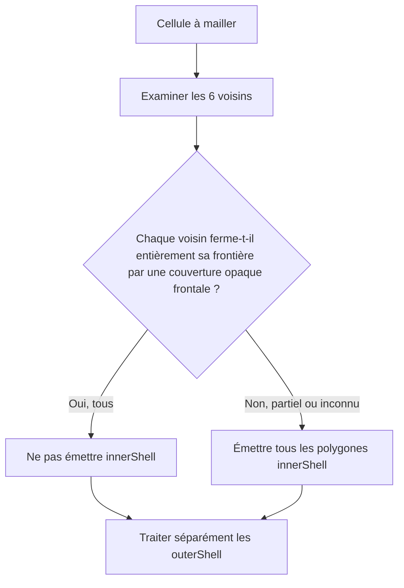

# Sparkle V0.1.4 — Meshing, visibilité et occlusion

[Sommaire de l'architecture](../voxel-engine-v0.1.4-specification.md)

## 3. Meshing, visibilité et occlusion

### 3.0 Géométries orientées déjà présentes dans `Shape`

Les huit `Shape::Instance` (quatre rotations horizontales × inversion verticale) sont créées et conservées dans `Shape::Data` lors de `Shape::Builder::build()`, conformément au §2. Le Mesher et l'algorithme d'occlusion consultent **les mêmes instances const** via `Shape::instance(orientation)`. Positions, normales, UV, winding, frontières et classifications y sont déjà finalisés. Aucun `ShapeTransformationCache` séparé n'existe et ni l'occlusion ni le Mesher ne réorientent les polygones. Chaque instance conserve exclusivement ses triangles précomputés via `triangles()`. L'occlusion les utilise comme sources et comme occultants du clipping, pour respecter l'interpolation affine des UV, et le Mesher les utilise directement lorsqu'aucun clipping n'est nécessaire. Le Builder accepte toujours des polygones convexes, mais aucune copie n'est conservée dans l'instance publiée.

### 3.1 `spk::Voxel::VoxelMesher`

Le Mesher transforme un `Volume` immuable en un **nouveau `Model` à géométrie immuable** par un **bake synchrone et complet**. Le programme peut lancer le bake dans le thread de son choix, gérer les priorités et choisir d'utiliser ou non le résultat, mais Sparkle n'impose aucun ordonnanceur ni rebake incrémental. Changer des cellules ou des données voisines nécessite un nouveau bake pour modifier le résultat du Model.

Son travail est indépendant des matériaux concrets et des pixels de texture. Le `VoxelMesher` fonctionne **avec ou sans `OcclusionCache`**. Si un cache externe lui est explicitement lié, il réutilise ou mémorise ses résultats d'occlusion ; sinon, il calcule l'occlusion à chaque bake par **le même algorithme CPU de clipping**, sans la mémoriser entre les requêtes. Il consulte toujours les `Shape::Instance` précalculées et ne recalcule jamais les orientations.

```cpp
spk::Voxel::VoxelMesher mesher;
auto uncachedModel = mesher.bake(volume); // Occlusion recalculée

spk::Voxel::OcclusionCache occlusion;
mesher.bind(&occlusion);                   // Optimisation facultative
auto cachedModel = mesher.bake(volume);
```

La liaison du cache, lorsqu'elle existe, est non propriétaire : l'appelant garantit sa durée de vie pendant le bake. Une absence de cache ou une liaison retirée signifie le mode sans cache, **pas une erreur**. La forme exacte de `bind(nullptr)` ou `unbind()` reste un détail d'API locale ; aucune liaison de cache de transformations n'est nécessaire. Le clipping partagé ne doit pas être dupliqué entre le chemin avec cache et le chemin sans cache.

La tolérance de clipping est un seul paramètre configurable du Mesher, **`1e-5` par défaut** dans les unités locales du cube. Toute valeur non finie ou non strictement positive est rejetée par `spk::Exception`. Cette tolérance contribue à la clé du cache. La détermination des longueurs, aires et seuils de dégénérescence doit rester dimensionnellement cohérente : ne pas comparer une aire directement à une longueur.

### 3.2 Voisinage et cellules extérieures

Pour les positions internes au Volume, chaque voisin existe toujours, éventuellement comme Cell Air. Pour une position **extérieure**, une spécialisation du Mesher peut fournir un état de voisin :

```cpp
struct OutsideCell
{
    enum class State { Empty, Occupied, Unknown };
    State state;
    // Cell associée lorsque Occupied.
};
```

- `Empty` signifie que l'application déclare l'extérieur vide : les surfaces de la cellule courante restent exposées.
- `Occupied` fournit une vraie Cell extérieure, y compris éventuellement Air. Le Mesher étudie **sa géométrie effective**, pas simplement son caractère « occupé ».
- `Unknown` représente une donnée indisponible : elle ne constitue **jamais une preuve d'occultation**. Le programme effectuera un nouveau bake lorsque cette donnée deviendra connue.

Le Mesher ne conserve pas ces cellules extérieures dans le Volume. Aucun composant de gestion de chunks ni dépendance à un terrain n'est imposé.

### 3.3 Clipping polygonal exact selon le contrat flottant

La visibilité entre deux cellules adjacentes est calculée en géométrie flottante, à partir des polygones réellement présents sur leurs frontières opposées. Le Mesher peut effectuer des rejets rapides par AABB, mais une AABB ou une rasterisation discrète **ne remplace jamais** le calcul des intersections, unions et différences polygonales pour les recouvrements partiels.

Pour une face de la cellule A, la couverture de la cellule B n'est occultante que pour ses polygones qui remplissent **simultanément** ces conditions :

1. le polygone appartient à `outerShell` sur la frontière correspondante ;
2. son **`Definition::Slot` associé au slot géométrique** possède `opacity == 1.0` ;
3. sa **face avant géométrique** est tournée vers la cellule A.

Le canal alpha de `albedo`, les normales personnalisées d'éclairage, et les faces `innerShell` n'entrent jamais dans cette décision. Une texture trouée peut donc afficher visuellement un trou alors que son slot d'opacité 1 a été traité comme occultant : il appartient à l'auteur de la géométrie et des matériaux de ne pas introduire cette incohérence.

Plusieurs polygones opaques frontaux peuvent conjointement fermer une frontière. Leur **union géométrique** est prise en compte, y compris s'ils se chevauchent : ni addition d'aires, ni XOR, ni double comptage, ni modification des polygones sources.

Le clipping préserve **positions, slots locaux, UV et normales**. Un nouveau sommet hérite de ses UV par interpolation des UV de la surface source, **pas** par reprojection automatique sur un plan. Pour un polygone convexe à plus de trois sommets dont les UV sont arbitraires, une triangulation **déterministe** fixe le domaine d'interpolation affine, triangle par triangle. Les fragments qui traversent plusieurs triangles doivent conserver ce mapping ; les normales d'éclairage interpolées sont renormalisées. Les triangles GPU émis respectent le winding CCW et les flips d'orientation.

Les fragments/triangles dégénérés selon la tolérance du Mesher sont écartés, sans supprimer artificiellement une couverture opaque légitime ou déclarer une frontière entièrement fermée par erreur. Aucun triangle GPU dégénéré ne doit être émis.

### 3.4 Règle d'émission des `innerShell`

Les surfaces intérieures ont une règle volontairement globale par cellule :



Chaque direction est **fermée** seulement si les polygones occultants du voisin couvrent **l'intégralité du carré `[0,1]²`** de sa frontière en vis-à-vis. La fermeture ne dépend pas des `outerShell` de la cellule courante. Si les six directions sont fermées, aucun `innerShell` de cette cellule n'est émis. Si au moins une direction est ouverte, partiellement couverte ou inconnue, **tous ses `innerShell`** sont émis, sans culling individuel supplémentaire par cette règle.

Les `outerShell` continuent à être traités par clipping directionnel indépendamment des `innerShell`.

**Limite fonctionnelle assumée :** cette optimisation ne prend pas en charge une caméra placée **à l'intérieur d'un espace entièrement enfermé** dont les surfaces intérieures ont été éliminées. Le moteur ne conserve pas ces faces de manière préventive et n'effectue aucun rebake automatique lié à la position de la caméra. L'application doit éviter ce scénario si elle veut garantir le rendu de ses surfaces intérieures.

### 3.5 `spk::Voxel::OcclusionCache`

Le cache est une ressource CPU autonome, indépendante des Meshers, palettes et GPU, et **facultative pour le VoxelMesher**. Plusieurs Meshers peuvent partager une même instance. Il n'a aucun binding de transformation et n'a pas de `ShapeTransformationCache` interne : les deux chemins d'occlusion (avec et sans cache) consomment directement `Shape::instance(orientation)`. En cas d'absence d'entrée, le cache utilise le même calcul CPU directionnel que le Mesher non caché, puis peut mémoriser le résultat.

Une entrée représente **une requête directionnelle A → B** : quels fragments de l'`outerShell` de A restent visibles après occultation par B ? Le sens **B → A** constitue une autre requête, une autre clé et éventuellement un autre résultat. Une valeur valide contenant zéro fragment signifie **occlusion totale**, tandis que l'absence d'entrée est représentée par `std::nullopt`.

La clé conserve les deux `Definition` immuables par valeur (copies légères), leurs orientations, la direction du voisinage et la tolérance de clipping. Deux Definitions partageant la même Shape mais définissant des opacités différentes ont des identités distinctes : leurs résultats d'occlusion ne sont pas confondus. Les objets conservés par la clé garantissent la durée de vie de leurs Shapes et évitent les faux résultats causés par le recyclage d'adresses. Les Materials concrets ne participent jamais au calcul.

`OcclusionResult` est une valeur immuable, à copie légère, contenant les **fragments visibles de A dans le repère local de la Shape A**, leurs UV, leurs attributs et leurs **slots géométriques locaux**. Il ne contient ni indices des slots du Model ni pointeurs vers une palette. Après lecture ou calcul de l'occlusion, le Mesher applique le mapping de la Definition et le placement dans le Volume ; la géométrie utilisée est déjà orientée.

`OcclusionCache` protège sa table par un `spk::ProtectedData<Data>` **privé** :

- `find(key)` copie légèrement un `std::optional<OcclusionResult>` sous verrou de lecture, puis libère le verrou avant de rendre la main ; aucun emprunt sur la table ne s'échappe ;
- `store(key, result)` publie une entrée complète sous verrou d'écriture ; deux Meshers peuvent calculer la même clé simultanément et n'en conserver qu'un résultat valide ;
- `clear()` supprime, sous verrou d'écriture, **les entrées présentes à cet instant**. Il n'annule pas un clipping déjà commencé hors verrou : un `store()` ultérieur peut réinsérer un résultat calculé avant la purge.

Le clipping lui-même s'effectue **hors verrou**. Les copies immuables d'`OcclusionResult` récupérées avant une purge restent valides. Les entrées du cache et les références aux Shapes restent détenues **jusqu'à `clear()` ou destruction** : aucune éviction automatique, aucun LRU et aucun budget de mémoire obligatoire.

Un cache partagé peut être interrogé simultanément ; sa **destruction** ou le changement de liaison facultative du Mesher pendant un bake actif ne sont pas rendus sûrs par la seule synchronisation de `find/store/clear`.

### 3.6 `spk::Voxel::Model` : géométrie immuable, palette liée par instance

Le Model contient ou conserve de manière sûre les données issues du Volume, **deux meshes visuels immuables** (opaque et translucide, éventuellement vides), **un `ShadowMap::Mesh` de profondeur immuable** (éventuellement vide) et la table complète des slots sémantiques déclarés par les Definitions effectivement utilisées. Le mesh d'ombre reprend les triangles opaques résultant du bake, leurs positions, indices et winding, sans UV, normales ni références de palette ; il ne représente pas nécessairement une enveloppe fermée. **Les triangles d'ombre sont entièrement opaques géométriquement** : une texture albedo trouée ou à alpha nul n'y découpe aucun fragment. Pour obtenir une silhouette ajourée, l'application doit fournir et lier explicitement un mesh d'ombre dont les triangles dessinent les ouvertures. Le mesher ne déduit pas une géométrie cutout depuis les textures ni ne reconstruit le mesh d'ombre lorsque seule la palette change.

Chaque polygone d'opacité **égale à 1** alimente le mesh opaque, et tout polygone d'opacité **inférieure à 1** alimente le mesh translucide. Il n'existe pas de catégorie `cutout` distincte. La texture ne modifie pas cette classification.

Tous les slots sémantiques **référencés par les Definitions des cellules du Volume** sont conservés, même si leurs triangles sont totalement occultés ou si leur Shape est vide. Une Definition qui reste dans une table interne mais n'est référencée par aucune Cell n'ajoute pas ses slots au Model.

Deux déclarations de slot portant le **même nom et la même opacité** sont fusionnées. Si elles portent le **même nom et des opacités différentes**, `bake()` échoue avec une `spk::Exception` descriptive ; aucune promotion implicite de catégories n'est tentée. Une fois fusionnés, les slots sont triés par **ordre lexicographique déterministe de leurs noms**, indépendamment de l'ordre de visite des cellules ou du culling.

Le sommet voxel comporte au minimum :

```cpp
struct MeshVertex
{
    spk::Vector3 position;
    spk::Vector3 normal;
    spk::Vector2 uv;
    std::uint32_t materialIndex; // Index dans la table triée du Model
};
```

Les meshes visuels et d'ombre réutilisent **l'infrastructure `spk::Mesh<TVertex>` existante** et ses buffers/layouts GPU ; pas de nouveau framework de maillage. `materialIndex` n'est jamais réattribué selon les seuls triangles visibles. Remplacer une palette ou déplacer un Assembly ne change pas les meshes du Model.

**Liaison d'apparence (PR-07).** Le Model né du bake n'a initialement aucune palette liée. Son `isCompatible(const spk::Palette&)` vérifie que tous les noms de slots sont fournis, indépendamment des triangles visibles. `bind(spk::Palette)` effectue cette validation et conserve une copie légère de la palette, ou lève `spk::Exception` en préservant la liaison précédente si un slot est manquant. `palette()` renvoie un pointeur const ou `nullptr` si rien n'est lié. Les données géométriques restent partagées via `shared_ptr<const Data>` ; chaque copie de Model possède sa propre association de palette, modifiable sans rebake. La validation d'atlas unique et de rôle `albedo` reste dans `spk::Voxel::Palette::Builder::setMaterial()`, jamais dans le mesher ni dans la compatibilité du Model.

**Réutilisation dans PR-08.** `Assembly::Part::model` contient un `std::optional<Model>` par valeur. Les données du Model restent partagées et aucun re-bake ni changement de mesh n’est nécessaire pour animer une Part. `Assembly::setModel` remplace uniquement l’occurrence et sa palette déjà liée.
