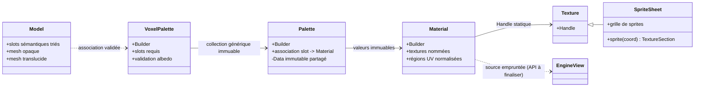
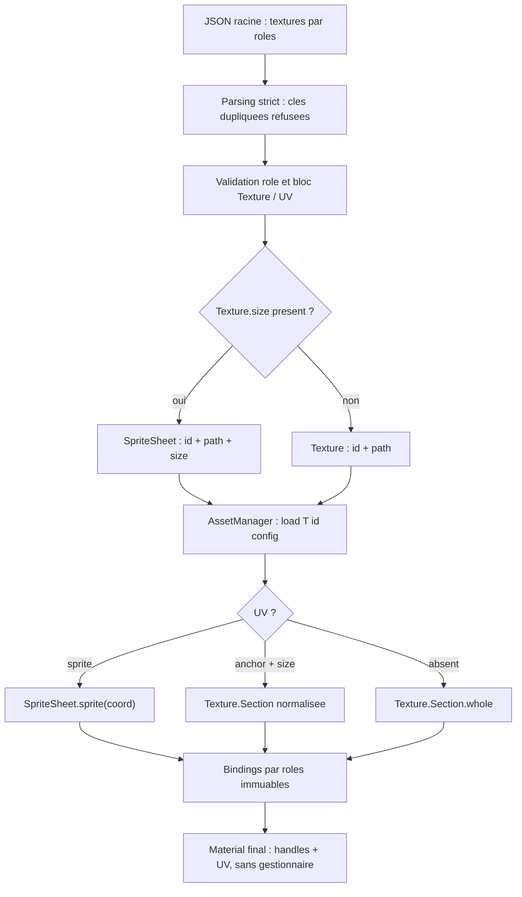
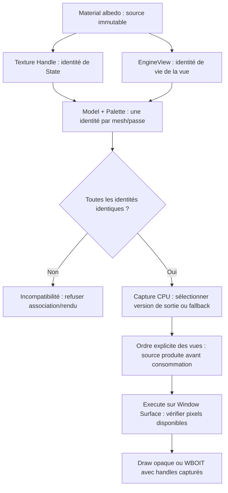

# Sparkle V0.1.4 — Matériaux, textures et palettes

[Sommaire de l'architecture](../voxel-engine-v0.1.4-specification.md)

## 4. Matériaux, textures et palettes



### 4.1 `spk::Material` : ressource générique

`spk::Material` est un **type générique Sparkle**, sans spécialisation `VoxelMaterial`. Il est construit via `Material::Builder`, puis devient **immuable**. Il peut associer zéro, une ou plusieurs textures à des **noms de rôles libres** (`albedo`, ou tout autre nom choisi par le programme). Seul le système voxel donne une signification au rôle `albedo`. Le Builder générique ne valide pas les conventions propres aux voxels.

Chaque liaison à une texture conserve un **`spk::Texture::Handle`** obtenu depuis la `const spk::Texture&` fournie lors du binding, ainsi qu'une région UV normalisée (`Texture::Section`, exprimable en `anchor` et `size`). Le Material conserve le **handle de l'état exact choisi** et non un pointeur brut vers l'objet Texture, une copie complète de Texture ou un pointeur vers l'AssetManager.

Un handle conserve l'état GPU partagé de la Texture après destruction du wrapper Texture initial. Il ne conserve toutefois **ni la grille du SpriteSheet, ni à lui seul son ensemble de résolutions**. Le Material final n'a pas besoin de la grille : la conversion d'un sprite en `Texture::Section` est réalisée **avant** sa construction.

La résolution effectivement capturée est celle de la Texture explicitement passée au Builder. Il n'existe **aucune sélection automatique de résolution** dans Material ou dans le rendu voxel. Changer de résolution implique de fournir la nouvelle Texture choisie à un **nouveau Material**, puis de choisir la nouvelle palette correspondante. Les mipmaps standards du State GPU restent possibles.

**Q-ARCH-008 — sortie finale tone-mappée uniquement (option A validée).** Un Material dont un rôle utilise une `EngineView` consomme **exclusivement la texture finale après composition opaque/WBOIT, exposition et tone mapping**. La même image est offerte à l'affichage dans les widgets et au `Material` d'une autre vue, sur la même surface et version de cible. Les textures opaques et d'accumulation HDR restent des intermédiaires internes : aucun choix de source HDR, deuxième texture de sortie, mode de sélection d'étape ni conversion GPU supplémentaire liée au Material en V0.1.4. La vue consommatrice éclaire son Material et applique ensuite son propre tone mapping normalement, sans réappliquer celui de la vue source au moment de l'échantillonnage. Les modalités de décodage sRGB/linéaire de la texture finale seront précisées dans Q-TECH-003 pour éviter une double correction gamma. L'identité d'atlas, les règles d'ordre de vues, la capture des handles et les fallbacks restent inchangés.

**Q-TECH-003 — couleur de sortie de vue.** Une EngineView utilisée comme source de `Material` a déjà exécuté l'exposition capturée et le tone mapping **Reinhard classique** par canal (`x=max(C_HDR,0)*E` puis `x/(1+x)`). Le Material échantillonne cette unique texture finale sans appliquer explicitement une seconde fois le tone mapping **de la vue source** ; la vue destinataire éclairera et composera normalement sa propre scène. Le format de sortie unique est `GL_SRGB8_ALPHA8` : encodage sRGB après Reinhard, puis décodage sRGB→linéaire matériel lors de la lecture en `albedo` d'une autre vue. Les états GL et de l'UI restent à consolider pour éviter une double correction.

**Q-ARCH-009 — source EngineView opaque.** Le fond RGB et les contributions de composants Skybox des Entities de la vue source sont déjà inclus dans l'unique texture finale tone-mappée. Le Material ne reçoit aucun attachment supplémentaire : l'alpha final reste toujours égal à 1, même si les faces de Skybox ou les fragments WBOIT utilisent des textures RGBA. Un même composant Skybox peut contribuer à différentes vues par le mécanisme ordinaire des layers, sans partager l'identité des sorties de vue.

**Q-ARCH-012 / Q-TECH-007 — six Materials de Skybox, une texture partagée.** Les six faces intérieures du cube inversé du composant `spk::Skybox` utilisent chacune **un `spk::Material` générique** avec les Builders, rôles et UV habituels ; les six rôles **`albedo` doivent désigner la même source logique de texture** : un même `Texture::Handle/State` pour une texture statique, ou une même identité de source `EngineView` pour une source dynamique autorisée par les Materials. Une égalité de pixels, de chemin texte ou de fallback GPU ne suffit pas si les identités de source diffèrent. Chaque Material peut utiliser **sa propre section de UV normalisées** dans cette texture commune ; aucune grille d'atlas, découpe en six régions obligatoires, nouvelle classe `SkyboxMaterial` ou texture cubemap n'est imposée. Les autres rôles nommés éventuellement stockés dans les Materials ne sont pas consommés par le shader Skybox.

Le composant peut remplacer l'association d'un Material pour une face sans modifier les cinq autres. **Avant publication d'un snapshot**, la capture CPU vérifie que les six Materials sont présents, que leur `albedo` est valide et que sa source est identique pour les six ; une incompatibilité produit `spk::Exception` et conserve le dernier snapshot. Les mutations successives de plusieurs Materials doivent être terminées avant une nouvelle capture si elles rendent temporairement les sources divergentes. **Aucun mutex ni mécanisme atomique particulier de Skybox n'est créé** : comme pour les autres composants de rendu, mutations CPU et capture sont coordonnées par l'application. Les six affectations et leurs handles sont capturés dans les commandes immuables, les snapshots antérieurs demeurent valides et `execute()` ne lit pas le composant. Le rendu Skybox reste non éclairé, passe par HDR puis exposition et tone mapping comme le reste de la vue.

**Q-TECH-006 — représentation sémantique et ABI GPU validées.** Les UV sont représentés en C++ par de vrais `spk::Vector2` (origine et dimensions distinctes), jamais par un `Vector4` utilisé comme emballage artificiel. Les positions, directions, normales et couleurs RGB sont des `spk::Vector3`. Le `SPK_PADDING(n)` existant n'est employé qu'aux endroits requis par le layout GPU (`std430`) et chaque structure de transfert est vérifiée par `sizeof`, `alignof` et `offsetof` contre le layout GLSL. Deux `vec2` consécutifs peuvent déjà occuper 16 octets sans padding.

**Extension pour les textures de vues :** la source statique conserve le contrat `Texture::Handle` ci-dessus. Le `Material::Builder` accepte également, pour un **rôle nommé quelconque**, une `EngineView&` explicitement fournie par le développeur et éventuellement une `Texture::Section` UV normalisée (exemple indicatif : `builder.setTexture("albedo", view, section)`). La liaison à l'`EngineView` est **non propriétaire**, sans résolution de son nom depuis un JSON d'asset. Le Material construit conserve la **nature de la source et son identité logique de vue pendant cette incarnation de l'objet**, immuablement, et non le `Texture::Handle` actuel de sortie. **À la construction CPU du snapshot**, le jeu de ressources et la politique de caméra/détachement sont résolus en handles logiques de sortie/fallback capturés ; **à l'exécution GPU**, ces handles sont matérialisés et leur disponibilité vérifiée par `Window::Surface`. Le Material n'allonge pas la durée de vie de l'`EngineView` et aucun rebinding implicite n'a lieu si cette dernière est supprimée puis recréée sous le même nom. Les snapshots antérieurs conservent leurs handles immuables. Les JSON d'assets ne découvrent pas implicitement les vues (le contrat d'un Material JSON complet reste traité séparément).

Les **propriétés et l'identité des handles** d'un Material sont immuables. Les **pixels de l'état Texture partagé** peuvent évoluer selon les API graphiques existantes, avec validation et synchronisation CPU/GPU adaptées : les Materials qui partagent ce même State verront son contenu actualisé. Si une opération détache/remplace le State d'une Texture source, un handle déjà capturé continue de référencer **l'ancien State** : il ne suit pas automatiquement cette substitution. Les paramètres du Material et les anciennes palettes restent inchangés.

### 4.2 Texture simple, SpriteSheet et région d'atlas

La configuration JSON d'une texture peut représenter une simple image :

```json
{
  "Texture": { "path": "terrain.png" },
  "UV": {
    "anchor": { "x": 0.25, "y": 0.5 },
    "size": { "x": 0.125, "y": 0.125 }
  }
}
```

Elle peut également demander un `spk::SpriteSheet`, en donnant une **grille de nombres de sprites**, et sélectionner une cellule de la grille :

```json
{
  "Texture": {
    "path": "terrain.png",
    "size": { "x": 16, "y": 16 }
  },
  "UV": {
    "sprite": { "x": 3, "y": 5 }
  }
}
```

Les coordonnées de type `Vector2` acceptent indifféremment un tableau `[x, y]` ou un objet `{"x": ..., "y": ...}`, aussi bien pour `Texture.size`, `UV.sprite`, `UV.anchor` que `UV.size`. La sérialisation `Vector2::toJSON()` conserve la forme tableau.

Ici, `Texture.size` signifie **16 sprites en largeur et 16 en hauteur**, **pas une résolution en pixels**. `SpriteSheet::sprite(Vector2UInt)` retourne une `Texture::Section` normalisée. Des UV explicites (`anchor`/`size`) restent utilisables **même avec un SpriteSheet**. La syntaxe `sprite` exige une grille valide et des coordonnées de sprite valides.

Ces exemples représentent **un bloc de rôle** réutilisable dans le schéma normatif complet `{ "textures": { "nomDuRole": { "Texture": ..., "UV": ... } } }` de la section 4.2.1. Le chargement JSON et la construction manuelle aboutissent à la même représentation Material : rôle nommé, handle de texture (ou identité de source EngineView uniquement via C++) et `Texture::Section`.

La Shape conserve des UV locaux ; le shader applique le rectangle du Material :

```text
uvFinal = material.anchor + shapeUV * material.size
```

Plusieurs Materials peuvent donc référencer le **même atlas** avec des rectangles UV distincts, sans rebake. Un UV local hors `[0,1]` est utilisé tel quel, sans répétition forcée dans la région ni clamp automatique. Le résultat visuel et la maîtrise des bords du sprite sont sous la responsabilité de l'appelant.

### 4.2.1 Schéma JSON normatif du Material multi-rôles (Q-ARCH-005 validée)

**Racine et rôles.** Un document `spk::Material` est un **objet JSON contenant exactement la propriété `"textures"`**, elle-même un **objet** dont chaque clé est un **nom de rôle libre** et chaque valeur un bloc source de texture `{ "Texture": ..., "UV": ... }`. Le nom `"albedo"` n'a aucun traitement spécial dans le Material générique ; seule `Voxel::Palette` le rend obligatoire pour les slots voxel. `"textures": {}` construit un Material générique sans textures, mais ce Material ne satisfait pas le contrat `albedo` d'un slot voxel. Les rôles sont des chaînes **non vides et non composées uniquement d'espaces**, sensibles à la casse et conservées textuellement (pas de `trim`, alias, normalisation de casse ni ordre signifiant). Tout champ inconnu au niveau racine, au niveau d'un bloc de rôle et au niveau d'une description `Texture` ou `UV` est rejeté, sans interprétation silencieuse.

**Exemple complet — source fichier, SpriteSheet et rôle supplémentaire :**

```json
{
  "textures": {
    "albedo": {
      "Texture": {
        "path": "terrain.png",
        "size": { "x": 16, "y": 16 }
      },
      "UV": { "sprite": { "x": 3, "y": 5 } }
    },
    "normal": {
      "Texture": { "path": "terrain_normal.png" },
      "UV": {
        "anchor": { "x": 0.0, "y": 0.0 },
        "size": { "x": 1.0, "y": 1.0 }
      }
    }
  }
}
```

**Source d'un rôle.** Le bloc `"Texture"` accepte uniquement `path`, `id` (facultatif) et `size` (facultatif). `path` est le chemin non vide du fichier à charger ; `id` est un nom logique indépendant du chemin, qui vaut `path` lorsqu'il est omis. **La présence de `size` choisit `SpriteSheet`, son absence choisit `Texture`.** Il n'existe pas de champ `type` ni de mode `asset` imbriqué.

- Sans `size` : `assets.load<Texture>(id, {"path":path})`.
- Avec `size` : `assets.load<SpriteSheet>(id, {"path":path,"size":size})` ; `size` est une grille d'entiers strictement positifs, pas une résolution en pixels.
- Exemples : `{"path":"terrain.png"}` pour une Texture ; `{"id":"terrain","path":"terrain.png","size":[16,16]}` pour une grille nommée.

La configuration `path` est toujours transmise à la factory graphique ; celle-ci ne déduit jamais le chemin de l'ID. Le gestionnaire conserve son cache par triplet `(type,id,config)` : un même ID peut avoir plusieurs versions, y compris des chemins différents, sélectionnables avec `setDefault<T>`. Une fois construit, un Material ne retient que ses handles et sections UV, pas de pointeur vers l'AssetManager ni vers le SpriteSheet. La liaison `EngineView` reste une opération explicite du Builder C++ et non une source JSON.

**Région UV.** `"UV"` est **facultatif**, son absence signifie `Texture::Section::whole`. Lorsqu'il est présent, c'est un objet prenant **une seule** de ces formes :

- `{ "sprite": {"x":3,"y":5} }` exige une source `SpriteSheet` (grille valide dans l'asset résolu) ; les indices sont des entiers positifs ou nuls et **strictement inférieurs aux dimensions de la grille**. Le résultat est exactement `SpriteSheet::sprite(coord)`.
- `{ "anchor": {"x":0.25,"y":0.5}, "size": {"x":0.125,"y":0.125} }` exige les deux champs. Les coordonnées et dimensions sont numériques, finies, exprimées dans `[0,1]`, les dimensions sont strictement positives et `anchor + size` ne dépasse pas `1` sur chaque axe. Cette forme fonctionne aussi avec un SpriteSheet et ne requiert pas de découpage automatique de cellules.

`UV.sprite` ne se combine pas à `UV.anchor` ou `UV.size`; `UV: null`, objet UV vide, tableau, chaîne, composante manquante, `NaN`, infini ou dimension nulle/négative sont invalides. La validation du rectangle du Material est **distincte de l'avertissement non bloquant sur les UV locaux d'une Shape** situés hors `[0,1]` : ceux-ci ne sont jamais clampés lors du rendu. Un SpriteSheet sans champ `UV` désigne simplement sa texture entière.

**Erreurs, doublons et atomicité.** Les objets JSON n'ont pas d'ordre sémantique. Le parseur existant `JSON::Value::fromString` / `loadFromFile` expose déjà `ParseOptions::rejectDuplicateKeys = true` par défaut : **ce mode est obligatoire** pour charger du texte de Material, afin de refuser les doublons de rôles et les doublons de champs à n'importe quel niveau. Un `JSON::Value` déjà construit est une map de clés uniques ; un doublon qui aurait été silencieusement éliminé par un parsing externe configuré permissif n'est **pas récupérable** après coup. Les constructions depuis `JSON::Value` valident les champs et les types présents, sans prétendre détecter un historique de doublons perdu. Toute erreur de schéma, type, clé, valeur, source non résolue ou coordonnée hors grille produit une `spk::Exception` descriptive avec **chemin logique précis** (par exemple `textures.albedo.Texture.size.x` ou `textures.normal.UV.sprite`), nom du rôle et cause de chargement lorsqu'elle existe. Un objet racine mal formé est rejeté avant publication ; seule l'absence de `UV` entraîne l'utilisation de la texture entière, et seule l'absence de `id` utilise le chemin comme identifiant.

**Builder et équivalence sémantique.** Le `Material::Builder` assemble exclusivement des Textures ou SpriteSheets déjà disponibles : il ne connaît ni le JSON ni l'`Asset::Manager`. La spécialisation `Asset::Factory<spk::Material>` lit le document JSON, résout les dépendances avec le gestionnaire reçu, puis alimente un Builder local. Une séquence qui utilise les **mêmes textures résolues et les mêmes `Texture::Section`** produit des Materials sémantiquement identiques (mêmes rôles, handles/identités de sources et UV), indépendamment de l'ordre des propriétés JSON. À rôles identiques, le Builder n'accepte pas qu'une seconde déclaration **remplace silencieusement** la première : la duplication est une erreur explicite. La factory valide les bindings avant de publier le Material ; en cas d'exception, aucun Material partiellement construit n'est exposé. Les assets dépendants chargés avec succès restent dans le cache en cas d'échec ultérieur, selon le contrat non transactionnel d'Asset::Manager.



### 4.3 `Material::Builder` et la factory JSON

Le Builder construit un Material uniquement depuis des ressources déjà résolues, sans liaison vers un gestionnaire ni logique JSON :

```cpp
spk::Material::Builder builder;
builder.add("albedo", texture);
spk::Material material = builder.build();
```

La lecture du JSON appartient à `Asset::Factory<spk::Material>`, appelée par `assets.load<spk::Material>(id, config)`. La factory reçoit l'`Asset::Manager&`, résout `Texture.path` et les références `Texture.asset`, puis remplit un Builder local. Ni le Builder ni le Material final ne conservent de référence vers l'Asset::Manager.

### 4.4 `spk::Palette` et `spk::Voxel::Palette`

`spk::Palette` est une collection générique immuable de `spk::Material`, indexée par nom. Elle ne contient ni opacité, ni SSBO, ni état GPU propre. Son `Builder` accepte des Materials quels que soient leurs rôles de textures.

`spk::Voxel::Palette` est une adaptation immuable par composition qui peut être construite **sans Model préalable**. Son `Builder` ajoute ou remplace librement des Materials par nom de slot. **À chaque `setMaterial()`, il exige un rôle `albedo` et un `Texture::Handle` valide** ; il refuse un nom vide ou uniquement composé d'espaces. `build()` publie simplement la palette immuable sans vérifier de slots attendus. On peut créer une variante depuis une palette voxel existante.

La complétude relève **exclusivement du Model**, via `Model::isCompatible(const Voxel::Palette&)`. Il vérifie que la palette contient chaque nom de slot du Model, y compris les slots intégralement occultés, puis vérifie qu'une même passe opaque ou translucide ne réclame pas plusieurs identités de source `albedo`. Les Materials supplémentaires sont ignorés pour ce Model. Une palette incomplète pour un Model peut être construite normalement puis être jugée incompatible par ce dernier ; elle n'est pas incomplète dans l'absolu.

**Aucune palette ne contient d'opacité.** `Voxel::Definition` fixe l'opacité et `Voxel::Model` la conserve pour déterminer les passes. Deux Models peuvent partager une même palette malgré des opacités différentes pour un slot de même nom. Aucun rebake ni division automatique des meshes n'est effectué.

**Exemple d'API PR-07 — palette construite avant le Model :**

```cpp
spk::Palette::Builder generic;
generic.setMaterial("normalOnly", normalMaterial);
const spk::Palette genericPalette = generic.build();

spk::Voxel::Palette::Builder builder;
builder.setMaterial("stone", stoneMaterial);
builder.setMaterial("glass", glassMaterial);
const spk::Voxel::Palette palette = builder.build();

// Création du Model indépendante de la palette (mesher).
const spk::Voxel::Model model = mesher.bake(volume);
if (!model.isCompatible(palette))
{
    throw spk::Exception("Palette incompatible avec le Model");
}

// Variante immuable sans changement de la géométrie.
spk::Voxel::Palette::Builder variant(palette);
variant.setMaterial("stone", replacementMaterial);
const spk::Voxel::Palette alternate = variant.build();
```

La validation de `albedo` n'est pas répétée dans `build()`. La création d'une association de rendu et ses diagnostics relèvent des PR suivantes ; l'intégration des Assemblies est traitée en PR-08.

**Identité d'atlas des sources de vue (Q-ARCH-003 validée).** La vérification de compatibilité utilise une **identité logique immuable de la source `albedo`**, jamais son handle GPU résolu. Deux types d'identités sont incompatibles entre eux : `Static(Texture::Handle)` (identité du `GPUResource::State` effectivement capturé, sans considérer une génération/pixels ultérieurs comme un nouvel atlas tant que le State reste le même) et `EngineView(identité de vie de la vue)`. La seconde identité est propre à **l'incarnation concrète** de la vue dans son `RenderingEngine`, et non à son nom textuel : supprimer puis recréer `"monitor"` ne rétablit aucune identité ou liaison antérieure. Un simple identifiant de vue stable attribué par son moteur suffit, sans registre global ni possession nouvelle. La source de vue reste non propriétaire et le développeur doit cesser de l'utiliser avant destruction.

**Validation de la paire Model/Palette.** Pour **chaque mesh/passe indépendamment**, tous les slots requis, **y compris les slots totalement occultés**, doivent présenter la **même identité `albedo`** ; s'il existe plusieurs identités, `Model::isCompatible(palette)` indique l'incompatibilité et la création d'une association destinée au rendu est refusée par `spk::Exception` descriptive, avant publication d'un snapshot. Deux Materials provenant de **la même EngineView vivante** sont admis, avec des régions UV différentes. Une source statique et une source de vue sont toujours incompatibles au sein du même mesh/passe, **même si `DefaultTexture` pointe provisoirement sur ce même State statique**. Deux EngineView distinctes sont toujours incompatibles, même si elles produisent des pixels identiques ou emploient le même fallback. Deux textures statiques distinctes sont incompatibles dans la même passe ; opaques et translucides peuvent utiliser des identités différentes. Les slots supplémentaires de la palette qui ne sont pas requis par ce Model n'interviennent pas dans cette vérification. Aucun split automatique de mesh, atlas de regroupement, copie inter-surfaces ni re-bake n'est introduit.

**Contrat de capture Q-ARCH-008.** Pour un rôle de Material lié à une EngineView active, le handle résolu est celui de sa **sortie finale tone-mappée** ; jamais un attachment opaque `RGBA16F`, une accumulation WBOIT ou une texture pré-tone mapping. En politique `KeepLastFrame`, réutiliser l'ancienne sortie finale produite sur cette version et surface. En `DefaultTexture`, le fallback explicitement fourni conserve son contrat ordinaire sans obligation de provenir d'une EngineView.

**Stabilité de l'identité et capture des ressources.** La compatibilité est **déterministe au moment de l'association Model/Palette** et ne change pas selon la surface, la caméra, un resize, la politique `Invalid/KeepLastFrame/DefaultTexture`, le fallback ou la disponibilité réelle des pixels. À chaque **nouvelle capture** utilisant cette association, Sparkle résout le handle logique courant de la sortie de la vue, sa version de cible et les UV capturés, conformément aux politiques d'erreur du chapitre 07. Une capture ancienne garde sa version ; un resize n'altère ni le Material ni la compatibilité logique. L'absence de contenu produit pour la surface/version courante reste une **erreur d'exécution GPU**, pas une raison de reclassifier les atlas ou de modifier le batching. Une politique de sortie invalide connue au CPU est refusée lors de la capture.

**Dépendances entre vues sans ordonnancement automatique.** Une source de vue utilisée par le dessin d'une autre vue doit avoir sa sortie disponible au moment effectif de l'échantillonnage. Si les deux vues **sont rendues dans le même snapshot moteur**, une référence à une vue qui n'a pas encore exécuté sa composition (même vue, vue suivante ou dépendance cyclique) est refusée dès la capture avec `spk::Exception` : le développeur doit fournir un ordre explicite compatible. Cela se vérifie par l'ordre des sous-snapshots existant, sans nouveau graphe ou ordonnanceur des Materials. Si la vue source **n'est pas rendue dans ce snapshot** (caméra détachée avec `KeepLastFrame` ou `DefaultTexture`, ou contenu produit auparavant dans un autre rendu), les règles de disponibilité par surface du chapitre 07 s'appliquent, sans production implicite ni copie. Lors de l'exécution, toute tentative d'échantillonner le **même attachment** en cours d'écriture est interdite ; Sparkle ne suppose jamais que les pixels indéfinis ou une boucle de rétroaction sont exploitables. Les dépendances impossibles et erreurs de texture non produite sont décrites sans masquer une scène mal configurée.

**Contrainte des atlas :** pour chaque association **Model + Voxel::Palette**, les Materials des slots **opaques** requis par ce Model doivent tous référencer **une seule identité logique de source `albedo` au maximum**, statique (`Texture::Handle`/State) ou `EngineView` ; la même règle s'applique, indépendamment, aux slots **translucides**. Cette vérification concerne **tous les slots déclarés par le Model, même sans triangles émis**, pas l'intégralité des slots supplémentaires de la palette. Les passes opaque et translucide peuvent utiliser le même atlas ou deux atlas différents.

Une palette peut donc contenir arbitrairement plusieurs atlas pour répondre aux besoins de divers Models ; elle n'est pas rejetée globalement pour cette raison. C'est une **association** qui est refusée explicitement lorsqu'elle demanderait deux atlas différents dans une même passe. Aucun remaillage silencieux ni découpage des meshes en sous-meshes par texture n'est prévu.




### 4.5 Alpha, opacité et visibilité

La classification géométrique reste celle de la Shape :

- `slot.opacity == 1.0` : triangles dans le mesh opaque ;
- `slot.opacity < 1.0` : triangles dans le mesh translucide (WBOIT).

Dans les **deux** fragment shaders :

```glsl
float alphaFinal = texture(albedo, uvFinal).a * slotOpacity;
if (alphaFinal == 0.0)
    discard;
```

Le mesh opaque est dessiné sans blending de translucence. Une texture contenant de l'alpha intermédiaire sur un slot d'opacité 1 **ne déclenche donc pas automatiquement** un passage translucide ; c'est un choix explicite de l'auteur. Le mesh translucide utilise Weighted Blended Order-Independent Transparency (WBOIT).

L'alpha des pixels n'a **jamais** d'incidence sur la décision de culling effectuée au bake. Il n'existe ni troisième mesh voxel cutout, ni booléen transparent supplémentaire, ni contrat d'occlusion indépendant.

**WBOIT — alpha et poids (Q-TECH-003).** Pour les triangles déclarés translucides, le shader calcule `alphaFinal` ci-dessus, puis un **poids indépendant de l'alpha** à partir de `gl_FragCoord.z` selon le contrat fixe du [§7.8](09-pipeline-gpu-transparence.md). Ce poids modifie uniquement leur accumulation et non la classification géométrique, les UV, l'albedo ou les ombres. La composition n'applique exposition/Reinhard qu'après mélange avec l'opaque.

**Ombres (option A validée pour V0.1.4).** L'alpha de `albedo` ne participe pas non plus au rendu des shadow maps : un triangle du `ShadowMap::Mesh` explicite ou issu du bake est considéré **plein**, même si son matériau visuel utilise `discard` pour certains pixels transparents. Les UV, textures et palettes ne sont jamais transmis au shader de profondeur des ombres. Les découpes d'ombre doivent être **géométriques** et fournies par le jeu au caster ; modifier seulement `albedo`, son alpha ou la palette ne demande aucune reconstruction de la carte d'ombres tant que la géométrie d'ombre, ses transformations et ses paramètres restent inchangés. Les récepteurs translucides peuvent toujours recevoir des ombres conformément au pipeline Forward/WBOIT.
