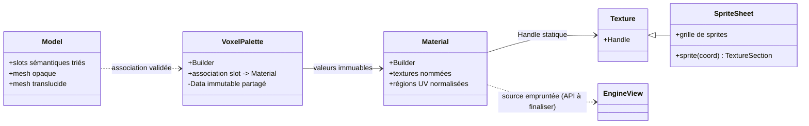
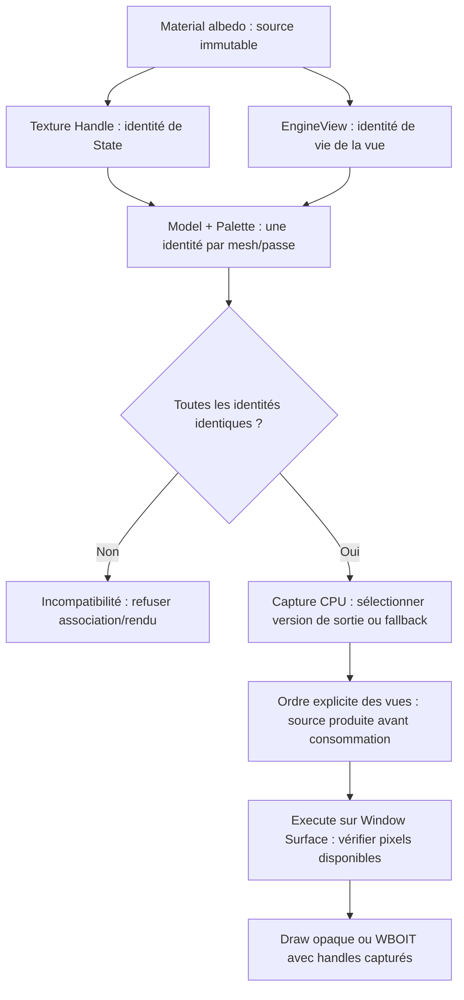

# Sparkle V0.1.4 — Matériaux, textures et palettes

[Sommaire de l'architecture](../voxel-engine-v0.1.4-specification.md)

## 4. Matériaux, textures et palettes



### 4.1 `spk::Material` : ressource générique

`spk::Material` est un **type générique Sparkle**, sans spécialisation `VoxelMaterial`. Il est construit via `Material::Builder`, puis devient **immuable**. Il peut associer zéro, une ou plusieurs textures à des **noms de rôles libres** (`albedo`, ou tout autre nom choisi par le programme). Seul le système voxel donne une signification au rôle `albedo`. Le Builder générique ne valide pas les conventions propres aux voxels.

Chaque liaison à une texture conserve un **`spk::Texture::Handle`** obtenu depuis la `const spk::Texture&` fournie lors du binding, ainsi qu'une région UV normalisée (`Texture::Section`, exprimable en `anchor` et `size`). Le Material conserve le **handle de l'état exact choisi** et non un pointeur brut vers l'objet Texture, une copie complète de Texture ou un pointeur vers l'AssetManager.

Un handle conserve l'état GPU partagé de la Texture après destruction du wrapper Texture initial. Il ne conserve toutefois **ni la grille du SpriteSheet, ni à lui seul son ensemble de résolutions**. Le Material final n'a pas besoin de la grille : la conversion d'un sprite en `Texture::Section` est réalisée **avant** sa construction.

La résolution effectivement capturée est celle de la Texture explicitement passée au Builder. Il n'existe **aucune sélection automatique de résolution** dans Material ou dans le rendu voxel. Changer de résolution implique de fournir la nouvelle Texture choisie à un **nouveau Material**, puis de choisir la nouvelle palette correspondante. Les mipmaps standards du State GPU restent possibles.

**Extension pour les textures de vues :** la source statique conserve le contrat `Texture::Handle` ci-dessus. Le `Material::Builder` accepte également, pour un **rôle nommé quelconque**, une `EngineView&` explicitement fournie par le développeur et éventuellement une `Texture::Section` UV normalisée (exemple indicatif : `builder.setTexture("albedo", view, section)`). La liaison à l'`EngineView` est **non propriétaire**, sans résolution de son nom depuis un JSON d'asset. Le Material construit conserve la **nature de la source et son identité logique de vue pendant cette incarnation de l'objet**, immuablement, et non le `Texture::Handle` actuel de sortie. **À la construction CPU du snapshot**, le jeu de ressources et la politique de caméra/détachement sont résolus en handles logiques de sortie/fallback capturés ; **à l'exécution GPU**, ces handles sont matérialisés et leur disponibilité vérifiée par `Window::Surface`. Le Material n'allonge pas la durée de vie de l'`EngineView` et aucun rebinding implicite n'a lieu si cette dernière est supprimée puis recréée sous le même nom. Les snapshots antérieurs conservent leurs handles immuables. Les JSON d'assets ne découvrent pas implicitement les vues (le contrat d'un Material JSON complet reste traité séparément).

Les **propriétés et l'identité des handles** d'un Material sont immuables. Les **pixels de l'état Texture partagé** peuvent évoluer selon les API graphiques existantes, avec validation et synchronisation CPU/GPU adaptées : les Materials qui partagent ce même State verront son contenu actualisé. Si une opération détache/remplace le State d'une Texture source, un handle déjà capturé continue de référencer **l'ancien State** : il ne suit pas automatiquement cette substitution. Les paramètres du Material et les anciennes palettes restent inchangés.

### 4.2 Texture simple, SpriteSheet et région d'atlas

La configuration JSON d'une texture peut représenter une simple image :

```json
{
  "Texture": { "path": "terrain.png" },
  "UV": {
    "anchor": { "x": 0.25, "y": 0.5 },
    "size": { "x": 0.125, "y": 0.125 }
  }
}
```

Elle peut également demander un `spk::SpriteSheet`, en donnant une **grille de nombres de sprites**, et sélectionner une cellule de la grille :

```json
{
  "Texture": {
    "path": "terrain.png",
    "size": { "x": 16, "y": 16 }
  },
  "UV": {
    "sprite": { "x": 3, "y": 5 }
  }
}
```

Ici, `Texture.size` signifie **16 sprites en largeur et 16 en hauteur**, **pas une résolution en pixels**. `SpriteSheet::sprite(Vector2UInt)` retourne une `Texture::Section` normalisée. Des UV explicites (`anchor`/`size`) restent utilisables **même avec un SpriteSheet**. La syntaxe `sprite` exige une grille valide et des coordonnées de sprite valides.

Ces exemples illustrent le **bloc de description d'une texture**, pas nécessairement la structure complète d'un Material à rôles multiples ; les noms et l'organisation des rôles restent génériques. Le chargement JSON et la construction manuelle doivent aboutir à la **même représentation Material : handle + section UV**.

La Shape conserve des UV locaux ; le shader applique le rectangle du Material :

```text
uvFinal = material.anchor + shapeUV * material.size
```

Plusieurs Materials peuvent donc référencer le **même atlas** avec des rectangles UV distincts, sans rebake. Un UV local hors `[0,1]` est utilisé tel quel, sans répétition forcée dans la région ni clamp automatique. Le résultat visuel et la maîtrise des bords du sprite sont sous la responsabilité de l'appelant.

### 4.3 `Material::Builder` et l'AssetManager

Le Builder peut fonctionner **sans AssetManager** lorsque le programme lui passe directement des Textures existantes. En revanche, un chargement JSON qui doit résoudre un chemin ou un asset requiert un AssetManager préalablement lié :

```cpp
spk::Material::Builder builder;
builder.bind(&assets);  // Liaison non propriétaire
// Construction depuis un JSON de matériau.
```

`void bind(spk::AssetManager*)` est la forme retenue. **`bind(nullptr)` provoque immédiatement une `spk::Exception`.** Une liaison à cible unique n'est pas implicitement remplacée sans détachement préalable, selon les conventions Sparkle. Le Material obtenu ne conserve aucune référence au gestionnaire.

### 4.4 `spk::VoxelPalette` : association des slots aux matériaux

Une `VoxelPalette` associe des **noms de slots sémantiques et leurs contrats d'opacité** à des valeurs `spk::Material`. C'est une valeur immuable, à copies légères partageant un bloc de données internes ; elle ne contient **aucun SSBO** et n'hérite d'aucun objet GPU.

Son Builder mutable peut être initialisé à partir d'un Model, de plusieurs Models, d'un Assembly (union de leurs besoins) ou d'une palette existante pour en créer une variante. Les collisions de **même nom avec des opacités différentes** entre sources sont rejetées explicitement. Construire une nouvelle palette n'altère pas l'ancienne, ses Materials ou les snapshots existants.

**Chaque slot déclaré** doit recevoir un Material compatible, **même s'il n'a aucun triangle visible**. Le Builder valide que chaque Material affecté possède au moins la texture nommée exactement **`albedo`**, avec exception descriptive sur absence. Le système voxel ne requiert, n'examine ni n'utilise d'autres noms de textures dans cette version. La présence d'autres rôles sur un Material reste autorisée.

Un Model peut être associé à une palette contenant **plus de slots** que lui. L'association est compatible seulement si tous ses noms et opacités requis sont présents. `Model::isCompatible(palette)` est la forme d'API envisagée pour vérifier ce contrat, y compris la limite d'atlas par passe décrite ci-dessous. La palette n'est pas obligée d'être identique au Model, et une même palette peut servir à plusieurs Models.

**Identité d'atlas des sources de vue (Q-ARCH-003 validée).** La vérification de compatibilité utilise une **identité logique immuable de la source `albedo`**, jamais son handle GPU résolu. Deux types d'identités sont incompatibles entre eux : `Static(Texture::Handle)` (identité du `GPUResource::State` effectivement capturé, sans considérer une génération/pixels ultérieurs comme un nouvel atlas tant que le State reste le même) et `EngineView(identité de vie de la vue)`. La seconde identité est propre à **l'incarnation concrète** de la vue dans son `RenderingEngine`, et non à son nom textuel : supprimer puis recréer `"monitor"` ne rétablit aucune identité ou liaison antérieure. Un simple identifiant de vue stable attribué par son moteur suffit, sans registre global ni possession nouvelle. La source de vue reste non propriétaire et le développeur doit cesser de l'utiliser avant destruction.

**Validation de la paire Model/Palette.** Pour **chaque mesh/passe indépendamment**, tous les slots requis, **y compris les slots totalement occultés**, doivent présenter la **même identité `albedo`** ; s'il existe plusieurs identités, `Model::isCompatible(palette)` indique l'incompatibilité et la création d'une association destinée au rendu est refusée par `spk::Exception` descriptive, avant publication d'un snapshot. Deux Materials provenant de **la même EngineView vivante** sont admis, avec des régions UV différentes. Une source statique et une source de vue sont toujours incompatibles au sein du même mesh/passe, **même si `DefaultTexture` pointe provisoirement sur ce même State statique**. Deux EngineView distinctes sont toujours incompatibles, même si elles produisent des pixels identiques ou emploient le même fallback. Deux textures statiques distinctes sont incompatibles dans la même passe ; opaques et translucides peuvent utiliser des identités différentes. Les slots supplémentaires de la palette qui ne sont pas requis par ce Model n'interviennent pas dans cette vérification. Aucun split automatique de mesh, atlas de regroupement, copie inter-surfaces ni re-bake n'est introduit.

**Stabilité de l'identité et capture des ressources.** La compatibilité est **déterministe au moment de l'association Model/Palette** et ne change pas selon la surface, la caméra, un resize, la politique `Invalid/KeepLastFrame/DefaultTexture`, le fallback ou la disponibilité réelle des pixels. À chaque **nouvelle capture** utilisant cette association, Sparkle résout le handle logique courant de la sortie de la vue, sa version de cible et les UV capturés, conformément aux politiques d'erreur du chapitre 07. Une capture ancienne garde sa version ; un resize n'altère ni le Material ni la compatibilité logique. L'absence de contenu produit pour la surface/version courante reste une **erreur d'exécution GPU**, pas une raison de reclassifier les atlas ou de modifier le batching. Une politique de sortie invalide connue au CPU est refusée lors de la capture.

**Dépendances entre vues sans ordonnancement automatique.** Une source de vue utilisée par le dessin d'une autre vue doit avoir sa sortie disponible au moment effectif de l'échantillonnage. Si les deux vues **sont rendues dans le même snapshot moteur**, une référence à une vue qui n'a pas encore exécuté sa composition (même vue, vue suivante ou dépendance cyclique) est refusée dès la capture avec `spk::Exception` : le développeur doit fournir un ordre explicite compatible. Cela se vérifie par l'ordre des sous-snapshots existant, sans nouveau graphe ou ordonnanceur des Materials. Si la vue source **n'est pas rendue dans ce snapshot** (caméra détachée avec `KeepLastFrame` ou `DefaultTexture`, ou contenu produit auparavant dans un autre rendu), les règles de disponibilité par surface du chapitre 07 s'appliquent, sans production implicite ni copie. Lors de l'exécution, toute tentative d'échantillonner le **même attachment** en cours d'écriture est interdite ; Sparkle ne suppose jamais que les pixels indéfinis ou une boucle de rétroaction sont exploitables. Les dépendances impossibles et erreurs de texture non produite sont décrites sans masquer une scène mal configurée.

**Contrainte des atlas :** pour chaque association **Model + VoxelPalette**, les Materials des slots **opaques** requis par ce Model doivent tous référencer **une seule identité logique de source `albedo` au maximum**, statique (`Texture::Handle`/State) ou `EngineView` ; la même règle s'applique, indépendamment, aux slots **translucides**. Cette vérification concerne **tous les slots déclarés par le Model, même sans triangles émis**, pas l'intégralité des slots supplémentaires de la palette. Les passes opaque et translucide peuvent utiliser le même atlas ou deux atlas différents.

Une palette peut donc contenir arbitrairement plusieurs atlas pour répondre aux besoins de divers Models ; elle n'est pas rejetée globalement pour cette raison. C'est une **association** qui est refusée explicitement lorsqu'elle demanderait deux atlas différents dans une même passe. Aucun remaillage silencieux ni découpage des meshes en sous-meshes par texture n'est prévu.




### 4.5 Alpha, opacité et visibilité

La classification géométrique reste celle de la Shape :

- `slot.opacity == 1.0` : triangles dans le mesh opaque ;
- `slot.opacity < 1.0` : triangles dans le mesh translucide (WBOIT).

Dans les **deux** fragment shaders :

```glsl
float alphaFinal = texture(albedo, uvFinal).a * slotOpacity;
if (alphaFinal == 0.0)
    discard;
```

Le mesh opaque est dessiné sans blending de translucence. Une texture contenant de l'alpha intermédiaire sur un slot d'opacité 1 **ne déclenche donc pas automatiquement** un passage translucide ; c'est un choix explicite de l'auteur. Le mesh translucide utilise Weighted Blended Order-Independent Transparency (WBOIT).

L'alpha des pixels n'a **jamais** d'incidence sur la décision de culling effectuée au bake. Il n'existe ni troisième mesh voxel cutout, ni booléen transparent supplémentaire, ni contrat d'occlusion indépendant.
