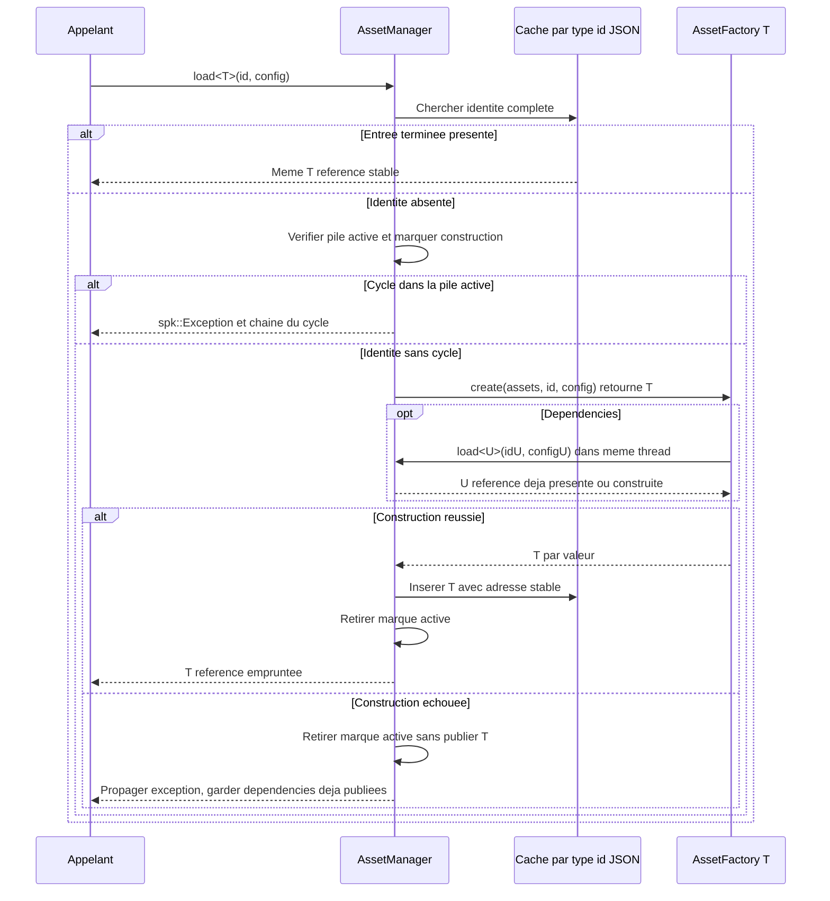

# Sparkle V0.1.4 — AssetManager générique

[Sommaire de l'architecture](../voxel-engine-v0.1.4-specification.md)

## 5. AssetManager générique

Le gestionnaire d'assets appartient à Sparkle, indépendamment de l'API voxel. Il gère la création et la possession d'objets de types variés, sans leur imposer de méthode `fromJSON()` ou `toJSON()` universelle.

### 5.1 API de chargement et identité de cache

```cpp
spk::AssetManager assets;

auto& first = assets.load<spk::SpriteSheet>("terrain", config16);
auto& same  = assets.load<spk::SpriteSheet>("terrain", config16);
auto& other = assets.load<spk::SpriteSheet>("terrain", config8);

// &first == &same ; &first != &other
```

Le cache distingue les assets par le **triplet `(type C++ T, identifiant, valeur structurelle de spk::JSON::Value)`**. Le même identifiant peut désigner plusieurs configurations : ce sont alors des ressources distinctes. L'identifiant est une chaîne libre ; l'AssetManager ne l'interprète pas automatiquement comme un chemin.

L'égalité des JSON est **structurelle** : l'ordre textuel des propriétés d'un objet JSON n'altère pas la clé. La configuration est conservée par valeur dans l'identité du cache, et non par pointeur vers l'argument. Deux appels pour un même triplet rendent **la même instance** sans réexécuter la factory.

La configuration peut être omise :

```cpp
auto& a = assets.load<MyAsset>("simple");
auto& b = assets.load<MyAsset>(
    "simple", spk::JSON::Value::object()
);
// &a == &b
```

La forme à un seul argument signifie **exactement un objet JSON vide**, obtenu par `spk::JSON::Value::object()`. Un `spk::JSON::Value{}` est en revanche **Null** dans l'API actuelle et demeure une clé **différente**. Ne jamais confondre objet vide et Null.

**Application au schéma `Material` multi-rôles (Q-ARCH-005 validée).** Le document `Material` du chapitre 04 est un objet `{ "textures": { "<role>": { "Texture": ..., "UV": ... } } }`. Une factory spécialisée `AssetFactory<spk::Material>` peut déléguer sa construction au `Material::Builder` explicitement lié à l'`AssetManager&` reçu, sans registre de factories ni méthode `fromJSON()` universelle. Un chargement par `load<Material>(id, config)` possède **exactement la même identité de cache structurelle** que tout autre type d'asset ; l'ordre des clés `textures` ne distingue pas deux Materials. Des variations réelles de rôles, de sources, de grilles ou de sections UV sont conservées dans la configuration, donc participent à cette identité.

**Résolution explicite de chaque rôle.** Pour `Texture: { "path": "fichier.png" }`, le constructeur de Material utilise `assets.load<Texture>("fichier.png", JSON::Value::object())`. La forme `{ "path": "atlas.png", "size": {"x":16,"y":16} }` fait appel à `assets.load<SpriteSheet>("atlas.png", { "size": ... })` ; le `size` désigne la **grille de sprites** et jamais une résolution en pixels. Ces formes fichier passent le chemin comme identifiant de factory, sans normalisation par l'AssetManager lui-même. Pour `Texture: { "asset": { "type": "Texture" | "SpriteSheet", "id": "...", "config": {...} } }`, le type est choisi **explicitement** puis `assets.load<T>(id, config)` est appelé avec le JSON de configuration intact. L'absence de `config` correspond à **un objet JSON vide**, pas à `Null`. Le code spécifique à `AssetFactory<T>` choisit lui-même comment interpréter `id` et `config` ; le schéma de Material ne lui impose aucune convention de chemin en mode référence typée.

```json
{
  "textures": {
    "albedo": {
      "Texture": {
        "asset": {
          "type": "SpriteSheet",
          "id": "terrain.png",
          "config": { "size": { "x": 16, "y": 16 } }
        }
      },
      "UV": { "sprite": { "x": 3, "y": 5 } }
    },
    "normal": {
      "Texture": {
        "asset": { "type": "Texture", "id": "terrain_normal.png" }
      }
    }
  }
}
```

Les deux formes `path + size` et `asset + type + id + config` qui aboutissent au **même triplet de dépendance** utilisent la même instance de `SpriteSheet` ou `Texture`. Deux configurations différentes (par exemple grille 16×16 et 8×8) créent des dépendances distinctes même si elles portent le même identifiant ; aucun rôle ne reconfigure une instance déjà chargée. La résolution d'un rôle ne change pas les règles de possession : après création, le Material conserve un `Texture::Handle` et une `Texture::Section`, sans emprunt au SpriteSheet ou à l'AssetManager. Un `AssetManager::clear()` invalide les références à ses assets, **mais n'invalide pas rétroactivement les handles** déjà conservés par les Materials.

**Validation et échecs de chargement.** Le texte de fichier Material est lu avec `JSON::ParseOptions::rejectDuplicateKeys = true` (valeur déjà par défaut) ; `JSON::Value` conserve ensuite les objets sous forme de map et ne mémorise pas les doublons rejetés par le parseur. L'intégralité du schéma et de ses rôles est validée, avec `spk::Exception` contextualisée par le chemin `textures.<role>...`, avant de publier le Material. Une erreur sur le dernier rôle ne doit pas publier le Material partiel ; les dépendances déjà construites avec succès peuvent rester dans le cache, conformément au contrat général d'échec des factories. En cas d'erreur de dépendance ou de cycle direct/indirect, la cause native est conservée dans l'exception descriptive et la pile de détection de cycles est nettoyée.

### 5.2 Factories statiques par type

Lorsqu'une clé est absente, le gestionnaire appelle une **factory spécialisée statiquement pour T**. Aucune inscription de factory par instance, aucun `registerFactory<T>()` et aucun registre dynamique de constructeurs ne sont requis.

L'interface conceptuelle est :

```cpp
template <>
struct spk::AssetFactory<MyAsset>
{
    static MyAsset create(
        spk::AssetManager& assets,
        const std::string& id,
        const spk::JSON::Value& config
    );
};
```

La factory reçoit **explicitement** le gestionnaire, l'identifiant original et la configuration. Elle peut appeler `assets.load<U>()` pour résoudre des dépendances et décider elle-même comment interpréter son identifiant ou le JSON (nom logique, fichier, options métier, etc.). Une spécialisation applicative est possible pour tout type d'asset pris en charge. Le nom exact de la spécialisation, le type de paramètre de chaîne et certaines contraintes de compilation sont encore des détails d'interface.

**La factory retourne `T` par valeur.** Elle ne retourne pas un `unique_ptr`, un `shared_ptr` ou un handle de possession et n'a pas à connaître la structure du cache. Une absence de factory pour un type demandé doit être signalée explicitement au niveau compilation/contrat, sans fallback arbitraire. Un chargement ne suppose aucune sérialisation JSON du type lui-même.

### 5.3 Possession, adresses stables et construction directe

`AssetManager::load<T>()` retourne **`T&`**, emprunt non propriétaire sur un asset que **l'AssetManager possède**. Tant que l'entrée est conservée, son adresse **ne change pas**, même lorsque de nouvelles entrées sont insérées, que des conteneurs sont réalloués ou qu'une table de hachage est réorganisée. Le gestionnaire peut utiliser des allocations dédiées et des pointeurs propriétaires **strictement internes** pour garantir cette stabilité.

Pour des types non copiables ou non déplaçables, C++23 permet de construire directement l'objet dans son emplacement final à partir d'une prvalue de `T` retournée par la factory :

```cpp
// Pseudo-implémentation interne : unique_ptr reste invisible de la factory.
auto owned = std::unique_ptr<T>(
    new T(spk::AssetFactory<T>::create(*this, id, config))
);
cache.emplace(key, std::move(owned));
```

L'élision obligatoire des copies fonctionne avec un retour direct de type `return T(args...);`. La forme `return local;` dépend, elle, d'une NRVO non garantie ; et `std::make_unique<T>(AssetFactory<T>::create(...))` peut demander une opération de déplacement. **Ni `unique_ptr` ni `new` ne constituent une obligation de l'API publique** : seuls comptent le retour par valeur de la factory, le retour `T&` du gestionnaire et l'adresse stable de l'objet stocké.

### 5.4 Dépendances et détection des cycles

Une factory peut effectuer des chargements imbriqués dans **le même AssetManager et le même thread**. Si elle redemande un asset **déjà en cours de construction dans la chaîne active**, le gestionnaire détecte ce cycle, direct ou indirect, et lance une **`spk::Exception` descriptive**.

La comparaison utilise le triplet **complet** `(type, id, JSON structurel)` ; deux configurations différentes du même nom ne sont pas un cycle à elles seules. Un asset déjà **terminé et publié** dans le cache est simplement réutilisé. Le message d'erreur doit permettre d'identifier la chaîne de dépendances en cause.

Une factory échouée **ne publie aucune entrée partiellement initialisée**. L'état provisoire de détection des cycles est nettoyé en cas de succès comme d'exception, permettant une nouvelle tentative ultérieure. Les dépendances qui ont été **chargées avec succès** avant cet échec restent dans le cache : il n'existe pas de transaction globale ou rollback de toutes les dépendances.

**Séquence de chargement, de dépendances et de publication.** La factory est exécutée seulement pour une identité absente ; la pile de construction active détecte les cycles, et seule une construction terminée entre dans le cache.



### 5.5 Synchronisation et durée de vie

**L'AssetManager n'est pas intrinsèquement thread-safe.** Tous les accès concurrents à **une même instance**, même pour des clés différentes, relèvent de la synchronisation de l'application. Les appels imbriqués depuis une factory **dans le même thread** restent autorisés ; une synchronisation externe doit tenir compte de cette réentrance séquentielle. L'AssetManager n'introduit ni verrou de coordination automatique ni attente implicite entre factories de threads différents.

Le gestionnaire garde tous ses assets jusqu'à :

- la destruction de l'AssetManager ;
- ou l'appel explicite à **`void AssetManager::clear()`**.

Il n'existe **aucune éviction automatique**, aucun LRU ni nettoyage des seules entrées prétendument inutilisées. `clear()` détruit **tous les objets appartenant au gestionnaire**, puis laisse celui-ci réutilisable pour de nouveaux chargements. Tous les `T&` et pointeurs empruntés deviennent invalides après la purge ; un chargement ultérieur de même clé crée un **nouvel asset** et ne restaure jamais la validité des anciennes références.

Les mécanismes propriétaires propres aux assets restent distincts de la vie du wrapper `T` : notamment, un `Texture::Handle` déjà capturé par un Material peut conserver son état graphique après `clear()`, sans conserver la grille SpriteSheet ni un Font d'origine. Des widgets détenant un `Font*` doivent cesser de l'utiliser avant la destruction de l'asset correspondant.

`clear()` suit les mêmes contraintes de synchronisation externe que `load<T>()`. La purge au milieu d'une factory ou d'une chaîne de chargements active n'est **pas un scénario pris en charge**. Aucun `unload<T>()` par clé, rechargement ciblé ou surveillance automatique des emprunts n'est ajouté dans cette version.
