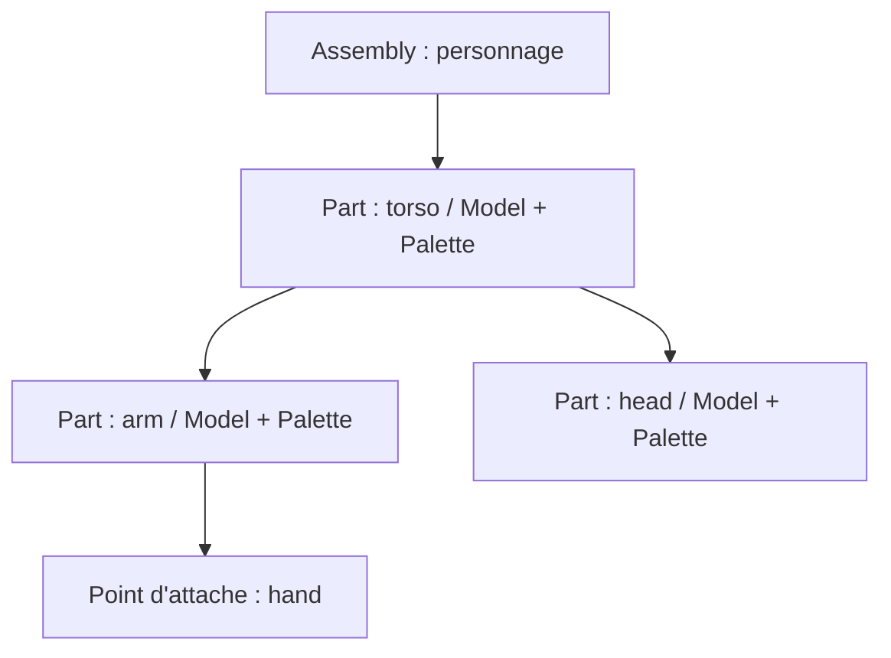

# Sparkle V0.1.4 — Assembly, composants et scène

[Sommaire de l'architecture](../voxel-engine-v0.1.4-specification.md)

## 6. Assembly, composants et scène

### 6.1 `spk::Voxel::Assembly`

Une Assembly est une **hiérarchie mutable de parties** sans Entity propre pour chaque membre. Chaque Part possède un identifiant stable au sein de son Assembly, un nom, éventuellement un parent, une transformation locale et éventuellement une copie légère de `Model` **avec sa propre association à une `VoxelPalette`**. Un point d'attache nommé peut ne contenir aucun mesh ; il peut servir à composer des modèles ou sous-assemblages.

Les opérations couvrent ajout, accès, transformation locale, changement de parent et retrait de parties, avec **refus des cycles**. La forme exacte des identifiants et des signatures est une question d'API, pas une raison d'introduire un deuxième système hiérarchique.

Les transformations locales sont indépendantes de `spk::Transform3D`, qui est déjà un Component3D. Une copie d'Assembly est **autonome pour sa hiérarchie et ses transformations**, tout en réutilisant les données immuables des Models et Palettes. L'Assembly copié démarre avec son **propre VersionedTrait, à version 1**, et non une copie des abonnés ou du compteur de version source. Les évolutions générales de `VersionedTrait` doivent rester compatibles avec cette propriété.

L'animation demeure **externe** à la bibliothèque voxel : un système de jeu peut modifier les transforms des parties, puis appeler `invalidate()` sur l'Assembly. Le rendu ne s'appuie toutefois sur **aucun cache de version** pour ses occurrences : il recalcule les transformations visibles à chaque RenderSnapshot.

**Adaptation des Assemblies aux ombres (A1, clos, complément matrice commune).** Aucun `ShadowMap::Contributor` n'est créé par `Assembly` ou par son composant de rendu. Le jeu construit explicitement une collection de `ShadowMap::MeshInstance`, avec pour chaque Part éligible son mesh de profondeur immuable et la matrice **locale cumulée par rapport au repère de l'Assembly** (composition des ancêtres de la Part, sans y incorporer une seconde fois la pose de l'Assembly). Il soumet **`bind(collection, assemblyMatrix)`**, où `assemblyMatrix` est la transformation de l'Assembly **dans le repère de l'Entity3D** porteuse du Contributor. Cette matrice commune s'applique à toutes les instances, puis chaque matrice locale de Part ; pour les positions, `M_world = M_entityWorld * M_assembly * M_partAccumulated`. Toute évolution de la pose des Parts **ou de la matrice commune d'Assembly** demande un nouveau `bind(collection, assemblyMatrix)` ; `Assembly::invalidate()` ne notifie pas automatiquement les ombres. Les matrices changent sans rebake de Model ni fusion de meshes. Une évolution de `Transform3D` de l'Entity est indépendante et ne demande pas de nouveau bind. Le jeu doit choisir un repère cohérent : **ne jamais fournir une matrice monde d'Assembly déjà multipliée par `M_entityWorld`**, sinon le déplacement de l'Entity serait appliqué deux fois.

### 6.2 `ModelRenderingComponent` et `AssemblyRenderingComponent`

Les deux composants sont des **composants de données** liés à une Entity3D et exposés au système de rendu par les mécanismes de Registry du moteur. Ils ne génèrent jamais eux-mêmes de `RenderCommand`.

- `ModelRenderingComponent` emprunte un `Model` et une `VoxelPalette` compatibles, sans transférer leur propriété ;
- `AssemblyRenderingComponent` emprunte une `Assembly`, sans la posséder. **Les layers individuels utilisés par le filtrage de `VoxelRenderingSystem` sont portés par ce composant graphique**, et non par l'Entity3D propriétaire ; l'API concrète des layers reprend le contrat générique des Contributors graphiques et du helper `CaptureContext::isLayerCompatible(...)`.

Leurs méthodes de liaison (`bind` / `unbind`, signatures à finaliser) utilisent des **pointeurs non propriétaires**, conformément aux usages Sparkle. Le programme doit conserver les objets liés en vie jusqu'à leur détachement et pendant tout accès nécessaire à la préparation d'un snapshot. Une liaison à cible unique n'est pas implicitement remplacée.

Les composants actifs sont trouvés **par Engine**, au moyen de `spk::Registry<T, Engine*>` ou de l'inscription typée réellement disponible. L'héritage Registry des composants spécialisés est à adapter à l'API existante et ne doit pas être inventé indépendamment de sa construction/contexte.
