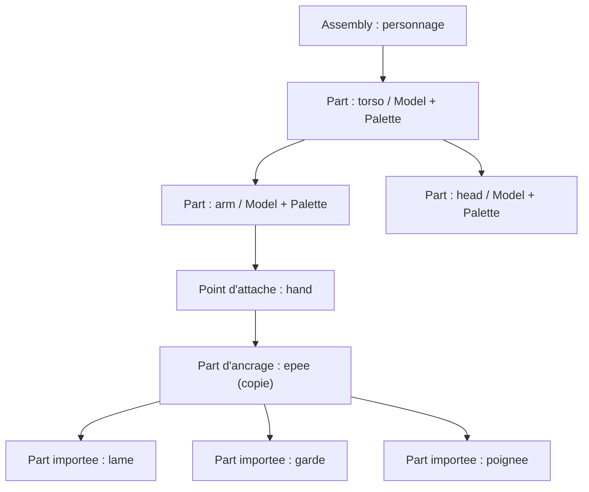
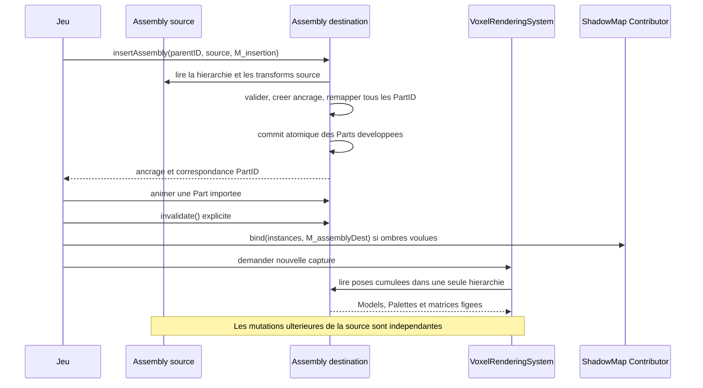

# Sparkle V0.1.4 — Assembly, composants et scène

[Sommaire de l'architecture](../voxel-engine-v0.1.4-specification.md)

## 6. Assembly, composants et scène

### 6.1 `spk::Voxel::Assembly`

Une Assembly est une **hiérarchie mutable de parties** sans Entity propre pour chaque membre. Chaque Part possède un identifiant stable au sein de son Assembly, un nom, éventuellement un parent, une transformation locale et éventuellement une copie légère de `Model` **avec sa propre association à une `Voxel::Palette`**. Un point d'attache nommé peut ne contenir aucun mesh ; il peut servir à composer des modèles ou à **insérer une copie développée** d'une autre Assembly, sans référence vivante à celle-ci.

Les opérations couvrent ajout, accès, transformation locale, changement de parent et retrait de parties, avec **refus des cycles**. L'insertion d'une autre Assembly est une **copie instantanée et une expansion de ses Parts dans cette unique hiérarchie** : aucune Part de type sous-Assembly, référence vivante, hiérarchie secondaire, Entity enfant ou propriété de l'Assembly d'origine n'est créée. La forme exacte des identifiants et des signatures reste une question technique d'API, non un choix d'une seconde hiérarchie.



Les transformations locales sont indépendantes de `spk::Transform3D`, qui est déjà un Component3D. Une copie d'Assembly est **autonome pour sa hiérarchie et ses transformations**, tout en réutilisant les données immuables des Models et Palettes. L'Assembly copié démarre avec son **propre VersionedTrait, à version 1**, et non une copie des abonnés ou du compteur de version source. Les évolutions générales de `VersionedTrait` doivent rester compatibles avec cette propriété.

**Q-ARCH-004 — Composition validée : insertion par copie et expansion.** Une insertion d'Assembly dans une autre est **une opération structurelle ponctuelle** de l'Assembly destination. Elle lit la hiérarchie et les poses de l'Assembly source à cet instant, puis crée **de nouvelles Parts directement dans l'arbre de la destination**. Les noms, poses locales, liens parent-enfant et associations `Model + Voxel::Palette` sont recopiés par valeur ; les valeurs immuables des Models et Palettes continuent à partager leurs blocs internes. L'Assembly source n'est ni déplacée, ni possédée, ni liée à la destination : une modification ou destruction ultérieure de la source n'a **aucun effet** sur la copie déjà insérée, et réciproquement. Une Assembly copiée normalement (constructeur de copie) conserve son contrat indépendant, sa version initiale 1 et ses propres Parts.

**Point d'ancrage et racines.** L'opération reçoit un **parent de destination** (ou la racine logique de destination, sans parent), une **matrice locale d'insertion** et la source. Elle crée dans la destination **une Part d'ancrage ordinaire sans Model**, portant cette matrice et rattachée au parent choisi. Chaque Part racine de l'Assembly source est recopiée comme enfant direct de cet ancrage, avec sa transform locale **inchangée** ; les descendants retrouvent le même parentage relatif après remappage des identifiants. L'ancrage est une Part normale pouvant être animée, déplacée, reparentée ou retirée : il n'ajoute aucun type spécial ni moteur hiérarchique supplémentaire. Cette règle fonctionne pour une source comportant plusieurs racines ou aucune Part (un ancrage vide reste un point d'attache valide). La matrice globale éventuellement fournie par le jeu pour afficher l'Assembly source **n'est pas incorporée implicitement** à l'insertion : le développeur choisit la matrice locale d'ancrage.

**Identifiants et contrat de résultat.** Chaque Part nouvellement insérée, **ancrage inclus**, reçoit un **nouvel identifiant stable et unique dans la destination** ; les identifiants de la source ne sont jamais utilisés directement comme identifiants des nouvelles Parts. L'opération retourne **l'identifiant de l'ancrage** et une **correspondance source `PartID` vers nouvelle `PartID`** pour que le jeu puisse animer les copies obtenues. Les identifiants de Parts déjà présentes dans la destination ne changent pas. Les IDs supprimés ne sont pas réattribués pendant la durée de vie de cette Assembly ; épuisement ou débordement de l'espace d'IDs déclenche `spk::Exception`. Les noms de Parts peuvent être identiques : seul le `PartID` sert à établir l'identité et les liens parentaux. L'ordre de parcours de la source pour créer les nouvelles Parts doit être **déterministe** (parents avant enfants et ordre de frères conservé). La forme C++ de ce résultat et des paramètres reste indicative ; le contrat sur les identifiants, leurs remappages et leur ordre est normatif.

**Opération atomique et contrôle des erreurs.** La destination valide son parent, l'intégrité de l'arbre source, les matrices locales et la disponibilité d'assez d'identifiants **avant tout changement visible**. Les nouvelles Parts et la correspondance d'identifiants sont préparées dans un état provisoire, puis insérées **en une seule transaction logique** : une erreur de validation ou de préparation ne modifie ni l'arbre, ni l'ordre des Parts, ni les IDs réservables, ni la version de la destination. Un parent inconnu, une matrice invalide, une source invalide ou une tentative d'insérer **l'Assembly destination elle-même comme source** est refusé par `spk::Exception` explicite. Cette dernière interdiction évite un comportement ambigu d'auto-expansion ; elle ne requiert aucun détecteur de cycles entre Assemblies puisque aucune référence inter-Assembly n'est conservée.

**Reparentage et retrait.** Après insertion, les Parts importées et leur ancrage se comportent **exactement comme toute autre Part de la destination**. Changer un parent doit refuser d'attacher une Part à elle-même ou à l'un de ses descendants, sans mutation partielle. Une demande de retrait d'une Part **retire explicitement tout son sous-arbre** : retirer l'ancrage supprime donc l'intégralité de l'importation, sans restaurer ni modifier l'Assembly source et sans réaffecter les identifiants des Parts restantes. Une modification de l'arbre de la destination n'a jamais d'effet rétroactif sur un snapshot visuel ou une collection de `ShadowMap::MeshInstance` déjà capturés.

**Compositions matricielles.** La pose monde d'un Model importé reste celle de la **seule hiérarchie de destination** :
`M_world = M_entityWorld * M_assemblyDest * M_ancestorsDest * M_insertionAnchor * M_sourceRoot * ... * M_sourcePart`.
Les matrices `M_sourceRoot ...` sont les matrices **locales recopiées** depuis la source ; `M_assemblyDest` est l'unique matrice commune relative à l'Entity. Il n'existe **aucune deuxième application de la pose d'Assembly source**, d'`EntityWorld` ou de la matrice d'ancrage. Le dessin visible parcourt cette hiérarchie développée et calcule les matrices cumulées à chaque nouvelle capture de RenderSnapshot, selon le contrat du chapitre 07. Les Parts sans Model apportent seulement leur transformation à leurs descendants.

**Animation, invalidation et ombres.** Le jeu peut animer les Parts copiées **indépendamment** de leur source. L'opération ne crée ni `ShadowMap::Contributor` ni `ShadowMode`, et ne transmet pas d'invalidation d'ombres automatiquement ; le jeu prépare explicitement les `MeshInstance` de toutes les Parts voulues, importées incluses, dans le repère de la **destination**, puis appelle `bind(collection, assemblyMatrixDest)`. Lors d'une modification de pose ou structure, le jeu conserve la responsabilité établie d'appeler `Assembly::invalidate()` pour le chemin visuel et de renouveler le `bind()` s'il veut mettre à jour la projection d'ombres. Il n'existe pas de propagation depuis l'Assembly source ni de `bind()` implicite. Tout `RenderSnapshot` déjà construit conserve les anciennes poses et les handles immuables de ses ressources.

**Exemple conceptuel (signatures non figées) :**

```cpp
// Personnage et épée sont deux Assembly sans propriété commune.
auto result = personnage.insertAssembly(mainPartID, epee, M_insertion);
PartID lameDansPersonnage = result.partIDs.at(lameDansEpee);
personnage.part(lameDansPersonnage).setLocalTransform(nouvellePose);
// L'épée originale n'est pas modifiée.
personnage.invalidate(); // Demande explicite de changement visuel.
// Si des ombres sont voulues, le jeu reconstruit puis rebind ses MeshInstance.
```



L'animation demeure **externe** à la bibliothèque voxel : un système de jeu peut modifier les transforms des parties, puis appeler `invalidate()` sur l'Assembly. Le rendu ne s'appuie toutefois sur **aucun cache de version** pour ses occurrences : il recalcule les transformations visibles à chaque RenderSnapshot.

**Adaptation des Assemblies aux ombres (A1, clos, complément matrice commune).** Aucun `ShadowMap::Contributor` n'est créé par `Assembly` ou par son composant de rendu. Le jeu construit explicitement une collection de `ShadowMap::MeshInstance`, avec pour chaque Part éligible son mesh de profondeur immuable et la matrice **locale cumulée par rapport au repère de l'Assembly** (composition des ancêtres de la Part, sans y incorporer une seconde fois la pose de l'Assembly). Il soumet **`bind(collection, assemblyMatrix)`**, où `assemblyMatrix` est la transformation de l'Assembly **destination** (pour une insertion, après expansion des Parts) **dans le repère de l'Entity3D** porteuse du Contributor. Cette matrice commune s'applique à toutes les instances, puis chaque matrice locale de Part ; pour les positions, `M_world = M_entityWorld * M_assembly * M_partAccumulated`. Toute évolution de la pose des Parts **ou de la matrice commune d'Assembly** demande un nouveau `bind(collection, assemblyMatrix)` ; `Assembly::invalidate()` ne notifie pas automatiquement les ombres. Les matrices changent sans rebake de Model ni fusion de meshes. Une évolution de `Transform3D` de l'Entity est indépendante et ne demande pas de nouveau bind. Le jeu doit choisir un repère cohérent : **ne jamais fournir une matrice monde d'Assembly déjà multipliée par `M_entityWorld`**, sinon le déplacement de l'Entity serait appliqué deux fois.

### 6.2 `ModelRenderingComponent` et `AssemblyRenderingComponent`

Les deux composants sont des **composants de données** liés à une Entity3D et exposés au système de rendu par les mécanismes de Registry du moteur. Ils ne génèrent jamais eux-mêmes de `RenderCommand`.

- `ModelRenderingComponent` emprunte un `Model` et une `Voxel::Palette` compatibles, sans transférer leur propriété ;
- `AssemblyRenderingComponent` emprunte une `Assembly`, sans la posséder. **Les layers individuels utilisés par le filtrage de `VoxelRenderingSystem` sont portés par ce composant graphique**, et non par l'Entity3D propriétaire ; l'API concrète des layers reprend le contrat générique des Contributors graphiques et du helper `CaptureContext::isLayerCompatible(...)`.

Leurs méthodes de liaison (`bind` / `unbind`, signatures à finaliser) utilisent des **pointeurs non propriétaires**, conformément aux usages Sparkle. Le programme doit conserver les objets liés en vie jusqu'à leur détachement et pendant tout accès nécessaire à la préparation d'un snapshot. Une liaison à cible unique n'est pas implicitement remplacée.

Les composants actifs sont trouvés **par Engine**, au moyen de `spk::Registry<T, Engine*>` ou de l'inscription typée réellement disponible. L'héritage Registry des composants spécialisés est à adapter à l'API existante et ne doit pas être inventé indépendamment de sa construction/contexte.
