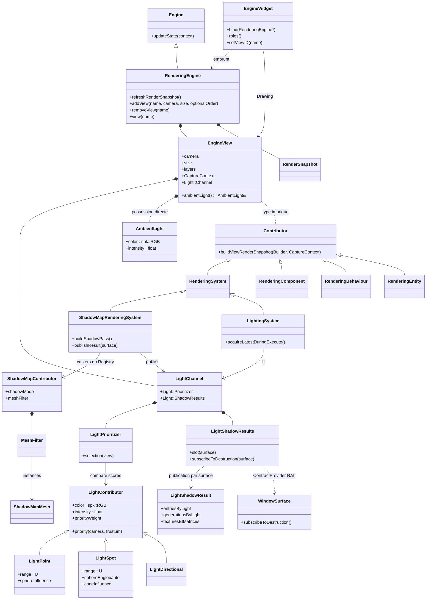
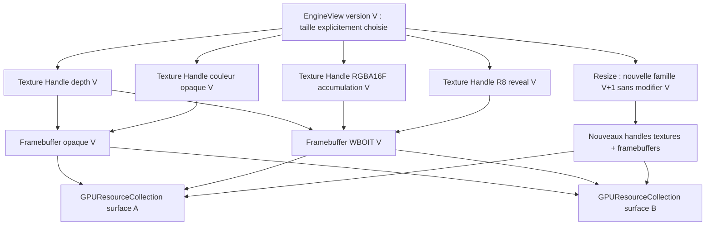
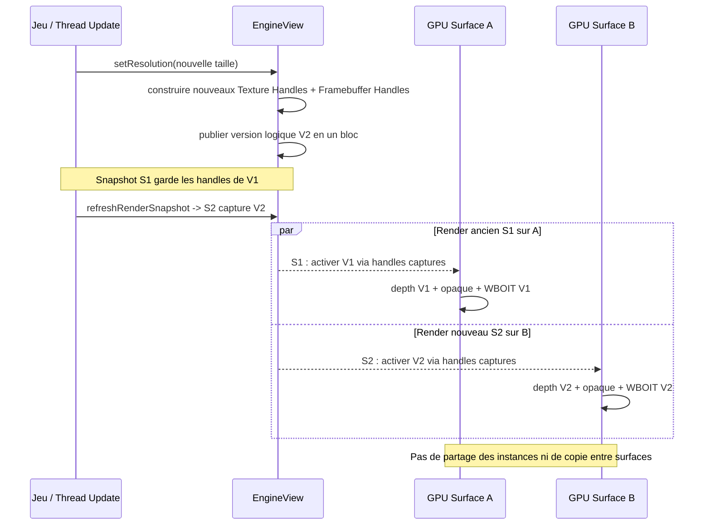
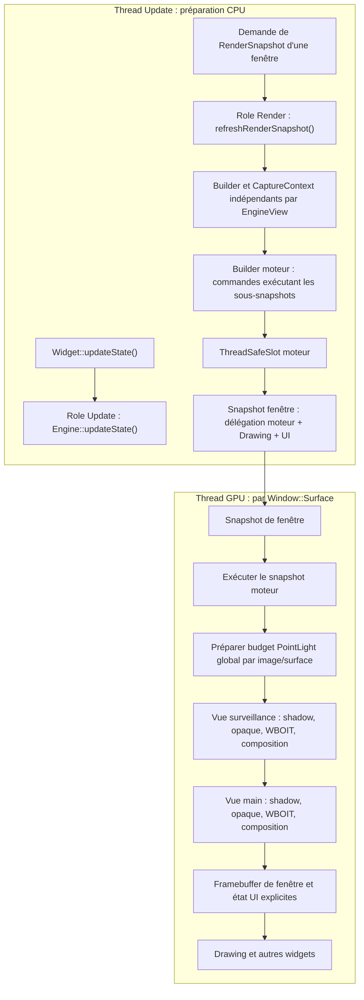
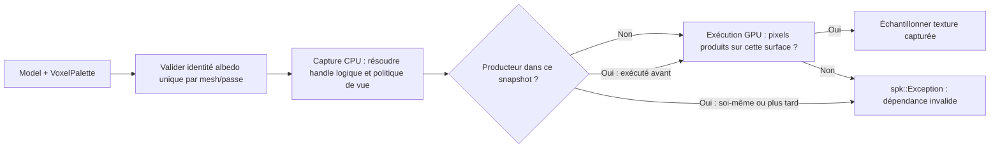
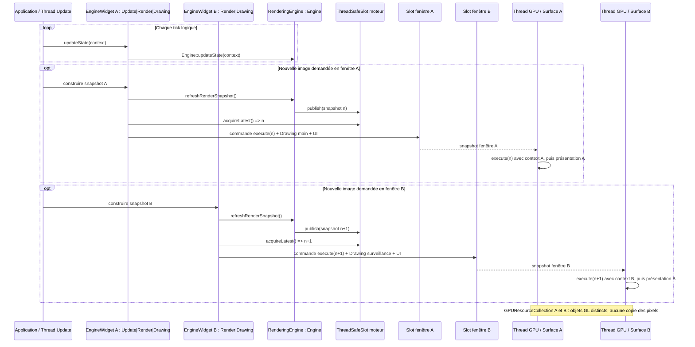
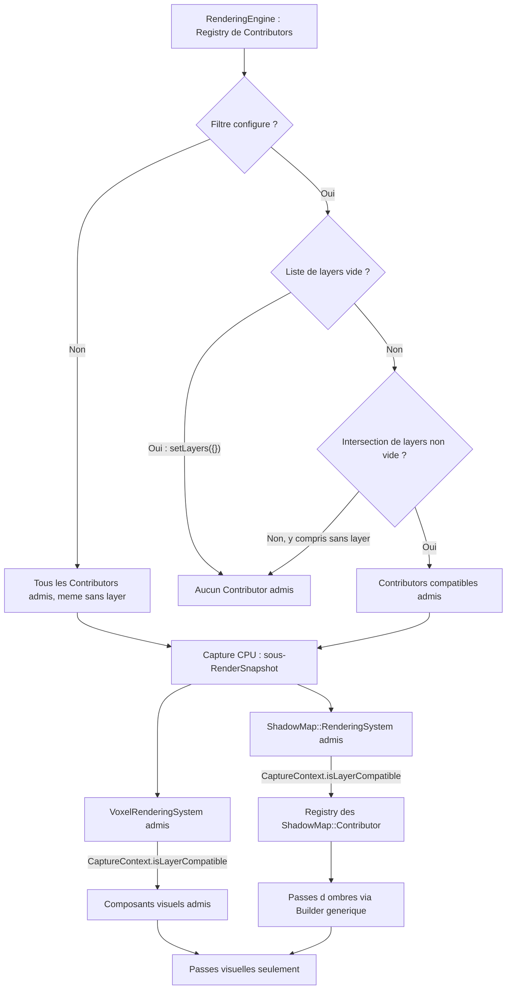
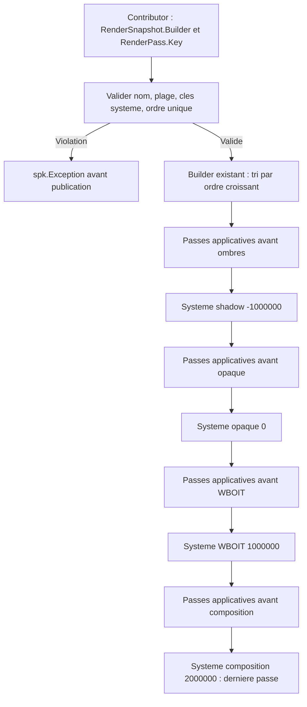

# Sparkle V0.1.4 — RenderingEngine, EngineView et passes

[Sommaire de l'architecture](../voxel-engine-v0.1.4-specification.md)

## 7. Systèmes de rendu visuel, d’ombres et commandes GPU

Le module graphique fournit une orchestration par vues, des systèmes de rendu visuel et d'ombres distincts, des ressources OpenGL par surface et des commandes indépendantes de l'état mutable de la simulation. Les types et comportements ci-dessous constituent le contrat cible ; les exemples de signatures expressément indicatifs ne fixent pas une API non arbitrée.

### 7.1 `RenderingEngine`, `EngineView` et `EngineWidget`



Dans ce diagramme, `Contributor` désigne **`EngineView::Contributor`** : le lien pointillé correspond à l'imbrication du type, sans possession. Un contributeur peut participer à plusieurs vues selon les layers. Le Channel appartient à la vue ; le système ShadowMap produit ses résultats et le système Lighting les lit, sans gestion d'ombres dans `Window::State` ou `Window::Surface`.

**Frontière des bibliothèques.** `spk::Engine` reste un moteur logique et headless de `sparkle::core`, responsable des entités, systèmes, événements et `updateState(UpdateContext&)`. `spk::RenderingEngine : public spk::Engine` se trouve dans `sparkle::sparkle` et ajoute les capacités graphiques : `EngineView`, contribution des objets graphiques, construction du `RenderSnapshot` moteur et publication via `ThreadSafeSlot<RenderSnapshot>`. Un serveur peut instancier `Engine` seul ; une application graphique instancie directement `RenderingEngine`. La conversion d'un Engine existant en RenderingEngine n'est pas prévue. L'héritage impose de rendre virtuel le destructeur de `Engine`. Le `RenderingEngine` adaptateur actuel fondé sur un `Engine*` est remplacé par l'héritage ; les capacités existantes de propagation des événements et d'input doivent être conservées.

**Propriété des vues.** Chaque `RenderingEngine` possède une collection de `spk::EngineView`, identifiées par une chaîne unique **et immuable**. Une vue désigne une `CameraComponent` explicite **ou aucune caméra lorsqu'elle est détachée**, sa résolution choisie par le jeu et, facultativement, un ordre numérique de capture. Une caméra peut être utilisée dans plusieurs vues. `EngineView` et `CameraComponent` relèvent désormais du module graphique et non de `sparkle::core` ; la caméra reste un `Component3D` positionné par son `Entity3D/Transform3D` habituel. Aucune caméra, vue, résolution, projection ou hiérarchie alternative n'est créée implicitement. Le nom `"main"` est uniquement la sélection par défaut du rôle `Drawing` d'un EngineWidget.

**Lumière ambiante possédée par la vue (décision A validée).** Chaque `EngineView` **possède directement et pendant toute sa durée de vie un unique `spk::AmbientLight`**, accessible et configurable par référence (API conceptuelle : `view.ambientLight().setColor(...)` et `.setIntensity(...)`). Aucun objet extérieur à créer, aucun `bind()`, pointeur externe, attachement/détachement, abonnement RAII ou partage entre vues. `AmbientLight` contient seulement `spk::RGB color` (linéaire, composants finis dans `[0,1]`) et `float intensity` (finie, `>= 0`, sans plafond artificiel). **Valeur initiale : `RGB{1,1,1}` et `intensity = 0`, donc contribution ambiante nulle sans configuration.** La désactivation se fait avec `intensity = 0`, sans supprimer l'objet. Il ne s'agit ni d'un `Component3D`, ni d'un `Light::Contributor`, ni d'une lumière du Registry ; aucun `Transform3D`, aucune sélection Top-N, aucune shadow map ou collection d'AmbientLight. Chaque vue dispose de sa propre instance indépendante. Le snapshot capture **par valeur** `color × intensity` au moment de `refreshRenderSnapshot()` ; le GPU n'accède pas à la vue ni à son objet mutable. Les changements ne touchent que les futures captures de cette vue, sans invalider Top-N ni shadow maps. Opaque et WBOIT consomment la même valeur. Les noms exacts des accesseurs/setters peuvent être consolidés dans Q-TECH-005, sans rouvrir la propriété directe ni introduire de liaison externe.

**Contexte lumineux de la vue.** Chaque `EngineView` possède un `spk::Light::Channel` comportant un `Light::Prioritizer` et un `Light::ShadowResults`. **À la création de chaque EngineView, la sélection locale démarre avec `N = 8` places Point/Spot et une hystérésis relative `h = 0,10`, tous deux reconfigurables explicitement pour cette vue** (Q-TECH-001, profil initial approuvé). Les Directional actives restent hors quota ; ces valeurs ne modifient pas les budgets d'ombres PointLight. **À score égal, les lumières locales sont départagées par leur ordinal d'enregistrement monotone au sein de l'Engine, l'inscription la plus ancienne étant prioritaire**, indépendamment du parcours du Registry et des différentes EngineView (Q-TECH-001). **Sans reconfiguration de `N` ni de `h`, le Channel conserve les Point/Spot précédemment retenues qui restent admissibles, retire immédiatement les anciennes devenues inadmissibles, et remplit les éventuelles places libres avec les meilleures nouvelles candidates sans hystérésis. Une fois le Top-N complet, il applique le remplacement progressif de la plus faible retenue avec dépassement strict du seuil `score(candidate) > score(lowestRetained) × (1+h)`** (contrat du chapitre 08, Q-TECH-001). Sur une première capture sans historique, toutes les places sont libres ; les meilleures candidates y entrent directement. Les anciennes sélections et les anciens sous-snapshots restent immuables. **Lorsqu'un appel du jeu change effectivement `N` ou `h` sur cette EngineView**, le Channel invalide la sélection locale en cache. La prochaine capture choisit directement les `min(N, candidates)` meilleurs scores Point/Spot admissibles, départagés par ordinal, **sans hystérésis**, et cette sélection devient l'historique de référence ; **le nouveau `h` ne régit les remplacements qu'aux captures suivantes**. Une modification isolée de `h` déclenche donc la même réinitialisation qu'un changement de `N`. `N=0` écarte toutes les Point/Spot mais non les Directional ; réaffecter une valeur inchangée à `N` ou `h` est un no-op. Les modifications successives avant capture sont consolidées selon les dernières valeurs configurées. Cette réinitialisation est propre à chaque EngineView, ne réenregistre aucune lumière et ne modifie jamais les snapshots déjà publiés. La caméra et les layers désignent ce qui peut être dessiné ; le Channel représente les lumières que la vue sélectionne et les shadow maps qu'elle peut exploiter. La vue ne sélectionne pas les casters, ne calcule pas l'éclairage et ne crée pas d'objets OpenGL. Le `CaptureContext` reçoit lors de sa construction une liaison au Channel, dont la durée de vie reste garantie pour toutes les commandes publiées. Les commandes ne lisent pas la vue mutable durant leur `execute()`, mais consultent les slots du Channel au rendu sur la surface courante. Le Channel peut donc être partagé logiquement entre plusieurs fenêtres, tout en conservant des textures GPU indépendantes par surface.

**Publication du Channel sous mutations concurrentes (Q-TECH-001).** Le `Light::Channel` de chaque EngineView conserve une `invalidationGeneration` monotone et une génération associée à la dernière `Light::Selection` publiée. Une seule reconstruction de Top-N est active à la fois **pour cette vue** ; la lecture cohérente des candidats et le classement sont faits **hors du mutex court du Channel**, puis la génération est comparée de nouveau sous mutex juste avant de publier. Toute invalidation survenue pendant la tentative force **son abandon et son recalcul**, sans écraser le cache publié, sans consommer un reset `N/h` et sans réconcilier les ombres sur un résultat rejeté. Les demandes concurrentes de cette vue partagent le même constructeur et attendent une génération courante ; les autres vues restent indépendantes. Une modification de caméra ou projection n'invalide que les Channels des vues utilisant cette caméra, même si plusieurs vues la partagent. Les `RenderSnapshot` déjà publiés restent inchangés et peuvent encore détenir leur ancienne `Light::Selection`. **La diffusion globale des invalidations de lumière/Registry à toutes les EngineView vivantes du même RenderingEngine est validée**, même lorsque la lumière modifiée n'appartient à aucune sélection courante. Chaque Channel incrémente sa génération sous mutex bref et ne reconstruit que lors d'une capture ultérieure. Les notifications liées uniquement à une caméra ou sa projection ciblent les vues qui utilisent cette caméra ; un changement `N/h` cible la seule vue configurée. Aucun index spatial ni suivi des seules lumières retenues n'est requis. **Q-TECH-001 clôturée (transaction synchronisée, option A) :** un verrou interne commun au moteur protège en une transaction la **mutation pertinente et l'invalidation de tous les Channels concernés**, puis protège également chaque validation finale de publication de sélection. Pour toute double prise de verrous, l'ordre est impérativement **moteur → Channel**. Les données CPU sont copiées de manière cohérente sous verrou moteur ; scores et tri se déroulent ensuite **hors des verrous**. Le commit vérifie sous les deux verrous que la génération du Channel est toujours courante et que la vue existe. Les notifications utilisateur s'exécutent après libération des verrous, jamais entre la visibilité d'une mutation et son invalidation. Les setters de lumières, de transformations et les opérations du Registry doivent participer à cette transaction à la source, pas uniquement émettre un événement tardif. Les vues sont enregistrées et retirées sous le même verrou ; tout Channel fermé refuse une nouvelle sélection et réveille ses demandeurs. Un Channel reste possédé par les anciens snapshots sans prolonger la vie de l'EngineView. Voir le chapitre 08 pour le protocole complet, ses exceptions et son diagramme de séquence.

**Identité immuable de la vue.** Le nom d'une `EngineView` est attribué lors de sa création et **ne peut jamais être modifié** pendant sa durée de vie. La collection du `RenderingEngine` garantit son unicité et refuse toute tentative de création avec un nom déjà utilisé via `spk::Exception`. Aucune méthode de renommage, propagation de noms vers les widgets, alias automatique ou registre de dépendances n'est introduit. Les recherches `renderingEngine.view(name)`, les identifiants sélectionnés dans les `EngineWidget` et les références logiques du jeu conservent ainsi un identifiant stable. La caméra, la résolution, l'ordre facultatif et la politique de sortie restent modifiables suivant leurs propres contrats ; elles n'affectent pas le nom. La destruction d'une vue peut libérer le nom pour une nouvelle vue, **sans rétablir la validité des anciennes références non propriétaires** ou modifier les snapshots déjà publiés.

**Suppression des vues.** Le jeu peut appeler `RenderingEngine::removeView(name)` (signature indicative) pour **retirer et détruire immédiatement** une `EngineView` possédée par le moteur, sans attendre la destruction du `RenderingEngine`. Cette suppression retire la vue de l'ordonnancement et de la recherche par nom **sous le verrou de cohérence moteur**, la marque fermée pour ses Channel et abonnements d'invalidation et réveille les captures attendant sa sélection ; aucun nouveau snapshot publié ensuite ne capture son rendu. Une capture déjà lancée revalide, sous ce verrou, les vues encore présentes avant le commit de son snapshot moteur. Les reconstructions en vol de la vue retirée sont rejetées sans publication de nouveau Top-N. Les désabonnements susceptibles de déclencher un callback sont exécutés hors des verrous, sur des abonnements RAII invalidés ; aucun callback ne garde de pointeur nu vers la vue détruite. Un nom inconnu demandé à `removeView` est une opération invalide, signalée par `spk::Exception`, conformément à la politique générale des API. La suppression libère son nom et, si elle était explicitement ordonnée, sa priorité numérique, sans modifier l'ordre de création relatif des autres vues non ordonnées. Réutiliser ensuite le nom pour créer une autre vue ne restaure **aucune référence** à la vue détruite et n'effectue aucun rebinding automatique.

La responsabilité des références non propriétaires reste **explicitement celle du développeur** : avant suppression, il doit cesser d'utiliser la vue depuis les Materials, widgets et autres détenteurs de références ou identifiants de vue qui ne seraient plus valides. Sparkle n'introduit ni comptage de références de vues, ni suppression différée, ni mise à jour automatique des consumers. Les `RenderSnapshot` **déjà publiés** restent immuables et peuvent conserver leurs handles de textures, framebuffers, SSBO et autres ressources concrètes capturées jusqu'à leur fin de vie ; le retrait d'une vue n'annule pas ni ne reconstruit automatiquement ces snapshots et ne prolonge pas la vie de son objet logique.

**Ordre de capture des vues.** Une `EngineView` peut être créée **avec ou sans ordre numérique explicite**. Les vues dotées d'un ordre explicite sont toutes exécutées **en premier**, dans l'ordre croissant de cette valeur. Leurs ordres numériques doivent être uniques dans le même `RenderingEngine` ; tout conflit à la création ou lors d'un changement d'ordre déclenche une `spk::Exception` descriptive sans laisser la configuration dans un état invalide. Les vues **sans ordre explicite** sont toujours exécutées **après toutes les vues ordonnées**, dans **leur ordre de création**, sans recevoir de priorité numérique automatique. Deux vues sans ordre ne sont **pas** en conflit : l'unicité ne s'applique qu'aux valeurs explicitement fournies. Ainsi, l'ajout ultérieur d'une vue ordonnée la place avant toutes les vues sans ordre, même si celles-ci ont été créées précédemment.

La construction du snapshot moteur produit d'abord cette séquence complète de vues (priorités explicites puis vues non ordonnées en ordre de création) et y place les commandes de délégation dans le même ordre. Comme le `RenderSnapshot::Builder` existant ne trie les `RenderPass::Key` que par valeur numérique, l'encodage interne doit **respecter cette séquence**, y compris si une priorité explicite vaut la borne maximale du type numérique. Il ne doit pas reposer sur une valeur sentinelle « après toutes les priorités » susceptible d'entrer en collision ; les priorités publiques n'ont pas à être réutilisées telles quelles comme ordres des passes internes. Cela préserve le mécanisme existant de Builder sans ordonnanceur supplémentaire.

**Association et détachement de caméra.** Après la création d'une `EngineView`, le jeu peut **modifier explicitement sa caméra** ou la **détacher** (API indicative : `setCamera(CameraComponent3D*)`, avec `nullptr` pour détacher ; la forme finale peut inclure `detachCamera()`). La vue conserve son identité, son nom, son ordre de capture, sa résolution choisie par le jeu et ses ressources graphiques logiques : changer ou détacher la caméra **ne détruit ni ne recrée la vue**, et ne redimensionne pas ses cibles. Une modification de caméra prend effet à la **prochaine construction du snapshot moteur**, sans modifier les commandes déjà publiées, dont les matrices et les handles de rendu sont figés. Plusieurs vues peuvent continuer de partager une caméra.

**Vue détachée à la capture.** Une vue sans caméra reste enregistrée dans son `RenderingEngine` et reste accessible par son nom, mais `refreshRenderSnapshot()` **ne construit aucune commande produisant un nouveau rendu pour cette vue** : pas de collecte de Contributors ni de passes shadow/opaque/WBOIT/composition ni d'effacement implicite de sa texture. Les autres vues continuent de se construire et de se rendre normalement, suivant leur ordre habituel. Aucun rendu alternatif, caméra par défaut ou exception de capture n'est créé par l'absence volontaire de caméra. La visibilité de la sortie dépend de la **politique explicite de la vue**, décrite ci-dessous ; elle ne modifie pas l'interdiction d'un nouveau rendu de scène pendant le détachement.

**Durée de vie de la caméra.** La liaison d'une `EngineView` vers sa `CameraComponent` est **non propriétaire**. Une caméra détruite sans que la vue en soit auparavant détachée reste une référence pendante, soumise au contrat de durée de vie habituel : Sparkle ne promet ni détection automatique ni exception garantie. Le jeu doit détacher ou remplacer la caméra avant sa destruction. Lorsqu'une vue est détachée, la recherche `camera.view(name)` sur une autre caméra ne la considère pas comme liée à celle-ci ; `renderingEngine.view(name)` continue de fonctionner. Les matériaux qui empruntent l'identité de la vue restent liés à cette **même vue**, et les snapshots déjà publiés restent immuables et valides suivant leurs handles capturés. La consultation de sa texture détachée dépend de la politique explicite de sortie décrite ci-dessous.

**Accès aux vues depuis l'Engine ou la caméra.** `renderingEngine.view("monitor")` retrouve une vue par son nom et lance `spk::Exception` si absente. `surveillanceCamera.view("monitor")` est également prévu : il utilise le contexte `Engine*` déjà transmis aux composants pour retrouver le `RenderingEngine`, puis vérifie que la vue demandée désigne bien cette caméra. Absence de moteur graphique, nom inconnu ou mauvaise caméra : `spk::Exception`. Cela ne demande **aucun registre inverse** dans la caméra. Signatures et noms secondaires restent illustratifs.

**Resize sous contrôle du jeu.** Redimensionner la fenêtre ou un widget ne change **ni la résolution d'une EngineView ni la projection de la caméra**. Le jeu ajuste chacune explicitement. L'affichage peut simplement étirer la texture existante. Une vue dont la résolution change crée une **nouvelle version des cibles logiques** ; les handles déjà publiés ne doivent pas être modifiés rétroactivement. Le `Framebuffer::resize()` **actuel** modifie les States de ses attachments sur place ; sa sémantique doit être adaptée ou ce chemin doit être explicitement interdit pour les framebuffers à attachments partagés. Le resize des vues reconstruit **un ensemble cohérent de nouvelles Texture::Handle et Framebuffer::Handle**, sans altérer les versions antérieures capturées par des snapshots.

**Politique de sortie d'une vue sans caméra.** Chaque `EngineView` expose une politique configurable, représentée par un **enum C++ explicite** (noms indicatifs : `DetachedOutputPolicy::KeepLastFrame`, `DetachedOutputPolicy::Invalid`, `DetachedOutputPolicy::DefaultTexture`). **La valeur initiale est `DetachedOutputPolicy::Invalid`** pour toute nouvelle `EngineView` ; le jeu peut la modifier explicitement ensuite. Elle détermine **la source de texture disponible aux consommateurs** lorsque la vue n'a pas de caméra. Elle n'entraîne dans aucun des trois modes un nouveau rendu 3D, un clear ou une mise à jour des sous-snapshots de cette vue.

- **`KeepLastFrame`** : les widgets `Drawing` et les `Material` empruntant cette vue utilisent la **dernière image produite sur la cible logique courante de la `Window::Surface` concernée**. Les dernières images restent **indépendantes par surface** ; aucun transfert ou rendu de rattrapage n'est effectué. Si aucune image valide n'existe pour cette cible/surface (vue jamais rendue, cible remplacée après un resize, etc.), **l'utilisation de cette sortie lève une `spk::Exception`** au lieu de lire silencieusement des pixels non initialisés.
- **`Invalid`** : la sortie de la vue est explicitement **invalide** lorsqu'elle est détachée ; aucun nouveau consommateur ne peut la résoudre comme une texture valide. **Toute tentative d'utilisation** depuis un widget ou un Material déclenche une `spk::Exception` descriptive. La vue reste enregistrée et ses anciennes ressources GPU ne sont pas nécessairement effacées.
- **`DefaultTexture`** : en l'absence de caméra, les nouveaux consommateurs utilisent une **texture de remplacement fournie explicitement par le développeur**, via une liaison configurable sur la vue (API indicative : `setFallbackTexture(const Texture&)` ou `Texture::Handle`). Aucun visuel par défaut interne, aucune texture « missing » automatique et aucun nouveau rendu de la scène ne sont fabriqués. Si la texture de remplacement **n'est pas configurée ou est invalide**, son utilisation déclenche une `spk::Exception` descriptive.

**Contrôles CPU puis GPU de la disponibilité d'une sortie de vue.** Une demande de sortie de vue est contrôlée à deux frontières distinctes, sans contourner l'immuabilité d'un `RenderSnapshot` publié :

1. **Construction CPU du snapshot :** vérifier les contraintes logiques qui sont déjà déterminables indépendamment d'une surface OpenGL : vue accessible, référence logique valide selon le contrat de durée de vie, état de la caméra, politique `DetachedOutputPolicy` capturée, validité structurelle du `Texture::Handle` de remplacement, et impossibilité d'utiliser une source déclarée `Invalid`. Une telle erreur lève immédiatement une `spk::Exception`, sans publier de nouveau snapshot partiel. Le Builder capture le **handle logique et les paramètres de la source sélectionnée**, pas une supposition sur les pixels disponibles dans toutes les fenêtres.
2. **Exécution GPU sur `RenderContext::targetSurface` :** juste avant d'utiliser la texture, vérifier l'existence et la **disponibilité effective de son contenu dans la `GPUResourceCollection` propre à cette surface**. Une cible peut devenir disponible au cours de **la même exécution** lorsqu'une EngineView précédente termine sa passe de composition. Le suivi d'initialisation/production est donc propre à la **version de cible et à la surface**, et distingue la simple allocation GL d'une texture de la production de son image valide. Si cette image est absente, invalidée ou non encore produite pour la surface/version courante, la commande qui tente de la consommer lève une `spk::Exception` descriptive.

**Contrat d'erreur commun.** L'utilisation d'une texture invalide ou absente lève toujours une `spk::Exception` **au premier contrôle pouvant établir l'erreur** ; aucune image de secours implicite, omission silencieuse du dessin ni lecture de pixels non initialisés. La simple présence d'une EngineView détachée ne déclenche pas d'erreur. Les `RenderCommand` ne relisent ni la caméra, ni la politique mutable, ni les autres objets du jeu pendant `execute()` : elles utilisent les décisions CPU déjà capturées et ne consultent que les ressources et leur disponibilité propres au `RenderContext`. Une erreur GPU n'annule pas rétroactivement les dessins déjà exécutés, et ne modifie pas le snapshot CPU publié.

Le `Material` conserve la **référence logique non propriétaire** à l'EngineView et **l'identité d'atlas de l'incarnation de cette vue** (et non son nom, sa cible ou son fallback) ; cette identité ne change jamais après resize, détachement ou passage en `DefaultTexture`. Deux Materials de la même vue utilisent une même identité logique, tandis qu'une texture statique — même identique au fallback courant — et deux vues différentes portent des identités distinctes, conformément au chapitre 04. Une nouvelle capture sélectionne explicitement la source appropriée (sortie de vue, dernière image ou fallback) et ses **handles logiques** ; les commandes construites conservent ces références de ressources immuables, résolues et vérifiées dans le contexte GPU de chaque fenêtre selon le contrat de validation en deux étapes. Les **snapshots déjà publiés** restent immuables et valables selon leurs handles capturés, même si la politique ou la caméra change ultérieurement.

Un rattachement de caméra rend à nouveau possible une capture normale de la vue ; la prochaine capture effectivement exécutée met à jour la sortie de la surface concernée. Le **resize explicite** produit une nouvelle version de cible : ni `KeepLastFrame` ni `DefaultTexture` ne copient automatiquement l'ancienne image vers la nouvelle cible. `DefaultTexture` peut cependant continuer d'exposer la texture de remplacement configurée, indépendamment de la cible de la vue. Le **mode initial est fixé à `DetachedOutputPolicy::Invalid`** : tant qu'aucune autre politique n'a été sélectionnée explicitement, l'utilisation de la sortie d'une vue sans caméra déclenche une `spk::Exception` descriptive, sans invalider la vue ni les snapshots déjà publiés.

**Scénario multifenêtre de validation.** Le snapshot moteur contient `surveillance` (vue exécutée en premier) puis `main` (qui échantillonne la sortie de `surveillance`). La capture CPU accepte cette source logiquement valide, même si la `Window::Surface` B n'a jamais rendu la surveillance. Sur B, l'exécution GPU de `surveillance` produit/valide son image locale avant l'échantillonnage par `main` : aucune erreur prématurée. En revanche, une utilisation de la même texture sur B **sans production préalable** (ni image précédente valide sur sa cible courante) déclenche une `spk::Exception` à l'étape GPU. L'image existante sur la surface A ne rend pas valide la source sur B.

**Un framebuffer logique, plusieurs réalisations OpenGL.** `spk::Framebuffer` dérive déjà de `GPUResource` ; ses attachments de couleur et de profondeur sont des **`Texture::Handle` réutilisables**, eux-mêmes adossés à un `GPUResource::State` partagé. La cible logique suit le contrat Q-ARCH-007 ci-dessous : les deux framebuffers opaque/WBOIT d'une même version d'EngineView partagent le **même handle de profondeur**, et non deux copies de texture. `GPUResource::activate(context)` passe par la `GPUResourceCollection` de `context.targetSurface` et matérialise une instance OpenGL **par Window::Surface**. Une `EngineView` peut donc décrire un framebuffer logique, réalisé indépendamment en fenêtre A et B, sans ajout d'une map `(Window, Engine, ViewID)` à l'API des vues. Il s'agit d'images **locales et distinctes** : rendre A ne copie ni ne met à jour les pixels de B. La dernière image rendue dans B reste disponible tant que sa cible locale n'est pas remplacée. Pour une cible locale jamais rendue (ou nouvellement remplacée), les pixels ne sont pas garantis ; aucune image n'est créée ni transférée automatiquement. **Lorsqu'un consommateur demande effectivement cette sortie alors qu'aucune texture valide n'est disponible, une `spk::Exception` doit être déclenchée**, conformément au contrat de politique de sortie ci-dessus. La texture de remplacement est utilisée exclusivement lorsque le développeur sélectionne et configure explicitement `DefaultTexture`.

### 7.1.1 Attachments partageables et versions des cibles (Q-ARCH-007 validée)

**Choix de conception : Framebuffer composé de handles, sans `RenderTarget` dédié.** `spk::Framebuffer` reste le type public générique représentant un framebuffer logique. Son `Framebuffer::State` contient une **collection ordonnée de `Texture::Handle` pour les attachments couleur** et **un `Texture::Handle` optionnel pour la profondeur ou profondeur/stencil** ; il n'est plus nécessaire qu'il possède ses propres wrappers `std::unique_ptr<Texture>`. Deux `Framebuffer` logiques peuvent donc faire référence au **même `Texture::Handle`**, sans duplication de `Texture::State` ni de contenu GPU. Les handles sont propriétaires de leur `GPUResource::State` par partage et ne constituent pas des pointeurs empruntés à une `Texture` ni une propriété d'une nouvelle classe `RenderTarget`. L'API historique de création par taille + formats peut rester un **raccourci constructeur** qui alloue des Textures logiques et ne conserve ensuite que leurs handles. Un chemin public de construction explicite accepte, à l'inverse, des attachments déjà créés (signature indicative ci-dessous).

```cpp
// Exemple conceptuel ; les noms définitifs de factory sont indicatifs.
auto depth = Texture::createRenderTarget(Texture::Target::Texture2D,
                                         size, Texture::Format::Depth24);
auto opaqueColor = Texture::createRenderTarget(Texture::Target::Texture2D,
                                               size, Texture::Format::RGBA);
auto accum = Texture::createRenderTarget(Texture::Target::Texture2D,
                                         size, Texture::Format::RGBA16F);
auto reveal = Texture::createRenderTarget(Texture::Target::Texture2D,
                                          size, Texture::Format::GreyLevel); // R8

Framebuffer opaque(size, {opaqueColor.handle()}, depth.handle());
Framebuffer wboit(size, {accum.handle(), reveal.handle()}, depth.handle());
// Même State logique de profondeur dans opaque et WBOIT.
```

**Création logique sans OpenGL.** Une factory/constructeur public de `Texture` destinée aux attachments prépare une ressource `ContentSource::RenderTarget` de taille, cible et format explicites **sans appeler OpenGL pendant la capture CPU** ; `Texture::Handle` reste le mécanisme de propriété. Pour cette version, les cibles nécessaires sont `Texture2D` pour opaque/WBOIT et `TextureCubeMap` pour les ombres ponctuelles ; les deux demandent une matérialisation GPU par `Window::Surface`. Le format d'accumulation `RGBA16F` doit être pris en charge par `Texture::Format` et sa description OpenGL ; `GreyLevel` correspond déjà à l'attachement `R8`. Aucune conversion automatique depuis une texture de pixels CPU, aucune allocation implicite au moment du `Material`, aucun multisampling silencieux et aucun nouveau gestionnaire d'attachments ne sont ajoutés.

**Compatibilité et validation des attachments.** À la construction du `Framebuffer`, valider le caractère non vide des handles, la taille non nulle et identique des images attachées, le nombre d'attachments couleur compatible avec l'ordre des slots, la catégorie des formats (couleur pour couleur, profondeur ou depth/stencil pour profondeur), leur `ContentSource::RenderTarget` et leur cible supportée. Un framebuffer doit comporter **au moins un attachment** ; pour un framebuffer de profondeur seule, aucun slot couleur n'est exigé. Les attachments actifs d'un même framebuffer doivent avoir **la même configuration d'échantillonnage** ; V0.1.4 n'active pas de multisampling automatiquement. Les réglages de charge/effacement et le binding explicite des cibles sont établis par les commandes des passes, pas par l'état OpenGL résiduel. Une même texture ne doit pas occuper simultanément deux rôles d'attachment incompatibles dans le même framebuffer. À l'exécution GPU, vérifier les limites et capacités réellement offertes par la surface (formats supportés, `GL_MAX_COLOR_ATTACHMENTS`, `GL_MAX_DRAW_BUFFERS`, taille maximale et complétude `glCheckFramebufferStatus`) avant tout draw ; l'absence d'une capacité nécessaire donne une `spk::Exception` descriptive avec surface, formats, attachments et statut GL, sans fallback implicite.

**Profondeur partagée opaque/WBOIT.** `RenderingEngine` construit pour **chaque version logique d'EngineView** un handle de profondeur unique référencé par le framebuffer opaque et le framebuffer WBOIT. Une même `Window::Surface` matérialise ce handle en **une unique texture OpenGL locale** accessible par ces deux framebuffers ; l'opaque écrit dans ce depth, puis WBOIT effectue son test de profondeur avec les écritures désactivées. Le framebuffer de la composition finale peut référencer les textures couleur déjà produites ; aucun copy/blit de profondeur ni synchronisation CPU entre deux textures n'est nécessaire. La validation d'identité exige une **égalité de `Texture::Handle`/State**, pas seulement des dimensions, du format ou des pixels identiques. La vue doit également empêcher la lecture d'une texture pendant l'écriture de ce même attachment sur cette surface.

**Versionnement et resize non destructif.** Lors d'un resize explicite, l'EngineView prépare **une nouvelle famille** de Textures render-target avec de **nouveaux States/identifiants logiques** (sortie finale, couleurs opaques, accumulation/reveal et profondeur), puis **de nouveaux framebuffers** qui référencent ces handles de la même génération de cible. La nouvelle famille est publiée **atomiquement** comme version logique courante de la vue, seulement après validation CPU ; si cette construction échoue, l'ancienne version reste courante. Les anciens `Framebuffer::Handle`, `Texture::Handle` et commandes des `RenderSnapshot` restent valables et indépendants ; ni la texture source ni la taille/format des anciens States ne sont modifiés. La nouvelle version n'a **aucune image produite** sur une surface avant son premier rendu effectif. Aucune copie de pixels de l'ancienne version n'est effectuée. L'`EngineView` conserve son identité logique pour les Materials (Q-ARCH-003) malgré ce changement de handles. **Politique normative du `Framebuffer::resize()` historique :** lorsqu'un framebuffer a été construit par le raccourci propriétaire taille/formats (attachments internes), un `resize()` construit **de nouveaux Texture::State et Framebuffer::State**, puis rebascule atomiquement le wrapper `Framebuffer` vers ces nouveaux States ; tout handle préalablement délivré continue de viser **l'ancienne version**, sans mutation des pixels, tailles ni attachments. Pour un framebuffer composé d'**attachments explicitement partagés**, `resize()` **lève `spk::Exception`** sans modifier l'objet : seule la reconstruction coordonnée de tous les framebuffers liés avec de nouveaux handles peut produire une nouvelle famille cohérente. Une taille identique peut rester un no-op sans changer de version. Dans tous les cas, aucun State conservé par un snapshot n'est redimensionné en place.

**Durée de vie et surfaces.** Chaque State logique de framebuffer ou texture est activé **dans la `GPUResourceCollection` de la surface courante**, créant ou retrouvant son instance OpenGL propre à cette surface. Deux surfaces qui exécutent les **mêmes handles CPU** n'échangent jamais de pixels ou de noms d'objets GL. Une ancienne version peut encore être utilisée par un snapshot en vol sur A pendant que la version suivante est rendue sur B ; aucune commande ne relit l'EngineView mutable au rendu. Les handles détenus par les snapshots gardent les anciens States vivants ; leur libération native ou mise en pool suit **exclusivement** les mécanismes existants de `GPUResourceCollection` et le bon contexte OpenGL, sans liste de destruction différée supplémentaire dans `EngineView`. La fermeture d'une surface supprime ses réalisations locales et invalide toute disponibilité d'image de cette surface, pas les autres.

**Cubemaps de profondeur et faces explicites.** `Texture::Target::TextureCubeMap` doit accepter une texture render-target à six faces **carrées, de même taille et format de profondeur**. Une paire de cartes statique/finale de `PointLight` conserve deux `Texture::Handle` de cubemap indépendants. Un framebuffer **depth-only** peut attacher la cubemap en choisissant **explicitement une seule face** lors du rendu ; la face est un enum fini (positive/negative X, Y et Z), sans indice implicite ni face par défaut pour un dessin de profondeur. La commande générique d'activation d'un framebuffer (nom indicatif `FramebufferRenderCommand`) capture `Framebuffer::Handle` et, lorsqu'une cubemap est ciblée, **la face concernée** ; au GPU, elle lie le framebuffer natif de la surface, matérialise la cubemap et attache la face via `glFramebufferTexture2D(..., GL_TEXTURE_CUBE_MAP_POSITIVE_X + face, ...)`, puis vérifie la complétude avant le clear/draw. Le changement de face est **une opération d'attachement native sur le framebuffer de cette surface** ; il ne modifie ni le `Texture::State` ni le `Framebuffer::State` partagé des snapshots. Aucun mode layered implicite ou `gl_Layer` n'est exigé. Le cache de cartes `ShadowMap` continue d'assurer l'atomicité des six faces et la publication seulement après reconstruction intégrale, comme décrit au chapitre 08.





**Durées de vie.** Les vues sont possédées par `RenderingEngine` et peuvent être supprimées immédiatement par `removeView(name)`. Toutes les références vers une `EngineView`, y compris celles éventuellement détenues par des matériaux, sont **non propriétaires** et deviennent invalides lorsque la vue disparaît. Une vue volontairement détachée de sa caméra est valide et simplement non rendue ; à l'inverse, une vue qui référence une caméra **détruite sans détachement préalable** possède une référence pendante et devient impropre à l'utilisation : le développeur doit détacher ou remplacer la caméra avant de la détruire. Utiliser une référence C++ pendante peut être un comportement indéfini, pas une exception garantie. Une vue supprimée ne doit pas laisser une texture accessible aux **nouveaux rendus**. En revanche, les `RenderSnapshot` **déjà construits** peuvent conserver les `Framebuffer::Handle` et `Texture::Handle` concrets jusqu'à leur fin d'utilisation, sans prolonger la vie logique de la vue.

**API de contribution par EngineView.** `EngineView::Contributor` remplace `RenderingObjectTrait` et fournit les capacités d'événements, de mise à jour par DeviceContext et de contribution graphique propre à une vue. Le trait générique `RenderSnapshotContributorTrait` demeure inchangé et reste utilisé par les widgets : il n'est plus une base des objets graphiques du moteur. Le nouveau `EngineView::CaptureContext` est transmis explicitement pendant la construction CPU des sous-snapshots, sans caméra courante mutable ni propriété d'une vue par le Contributor.

**Deux opérations distinctes.** `Engine::updateState(context)` fait avancer le monde, les entités et systèmes ; **ne construit et ne publie aucun snapshot**. `RenderingEngine::refreshRenderSnapshot()` lit les contributeurs et les `EngineView`, prépare les commandes des vues, construit le `RenderSnapshot` moteur puis le publie dans un `ThreadSafeSlot<RenderSnapshot>` propre au moteur. Une construction échouée ne publie pas de snapshot partiel et laisse le précédent en place. Les `RenderCommand` publiées ne lisent plus les `Transform3D`, `Assembly`, caméras ou lumières mutables. Le slot fournit des `shared_ptr<const RenderSnapshot>`, chacun utilisable par plusieurs consommateurs. Aucune exécution OpenGL n'a lieu durant les deux opérations.

**Rafraîchissement au rythme des fenêtres.** La boucle Update de l'Application continue d'appeler les mises à jour des widgets. La construction du `RenderSnapshot` **de fenêtre** reste **sur demande**, comme dans Sparkle actuel : un rendu précédent peut demander la prochaine capture. Ce n'est que lors de cette construction qu'un `EngineWidget` ayant le rôle `Render` appelle `refreshRenderSnapshot()`. Publier un nouveau snapshot moteur **ne déclenche pas** automatiquement le rafraîchissement des autres fenêtres. Chaque demande `Render` est indépendante, sans déduplication automatique : plusieurs widgets peuvent reconstruire le snapshot moteur successivement, à la charge du développeur.

**Un seul `EngineWidget`, trois rôles combinables.** `bind(RenderingEngine*)` installe une liaison **non propriétaire**. Un `spk::Flags<EngineWidget::Role>` (syntaxe indicative) distingue :

- `Update` : appelle `Engine::updateState()` et utilise la propagation existante des événements et du device, selon le contrat de focus ;
- `Render` : sur demande de snapshot de **sa fenêtre**, appelle `refreshRenderSnapshot()` et ajoute la commande d'exécution du snapshot moteur dans cette fenêtre ;
- `Drawing` : affiche dans sa géométrie la **texture locale** d'une vue sélectionnée, sans provoquer update ni capture.

Les rôles peuvent être combinés : `Update|Render|Drawing` pour une fenêtre principale, `Render|Drawing` pour une fenêtre secondaire, `Drawing` pour un écran de contrôle affichant le résultat courant, ou `Update` sans vue affichée. Il n'existe plus de `EngineViewWidget` séparé. Deux widgets avec rôle `Update` peuvent faire deux mises à jour, sans garde-fou ni association automatique. Les rôles `Render` et `Drawing` sont également indépendants ; le second ne relance jamais le premier.

```cpp
// Exemple conceptuel (constructeurs/Flags et noms secondaires à finaliser).
spk::RenderingEngine engine;
engine.addView("surveillance", surveillanceCamera, {640, 360}, 0);
engine.addView("main", playerCamera, {1280, 720}, 1);
engine.addView("debug", debugCamera, {320, 240}); // Sans ordre : exécutée après toutes les vues ordonnées.

mainWidget.bind(&engine);
mainWidget.setRoles(Role::Update | Role::Render | Role::Drawing);
mainWidget.setViewID("main");

secondaryWidget.bind(&engine);
secondaryWidget.setRoles(Role::Render | Role::Drawing);
secondaryWidget.setViewID("surveillance");

// Une autre vue est retrouvable depuis sa propre CameraComponent :
spk::EngineView& monitor = surveillanceCamera.view("surveillance");
// Changer de caméra sans recréer la vue :
monitor.setCamera(&otherCamera);
// Suspendre le rendu de la vue, sans la supprimer :
monitor.setCamera(nullptr);

// Un matériau de surveillance emprunte la source logique de la vue.
// Surcharge indicative à finaliser ; le Material ne possède pas la vue.
spk::Material::Builder builder;
builder.setTexture("albedo", monitor);
spk::Material screenMaterial = builder.build();
```

**Deux niveaux de snapshots, sans seconde boucle GPU.** Le `RenderingEngine` possède son slot de snapshot moteur, commun à toutes les fenêtres. L'`Application` conserve son slot de `RenderSnapshot` **par fenêtre**, contenant UI et commandes de ses widgets. Le widget `Render` insère, dans le snapshot de cette fenêtre, une `RenderCommand` qui **capture le `shared_ptr<const RenderSnapshot>` moteur sélectionné**, puis exécute `engineSnapshot->execute(renderContext)` sur le thread de rendu de la fenêtre. Ainsi une publication ultérieure du slot moteur ne change pas le snapshot déjà capturé par A, même si B en choisit un plus récent.



L'ordre surveillance puis main illustre une configuration demandée par le jeu. Les cibles graphiques de chaque vue sont matérialisées localement dans la `GPUResourceCollection` de chaque surface.

**Réentrance des snapshots de rendu.** Un snapshot moteur est une **description de commandes immuable**. Il doit être possible de l'exécuter sur deux `RenderContext` distincts, éventuellement simultanément, sans écrire dans l'état mutable partagé des commandes. Les allocations et synchronisations OpenGL sont locales à la `Window::Surface`. Le `ThreadSafeSlot` garantit la durée de vie de l'objet snapshot, mais **n'assure pas** à lui seul la réentrance des commandes personnalisées ni la synchronisation de mutations concurrentes durant la capture CPU. Les mutations de `Engine` / caméra / Assemblies et `refreshRenderSnapshot()` doivent être coordonnées sur le thread Update, ou synchronisées explicitement par l'appelant.

**Cas de l'écran de surveillance.** La vue `surveillance` d'ordre 0 doit être **complètement** rendue (ombres, opaque, WBOIT, composition, texture finale) avant que la vue `main` d'ordre 1 utilise sa texture comme matériau de son écran 3D. Le jeu fixe l'ordre des vues ; Sparkle ne déduit pas de dépendances automatiquement d'un Material. Les vues sont exécutées intégralement et successivement via leurs sous-snapshots indépendants (section 7.1), avec préparation GPU par `RenderCommand` typées et restauration explicite de la présentation.

**Une source de texture EngineView dans un Material (Q-ARCH-003 validée).** Le `Material` peut emprunter explicitement une `EngineView&` pour n'importe quel rôle nommé, en particulier `albedo` (signature indicative `Material::Builder::setTexture(role, view, section)`). Son **identité de source immuable** représente l'incarnation concrète de la vue, non son nom textuel, sa cible courante ou son fallback. Le `Material` ne la possède pas et la destruction de cette vue invalide le lien applicatif ; recréer une vue homonyme ne le rétablit pas. La validation `Model + VoxelPalette` compare cette identité avant toute capture, et impose **une identité `albedo` par mesh/passe** : même vue avec sections UV différentes admise ; vue + texture statique, deux vues distinctes ou deux Textures de State différent dans une même passe refusées, **y compris lorsque les fallbacks effectifs coïncident**. Cette compatibilité est indépendante d'un resize, d'un détachement ou du changement de politique de sortie.

Lors de la construction d'un snapshot, Sparkle sélectionne sa source selon l'état de la caméra et la politique explicite de la vue (cible courante, `KeepLastFrame`, `Invalid` ou `DefaultTexture`), puis capture **les handles logiques et versions de sortie** lorsque cette source est logiquement valide. La vérification CPU refuse également les dépendances impossibles **entre vues rendues dans ce même snapshot moteur** : un consommateur ne peut pas référencer sa propre sortie ni la sortie d'une vue rendue plus tard, sous peine de rétroaction ou cycle ; aucune réorganisation automatique n'est effectuée. Une vue source qui ne participe pas à cette exécution conserve son contrat explicite d'image déjà produite ou de texture de remplacement. À l'exécution GPU, Sparkle vérifie l'image réellement disponible sur la surface/version sélectionnée, sans copie entre fenêtres, et refuse un échantillonnage d'un attachment actuellement écrit. Une `spk::Exception` est levée dès le premier contrôle capable de déterminer l'erreur ; les objets mutables de simulation ne sont jamais relus par le thread de rendu. Le Material ne conserve pas de handles de sortie GPU pérennes, mais les snapshots publiés préservent les handles qu'ils avaient capturés. Aucun graphe de dépendances, ordonnanceur de passes ou regroupement automatique d'atlas n'est créé.



**Rendu ou dessin seul.** `Render` produit les vues du moteur dans la surface courante sans nécessairement en afficher aucune ; `Drawing` dessine la vue sélectionnée sans forcément déclencher une nouvelle capture. Lorsque sa caméra est liée, il utilise la dernière sortie **locale** de cette vue, si elle existe. Lorsqu'elle est détachée, `Drawing` respecte sa politique explicite à trois modes (`KeepLastFrame`, `Invalid` ou `DefaultTexture`), comme les Materials qui l'empruntent. Une source invalide ou absente déclenche une `spk::Exception` lors de son utilisation. Un widget ne doit pas supposer que la dernière exécution du snapshot moteur dans une autre fenêtre a mis à jour ses propres textures.

**Séquence multifenêtre et publication indépendante.**



### 7.2 Captures, Contributors, layers et `RenderPass`

**Liaison au Channel dans le contexte de capture.** Le `EngineView::CaptureContext` contient les valeurs immuables de caméra, frustum, résolution, layers **et de la contribution capturée de son `spk::AmbientLight` possédé (intensité initiale nulle)** ainsi qu'une liaison vers le `Light::Channel` de cette même vue. Les commandes de `ShadowMap::RenderingSystem` et de `Lighting::System` obtiennent ainsi le même contexte, sans s'appeler directement. La liaison est créée avec la capture et demeure vivante pour les snapshots encore en vol. **Chaque `refreshRenderSnapshot()` attribue un ordinal CPU strictement croissant au snapshot moteur et à ses sous-snapshots de vue** ; les commandes ShadowMap/Lighting utilisent cet ordinal pour refuser une carte d'ombres issue d'une capture future. Ce numéro ne représente ni une image GPU par surface, ni une unité de budget d'ombres. La définition complète de la cohérence lumineuse figure au chapitre 08. L'identité de `Window::Surface` est prise dans le `RenderContext` de l'exécution GPU, et non dans les données de simulation.

**Sous-snapshot propre à chaque EngineView.** À chaque `RenderingEngine::refreshRenderSnapshot()`, le moteur **réconcilie d'abord les abonnements de chaque vue** au regard des Contributors présents dans le Registry et des layers, même si sa caméra est détachée. Il crée ensuite un `RenderSnapshot::Builder` neuf pour chaque **vue ayant une caméra liée à l'instant de la capture** ; il ignore pour ce nouveau rendu les vues volontairement détachées. Les `EngineView::Contributor` actifs **admis par le filtre de layers de la vue** contribuent au **même Builder de cette vue**, à l'aide d'un `EngineView::CaptureContext` explicite (caméra, matrices, résolution, identifiant de vue, lumières pertinentes et handles de cibles logiques). Le moteur prépare les passes standard avant de solliciter les contributeurs.

Le sous-snapshot de chaque vue est construit puis **détenu par valeur** par une commande de délégation (nom illustratif : `ExecuteViewSnapshotCommand`). Le Builder du snapshot moteur contient **une passe de préparation globale des reconstructions de PointLight, puis une passe par vue**, de noms distincts. Leurs ordres **internes** respectent cette étape préalable et la séquence calculée à partir des vues à priorité explicite, puis des vues non ordonnées dans leur ordre de création (voir règle ci-dessus). Les numéros internes des passes ne reprennent pas directement les priorités publiques des vues et n'emploient aucune sentinelle supérieure à la borne maximale de `RenderPass::Order`. L'exécution d'une passe du moteur appelle `subSnapshot.execute(renderContext)` : **toutes** les phases de `surveillance` (ombres, opaque, WBOIT, composition) sont exécutées avant la première phase de `main`, lorsque leurs ordres explicites sont 0 et 1. Toute vue sans ordre est exécutée après ces deux vues. Les noms et ordres des passes **internes aux sous-snapshots** sont isolés entre vues. Aucun second ordonnanceur, tri de dépendances des Materials ou encodage global des phases n'est introduit.

**Commande préalable de budget des PointLight.** Pendant la capture CPU, le `ShadowMap::RenderingSystem` fournit à la construction du snapshot moteur les **demandes immuables de toutes les EngineView effectivement capturées** : identité de vue, identité de lumière/admission, score déjà calculé par `Light::Prioritizer`, ordinal CPU de capture, références fortes des ressources/caches logiques et commandes de reconstruction potentielles. Cette agrégation n'est **pas** une mutualisation des données de dessin des vues et ne vérifie pas la validité OpenGL sur le thread CPU. Le moteur place une seule commande préalable (nom indicatif `PreparePointShadowRebuildsCommand`) **avant la première délégation de vue**. Elle n'ajoute ni dépendance automatique entre vues, ni second ordonnanceur de passes : chaque sous-snapshot conserve son ordre et ses passes habituelles.

**Exécution et durée de vie du plan.** Sur le `RenderContext` de la `Window::Surface` courante, cette commande examine **toutes** les demandes capturées, consulte uniquement la validité/génération GPU et l'admission synchronisée pertinentes **pour cette surface**, supprime les doublons puis classe les paires à reconstruire par score décroissant (départage stable vue/lumière). Elle réserve jusqu'au budget commun les paires éligibles dans un **plan figé pour l'exécution de l'image**. Le plan et un ensemble transitoire de paires déjà traitées appartiennent à l'**état d'exécution de l'image**, lié au `RenderContext` et à ce système d'ombres, non au snapshot ni à une commande partagée. Le `RenderContext` est créé pour chaque rendu effectif de fenêtre et détruit à son terme ; ses données n'existent pas pendant la capture et ne survivent pas à l'image. Une seconde exécution du même snapshot **dans ce même contexte d'image** conserve le plan et n'autorise pas deux reconstructions de la même paire ; une nouvelle image, même si elle réexécute un ancien snapshot, recalcule un plan neuf depuis les demandes immuables et les validités de sa surface.

**Utilisation du plan.** Chaque commande d'ombres ponctuelles de la vue consulte l'autorisation préparée pour sa paire (vue, lumière, admission, surface) au moment d'exécuter les faces. Elle revérifie la validité GPU et l'admission avant reconstruction : une paire devenue valide ou révoquée ne doit pas être redessinée ni publiée. Une paire non attribuée n'effectue aucune reconstruction et reste disponible pour éclairer avec sa carte complète antérieure si celle-ci est admissible. Une annulation, un échec GPU ou un changement de validité **après la préparation** ne provoque pas de redistribution implicite du budget aux candidats moins bien classés pendant l'image : les demandes seront réévaluées à l'image suivante. Une paire ne peut être marquée reconstruite et publiée qu'après traitement complet des six faces (statique/finale selon invalidation) ; les erreurs propagent `spk::Exception` et ne publient pas de carte partielle.

**Portée et réentrance.** Le budget demeure propre au `ShadowMap::RenderingSystem`, commun à toutes les vues de **son snapshot moteur** et isolé par `Window::Surface`. Deux surfaces peuvent exécuter le même snapshot simultanément avec des plans et réalisations GPU indépendants. Comme déjà établi pour les `EngineWidget`, l'application est responsable d'éviter les doubles déclenchements logiques du même `RenderingEngine` dans une fenêtre : aucun ordonnanceur global inter-`EngineWidget` ou inter-moteurs n'est créé pour agréger plusieurs snapshots moteurs indépendants dans une image. Si une même paire est rencontrée à nouveau au cours de cette image, elle n'est jamais reconstruite ou débitée deux fois. Le protocole d'exécution des vues et leurs `RenderPass` reste strictement inchangé.

**Pas de mutualisation inter-vues pour V0.1.4.** Chaque vue recalcule indépendamment ses transforms, sa visibilité, ses buckets, ses SSBO d'instances et ses commandes. Les ressources sources préexistantes (meshes, matériaux, textures, handles) demeurent réutilisables ; aucun cache ou objet de capture partagé entre vues n'est exigé. La mutualisation est une optimisation future éventuelle, seulement après mesures. La simulation `Engine::updateState()` n'est pas répétée pour chaque vue.

```mermaid
sequenceDiagram
  participant G as Jeu
  participant E as RenderingEngine
  participant C as EngineView::Contributor
  participant SH as ShadowMap RenderingSystem
  participant V as Builder par vue
  participant M as Builder moteur
  participant S as Slot moteur
  participant R as RenderContext GPU
  G->>E: updateState() (simulation)
  G->>E: refreshRenderSnapshot()
  E->>E: initialiser collecte globale de demandes PointLight
  loop Pour chaque EngineView dans l'ordre
    E->>E: reconcilier les Contributors visuels selon Registry et layers
    alt Ensemble admissible modifie
      E->>E: ajouter ou resilier les contrats des Contributors visuels
    end
    alt Camera liee
      E->>E: capturer EngineView::CaptureContext
      E->>V: creer Builder et initialiser passes GPU
      E->>E: filtre non configure : tous ; filtre vide : aucun ; sinon intersection non vide
      E->>C: buildViewRenderSnapshot(V, CaptureContext) pour les Contributors admis
      C->>C: pour chaque composant graphique interne : isLayerCompatible(component.layers)
      C->>V: commandes visuelles et passes generiques
      SH->>SH: filtrer casters et reconcilier contrats d ombre
      SH->>V: commandes de la RenderPass d ombres unique
      SH->>E: ajouter demandes PointLight immuables de cette vue
      E->>V: finaliser les phases de la vue
      V-->>E: sous-RenderSnapshot immuable
      E->>M: ajouter passe de vue + ExecuteViewSnapshotCommand
    else Camera detachee
      E->>E: ne pas construire de rendu pour cette vue
    end
  end
  E->>M: ajouter passe initiale de preparation globale PointLight
  M-->>E: RenderSnapshot moteur immuable
  E->>S: publish(snapshot moteur)
  S-->>R: snapshot immuable capture par la fenetre
  R->>R: preparer plan GPU global pour cette surface et image
  loop Pour chaque vue dans son ordre initial
    R->>R: executer sous-snapshot et ombres autorisees par plan
  end
  R->>R: retablir framebuffer de presentation et etat UI
```

**Contribution graphique générique.** `EngineView::Contributor` remplace `RenderingObjectTrait` pour les classes graphiques visibles (`RenderingComponent`, `RenderingBehaviour`, `RenderingEntity`, `RenderingSystem`). Les widgets gardent `RenderSnapshotContributorTrait`. Le Contributor construit des commandes via `RenderSnapshot::Builder&` et `const EngineView::CaptureContext&` pour chaque vue admise par layers, sans propriété de scène, caméra globale mutable ni API d'ombres. **L'enum `ShadowMode`, le `MeshFilter`, les notifications d'ombres et les caches appartiennent exclusivement à `ShadowMap::Contributor` et au `ShadowMap::RenderingSystem`**. Ce dernier est un `RenderingSystem` participant au Builder au même titre que les autres, sans que `EngineView` connaisse le sens des passes qu'il ajoute.

**Filtrage des Contributors par layers.** Les layers sont des **identifiants textuels** portés par les `EngineView::Contributor` (un ou plusieurs noms de layer ; représentation C++ finale `std::string` ou collection de chaînes à définir). Chaque `EngineView` expose une sélection explicite de layers (API illustrative : `setLayers({"layerA", "layerB"})`). Le rendu reste celui du **RenderingEngine entier**, restreint par ce **filtre d'admission**, et non par une liste de scènes, d'entités ou de Contributors assignés manuellement à la vue. Un Contributor correspondant au filtre est sollicité normalement pour construire le sous-snapshot de cette vue. Un Contributor exclu n'ajoute **aucune commande graphique** à cette vue, **y compris dans ses passes shadow maps** ; un caster situé hors champ caméra mais admis par layers doit néanmoins pouvoir projeter une ombre.

**Sémantique des filtres de layers.** Une `EngineView` distingue impérativement **un filtre non configuré** d'**un filtre configuré contenant une liste vide**. `setLayers({})` configure un filtre explicitement **vide**, qui n'admet **aucun Contributor**, même ceux sans layer ; ce n'est jamais un raccourci pour désactiver le filtre. Une `EngineView` nouvellement créée a un filtre **non configuré**, qui admet **tous** les Contributors du RenderingEngine, y compris ceux sans layer. Le moyen public exact de **revenir** à cet état depuis un filtre configuré reste un détail d'API à définir explicitement ; il doit exister sans réinterpréter `setLayers({})` comme « tout accepter ».

Un Contributor (ou composant graphique filtré explicitement dans un RenderingSystem) avec une collection **de layers vide/non définie** n'est compatible **que si la vue n'a aucun filtre configuré**. Il ne représente **pas** un objet global visible dans toutes les vues filtrées. Avec `setLayers({"layerA", "layerB"})`, seuls les Contributors possédant **au moins un layer commun** (intersection non vide) sont admis ; ceux seulement sur `"layerC"` et ceux sans layer sont exclus. La même règle, **sans autre exception**, est appliquée par `CaptureContext::isLayerCompatible(component.layers())` aux composants sélectionnés volontairement par un RenderingSystem. Aucune sélection wildcard implicite, layer par défaut ajouté, héritage des layers de l'Entity ou traitement spécial des composants voxel n'est créé.

| Filtre de l'EngineView | Layers du Contributor/composant | Admis ? |
| --- | --- | --- |
| Non configuré | Tous, y compris aucun layer | Oui |
| `setLayers({})` | Tous, y compris aucun layer | Non |
| `setLayers({"layerA", "layerB"})` | `{"layerA"}` ou `{"layerB", "layerC"}` | Oui |
| `setLayers({"layerA", "layerB"})` | `{"layerC"}` ou aucun layer | Non |

L'état **« non configuré »** doit rester distinct d'une liste vide et être figé dans le `CaptureContext`. La sélection des `EngineView::Contributor` (notamment les systèmes visuels et `ShadowMap::RenderingSystem`) est recalculée sur le Registry à chaque `RenderingEngine::refreshRenderSnapshot()` ; une nouvelle capture utilise l'ensemble admissible sans modifier les snapshots déjà publiés. **EngineView ne détient aucun contrat d'abonnement aux shadow casters et n'invalide aucune shadow map.** Son filtre reste générique, et les vues à caméra détachée restent recensées mais n'émettent pas de passes de scène.

**Réconciliation des casters par le sous-système d'ombres.** Le `ShadowMap::RenderingSystem` découvre ses `ShadowMap::Contributor` dans leur Registry, filtre leurs layers au moyen du `CaptureContext` figé, et surveille par contrats RAII les invalidations qu'ils produisent. Un changement de casters admissibles (ajout, retrait, layers, activation, parenté, collection d'instances ou projection lumineuse) doit rendre périmées les ressources d'ombre nécessaires **dans le sous-système d'ombres** : une modification purement dynamique n'invalide que la carte finale ; les changements de casters statiques, de classification ou de projection invalident également la statique. La synchronisation pendant les captures, le remplacement des ressources et la reprise d'une vue détachée devront garantir qu'aucune invalidation n'est perdue ; **ce n'est pas la vue qui réconcilie un tableau de contrats d'ombres**. Le système calcule un état logique d'ombres par vue/lumière, avec matérialisation GPU distincte par surface ; aucune exécution GPU immédiate lors d'un changement de layers ou de Registry.

**Filtrage interne des RenderingSystem.** L'admission automatique par Sparkle reste **au niveau du Contributor dans son ensemble** : chaque `EngineView` sélectionne les Contributors selon les layers qu'ils déclarent, sans posséder leurs objets ou gérer une scène. **Un `RenderingSystem` admis reste entièrement responsable du choix des objets qu'il dessine à l'intérieur de sa contribution**, y compris lorsque ceux-ci portent des layers différents. Pour garantir une règle unique sans imposer de connaissance de la structure des entités à la vue, `EngineView::CaptureContext` expose un helper de comparaison des layers (signature illustrative `bool isLayerCompatible(const LayerCollection&) const`). Le helper compare les layers fournis au **filtre de la vue figé lors de la capture CPU** ; il ne reçoit pas de `Entity*` ou de `Component*`, ne lit pas une EngineView mutable et ne filtre **jamais automatiquement** les éléments d'un `RenderingSystem`.

**Assemblies composées sans hiérarchie graphique supplémentaire.** Une `Voxel::Assembly` obtenue en insérant une autre Assembly **développe les Parts copiées dans son unique hiérarchie** : ancrage et Parts importées possèdent des identifiants nouveaux dans la destination, avec `Model` et `VoxelPalette` immuables partagés. `VoxelRenderingSystem` parcourt ces Parts comme toutes les autres, sans connaître d'objet sous-Assembly, et calcule depuis la destination les matrices locales cumulées à chaque capture ; ni `Entity3D`, ni deuxième matrice d'Assembly source ne sont appliquées implicitement. Les Parts importées peuvent être animées ou supprimées sans altérer la source ; les snapshots déjà publiés restent immuables (chapitre 06).

**Cas voxel — responsabilité visuelle exclusive.** Les `AssemblyRenderingComponent` fournissent les meshes visibles des voxels ainsi que leurs layers de scène. `VoxelRenderingSystem`, s'il passe le filtre externe de la vue, filtre ses composants avec `CaptureContext::isLayerCompatible(component.layers())` et produit uniquement les dessins visibles. Il n'interprète pas `ShadowMode`, ne soumet aucun caster et ne transmet aucune invalidation liée à un mesh d'ombre.

**Cas d'ombre voxel séparé.** Une `Entity3D` hébergeant un modèle ou assemblage voxel, y compris des Parts importées par expansion depuis une autre Assembly, peut posséder **un seul `ShadowMap::Contributor` avec plusieurs `MeshInstance`**. Chaque instance conserve son mesh de profondeur par copie légère et la matrice cumulée de sa Part **dans le repère de l'Assembly**. Le jeu lie explicitement `bind(collection, assemblyMatrix)` avec une **matrice commune d'Assembly relative à l'Entity**, puis renouvelle cette liaison après changement de pose des Parts ou de l'Assembly, sans rebake et sans introspection d'Assembly par le système d'ombres. Le `Voxel::Model` expose son mesh de profondeur au sortir du bake, sans créer ni lier automatiquement de Contributor. `ShadowMap::RenderingSystem` découvre cette source via Registry et vérifie activation, layers, `ShadowMode` propre au Contributor, présence de triangles et projection lumineuse. La classification opaque de la géométrie est **garantie par le producteur du mesh** : un `ShadowMap::Mesh` ne contient ni alpha, ni matériau et le système d'ombres ne peut pas les déduire de positions seules. Les deux systèmes peuvent considérer une même Entity tout en produisant **des commandes différentes** ; la présence du mesh visible n'implique pas automatiquement la présence ou la création d'un mesh d'ombre.

```cpp
// API conceptuelle, signatures finales à vérifier durant l'implémentation.
void VoxelRenderingSystem::contribute(
    RenderSnapshot::Builder& builder,
    const EngineView::CaptureContext& captureContext)
{
    for (const auto& component : _components)
    {
        if (!captureContext.isLayerCompatible(component.layers()))
            continue;

        // Ajouter uniquement les commandes de rendu visuel du composant admis.
    }
}
```

**Responsabilité explicite du développeur.** Le filtrage des layers reste indépendant des ombres : `EngineView` fournit un helper générique, que chacun des systèmes utilise pour ses propres sources. Le `VoxelRenderingSystem` n'élargit pas le filtre de la vue, ne devient pas une scène et ne s'occupe pas de la projection des ombres. Le `ShadowMap::RenderingSystem` filtre les `ShadowMap::Contributor` et lit directement **leur `ShadowMode` propre**, sans remonter la hiérarchie des Entities ni interpréter les regroupements graphiques. Modifier `ShadowMode` via `setShadowMode(mode)` notifie automatiquement le système d'ombres ; modifier une géométrie ou des layers exige les notifications appropriées sur la source d'ombres, jamais sur `VoxelRenderingSystem`. Le déplacement d'une Entity par son parent reste pris en compte via la transformation monde et ses invalidations, **sans transmission du mode d'ombre**.

**Règles de filtrage.** Le helper applique la règle suivante : filtre non configuré = tout accepter ; filtre `setLayers({})` = tout exclure ; layers non définis/vides d'un composant = accepté uniquement si le filtre de vue est non configuré. Aucun héritage implicite de layer Entity → composant ni surcharge automatique des layers du Contributor par ceux du composant n'est introduit. Les layers ne remplacent pas le culling spatial : un caster admis mais hors frustum caméra peut encore projeter des ombres.



**Initialisation des passes et transitions GPU.** Sparkle emploie déjà ce principe pour `RootWidget` : les passes `sparkle.Background`, `sparkle.Overlay`, `sparkle.Popup` et `sparkle.Tooltip` reçoivent des commandes de viewport, scissor ou clear avant les dessins. De même, `RenderingEngine` ajoute les commandes d'état en **début de chaque passe standard de chaque vue**, puis les Contributors enrichissent ces passes. Les phases shadow, opaque, WBOIT et composition établissent chacune leurs états d'entrée (framebuffer, viewport, scissor, blending, profondeur, culling et masques d'écriture), sans supposer ceux de la phase précédente. Les clear tiennent compte des masques d'écriture actifs.

Les nouvelles `RenderCommand` sont **génériques à Sparkle, par famille d'état OpenGL** et configurables avec des types/enums C++ : `BlendRenderCommand` (activation, facteurs, équations et configuration par attachment pour WBOIT), `DepthRenderCommand` (test, comparaison, depth mask), `CullFaceRenderCommand` (activation, face et winding), `ColorMaskRenderCommand` (écritures couleur) et `FramebufferRenderCommand` (cible logique ou framebuffer de présentation). Les commandes existantes `ViewportRenderCommand` et `ScissorRenderCommand` sont réutilisées ou étendues pour les cibles offscreen et pour activer/désactiver le scissor. Les noms et signatures restent indicatifs. Aucune commande monolithique de sauvegarde/restauration de tout l'état GL n'est nécessaire.

**Restauration des états GPU à la frontière EngineWidget/fenêtre.** Le **snapshot moteur ne restaure pas lui-même l'état de présentation** : il ne connaît pas les exigences graphiques de l'interface et se limite à ses vues et à leurs passes. Dans le **snapshot de fenêtre**, la commande de délégation qui exécute le snapshot moteur est suivie **immédiatement, avant toute commande ultérieure de dessin UI**, des `RenderCommand` génériques et typées qui rétablissent le framebuffer de présentation de la `Window::Surface`, le viewport/scissor de fenêtre et les autres états OpenGL nécessaires aux widgets (profondeur, blending, culling, masques d'écriture selon leur contrat). Cette transition appartient à la frontière `EngineWidget`/fenêtre, pas à une passe finale du `RenderingEngine` ; elle doit rester vraie même si les commandes de délégation et de dessin appartiennent à un même `RenderPass` de fenêtre. Chaque passe UI conserve la responsabilité de préparer ses propres états d'entrée et ne dépend pas d'un état global laissé par le moteur. Un `EngineWidget` avec rôle `Drawing` seul n'exécute aucune délégation moteur ; il dessine dans le cadre des passes UI, avec leur état de présentation explicitement préparé. Si plusieurs widgets demandent des rendus, chaque délégation doit respecter cette transition indépendamment, sans garde-fou de déduplication. L'emplacement concret et les clés de passes nécessaires pour préserver cet ordre dans tous les agencements de widgets restent à finaliser, sans déplacer la responsabilité de la transition.

Les configurations de rendu jusqu'ici fixées uniquement dans `Window::Surface::initializeRenderState()` doivent être exprimées dans les passes appropriées ; l'initialisation effective du contexte OpenGL reste dans `Window::Surface`. Les commandes sont construites sur CPU sans appel GL, puis exécutées dans le `RenderContext` de chaque surface, sans état CPU mutable partagé.

### 7.2.1 RenderPass personnalisées — Q-ARCH-006 validée : plages numériques

**API retenue.** Les `EngineView::Contributor` reçoivent **le même `RenderSnapshot::Builder&`** et continuent de demander les passes par `renderPass(RenderPass::Key{name, order})`, comme dans Sparkle actuel : **aucune API de placement sémantique, aucun tri de dépendances et aucun autre ordonnanceur**. Cette politique s'applique seulement **aux passes à l'intérieur d'un sous-snapshot EngineView**, pas aux passes UI d'Application ni à la passe de préparation globale des PointLight et aux délégations de vues du snapshot moteur. `RenderPass::Order` reste un **`std::int32_t`**, sans conversion vers un ordre public de vue.

**Plages et clés normatives.** Les quatre passes de base ont un **ordre numérique réservé** et un nom système stable. Les Contributors peuvent ajouter des passes **personnalisées** dans les seules plages ouvertes suivantes. Chaque intervalle est **inclusif** ; les valeurs du tableau sont des valeurs exactes et ne sont pas calculées en ajoutant 1 à une sentinelle en borne entière.

| Étape de la vue | `RenderPass::Order` | Nom/usage |
|---|---:|---|
| Personnalisée avant ombres | `[-2147483648, -1000001]` | Avant la passe système des ombres |
| **Système — ombres** | **`-1000000`** | **`sparkle.engineview.shadow`** |
| Personnalisée après ombres | `[-999999, -1]` | Après ombres, avant opaque |
| **Système — opaque** | **`0`** | **`sparkle.engineview.opaque`** |
| Personnalisée après opaque | `[1, 999999]` | Après opaque, avant WBOIT |
| **Système — WBOIT** | **`1000000`** | **`sparkle.engineview.wboit`** |
| Personnalisée après WBOIT | `[1000001, 1999999]` | Avant composition finale |
| **Système — composition** | **`2000000`** | **`sparkle.engineview.composition`** |
| Interdite après composition | `[2000001, 2147483647]` | Aucun draw de vue après la finalisation |

Le domaine des nombres autorisés comprend les valeurs minimales et maximales **du type signé 32 bits** sans débordement ; les constantes de phases sont visibles dans les en-têtes de l'EngineView ou dans une configuration équivalente de Sparkle (noms C++ définitifs à consolider). Ces valeurs sont **un contrat de V0.1.4**, pas de simples exemples. L'ordre croissant des clés suffit à garantir le classement du `Builder` existant. La composition reste la dernière passe de la vue : des post-traitements personnalisés appartiennent donc à l'intervalle immédiatement **avant composition**, et non à une hypothétique passe implicite après la sortie finale.

**Contributeurs et passes système.** `RenderingEngine` crée les quatre passes système dans chaque sous-snapshot actif, **même si elles ne possèdent aucun draw**, puis y place les commandes d'état framebuffer/viewport/scissor/blending/depth/cull/clear avant les contributions. Un Contributor peut contribuer **intentionnellement** à une de ces passes en demandant **exactement sa paire nom + ordre système** ; ses commandes sont ajoutées après l'initialisation système et, comme pour toute autre commande, doivent préparer explicitement l'état GL qu'elles requièrent. Il ne peut ni déplacer, ni renommer, ni recréer la passe système sous une autre clé, ni changer la cible GPU implicitement. L'API garde ainsi une insertion directe à l'intérieur des phases système sans placer arbitrairement d'autres passes entre deux commandes d'une même phase.

**Noms, collisions et fusion existante.** Tout nom de passe est **non vide** ; le préfixe `sparkle.` est réservé aux passes de Sparkle, sauf pour demander **exactement** une des quatre clés système existantes. Une passe personnalisée doit utiliser un nom hors de cet espace et un ordre dans **une plage personnalisée valide**. Plusieurs Contributors peuvent **fusionner explicitement leurs commandes** dans une même passe personnalisée en demandant **le même nom et le même ordre** : c'est le comportement existant de `RenderSnapshot::Builder::renderPass()`. Un nom demandé à **des ordres différents** reste une erreur, comme déjà dans le Builder ; **deux noms distincts au même ordre numérique** sont une **collision interdite dans un sous-snapshot EngineView**, même si le tri stable du Builder les aurait autrement ordonnés selon l'insertion. Les clés système ne peuvent être usurpées ni entrer en conflit avec un autre nom. Les passes personnalisées ne sont jamais mutualisées entre des vues différentes : le même nom/ordre est légal dans deux Builders de vues distincts. L'ordre des commandes volontairement fusionnées dans une passe suit leur insertion dans ce Builder, et n'est **pas** un nouvel ordre de priorité entre Contributors ; le jeu souhaitant un ordre strict choisit des clés numériques distinctes.

**Contrôle à la capture et implémentation minimale.** Toutes les demandes de passe du Builder de vue doivent être validées **avant `build()` et publication du snapshot moteur**. Les contraintes sont : nom non vide, domaine entier autorisé, réservations système, doublons de noms/ordres, et absence de noms distincts partageant le même ordre. Une violation lève une **`spk::Exception` descriptive** donnant la vue, le nom, l'ordre en cause et la plage attendue, sans publier de snapshot moteur partiel ; le dernier snapshot déjà publié demeure inchangé. Le `Builder` générique garde son mécanisme de fusion par nom et de tri stable, et ses usages hors EngineView ne deviennent **pas** soumis implicitement à cette politique. Pour vérifier aussi les passes ajoutées directement par les Contributors via `Builder&`, `RenderingEngine` peut lire les clés préparées au moyen d'un accès **en lecture seule** (getter/visiteur indicatif ajouté au Builder), puis appliquer la validation **spécifique à la vue** ; ce contrôle n'est pas une nouvelle API de scheduling.

**État GPU et cibles.** Chaque passe système réinstalle au début les états explicitement prescrits ; chaque passe applicative fait de même pour les états dont elle dépend. Une passe entre opaque et WBOIT ne suppose pas que le depth mask ou la cible MRT précédemment activée restent utiles. Les couleurs et la profondeur produites par les phases standard ne doivent pas être invalidées en silence ; une passe personnalisée demeure responsable de ses framebuffer, textures et synchronisations. Aucune passe ne peut forcer le changement d'ordre entre vues, ni contourner la composition finale, ni déplacer les commandes de retour aux états UI qui appartiennent **au snapshot de fenêtre**, après la délégation complète de la vue/moteur.

**Exemple (clés et valeurs retenues ; signatures de création de Contributor indicatives) :**

```cpp
// Depuis un EngineView::Contributor, dans le Builder de cette vue :
auto& outline = builder.renderPass({"game.outline", 100});
outline.emplace<OutlineRenderCommand>(/* paramètres immuables */);

// Contribution directe à la passe système opaque :
auto& opaque = builder.renderPass({"sparkle.engineview.opaque", 0});
opaque.emplace<DrawMyOpaqueCommand>(/* ressources capturées */);

// builder.renderPass({"game.late", 2000001});          // interdit : après composition
// builder.renderPass({"game.conflict", 100});          // interdit si game.outline existe
// builder.renderPass({"sparkle.engineview.opaque", 42}); // interdit : ordre système
```




**Contraintes de construction et de réentrance.** L'encodage des clés de délégation respecte l'ordre explicite des vues puis leur ordre de création, sans attribuer de priorité numérique cachée aux vues non ordonnées. La transition `EngineWidget`/fenêtre intervient avant toute commande UI ultérieure. Les `RenderCommand` existantes, y compris celles utilisant des UBO, doivent être réentrantes entre plusieurs `RenderContext` ; le `Profiler` doit décrire correctement l'exécution de sous-snapshots imbriqués. Une construction incomplète conserve le snapshot précédemment publié. Les bornes numériques des clés et les coefficients WBOIT non spécifiés figurent dans le document complémentaire.
