# Sparkle V0.1.4 — Lumières et ombres

[Sommaire de l'architecture](../voxel-engine-v0.1.4-specification.md)

### 7.3 `ShadowMap` : contributeurs, invalidation et caches

**Séparation des responsabilités.** `VoxelRenderingSystem` produit **exclusivement** les passes visibles des voxels (opaque, WBOIT translucide, matériaux et SSBO). Il ne génère **aucune commande** de shadow map, n'observe aucun mode d'ombre de ses composants et ne gère aucune souscription RAII de cache d'ombres.

**Producteur et consommateur indépendants.** `spk::ShadowMap` est une abstraction de profondeur comprenant `ShadowMap::Contributor` (géométrie des casters et mode `None/Static/Dynamic`) et `ShadowMap::RenderingSystem` (découverte des casters, cache statique/final et reconstruction GPU). `spk::Lighting::System` est le consommateur Forward : il prépare les données de lumière pour les objets opaques et WBOIT et utilise les cartes finalisées. Les deux systèmes sont indépendants et accèdent à `Light::Channel`, sans dépendance de `Lighting` vers `ShadowMap`.

**Passe d'ombres unique par vue.** Le `ShadowMap::RenderingSystem` inscrit au plus une `RenderPass` d'ombres dans le sous-snapshot de la vue, avant les passes de lumière. Cette passe regroupe les reconstructions de toutes les lumières sélectionnées, avec cibles statiques et finales propres à chaque lumière et à chaque surface. Les six faces d'une cubemap `Point` sont entièrement rendues avant que la carte puisse être publiée. Une **commande de préparation globale placée au début du snapshot moteur** examine les demandes de toutes ses vues sur la surface de l'image avant toute reconstruction, puis attribue le budget ponctuel selon leur score décroissant, sans bonus d'attente, indépendamment de l'ordre dans lequel les vues seront exécutées.

**Réutilisation et publication.** Une carte complète précédemment produite reste exploitable pendant l'attente ou la reconstruction d'une nouvelle génération, avec ses anciennes matrices, projections et son état lumineux géométrique. La couleur RGB et l'intensité scalaire, indépendantes de la géométrie des ombres, viennent du snapshot consommateur ; la portée `range` et toutes les données de projection et de profondeur restent cohérentes avec la carte historique. Une reconstruction opère dans de nouvelles ressources GPU logiques sans modifier les textures antérieures. Aussitôt une carte complète obtenue, le système publie un `Light::ShadowResult` immuable dans le slot de la surface ; une commande d'éclairage ultérieure de la même image peut l'utiliser. Sans carte compatible ou après désélection/désactivation, la lumière éclaire sans ombre. `GPUResourceCollection` assure le recyclage après extinction des références.

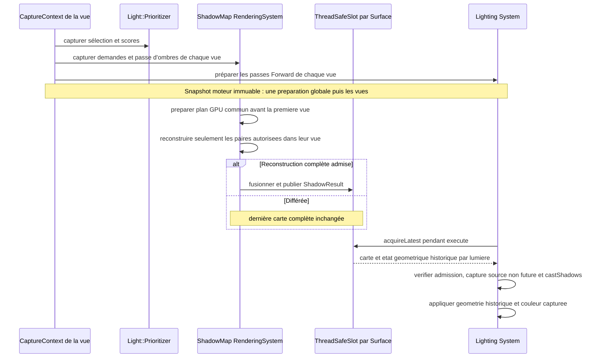

**Répartition des responsabilités.** `ShadowMap::Contributor` fournit les meshes de profondeur via le `MeshFilter`, sans porter de lumière ni participer comme `EngineView::Contributor`. Le `ShadowMap::RenderingSystem` souscrit aux casters et gère les invalidations de ses caches, sans transférer cette responsabilité à l'`EngineView`. Le `Light::Prioritizer` consulte les scores propres aux composants `Light` et sélectionne les lumières sans produire de shadow map. La `EngineView` détient le Channel mais ne connaît pas la politique des casters.


**A2 — aucune propagation des modes d'ombres en V0.1.4.** Chaque `ShadowMap::Contributor` porte **son seul `ShadowMode`** : `None`, `Static` ou `Dynamic`. La relation parent/enfant de `InherenceTrait` **ne transmet jamais** ce mode ; le parent ne peut donc ni activer, ni désactiver, ni reclassifier les ombres d'un descendant. Un regroupement graphique ou une inscription dans `Registry` ne modifie pas davantage les modes. `Registry` sert exclusivement à **découvrir** les Contributors, pas à établir des priorités ou des héritages. Aucune enum `ShadowPropagation`, aucune surcharge de `setShadowMode` acceptant une politique et aucun mécanisme d'override `Descendants` ne sont introduits dans cette version. Les relations de parenté restent pertinentes pour **calculer la transformation monde** d'une Entity et invalider ses caches si elle bouge avec son parent, sans propagation de configuration d'ombre. Un développeur voulant changer les ombres de plusieurs Entities modifie explicitement chaque Contributor concerné ; il n'existe pas de modification récursive automatique.

**Invalidations du sous-système d'ombres.** Les notifications `ContractProvider` des casters (mode, matrices, geometries, layers), des transforms et des lumières rendent les caches de production statique/finale obsolètes sans déclencher immédiatement une commande GPU. L'ancienne carte finale complète et ses anciennes matrices restent lisibles tant que la lumière est toujours sélectionnée et que les ombres restent activées. La désélection et l'extinction des ombres interdisent immédiatement son échantillonnage, même si des snapshots en vol détiennent encore ses handles. Les `EngineView` ne possèdent aucun contrat d'invalidation des casters.

```mermaid
flowchart LR
  Entity["Entity3D et InherenceTrait"] --> Visual["Composants visuels"]
  Entity --> ShadowComp["ShadowMap::Contributor"]
  M["ShadowMap : passe logique"] --> ShadowComp
  M --> SR
  M --> PassKey["Cle systeme reservee : sparkle.engineview.shadow / -1000000"]
  ShadowComp --> ShadowMode["ShadowMode propre : None, Static, Dynamic"]
  ShadowComp --> Filter["MeshFilter : collection de MeshInstance"]
  SourceMesh["spk::Mesh de TVertex"] -->|"extracteur Vector3 + indices"| Converted["ShadowMap::Mesh"]
  Converted -->|"copie legere"| Instance["MeshInstance : mesh + matrice locale"]
  AssemblyPose["Assembly : matrices cumulees des Parts relatives a Assembly"] -->|"valeurs explicites"| Instance
  AssemblyMatrix["Matrice Assembly relative a Entity"] -->|"bind(collection, assemblyMatrix)"| Filter
  Instance -->|"bind(collection, assemblyMatrix) : remplace tout"| Filter
  Visual --> VR["VoxelRenderingSystem : rendu visuel"]
  VR --> Scene["Passes opaques et WBOIT"]
  ShadowComp --> Registry["Registry des casters"]
  Registry --> SR["ShadowMap::RenderingSystem"]
  Filter --> SR
  SR --> Score["PointLight : intensite x range² x poids / distance bornee"]
  Score --> Target["Cible X : score de la Xe lumiere"]
  Target --> Tolerance["Admissibles en surplus si score >= PX x (1 - tolerance)"]
  Tolerance --> Remove["Ecarter anciennes retenues hors tolerance"]
  Remove --> Keep["Hysteresis seulement entre surplus admissibles"]
  Keep --> Max["Maximum absolu Y, socle X obligatoire"]
  Max --> RP["Une RenderPass ombres par EngineView"]
  Max --> Removed["PointLight sortie : caches actifs retires"]
  Removed --> Retire["Anciennes versions conservees par snapshots et GPU"]
  Max --> Pending["Demandes de reconstruction PointLight des vues"]
  Pending --> SurfaceBudget["Budget global par image et Window Surface"]
  SurfaceBudget --> Priority["Score brut decroissant seulement, sans bonus d attente"]
  Priority --> RP
  RP -->|"Pour chaque lumiere compatible"| Checks["Layers + activation + mode propre"]
  Checks --> SM["Cache statique individuel de la lumiere"]
  SM -->|"Copie si finale invalide"| FM["Carte finale individuelle de la lumiere"]
  Checks --> FM
  FM --> Scene
  View["EngineView : donnees generiques de capture"] --> Builder["RenderingEngine : Builder de sous-snapshot"]
  Builder --> VR
  Builder --> SR
```

**Sources d'ombres et mode propre.** Le `ShadowMap::Contributor` est un **composant graphique spécialisé de caster**, distinct de `EngineView::Contributor`. Il porte **son seul** `ShadowMode { None, Static, Dynamic }`, ses layers et un **`MeshFilter` intégré contenant une collection de `MeshInstance`**, chaque entrée ayant son mesh partagé et sa matrice locale par valeur. La source doit être liée explicitement par l'application, sans recherche automatique d'un mesh visuel. Le `ShadowMap::RenderingSystem` seul lit ces données et émet les passes d'ombres.

**`ShadowMap::Mesh` : géométrie de profondeur (A1, validé).** `ShadowMap::Mesh` est une **classe** dérivant de `spk::Mesh<spk::Vector3>`, et non un alias. Elle dispose d'un Builder dont l'unique attribut de sommet est une position `Vector3`. Une factory **statique générique** (nom indicatif `from`) accepte `const spk::Mesh<TVertex>&` et un extracteur invocable avec un `const TVertex&` et retournant `spk::Vector3`. Cette fonction n'est pas un prédicat booléen. La factory applique l'extracteur à chaque sommet et recopie les indices dans leur ordre d'origine, préservant triangles, winding et sommets partagés. Elle ne calcule ni volume fermé, ni enveloppe convexe, ni simplification, ni matériaux, et ne fait aucun rendu GPU. Le développeur choisit explicitement le mesh d'origine : opaque, proxy simplifié ou autre géométrie de projection **composée exclusivement des surfaces que l'application considère comme opaques**. Le format de position seule ne permet pas de contrôler l'opacité d'un mesh arbitraire ; cette sélection relève du producteur, pas d'une analyse de matériaux par la factory. La conversion CPU peut employer `source.layout().vertexBuffer().cast<TVertex>()` et `source.layout().indexBuffer().cast<std::uint32_t>()`, disponibles dans Sparkle ; elle ne requiert aucun contexte OpenGL. Les entrées triangulaires malformées (indices invalides, nombre d'indices non multiple de trois, positions non finies) sont refusées avec une `spk::Exception` descriptive sans publier de résultat partiel ; un mesh source vide donne un mesh d'ombre vide.

**Q-ARCH — ombres exclusivement géométriques (option A validée pour V0.1.4).** Le rendu des shadow maps emploie **uniquement les positions, les indices et les matrices** fournis par `ShadowMap::Mesh` et `MeshInstance`, avec écriture de profondeur pour les triangles admis. Il **ne lit ni texture albedo, ni UV, ni canal alpha, ni `Material`** et n'effectue aucun `alpha test`, `alpha discard`, seuil de cutout ou découpe de silhouette dépendant d'une texture. Tous les triangles du mesh d'ombre lié explicitement et classés comme casters opaques sont traités comme **entièrement occultants** sur leur surface, même si le matériau visuel comporte des pixels transparents. Un rectangle texturé représentant une feuille ajourée projette donc l'ombre pleine du rectangle, sauf si le développeur fournit **un mesh d'ombre géométriquement découpé** adapté. Le meshing voxel continue de sélectionner ses triangles d'ombre depuis les seuls polygones de slot d'opacité `1` au bake, indépendamment de l'alpha de l'albedo ; les surfaces visuelles translucides de slot d'opacité `< 1` ne projettent pas d'ombres, mais peuvent en recevoir. Aucune nouvelle catégorie `cutout`, aucun lien implicite matériau→caster et aucun shader de profondeur alpha-aware ne sont introduits. Changer uniquement une texture ou une palette ne modifie ni la géométrie du caster ni la validité des caches d'ombres : seul un nouveau `bind()` ou une autre invalidation géométrique explicite doit les affecter.

**`ShadowMap::MeshInstance` et transformations locales (A1, complément matrice commune).** Une `MeshInstance` est une structure publique contenant un `ShadowMap::Mesh mesh` et une `spk::Matrix4x4 localTransform`. La copie de `mesh` est **légère** : elle partage les données immuables de `spk::Mesh`. La matrice est détenue **par valeur**, sans pointeur, abonnement ni dépendance à un autre `Transform3D`. Elle exprime la pose du mesh **dans le repère local de la collection**, par exemple le repère d'une `Voxel::Assembly`, et non le monde. Le `MeshFilter` conserve également **une seule `spk::Matrix4x4 baseTransform` commune à toutes les instances**, exprimée dans le repère de l'`Entity3D` porteuse ; à défaut elle est identité. Pour chaque position, la matrice complète est `M_world = M_entityWorld * M_base * M_instanceLocal`, appliquée au sommet du mesh, selon la convention algébrique de Sparkle. `M_base` peut être la matrice de l'Assembly : chaque descendant conserve sa propre matrice cumulée **relative à l'Assembly**, sans incorporer `M_base` une seconde fois. Plusieurs instances peuvent partager le même mesh avec des matrices différentes ; elles n'ont pas d'identifiant ni de cycle de vie indépendant. Le système peut composer les matrices à la capture CPU sans modifier ni prétransformer les buffers des meshes.

**API de liaison, remplacement intégral et état atomique (A1, complément matrice commune).** Le `MeshFilter` intégré au Contributor contient **une collection ordonnée** de `MeshInstance` **et une matrice commune `baseTransform`**. Les signatures conceptuelles sont `bind(const ShadowMap::Mesh&)`, `bind(const ShadowMap::Mesh&, const spk::Matrix4x4&)`, `bind(collection<MeshInstance>)` et **`bind(collection<MeshInstance>, const spk::Matrix4x4& baseMatrix)`**. Pour un mesh unique, `bind(mesh, matrix)` équivaut à une collection d'une entrée avec `localTransform = identité` et `baseTransform = matrix` ; pour une collection sans second argument, `baseTransform = identité`. **Toutes les surcharges remplacent intégralement et atomiquement le couple `(instances, baseTransform)`**, sans ajout incrémental ni conservation cachée de l'ancienne matrice commune. Une collection vide supprime toutes les instances, remet la matrice commune à l'identité ; `unbind()` peut être un raccourci explicite à cette remise à zéro. Il n'existe ni `add(mesh, transform)`, ni `remove(id)`, ni `setTransform(id)` ni identifiants pérennes d'entrée. Les wrappers des meshes immuables sont copiés légèrement ; toutes les matrices (instance et base) sont copiées par valeur. La destruction des wrappers, du Model ou de l'Assembly de départ ne rend pas les copies invalides. Une matrice non finie, qu'elle soit commune ou particulière, est refusée par `spk::Exception`, et toute erreur de validation laisse **collection et matrice commune anciennes intactes**.

**Invalidation des bindings et capture sûre (A1, clos).** Le Contributor prépare sa nouvelle collection avant de remplacer la précédente. Chaque **appel `bind()` réussi**, même si le contenu est identique, effectue un remplacement logique puis émet **une notification unique** via son `ContractProvider`, quel que soit le nombre de meshes ou matrices changés ; il n'existe aucune notification par entrée ni comparaison profonde implicite. Le système d'ombres invalide les caches selon le **mode propre du Contributor** : un changement purement `Dynamic` n'invalide que la **carte finale**, tandis qu'un changement `Static` invalide **statique et finale**. Un changement de `ShadowMode` conserve sa propre invalidation statique + finale déjà spécifiée. La notification unique d'un `bind()` suffit à déclencher cette logique de classification. Pour actualiser la pose d'une `Voxel::Assembly`, le jeu recalcule les matrices locales **cumulées par rapport à l'Assembly** des Parts et rappelle `bind(collection, assemblyMatrix)` ; pour déplacer l'Assembly entière relativement à l'Entity, il peut réutiliser la même collection et fournir **une nouvelle matrice commune**, sans rebake, ni fusion géométrique, ni suivi automatique d'Assembly. Un mouvement global de l'Entity ne nécessite pas de nouveau bind local, mais sa notification de transformation demeure nécessaire au système d'ombres. Lors de la capture CPU, chaque entrée admise est transformée par `M_entityWorld * M_base * M_instanceLocal` ; les **commandes du snapshot copient/capturent les matrices finales, buffers et handles**. `execute(RenderContext&) const` n'accède jamais au conteneur du Contributor, à l'Entity mutable ou à une Part d'Assembly. Les snapshots publiés avant le bind continuent d'utiliser leurs anciennes versions.

**État initial et absence de sources (A1, clos).** Un `ShadowMap::Contributor` est **facultatif** sur une Entity ; aucun composant visuel ne le crée automatiquement. À la construction : `ShadowMode = None`, collection de `MeshInstance` **vide**, `baseTransform = identité`, et **aucun layer** (collection de noms vide). `None` évite toute projection implicite ; l'application demande explicitement `Static` ou `Dynamic` **sur ce Contributor**. Aucun mesh, une collection vide ou des meshes vides ne produisent de triangles d'ombre et ne déclenchent pas d'exception. Le Contributor ne transmet aucun mode d'ombre aux descendants, même s'il n'a lui-même aucune géométrie. Les layers ne s'héritent ni de l'Entity ni du visuel : selon §7.2, une liste vide est admise par une vue **sans filtre configuré**, et exclue d'une vue **avec filtre explicite**, même si la liste de filtre est vide. Aucune liaison implicite au premier mesh visuel n'est autorisée. Le producteur garantit l'opacité des triangles fournis ; le mesh position-seule ne peut pas vérifier l'alpha.

**Exemple d'utilisation conceptuel :**

```cpp
std::vector<spk::ShadowMap::MeshInstance> instances;
instances.push_back({bodyShadowMesh, bodyLocalMatrix});
instances.push_back({armShadowMesh, armAccumulatedLocalMatrix});
shadowContributor.bind(instances, assemblyLocalMatrix); // M_assembly sur toutes les Parts ; remplace TOUT.
shadowContributor.setShadowMode(ShadowMode::Dynamic);
// Nouvelle pose : recalculer les matrices des Parts, puis bind(instances, assemblyLocalMatrix).
// Deplacement de toute l Assembly : bind(instances, nouvelleAssemblyLocalMatrix).
// Cas simple : shadowContributor.bind(modelShadowMesh); // Matrice identite.
```

Les noms secondaires et la qualification exacte des enums sont illustratifs ; le contrat de possession, de remplacement et de capture est normatif.


- `None` interdit la projection pour le caster concerné, `Static` le classe dans le cache statique, `Dynamic` dans la partie dynamique de la carte finale. Seules les contributions de géométrie déclarée opaque sont susceptibles de projeter des ombres ; l'alpha d'une texture ne crée jamais de trou dans leur shadow map. Les géométries translucides n'en projettent pas, mais peuvent en recevoir lors de l'éclairage Forward. `ShadowMode` n'est ni un booléen `castShadow` ni un tag de Contributor générique.
- **A2 : pas de `ShadowPropagation`.** `ShadowMode` s'applique exclusivement aux `MeshInstance` du Contributor qui le porte. Aucune relation de parenté (`InherenceTrait`, Entity, Assembly ou collecte graphique) ne l'étend à un autre Contributor. Une Entity parent en mode `None` n'interdit pas les ombres d'une Entity enfant en mode `Dynamic` ; inversement un parent `Dynamic` n'active pas un enfant `None`. Les valeurs des autres Contributors ne changent jamais lorsque le parent change de mode.
- Les layers de `ShadowMap::Contributor` sont testés **par le `ShadowMap::RenderingSystem`** via le filtre générique figé de la vue. Ils ne sont pas lus implicitement depuis les layers du mesh visuel : **initialement vides**, ils ne permettent l'admission que dans une vue dont le filtre est non configuré, selon §7.2. L'activation de l'Entity reste une condition indépendante.

**Setter et notifications automatiques (A2).** `ShadowMap::Contributor::setShadowMode(mode)` compare uniquement le nouveau `ShadowMode` à la valeur stockée. Si le mode change, il l'enregistre et notifie son **`ContractProvider` propre aux ombres** ; sinon il ne notifie rien. Aucune politique de propagation, ni mise à jour des composants parents ou enfants, n'est effectuée. `ShadowMap::RenderingSystem` souscrit par contrats RAII à ses `ShadowMap::Contributor` connus ; à la réception, il marque **ses caches statique et final** logiquement invalides pour les vues/lumières concernées. Aucun appel manuel à `invalidateShadowMap()` n'est exigé après le setter, et aucune copie de l'ancienne catégorie n'est requise. Les événements de transformation (y compris un reparenting qui change une transformation monde), de modification de la géométrie `MeshFilter`, des layers ou de la disponibilité d'une source demandent également une invalidation, selon des mécanismes précis encore à finaliser. Le reparenting ne modifie **aucun** `ShadowMode`.

**Séquence de liaison d'une Assembly animée (A1, matrice commune ; Q-ARCH-004).** Le jeu calcule les matrices des Parts relatives au repère de l'Assembly et sa matrice commune relative à l'Entity, puis soumet l'ensemble atomiquement. Si une autre Assembly a été insérée, ses Parts ont été **copiées et développées** dans la seule hiérarchie de destination : le jeu parcourt les Parts importées comme toute autre Part, sans référence à une sous-Assembly vivante et sans appliquer une seconde fois la transform externe de l'Assembly source. Retirer l'ancrage ou reparent une Part importée ne notifie pas automatiquement les ombres : un nouveau `bind(collection, assemblyMatrixDest)` est nécessaire, avec la matrice commune de destination uniquement. Les snapshots et `MeshInstance` déjà construits restent inchangés. Le système graphique n'extrait pas de Parts depuis l'Assembly et la thread GPU ne consulte pas les objets mutables.

```mermaid
sequenceDiagram
  participant Jeu as Jeu/animation
  participant Assembly as Voxel::Assembly
  participant C as ShadowMap::Contributor
  participant Sh as ShadowMap::RenderingSystem
  participant B as Builder de vue
  participant GPU as RenderContext
  Jeu->>Assembly: modifier poses des Parts
  Jeu->>Assembly: invalidate() pour chemin visuel
  Jeu->>Assembly: lire meshes et matrices Parts relatives a Assembly
  Assembly-->>Jeu: collection de MeshInstance (valeurs)
  Jeu->>Jeu: preparer M_base = matrice Assembly dans repere Entity
  Jeu->>C: bind(collection, M_base) (remplacement entier)
  C->>C: copier Mesh partages + matrices Parts + M_base, valider
  alt Erreur de validation
    C-->>Jeu: Exception ; collection et M_base precedentes intactes
  else Liaison acceptee
    C->>C: substituer ensemble collection et M_base
    C-->>Sh: ContractProvider : un evenement
    Sh->>Sh: invalider caches des ombres concernes
  end
  Jeu->>Sh: capture vue suivante via RenderingEngine
  Sh->>C: lire collection et Entity world matrix sur thread capture
  C-->>Sh: MeshInstance[], M_base et M_entityWorld
  loop Chaque MeshInstance et lumiere admissible
    Sh->>Sh: M_world = M_entityWorld * M_base * M_instanceLocal
    Sh->>B: commandes profondeur avec mesh et matrice captures
  end
  B-->>GPU: snapshot immuable publie et execute plus tard
  Note over GPU: Aucune lecture de Contributor, Entity ou Assembly mutable
```

**`Light::ShadowResult` : résultat immuable par surface.** Une publication représente les **shadow maps finales** déjà produites pour une `EngineView` sur une `Window::Surface` particulière. Elle contient des entrées par lumière, chacune avec identité logique, génération individuelle, texture de profondeur finale (2D pour Spot/Directional, cubemap pour Point), projections et matrices correspondantes, et paramètres d'échantillonnage, **état géométrique lumineux historique, identité d'admission aux ombres et ordinal de capture source**. Les caches statiques restent internes à `ShadowMap::RenderingSystem`. Un `ShadowResult` ne contient pas un framebuffer de production, ni des copies de pixels CPU, ni des références aux Entities mutables.

**`Light::ShadowResults` et le Channel.** Un `Light::Channel` par vue possède un `Light::Prioritizer` et une collection `Light::ShadowResults`. Cette dernière est un dictionnaire d'instances vivantes de `Window::Surface` vers des `ThreadSafeSlot<Light::ShadowResult>`, avec un slot indépendant par surface. `ThreadSafeSlot` fournit un `shared_ptr<const Light::ShadowResult>` : le consommateur garde cette version pendant son dessin. Deux fenêtres affichant la même vue partagent la sélection logique mais pas leurs instances OpenGL, puisque Sparkle V0.1.4 n'utilise pas de groupe de partage des contextes.

**Fermeture des surfaces.** `Window::Surface` expose un abonnement de destruction fondé sur `ContractProvider` (nom indicatif `subscribeToDestruction()`). `Light::ShadowResults` s'abonne aux surfaces dont il possède un slot et efface l'entrée et le contrat à leur fermeture effective, en synchronisant les accès concurrentiels au dictionnaire. Le signal est émis une seule fois, alors qu'aucune nouvelle commande de rendu ne peut débuter sur cette surface. `GPUResourceCollection` reste seule responsable de libérer les instances OpenGL avant destruction de leur contexte. Ni `Window::State` ni `Window::Surface` ne stockent de caches d'ombres. Les identifiants textuels de fenêtre et handles `HGLRC` pouvant être réutilisés, une fenêtre recréée ne doit jamais voir des résultats de l'ancien contexte.

**Reconstruction non destructive.** Le système produit chaque carte remplacée dans de **nouvelles ressources GPU logiques**, sans réécrire la profondeur de la carte antérieure. Cette dernière et les matrices/projections de sa propre génération demeurent cohérentes et consultables pendant l'attente si la lumière est encore sélectionnée et projette toujours des ombres. Une nouvelle reconstruction complète peut être publiée même si la simulation a évolué depuis la capture CPU. Cependant, une génération plus ancienne ne peut jamais écraser une génération plus récente de la même lumière. Une cubemap `Point` est publiée uniquement après les six faces cohérentes, jamais partiellement.

**Publication incrémentale par lumière.** Aussitôt la reconstruction complète d'une lumière, `ShadowMap::RenderingSystem` publie dans le slot correspondant à sa surface **un nouvel état complet de `Light::ShadowResult`** qui remplace uniquement l'entrée de cette lumière et conserve les entrées, générations et handles des autres. Le contrôle anti-régression, la fusion et la publication sont atomiques/serialisés afin qu'une mise à jour concurrente d'une autre lumière ne soit pas perdue. L'ancienne valeur immuable reste disponible aux `shared_ptr` déjà acquis. Les générations sont monotones par lumière et par contexte logique de vue, sans ressusciter les caches après désélection ou destruction/recréation.

**Cohérence générationnelle entre lumière et shadow map (contrat validé).** L'entrée immuable de `Light::Selection` contient l'identité durable de la lumière, les paramètres d'éclairage capturés, son autorisation `castShadows` et son **identité d'admission aux ombres pour la vue**. Cette dernière est stable uniquement pendant une admission continue : toute désélection, désactivation, suppression ou recréation la révoque. Une réadmission reçoit une identité neuve, même si le nom ou l'identité applicative est réutilisé. L'éviction retire l'entrée active de la publication, et une reconstruction tardive d'une admission révoquée ne peut la republier. Cette identité n'est pas une génération de `GPUResource::Handle`.

**Ordre des captures.** `RenderingEngine::refreshRenderSnapshot()` émet un **ordinal CPU strictement croissant pour le moteur**, partagé par les sous-snapshots de ses vues. Une shadow map publiée conserve l'ordinal **de la capture ayant produit ses casters et sa lumière**. Ce numéro distingue l'ordre logique des captures, sans être le numéro d'image GPU/surface ni le compteur de budget de reconstruction. Si une commande d'éclairage provient de la capture `C`, elle **refuse toute carte produite depuis une capture `R > C`**, même si les matrices semblent numériquement identiques : cela évite qu'un ancien snapshot emprunte une représentation géométrique future de la scène. Une carte `R <= C` est admissible seulement lorsque les identités lumière/admission correspondent, que la sélection capturée permet ses ombres et que l'admission n'a pas été révoquée. Les contrôles de publication/retrait sont sérialisés dans le Channel, sans consulter les composants de jeu mutables sur le thread GPU.

**Paramètres à combiner.** Une carte d'ombres historique admissible transporte l'état géométrique nécessaire à sa projection : position/orientation de source, `range`, angle Spot, matrices, plans proche/lointain, résolution, format et paramètres de profondeur par face. Elle ne doit pas mélanger géométrie récente et projection ancienne. `RGB` **et `intensity`**, qui modulent le shading sans changer la géométrie, proviennent du snapshot consommateur courant. Le même contrat s'applique à opaque et WBOIT ; en absence de carte compatible, la lumière éclaire sans ombre avec son état capturé.

**Résolution au dessin.** Après la passe d'ombres, `Lighting::System` effectue `acquireLatest()` dans le slot de la **surface courante** et résout une seule fois, **par exécution de vue**, l'état effectif de chaque lumière. Si la carte est admissible, l'état géométrique vient de la carte et les paramètres indépendants viennent du snapshot ; sinon, la lumière utilise **tous ses paramètres capturés et éclaire sans ombre**. L'opaque et WBOIT partagent exactement cette résolution, sans lecture de lumière, caméra ou Entity mutable dans `execute()`. Le `ThreadSafeSlot` ne fournit aucun historique : si sa dernière carte est future ou incompatible, aucun retour automatique à une version antérieure n'est effectué. Ce contrat n'ajoute ni attente GPU, ni gestionnaire de ressources d'ombres, ni propriété GPU dans le Channel.

**Publications entrelacées.** Une fusion incrémentale doit vérifier sous synchronisation l'identité encore active de l'admission ainsi que l'absence de régression de génération ; elle ne peut ressusciter une carte retirée. Une désélection empêche les **nouvelles acquisitions** de cette carte, sans annuler rétroactivement un draw GPU déjà soumis ou détruire les handles conservés par des snapshots en vol. Une ancienne capture peut produire une nouvelle carte si elle est toujours admissible, mais ne peut remplacer une génération plus récente.

**Consommation au rendu.** Les commandes de `Lighting::System` capturent une liaison sûre au Channel mais appellent `acquireLatest()` dans leur `execute(RenderContext&) const`, après la passe d'ombres de la vue. Elles utilisent donc les résultats déjà terminés **dans la même image**. Aucune attente de reconstruction GPU n'est ajoutée ; une carte antérieure toujours éligible peut être échantillonnée avec **son état géométrique lumineux et ses matrices historiques**, après contrôles d'identité d'admission et d'ordinal source. L'éligibilité des lumières et l'activation des ombres sont vérifiées séparément de la simple présence d'une texture. Un résultat absent, incomplet ou appartenant à un ancien contexte est indisponible et la lumière continue à éclairer sans ombre. L'exécution ne lit aucune `Entity`, caméra, lumière ou vue mutable.

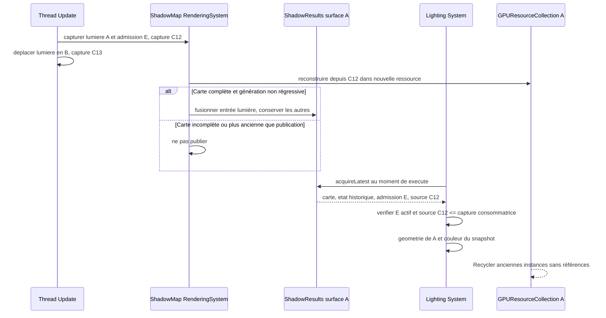


**Admission et prévention du double rendu.** `ShadowMap::RenderingSystem` découvre uniquement les sources du Registry de `ShadowMap::Contributor`; chaque source est traitée **une seule fois par parcours de casters pour chaque lumière/cible admissible**, indépendamment de l'arborescence des Entities et des éventuels regroupements graphiques. `VoxelRenderingSystem` et les autres systèmes de rendu visuel ne produisent **aucun caster en parallèle**. Une contribution hors frustum caméra peut continuer à projeter sur les objets visibles si elle est pertinente pour la projection lumineuse.

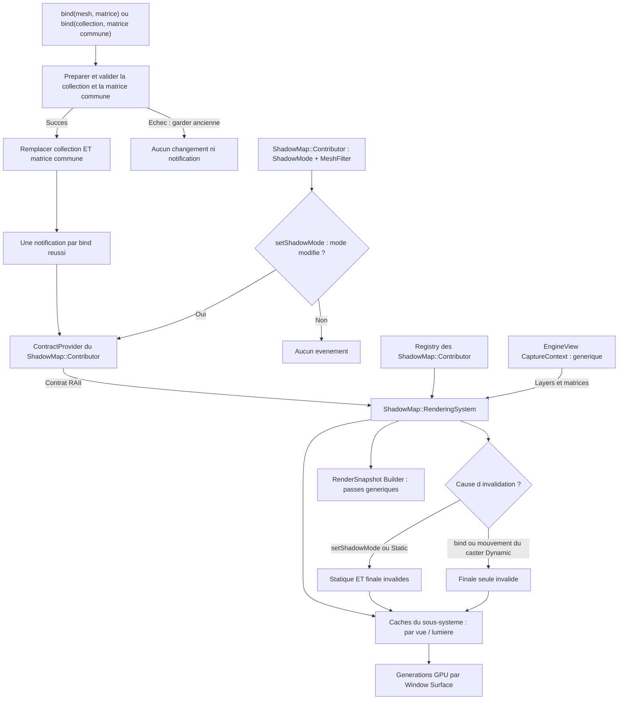

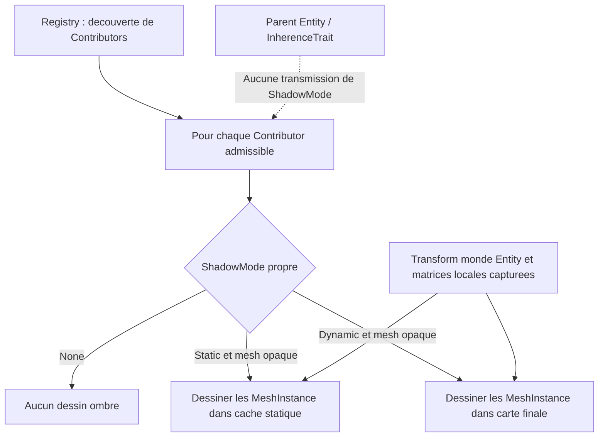
**Cache de profondeur statique et carte finale.** Pour chaque combinaison **`EngineView` × lumière projetant des ombres**, l'infrastructure graphique distingue **un cache statique** (caster opaques classés statiques) et **une carte finale** (utilisée par l'éclairage Forward). Les deux ressources ont la même topologie : **deux textures de profondeur 2D** pour une directionnelle ou un spot ; **deux cubemaps de profondeur à six faces chacune** pour une ponctuelle. Ces cibles ne sont jamais partagées entre lumières. Les géométries opaques classées dynamiques ne sont pas dessinées dans le cache statique. Ces deux catégories sont des **politiques de mise à jour des ombres**, et non une nouvelle classification de transparence ; les translucides ne projettent toujours pas d'ombres. **La classification dépend exclusivement du `ShadowMode` propre de chaque `ShadowMap::Contributor`, sans recherche ni priorité d'ancêtres.** Les notifications vont de la source de caster au **`ShadowMap::RenderingSystem` par contrat RAII**, et celui-ci invalide **ses propres caches** par vue/lumière ; aucune invalidation ne transite par `EngineView`. Aucun identifiant persistant par groupe n'est requis. La portée exacte des événements, les règles d'appartenance vue/Contributor et le suivi des générations restent à préciser ; aucune détection implicite du mouvement.

**Actualisation à la demande, par invalidation :**
- **Tout changement effectif de `ShadowMode` sur `ShadowMap::Contributor` invalide automatiquement statique + finale par notification directe au `ShadowMap::RenderingSystem`.** Une valeur inchangée ne notifie pas ; le dessin GPU intervient ultérieurement, jamais dans le setter.
- Lorsqu'une contribution **statique** change ou lorsque la carte statique n'a encore jamais été construite, la partie statique est invalidée. Au prochain rendu **autorisé par le budget de reconstructions lorsqu'il s'agit d'une PointLight**, Sparkle redessine **uniquement les casters statiques** dans la carte statique, puis invalide et reconstruit la carte finale. Si aucune unité de budget n'est attribuée, la PointLight peut réutiliser la dernière carte finale complète et ses matrices tant qu'elle est sélectionnée et que ses ombres sont activées ; sans carte complète, elle éclaire sans ombre.
- Lorsqu'une contribution **dynamique** change (ajout, retrait, position, géométrie ou toute modification affectant sa projection), seule la **carte finale** doit être reconstruite : **copie de la profondeur statique valide dans la carte finale, puis dessin des casters dynamiques** avec depth test et depth write activés. Les casters statiques ne sont pas redessinés pour ce changement.
- Une modification de la **lumière ou de sa projection**, de la région couverte ou de la définition/version des cibles qui affecte les deux cartes invalide **les deux**. La carte statique est reconstruite en premier, puis la finale.
- Tant que les cartes restent valides, **aucune copie ni nouveau dessin d'ombres n'est exigé** pour cette combinaison vue/lumière/surface. Une image finale valide demeure consultable par les dessins opaques et translucides de la vue.

**Combinaison de profondeur.** Les deux ressources d'une lumière utilisent **la même projection** (pour une ponctuelle, le même ensemble des six projections) et des dimensions, formats de profondeur et conventions compatibles. Pour une cubemap, la copie et les tests de profondeur sont réalisés pour chaque face, sans copie entre faces ou lumières. La reconstruction finale **copie la profondeur** du cache statique vers la cible finale (opération GPU de copie/blit adaptée), puis rend les objets dynamiques dans cette cible. Le test de profondeur réalise alors l'occlusion par le plus proche fragment opaque des deux catégories. **Les shaders d'éclairage Forward n'échantillonnent que la carte finale, 2D pour un spot/directionnelle ou cubemap pour une ponctuelle** : aucun second échantillonnage statique/dynamique ni atlas d'ombres regroupant plusieurs lumières n'est prescrit. Le support d'une copie de profondeur compatible doit être vérifié ; aucune copie entre fenêtres n'est autorisée et un contexte/cible incompatibles déclenchent `spk::Exception` plutôt qu'un fallback silencieux.

**Isolation des surfaces et des snapshots.** Les `Light::ShadowResult` sont publiés séparément pour chaque surface dans le Channel de la vue. Une reconstruction sur la surface A ne met jamais à jour la carte sur B. Les `RenderSnapshot` sont immuables et peuvent être exécutés sur deux surfaces ; le slot est acquis au moment du dessin. Les ressources GPU logiques référencées survivent à la publication suivante selon les mécanismes existants de `GPUResourceCollection` ; la fermeture de surface invalide les publications locales. Une ancienne génération peut éclairer avec ses **anciennes matrices** tant que la sélection et `castShadows` l'autorisent.

### 7.4 Composants lumineux, cubemaps et budgets

Les **caméras et les trois lumières directes (Point, Spot, Directional) sont représentées par des composants spécialisés dérivant de `spk::Component3D`**, attachés aux `Entity3D` existantes. Leur position et leur orientation dans le monde proviennent des **`Transform3D` des entités qui les portent** : il n'existe pas de seconde hiérarchie de transformations dédiée aux caméras ou aux lumières. Ces composants appartiennent à l'Engine concerné et sont découvrables par ses mécanismes de Registry, comme les autres composants du moteur.

**`spk::AmbientLight` — objet possédé par chaque EngineView (décision A validée).** Chaque `EngineView` construit et possède **exactement un** `spk::AmbientLight`, vivant aussi longtemps qu'elle, accessible directement par référence (`view.ambientLight()`, nom d'accesseur indicatif). Aucun `bind()` ni pointeur emprunté, objet extérieur, liste d'ambiances, partage entre vues ou désabonnement de lumière ambiante. Contrairement aux lumières directes, il ne dérive ni de `Light::Contributor` ni de `Component3D` ; aucun Registry, portée, direction, position, priorité, atténuation, shadow map ou sélection Top-N. Il contient `spk::RGB color` linéaire fini borné à `[0,1]` et `float intensity` fini `>= 0` sans plafond arbitraire. **Initialement `color = RGB{1,1,1}` et `intensity = 0`**, donc éclairage ambiant nul ; mettre l'intensité à zéro désactive l'ambiance sans retirer l'objet. À la capture CPU de chaque vue, calculer `ambientRGB = color × intensity` (HDR linéaire, non clampé) et le placer par valeur dans le snapshot immuable. Les shaders opaque et WBOIT appliquent cette valeur uniformément à l'albedo du matériau, séparément de l'éclairage direct, sans PCF, shadow map ni illumination globale. Une modification n'affecte que les captures futures de la vue, sans invalider ses cartes d'ombres ou son Top-N. Les signatures exactes des setters/accesseurs restent à consolider dans Q-TECH-005, sans remettre en question l'objet possédé.

**Q-TECH-002 — unité spatiale de référence (option B validée).** Les longueurs sont exprimées en `U` (unité de monde générique sans correspondance physique imposée) : positions, distances lumière/caméra, `range`, `minLightDistance` et plans de projection. Les couleurs RGB, l'intensité scalaire, les angles, les UV, les texels et les profondeurs normalisées ne sont pas des longueurs. Aucune conversion d'unité n'est implicite.

**Types et paramètres lumineux — décision révisée et validée.** Les composants `spk::Light::Point`, `spk::Light::Spot` et `spk::Light::Directional` héritent de `Light::Contributor` et utilisent `spk::RGB color` (linéaire, trois canaux dans `[0,1]`) et une intensité scalaire `float intensity` finie, positive ou nulle, sans plafond arbitraire. Une intensité nulle n'éclaire pas. Point et Spot exposent également `range` en `U` ; Spot ajoute un unique angle d'ouverture. Directional ne possède pas de portée, prend sa direction depuis `Transform3D`, et sa contribution non atténuée par distance est `RGB × intensity`. `priorityWeight` n'agit que sur le classement. Les ombres Point sont désactivées par défaut, Spot et Directional activées par défaut ; le mode des casters demeure indépendant.

**Q-TECH-002 — atténuation radiale Smoothstep (nouvelle décision validée).** L'ancien modèle en inverse du carré et `d_floor` est **abandonné** pour Point et Spot. Pour `R = range > 0` et une distance `d >= 0`, `x = clamp(d/R, 0, 1)` et `A(x) = 1 - 3x² + 2x³`. La contribution radiale est `RGB × intensity × A(x)` pour `0 <= d < R` ; elle vaut zéro pour `d >= R` ou `R = 0`. En particulier `A(0)=1` et `A(1)=0`, avec raccord de pente nul aux deux extrémités. Il n'existe **ni `d_min`, ni `d_floor`, ni facteur inverse du carré** dans le shading. Même profil dans les passes opaque et WBOIT ; Spot multiplie ce profil par son facteur angulaire Smoothstep, Directional ne reçoit aucune atténuation en distance. La formule n'impose aucun seuil minimal de portée positive.

**Q-TECH-002 — types et domaine de couleur (décisions validées).** Introduire `spk::RGB` (trois composantes R/G/B linéaires, finies et dans `[0,1]`, sans alpha) ; renommer l'ancien `spk::Color` RGBA en `spk::RGBA` et conserver `using Color = RGBA;` dans `spk` pour compatibilité. Le paramètre `intensity` est un scalaire indépendant, fini et non négatif, sans limite supérieure arbitraire ; aucune composante RGB ne l'encode. Les conversions explicites RGB/RGBA et l'intégration des formats existants restent à préciser, sans affecter le contrat des lumières.

**Q-TECH-002 — portée et valeurs admises (validées).** `range` Point/Spot est une longueur en `U`, non négative et finie, indépendante de `intensity` et de `RGB`. `range = 0` donne une contribution et un volume nuls, sans génération de shadow map. Une portée positive, même inférieure à `0,01 U`, est autorisée ; aucun plancher de distance ne la tronque. Les valeurs non finies ou négatives de `range` et `intensity` sont refusées. Les politiques de limites matérielles des très grandes portées restent à préciser, sans clamp silencieux.

**Influence définie directement par la portée.** `R = range` détermine le volume d'influence, le culling, le far des shadow maps locales et l'extinction Smoothstep. La portée n'est pas calculée depuis l'intensité : l'ancien modèle `R = sqrt(I/E_min)` et tout seuil `E_min` sont abandonnés. `intensity` module l'éclairage et le score, pas la géométrie ; `RGB` module l'éclairage et n'entre pas dans le score. Les données historiques nécessaires à une carte d'ombres incluent géométrie, portée, matrices, plans et paramètres de projection, jamais la couleur ou l'intensité courantes.

**Volumes précalculés.** `Light::Point` conserve une sphère (centre et `range`), précalculée à la construction et mise à jour lors d'un changement de portée ; le mouvement de l'Entity ne change que le centre monde. `Light::Spot` conserve `range`, ouverture, géométrie du cône et sphère englobante conservative, recalculés aux changements de portée ou d'ouverture. Translation et rotation mettent à jour seulement position et direction monde. Aucun recalcul intégral n'est fait à chaque classement.

**Frustum et test sphère.** Les six plans normalisés du frustum caméra sont calculés à la capture de la vue, sans recalcul par lumière. Pour un plan de normale unitaire `n` orientée vers le volume intérieur et de constante `D`, une sphère de centre `C` et rayon `R` est exclue si `dot(n,C) + D < -R`. Il suffit qu'un seul plan rejette la sphère pour donner un score nul. Les faux positifs conservateurs sont admis ; un volume réellement intersectant n'est jamais rejeté.

**Frustum et test cône du Spot.** Le spot applique d'abord **le test de sa sphère englobante**, plus léger ; seul un candidat survivant subit le test de son **cône fini**. Pour chaque plan unitaire `(n,D)`, un cône de sommet `A`, d'axe unitaire `u`, longueur `L` et rayon de base `r` est entièrement exclu lorsque `dot(n,A)+D+max(0,L*dot(n,u)+r*sqrt(max(0,1-dot(n,u)^2))) < 0`. Les deux tests rejettent au premier plan excluant entièrement le volume. Ils représentent un pré-filtrage conservateur, sans calculer le volume d'intersection ni un coefficient de recouvrement. La sphère est moins chère par plan, mais le gain réel du filtrage en deux étapes dépend des scènes et doit être mesurable.

**Formules de priorité par type (décision validée, mise à jour).** Chaque type de lumière produit son propre score depuis l'état capturé et le frustum/caméra. Pour Point/Spot, après admission du volume : `P = intensity × range² × priorityWeight / max(distanceCamera, minLightDistance)` ; un rejet frustum, une portée nulle ou une intensité nulle donne `P = 0`. `minLightDistance > 0` n'est **qu'un plancher numérique du classement**, à définir ; il ne participe pas au shading Smoothstep. À autres paramètres égaux, doubler `intensity` double le score ; doubler `range` le quadruple. RGB ne participe pas au classement ; les Directional actives restent hors Top-N. Les résultats doivent être finis et non négatifs.

**`spk::Light::Prioritizer`.** Le `Light::Prioritizer` du `Light::Channel` de chaque EngineView sélectionne les lumières pour **l'éclairage Forward classique de cette vue entière**. Il ne calcule aucun score propre ; chaque type fournit son score, et le Prioritizer compare ces valeurs. `Point` et `Spot` à score positif participent au **même Top-N global**, alors que **toutes les `Directional` actives** sont retenues séparément, sans consommer N. **Q-TECH-001 — profil initial validé : toute nouvelle EngineView initialise son Prioritizer avec `N = 8` et `h = 0,10` (10 %).** `N` et `h` demeurent **configurables indépendamment par EngineView**, sans valeur globale modifiable ni changement implicite pour les vues existantes. `N` est un nombre de places locales (Point et Spot ensemble) ; `h` est un taux relatif, pas une valeur additive en points de score. Une candidate nouvelle n'évince une lumière locale retenue que lorsque `score(candidate) > score(retained) * (1 + h)`. **Q-TECH-001 — égalités : les scores identiques sont départagés par le numéro d'enregistrement monotone et stable de chaque lumière dans son Engine ; la plus ancienne a priorité.** L'ordre de parcours du Registry, le type Point/Spot, l'adresse mémoire ou l'ordre d'inscription dans une EngineView ne servent jamais à départager les scores. Le remplissage ordinaire des places vacantes est défini ci-dessous ; une **modification effective de `N` ou de `h`** réinitialise le Top-N brut suivant le contrat ci-dessous. Ce profil ne fixe ni les budgets `X/Y/epsilon` d'ombres PointLight, ni leur hystérésis `shadowSelectionHysteresis`, qui sont des paramètres indépendants.

**Q-TECH-001 — identifiant de départage validé (option A).** Chaque lumière `Light::Contributor` (Point, Spot ou Directional) admise au Registry d'un `Engine` reçoit, **à sa première inscription effective dans cet Engine**, un ordinal `LightRegistrationOrder` (nom indicatif), issu d'un **compteur entier non signé 64 bits strictement croissant propre à cet Engine**. L'ordinal est **unique entre les lumières de cet Engine** et **immuable durant cette inscription**, y compris si la lumière change de score, d'Entity par opérations admises, de transform, d'activation ou de visibilité dans une vue. Ce compteur est attribué **au moment de l'inscription**, de manière sérialisée si les inscriptions sont concurrentes, **pas au moment du parcours** d'un `Registry` ni de l'acquisition d'un `Light::Selection`. La suppression de l'inscription termine cette identité ; une nouvelle inscription ultérieure, même avec le même objet ou à la même adresse, reçoit **un ordinal strictement plus récent**, jamais l'ancien. Le compteur n'est pas réinitialisé durant la durée de vie de l'Engine ; épuiser sa plage doit provoquer `spk::Exception` au lieu de réutiliser une valeur ou de déborder silencieusement. Deux moteurs indépendants possèdent chacun leur compteur ; leurs lumières ne sont **jamais mélangées dans un même Prioritizer**.

**Ordre total de sélection.** Le classement des `Point` et `Spot` locaux repose sur la clé `(-score, registrationOrder)` : **score décroissant d'abord, ordinal croissant ensuite** (la plus ancienne gagne à score identique), sans faveur pour le type de lumière et sans comparer des nombres flottants par epsilon de classement. Pour identifier **la plus faible retenue** à évincer quand `N` est plein, le score **le plus bas** perd d'abord ; en cas d'égalité entre retenues, **la plus récente** (ordinal le plus élevé) est la plus faible. Le remplacement garde impérativement son test d'hystérésis **strict sur les scores** ; le numéro d'enregistrement sert uniquement à choisir l'ordre des candidats et laquelle des titulaires de même score serait évincée, **jamais** à autoriser un remplacement qui ne passe pas `score(candidate) > score(lowestRetained) × (1+h)`. Les anciennes `Light::Selection` conservent leurs ordinals et leur ordre déterministe capturés, même après suppression de lumières du moteur.

**Ordre des ombres cohérent avec le même moteur.** La sous-sélection `PointLight` pour les ombres `X/Y/epsilon` utilise le **même départage d'égalité de score** parmi les lumières d'une même vue, sans réattribuer d'ordinals dans `ShadowMap::RenderingSystem`. Lorsqu'une préparation GPU agrège plusieurs vues et rencontre des scores de reconstruction égaux, sa clé reste **(identité/ordre stable de vue, `LightRegistrationOrder` croissant)** après le score, conformément à la règle préexistante de priorité globale ; ni le Registry ni la durée d'attente GPU ne décident de l'égalité.

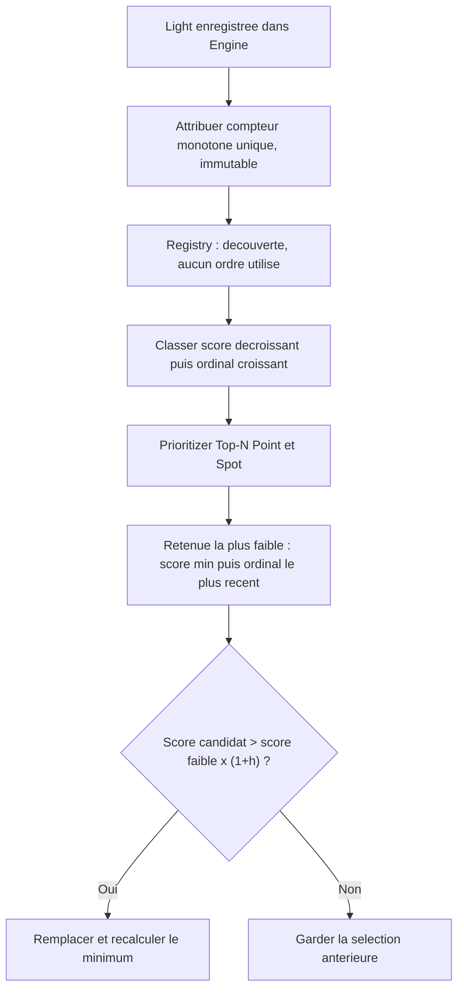

**Q-TECH-001 — changement effectif de `N` ou de `h` : réinitialisation intégrale (option B validée pour chacun).** Lorsque le développeur modifie **l'un des deux paramètres** d'une `EngineView` (nouvelle valeur différente de celle configurée), le `Light::Prioritizer` invalide sa sélection CPU en cache et **abandonne les retenues historiques pour la prochaine capture**. Une modification isolée de `h` produit donc le **même reset** qu'une modification de `N`, y compris si `N` ne change pas. Réaffecter à l'un des paramètres sa valeur courante est un **no-op** qui ne provoque pas de nouvelle réinitialisation ; les affectations validées et l'invalidation sont atomiques vis-à-vis des captures. `N` est un nombre de places non négatif ; `h` est un taux fractionnaire **fini et non négatif**. Une valeur invalide lève une `spk::Exception` sans changer la configuration, l'historique ou le cache.

**Capture suivant une reconfiguration.** Reprendre **toutes les candidates Point/Spot actives de score strictement positif**, les trier **par score décroissant puis ordinal `LightRegistrationOrder` croissant** et retenir les `min(N, nombre de candidates)` premières, **sans appliquer l'hystérésis**, qu'il s'agisse d'une diminution/augmentation de `N`, de `h`, ou des deux. Les anciennes retenues ne sont pas favorisées. Les `Directional` actives sont toujours ajoutées hors quota. `N = 0` produit une sélection locale vide. Cette sélection brute est **le nouvel historique** ; le **nouveau taux `h`** ne sert aux remplacements stricts **qu'à partir de la capture suivante**. Plusieurs modifications de `N` ou `h` avant la première capture effective sont agrégées : aucun snapshot intermédiaire n'est publié, seule la dernière configuration cohérente détermine un classement brut. Aucune autre EngineView ne subit de réinitialisation implicite.

**Snapshots, identité et ombres.** Un reset de sélection n'altère pas les `LightRegistrationOrder`, les `RenderSnapshot` déjà publiés, leurs `shared_ptr<const Light::Selection>` ni leurs handles GPU. Les admissions de `ShadowMap::RenderingSystem` sont réconciliées au prochain recalcul : les PointLight désormais exclues quittent immédiatement les caches d'ombres actifs **de cette vue** selon le contrat d'éviction déjà validé ; leur réadmission exige de nouvelles ressources et les budgets GPU habituels. Les budgets `X/Y/epsilon/shadowSelectionHysteresis` restent indépendants des paramètres du Top-N d'éclairage.

**Exemples de validation.** Avec `N=3`, `h=0,10`, retenues `A=100`, `B=95`, `C=90` et candidate `D=97` auparavant refusée (`97 <= 90 × 1,10 = 99`), le passage à `N=2` retient **`{A=100,D=97}`**, sans conserver B ou C grâce à l'historique. Avec `N=2` inchangé, `h=0,10`, retenues `A=100`, `B=95` et candidate `C=102` précédemment refusée (`102 <= 95 × 1,10 = 104,5`), changer seulement `h` à `0,20` retient immédiatement **`{C=102,A=100}`**, sans seuil de 20 % sur cette capture. À la capture suivante, si les scores ne changent pas et aucun paramètre ne change, ces titulaires sont conservés et le seuil `h=0,20` s'applique normalement.

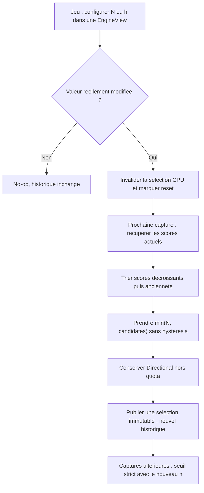

**Q-TECH-001 — places vacantes : remplissage sans hystérésis et conservation des titulaires admissibles (option A validée).** En l'absence de changement effectif de `N` ou de `h`, chaque nouveau classement part de **l'ensemble précédemment retenu pour cette EngineView**, et retire d'abord les lumières qui ne sont plus admissibles (supprimées du Registry, désactivées, hors volume d'influence/frustum donc de score nul, ou de score non strictement positif). Leur ancienne place n'est **pas protégée** par l'hystérésis. Les autres titulaires Point/Spot admissibles conservent leur place, même si leurs scores sont devenus inférieurs à ceux de nouvelles candidates qui n'ont pas encore franchi l'hystérésis.

Classer ensuite les **candidates Point/Spot non déjà retenues** de score strictement positif par **score décroissant puis `LightRegistrationOrder` croissant**. Pour chacune : tant qu'il existe une place disponible (`retainedCount < N`), **l'admettre immédiatement sans test d'hystérésis**. Dès que les `N` places sont occupées, reprendre pour toutes les candidates suivantes **la seule règle déjà validée** : comparer à la plus faible retenue actuelle (score minimal, puis ordinal le plus récent en cas d'égalité) et remplacer uniquement si `score(candidate) > score(lowestRetained) * (1 + h)`, puis recalculer le minimum. Il n'y a ni recalcul brut complet des `N` meilleurs à cause d'une simple disparition, ni quota souple, ni place gardée vide en présence d'une candidate admissible.

**Première sélection sans historique.** Une EngineView qui n'a encore **aucune sélection historique** commence avec un ensemble retenu vide et suit ce même remplissage : au plus `min(N, eligibleCount)` candidates, par score décroissant puis ancienneté, sans hystérésis pour les places initialement libres. Les captures suivantes réutilisent l'historique. `N=0` ne retient aucune Point/Spot ; les Directional actives restent hors quota. La décision de **réinitialiser entièrement le Top-N brut lorsque le jeu modifie effectivement `N` ou `h`** conserve la priorité sur ce mécanisme ordinaire de places vacantes ; elle ne doit jamais être confondue avec la disparition d'une lumière.

**Exemple obligatoire (`N=3`, `h=0,10`).** Retenues historiques `A=100`, `B=96`, `C=95`, tandis que `D=102` et `E=99` sont non retenues (leurs scores ne dépassaient pas `95 × 1,10 = 104,5`). `C` est supprimée sans modification de `N` ni de `h` : conserver `A` et `B`, puis **admettre `D` sans hystérésis** dans la place vacante. La sélection devient `{D=102,A=100,B=96}`. `E=99` ne remplace pas `B=96` car `99 > 96 × 1,10 = 105,6` est faux. Un recalcul brut `{D,A,E}` est **interdit** dans ce cas. La suppression de `C` peut parallèlement entraîner son éviction de la sous-sélection d'ombres et de ses caches actifs, sans toucher aux cartes encore utilisées par des snapshots en vol.

**Identité et publication.** Aucun `LightRegistrationOrder` n'est réattribué au remplissage. Si la candidate admissible est une PointLight à ombres, son admission à l'éclairage ne contourne ni `X/Y/epsilon`, ni l'hystérésis propre aux ombres, ni le budget de reconstruction GPU. Les `Light::Selection` précédemment publiées restent immuables, et les sorties de sélection d'une vue ne modifient pas une autre vue qui retient toujours la même lumière.

**Q-TECH-001 — remplacement progressif validé lorsque le Top-N est complet (option A).** Pour chaque nouvelle sélection d'une `EngineView`, le `Light::Prioritizer` considère les **lumières locales Point/Spot précédemment retenues encore actives et de score strictement positif** comme les titulaires historiques ; une lumière qui a disparu, a été désactivée ou a un score nul n'est pas protégée par l'hystérésis. Les autres candidates locales actives et de score strictement positif, non déjà retenues, sont évaluées **par score décroissant, puis par ordinal d'enregistrement croissant** ; à score égal, la plus ancienne est évaluée d'abord. **Lorsque N places sont effectivement occupées**, la candidate considérée affronte exclusivement **la lumière au score le plus faible parmi toutes celles actuellement retenues**, y compris une lumière entrée lors d'un remplacement plus tôt dans cette même sélection. Le remplacement est accepté **si et seulement si** :

```text
score(candidate) > score(lowestRetained) * (1 + h)
```

En cas d'échec, la candidate est écartée **pour cette capture**, sans modifier l'ensemble retenu. En cas de succès, retirer uniquement la plus faible retenue, insérer la candidate et **recalculer la nouvelle plus faible** avant la candidate suivante. La comparaison est stricte : une égalité mathématique avec le seuil ne remplace jamais ; aucune comparaison par rang entre les deux classements, aucun « socle obligatoirement Top-N brut », aucun bonus lié à l'attente, aucune priorité artificielle entre Point et Spot. **Jamais plus de N lumières locales** ; les Directional ne participent ni au minimum ni à la comparaison. Une entrée ou sortie de ce Top-N peut modifier les demandes d'ombres, mais n'autorise pas le système ShadowMap à sélectionner une lumière qui n'est plus éclairante. Le nouveau résultat reste une `Light::Selection` CPU immuable partagée par les consommateurs de la vue.

**Exemple vérifiable (`N=2`, `h=0,10`).** L'ancienne sélection contient `A=100` et `B=95`; les nouvelles candidates sont `C=110` puis `D=106`. `C` remplace `B` car `110 > 95 × 1,10 = 104,5`. La plus faible retenue devient `A=100` ; `D` est refusée car `106 > 100 × 1,10 = 110` est faux. La sélection devient `{A,C}`. Avec `h=0,10`, une candidate à `110` ne remplace pas une retenue à `100` car le seuil est **strict**.

**Portée de ces règles.** La sélection ordinaire **sans reconfiguration** comprend désormais la conservation des retenues admissibles, le remplissage sans hystérésis des places libres et les remplacements stricts une fois `N` complet, y compris lors de la toute première capture sans historique. Les changements effectifs de `N` ou `h` relèvent au contraire de la réinitialisation brute déjà validée. Le protocole d'invalidation concurrente et de publication du cache est fixé plus bas dans Q-TECH-001, avec transaction moteur synchronisée. Ne pas confondre ces règles avec la sous-sélection distincte d'ombres ponctuelles `X/Y/epsilon` et son hystérésis propre.

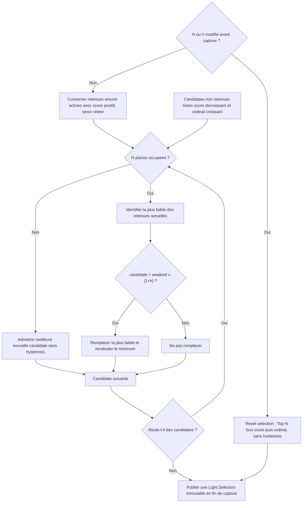

**Sélection immuable et invalidation.** Le Prioritizer produit à la demande une `shared_ptr<const Light::Selection>` immuable, mise en cache et partagée par `Lighting::System` et `ShadowMap::RenderingSystem` à travers le `Light::Channel`. **Toute modification pertinente d'une lumière ou de son inscription au Registry invalide systématiquement les `Light::Channel` de toutes les EngineView vivantes du même `RenderingEngine`**, qu'elles sélectionnent ou non cette lumière et que leur caméra voie ou non son volume. Les changements de caméra ou de projection invalident **uniquement les vues utilisant cette caméra**, sans diffusion générale aux vues qui ne la partagent pas. Une ancienne `Light::Selection` déjà capturée reste utilisable sans mutation rétroactive. **Q-TECH-001 : le cache est protégé par génération, avec une seule reconstruction active par Channel, sans verrouillage prolongé du calcul** ; voir le contrat détaillé ci-dessous.

**Q-TECH-001 — publication générationnelle du Top-N (option A validée).** Chaque `Light::Channel` possède, **indépendamment par EngineView**, un compteur monotone `invalidationGeneration` (entier non signé, initialement zéro), une génération associée à sa dernière sélection publiée, un `shared_ptr<const Light::Selection>` publié, le dernier historique de retenues **effectivement validé** et un indicateur de reconstruction active, synchronisés par le **même mutex court de Channel**. Une modification pertinente (inscription, suppression, activation, état influant sur score ou admissibilité ; caméra, projection, paramètres `N/h`) déclenche l'invalidation de cette vue en incrémentant sa génération **une seule fois par événement de changement cohérent**. Une modification effective de `N` ou `h` marque en outre une réinitialisation du Top-N brut, selon leur contrat déjà validé ; **un recalcul rejeté ne doit ni consommer ce marqueur ni modifier l'historique publié**. Une valeur inchangée ne crée pas de génération artificielle. Le dépassement de capacité du compteur est une erreur `spk::Exception`, sans retour à zéro ni réutilisation de génération.

**Reconstruction sans verrou long :**

1. Sous mutex de `Light::Channel`, un consommateur constate si la sélection publiée correspond **à la génération courante**. Si oui, il acquiert ce `shared_ptr` immédiatement. Sinon, **un seul** constructeur devient actif pour cette vue et relève la génération `G`, les paramètres configurés et la référence à l'historique **publié** ; le mutex est ensuite libéré.
2. Le constructeur obtient **sous le verrou de cohérence du moteur** un **ensemble cohérent et possédé de données de capture CPU** (candidates, scores/paramètres, caméra/frustum, ordinals), puis calcule le Top-N **hors des verrous moteur et Channel**. Il ne doit pas conserver de référence nue à un `Light::Contributor`, une `Entity` ou un `Registry` mutable pendant le classement. Les modifications concurrentes des sources doivent être observables par l'invalidation de la génération et ne peuvent se produire sans signaler le Channel avant qu'un ancien résultat ne soit publiable.
3. Avant publication, il acquiert **dans l'ordre le verrou moteur puis le mutex du Channel**, vérifie que le Channel est vivant, et compare **`G` à la génération courante**. Si elles diffèrent, il **jette intégralement** le résultat (y compris retenues/historique, demande d'ombres ou marqueur de reset provisoires) ; il ne publie **aucun** résultat périmé, conserve le rôle d'unique constructeur et recommence avec une **nouvelle capture cohérente** et la génération la plus récente. Si `G` correspond, il publie **atomiquement** le nouveau `shared_ptr<const Light::Selection>`, son numéro de génération et le nouvel historique, puis libère le rôle de constructeur et signale les consommateurs en attente.
4. Plusieurs consommateurs de la **même vue** ne lancent jamais des reconstructions parallèles ni ne calculent leur propre Top-N. Lorsqu'une reconstruction est en cours, les demandes de nouvelle capture attendent son résultat **valide pour la génération courante**, ou réutilisent la sélection **déjà courante** si celle-ci existe ; elles ne reçoivent jamais une génération invalidée comme sélection de leur **nouvelle capture**. Les snapshots déjà publiés gardent librement leur ancienne sélection.
5. Une interruption, exception de calcul ou échec d'acquisition des données libère systématiquement l'état « reconstruction active », sans publier ni consommer l'historique ou le marqueur de reconfiguration ; réveiller les consommateurs en attente et **propager l'erreur** suivant la politique générale `spk::Exception`. Ne pas laisser un Channel bloqué indéfiniment par un drapeau de calcul actif après une exception.

**Ordonnancement et propriété.** Les sections critiques du mutex de Channel sont limitées aux lectures/écritures de génération, cache, historique et état de construction ; **aucun calcul de scores, tri, création de commandes GPU ou callback utilisateur n'y est exécuté**. La copie cohérente du Registry et des états lumineux/caméra est faite sous le verrou moteur ; cet accès est borné à la copie des données, jamais au classement. Le contrat d'événement doit ordonner de manière sûre la **visibilité du changement source** et l'incrément de génération : le double contrôle de génération ne suffit pas si un changement devient visible sans invalider le cache avant sa publication. **Q-TECH-001 — diffusion globale validée (option A).** L'abonnement aux événements de Registry et de lumières sert à détecter toutes les mutations **pertinentes pour le score, l'admissibilité ou le membership de la sélection** : inscription et désinscription de toute lumière, activation/désactivation, changement d'intensité, de poids de priorité, des paramètres d'influence ou de frustum, et déplacement/rotation de l'Entity porteuse, y compris via un parent. Les événements pertinents déclenchent la **diffusion à chacun des `Light::Channel` de toutes les EngineView encore vivantes du même moteur**, y compris celles dont le cache actuel ne contient pas la lumière et celles dont la caméra est détachée. Aucune liste de dépendances spatiales, aucun abonnement par membre du Top-N, aucun filtre fondé sur le frustum courant, et aucune réservation pour une lumière inactive ne doivent empêcher cette diffusion. **Seules les vues liées à la caméra effectivement modifiée** sont invalidées pour un changement de position/orientation/projection de caméra ; si plusieurs vues partagent la même caméra, chacune de ces vues est concernée. Une modification effective de `N/h` invalide uniquement le Channel configuré. Cette politique ne modifie pas les règles d'invalidation propres aux cartes d'ombres.

**Diffusion paresseuse et synchronisée.** La diffusion ne calcule aucun score et ne provoque pas de capture GPU ni de reconstruction immédiate : pour chaque Channel vivant, elle ne fait qu'incrémenter sa génération sous son mutex bref ; plusieurs événements arrivés avant une acquisition conduisent à **un seul recalcul à la demande** sur la génération la plus récente, sous réserve d'une nouvelle invalidation concurrente pendant ce calcul. Le coût d'une diffusion de lumière est proportionnel au nombre de vues vivantes de l'Engine et **non** au nombre d'intersections spatiales. L'Engine/RenderingEngine réutilise les notifications et abonnements existants de Registry, de composants et de transformations ; il ne faut **pas inventer un deuxième index spatial, scheduler, ni gestionnaire GPU** à cette fin.

**Q-TECH-001 — transaction synchronisée (option A validée, contrat clos).** Le `RenderingEngine` protège par **un même verrou interne de cohérence moteur** les mutations pertinentes des lumières, du Registry, de la hiérarchie de Transform, des caméras/projections et des paramètres `N/h`, ainsi que la validation finale des `Light::Selection`. Une transaction de mutation réalise sous ce verrou : (1) la mise à jour effective de la source, (2) l'invalidation générationnelle de **tous les Channels vivants concernés**, puis (3) le déverrouillage qui rend le changement et ses invalidations observables ensemble par les lecteurs respectant ce protocole. Une lumière ou un événement Registry touche toutes les vues du même moteur ; une caméra toutes les vues qui l'utilisent ; `N/h` sa vue uniquement. **Aucune publication ne peut s'intercaler entre source modifiée et diffusion terminée.** Une écriture sans changement ne déclenche aucune invalidation ; la diffusion ne réalise aucun recalcul.

**Ordre des verrous et publication.** Toute opération qui nécessite deux verrous les acquiert **moteur → Channel**, jamais l'inverse. Le constructeur peut entrer en reconstruction ou attendre sous le mutex Channel seul, mais le libère **avant** de demander le mutex moteur. Il copie les entrées CPU cohérentes et possédées sous le verrou moteur, puis effectue **scores et tri hors de tous les verrous**. Au commit, il acquiert moteur → Channel, recontrôle la génération `G` et le Channel encore vivant, puis publie atomiquement sélection immuable, historique et consommation du marqueur `N/h`. Une génération différente entraîne abandon et nouvelle copie/calcul ; un Channel fermé entraîne abandon sans nouvelle publication. Les captures successives, les deux surfaces et les consommateurs concurrents respectent ce même point de linéarisation. **Aucun callback utilisateur, notification `ContractProvider` externe, calcul de score, tri, commande GPU, attente ou destruction réentrante ne s'exécute sous ces verrous.** Les vues différentes peuvent reconstruire indépendamment ; seules leurs sections critiques de mutation/copie/publication sont sérialisées.

**Intégration des setters et du Registry.** La protection doit entourer **la mutation à sa source**, y compris l'activation, les paramètres de lumière, les Transform directs/hérités, les inscriptions/suppressions Registry et l'affectation/projection de caméra. Une notification émise après que la nouvelle valeur est déjà visible sans verrou moteur n'est **pas suffisante**. Les abonnements aux événements existants relaient les changements mais ne constituent pas le verrou de sûreté : les callbacks externes sont diffusés après la transaction, sans double incrément de génération pour un même changement. Les mutations non synchronisées contournant les API contrôlées ne bénéficient pas de cette garantie concurrente. Préparer/valider les opérations susceptibles d'échouer avant commit ou assurer leur rollback complet ; un échec ne laisse pas d'état source partiellement visible. Un dépassement de génération bloque la transaction avant d'exposer une mutation qui ne pourrait plus être invalidée, et déclenche `spk::Exception`.

**Vie des EngineView et désabonnement RAII.** La création d'une vue est synchronisée par le verrou moteur : une vue née durant une transaction n'est visible qu'après son commit et démarre avec un Channel sans sélection courante. `removeView()` retire sous ce **même verrou** la vue des captures futures et des destinataires de diffusion, marque son Channel **fermé** et réveille ses éventuels demandeurs ; les calculs déjà lancés échouent à la validation finale et ne publient plus. Les notifications en vol ne conservent jamais de pointeur nu vers une vue : sous verrou moteur elles prennent les références fortes nécessaires vers les Channels vivants, ou utilisent des jetons faibles/invalidables ; la désactivation d'abonnement est synchronisée avec le retrait, et les opérations de désabonnement pouvant invoquer des callbacks s'effectuent **hors des verrous**. Une capture concurrente revalide la présence des vues avant publication de son nouveau snapshot : une vue retirée ne doit pas réapparaître dans un nouveau snapshot publié après son retrait. L'objet `EngineView` est détruit immédiatement selon son contrat ; seul son Channel peut continuer de vivre via les commandes des **snapshots antérieurs**, sans nouvelle acquisition Top-N courante. Les abonnements ne réaniment pas la vue.

**Exception et périmètre.** Une erreur de reconstruction libère le drapeau de constructeur et réveille les demandeurs. Les sélections et snapshots déjà publiés ne changent pas ; une tentative rejetée n'affecte jamais l'historique ni les admissions d'ombres. Ce contrat clôt **Q-TECH-001** au niveau architectural. Il ne remplace pas les règles propres aux `Light::ShadowResults`, aux fermetures de `Window::Surface` ou à la durée de vie GPU, qui restent couvertes par Q-TECH-007.

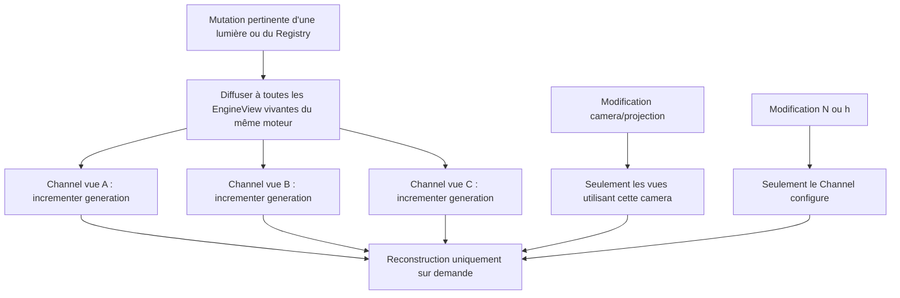

**Consommation et effets secondaires.** `Lighting::System` et `ShadowMap::RenderingSystem` utilisent **la même publication immuable acceptée** pour cette vue et cette capture. Les transitions d'admission d'ombres ou l'éviction de caches logiques actifs ne doivent pas être déclenchées sur un résultat de Top-N rejeté ; elles découlent seulement de la sélection **validée et publiée**, conformément au contrat d'ombres déjà établi. Deux EngineView ont des générations et constructeurs indépendants ; deux surfaces rendues simultanément n'altèrent pas cette synchronisation CPU. La politique `N/h` et les valeurs de scores utilisées pour la publication sont celles de la génération acceptée, et non celles d'une tentative devenue périmée.

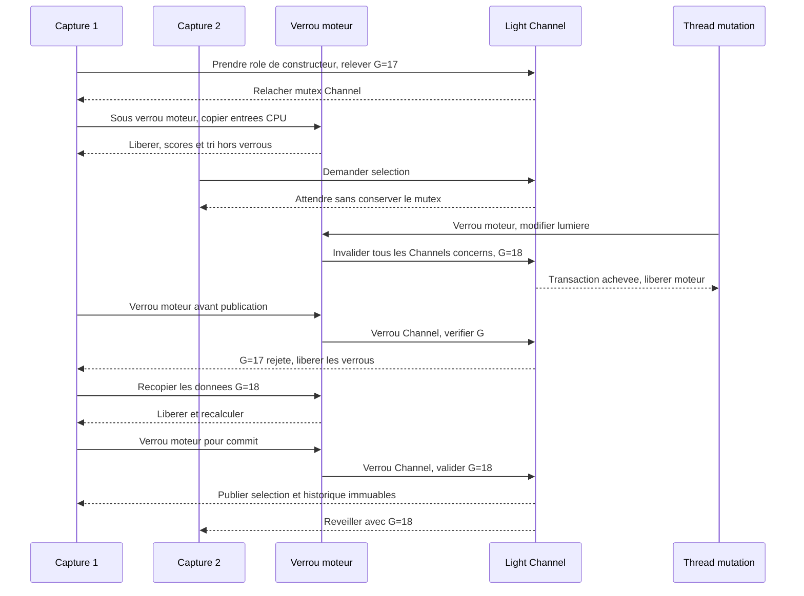

**Cohérence éclairage/ombres.** Seules les lumières retenues par ce classement pour l'éclairage peuvent demander des cartes d'ombres pour cette vue. `ShadowMap::RenderingSystem` applique ensuite ses propres budgets et politiques sur les candidates admissibles sans dupliquer le score ni modifier la liste d'éclairage. Une lumière éclairante dont aucune carte d'ombres exploitable n'est disponible continue à éclairer **sans ombre**. Les dessins opaques et WBOIT d'une même capture utilisent cette **même sélection globale**, sans liste par tile.

**Sélection des cartes d'ombres.** Les budgets souples X/Y/tolérance/hystérésis ne concernent que les `Point` admissibles demandant des ombres, sous-sélection de la sélection globale du `Light::Prioritizer`. `ShadowMap::RenderingSystem` consomme les scores déjà calculés, indépendamment du Forward classique ; aucune grille GPU par tile n'est introduite.


**Projection omnidirectionnelle des PointLight.** Une `PointLightComponent` autorisée à projeter des ombres dispose pour chaque vue de **deux cubemaps de profondeur logiques à six faces chacune** : cache statique et carte finale, indépendants des autres lumières et réalisés par `Window::Surface`. Les six faces couvrent l'ensemble des directions, avec six orientations et une projection perspective carrée à **90° par face**, bornée par les plans proche/lointain adaptés à la portée de la lumière. Le `ShadowMap::RenderingSystem` choisit les seuls casters opaques qui peuvent influencer cette lumière (intersection avec son volume d'influence, puis culling facultatif par face), classe leur mode propre `Static`/`Dynamic`, et écrit les commandes de profondeur nécessaires aux faces dans **la seule RenderPass d'ombres de la vue**. Il ne parcourt pas ni ne dessine systématiquement la totalité des Entities pour chaque point light.

**Cache et consommation des cubemaps.** Le cache statique est reconstruit si nécessaire, puis copié face par face dans la cubemap finale avant les casters dynamiques. Une invalidation dynamique ne reconstruit que la finale, une invalidation statique impose la reconstruction de la finale ; la granularité d'invalidation peut rester globale aux six faces. L'éclairage Forward lit uniquement les cubemaps finales complètes, avec les projections historiques par face et le filtrage manuel PCF 3×3 défini ci-dessous. La cubemap depth-only est réalisée par six attachements explicites ; aucun geometry shader/layered obligatoire.

**Q-TECH-002 — facteur angulaire Spot (validé).** Une Spot applique un unique angle d'ouverture configurable, de l'axe vers le bord du cône fini. Pour la direction unitaire `toReceiver` et l'axe unitaire `axis`, `c = dot(axis, toReceiver)`, `cEdge = cos(angle)` et `t = clamp((c-cEdge)/(1-cEdge),0,1)` ; la pondération angulaire `S(t)=3t²-2t³` vaut zéro au bord et un sur l'axe. La contribution du Spot est `RGB × intensity × A(d/range) × S(t)`. Cette définition évite `acos` dans le shader ; le cas d'un angle dégénéré est traité par validation des paramètres, sans division par zéro.

**Q-TECH-002 — projections Point/Spot (validées).** Pour une portée strictement positive, utiliser `near = range × 0,001` et `far = range` en `U` : six faces perspectives carrées à 90° pour une Point, une projection perspective alignée sur le cône pour une Spot. Le ratio reste invariant avec l'échelle de la lumière. `range = 0` ne construit aucune shadow map. Si la projection ou ses bornes ne sont pas représentables à la préparation GPU, lever une `spk::Exception` descriptive plutôt que corriger silencieusement. Le clipping de génération des maps est standard ; les récepteurs avant `near` sont non ombrés pour cette comparaison, sans faire disparaître leur contribution lumineuse Smoothstep. Les règles pour `far` et la précision numérique à la limite restent à consolider.

**Q-TECH-002 — biais automatique de comparaison (validé).** Appliquer le biais **au moment du test d'ombre dans le shader**, jamais pendant la génération de profondeur. Deux coefficients publics de la lumière, `constantFactor` et `slopeFactor`, valent `1,0f` par défaut. Pour un échantillon, le biais est `B = max(B_texel, ULP(z_recepteur)) × (constantFactor + slopeFactor × sin(theta))` avec `cos(theta) = clamp(dot(normalGeometrique, directionVersLumiere),0,1)` et `sin(theta)=sqrt(max(0,1-cos(theta)^2))`. `B_texel` provient de l'empreinte projetée d'un texel dans la projection historique, `ULP` de la précision locale du format de profondeur à la référence du récepteur. Les calculs, la résolution, le format et la projection sont spécifiques à la **face effectivement lue** ; les coefficients, distincts des données de projection, peuvent changer sans reconstruire la carte. Aucune constante arbitraire de biais en unité de profondeur ne remplace ce calcul. Les comportements extrêmes du biais seront validés par tests.

**Q-TECH-002 — résolution standard des shadow maps, réglable par lumière (option A validée).** `Light::Point`, `Light::Spot` et `Light::Directional` exposent chacun un **paramètre de résolution des ombres** (nom d'API indicatif : `shadowResolution`), initialisé automatiquement avec la même résolution standard pour qu'une lumière puisse fonctionner sans configuration manuelle. Le développeur peut le configurer **individuellement par lumière** ; une configuration sur une lumière ne modifie pas celle des autres ni la résolution des `EngineView`. La taille demandée est **fixe tant que ce paramètre ne change pas** : aucun calcul automatique de résolution à partir de la caméra, de la distance ou du classement Top-N. Pour simplifier le contrat, le paramètre est la longueur entière d'un côté d'une carte carrée de profondeur : une texture 2D pour Spot/Directional, **six faces carrées de même dimension** pour une Point, avec cache statique et final aux dimensions identiques. Les deux cartes d'une même lumière et d'une même génération utilisent la même configuration de résolution, sans resampling ni mélange de générations. Une reconfiguration effective rend obsolètes les caches statique et final de cette lumière sur les vues/surfaces concernées : leur prochaine reconstruction s'effectue avec de nouvelles ressources logiques et la nouvelle résolution, en respectant les budgets PointLight existants. Les snapshots en vol et les anciennes cartes complètes conservées dans les limites de leur admissibilité restent immuables, avec leur **résolution historique** pour le filtrage et le biais ; les règles de publication et de disponibilité sans ombre sont inchangées. **Valeur numérique validée : 1024×1024**, en format **D32F** (`Texture::Format::Depth32F` / `GL_DEPTH_COMPONENT32F`) pour Point, Spot et Directional. Les validations de capacité GPU, les limites de taille et la politique de résolution invalide restent à préciser en Q-TECH-002. Aucune adaptation automatique ni fallback silencieux de la taille demandée n'est introduit.

**Q-TECH-002 — PCF 3×3 commun à Point, Spot et Directional (validé).** Toute shadow map exploitable par le shader Forward utilise **un filtre PCF 3×3 fixe**, soit neuf positions de comparaison réparties à raison d'un texel d'écart sur les deux axes de la projection d'ombre. La visibilité est la moyenne des résultats de comparaison (et non une moyenne des profondeurs). Il n'existe ni sélection publique du mode de filtrage ni option de taille du noyau en V0.1.4. Les textures de profondeur sont lues sans interpolation des valeurs avant comparaison ; les paramètres de profondeur, résolution et biais sont ceux de la carte historique admissible. Si aucune carte n'est disponible, la lumière continue d'éclairer sans ombre.

Pour **Spot** et **Directional**, la shadow map est une texture de profondeur 2D unique : projeter le récepteur en coordonnées de la carte, puis former les neuf décalages `i/W`, `j/H` avec `i,j ∈ {-1,0,1}` en UV `[0,1]`. Chaque position intérieure à la carte donne une comparaison profondeur/biais ; les neuf résultats sont moyennés. Spot conserve sa perspective historique, Directional son orthographique historique ; le PCF ne change ni le type de projection ni les ressources de carte. Les comportements exacts des positions situées hors des UV de la texture, des fragments hors volume et des égalités de profondeur restent des précisions de Q-TECH-002, à fixer sans inventer de nouveaux réglages publics.

**Q-TECH-002 — PCF PointLight fixe et inter-faces (spécificité validée).** La visibilité PCF d'une Point est la **moyenne de neuf comparaisons manuelles** (`3×3` fixe), avec lecture de profondeur `nearest` : jamais de mélange matériel des profondeurs entre faces. Pour un récepteur `P` et la source `L`, la face centrale provient de `v=P-L` par composante absolue dominante ; les égalités sont départagées **X > Y > Z**, le signe de l'axe choisi déterminant sa face. Le noyau est aligné sur les axes UV de **cette face centrale**, décalages `i×(2/W)`, `j×(2/H)` pour `i,j ∈ {-1,0,1}` en coordonnées UV normalisées `[-1,1]`. Chaque UV décalé, y compris hors `[-1,1]`, est reconverti en direction 3D, puis reclassé par la même règle d'axe dominant et reprojeté dans sa **face réelle**. Chaque tap utilise alors sa profondeur historique, la référence du récepteur exprimée dans la projection de cette face et le biais calculé pour celle-ci ; chaque comparaison retourne 0 ou 1, puis `visibility = sum(taps)/9`. Ce procédé n'exécute **pas six noyaux** et n'ajoute pas de mélange de noyaux près des arêtes/coins. Une différence d'orientation du filtre de part et d'autre d'une couture est possible et doit être testée visuellement.

**Q-TECH-002 — singularité et proximité de la source (validé).** Si `P == L` exactement, `visibility = 1`, sans lecture de cubemap ; le calcul d'éclairage évite de normaliser le vecteur nul. Pour `v ≠ 0`, sans seuil `d_min` artificiel, normaliser avec `m=max(abs(v.x),abs(v.y),abs(v.z))`, `q=v/m`, puis `direction=q/sqrt(dot(q,q))` ; cette procédure ne recrée pas les différences de coordonnées déjà perdues en flottant. Pour **chaque tap** dont la référence de profondeur du récepteur est strictement avant le `near` historique de sa face, retourner `1` sans texture depth ni comparaison ; le total des neuf positions du noyau reste défini, même si certains taps sont court-circuités. Les égalités exactes aux plans et les cas non finis restent couverts par les contrôles de validité et tests à finaliser.

**Extension de `Texture` pour les cubemaps.** Le type `Texture::Target::TextureCubeMap` existe déjà, mais `Texture::State::_synchronize()` ne sait actuellement synchroniser que `Texture2D`. Compléter **`Texture`**, sans créer de classe `ShadowCubeMap` ni de nouveau gestionnaire de ressources : une texture de cible cubemap doit pouvoir allouer et synchroniser **ses six faces carrées** en format de profondeur déjà pris en charge, sous une identité logique `GPUResource::State` et avec une instance OpenGL distincte par `Window::Surface`. Le recyclage des instances reste dans `GPUResourceCollection`, avec compatibilité de cible et resynchronisation obligatoire après réutilisation ; une ancienne profondeur recyclée n'est jamais considérée comme valide.

**Attachement de faces dans `Framebuffer` (Q-ARCH-007 validée).** `Framebuffer::State` référence les attachments par `Texture::Handle` partageables, jamais par propriété exclusive des wrappers `Texture` ; les deux cubemaps statique/finale sont des **States logiques distincts**. Une instance de `Framebuffer` **depth-only** peut recevoir un handle de cubemap, mais **la face ciblée est toujours sélectionnée explicitement** dans la `FramebufferRenderCommand` (ou commande générique de binding équivalente) pour chaque dessin : enum des faces `PositiveX`, `NegativeX`, `PositiveY`, `NegativeY`, `PositiveZ`, `NegativeZ`. Sur le contexte GPU de la `Window::Surface`, la commande active le handle de cubemap de cette surface, lie le FBO natif et attache **une face** avec `glFramebufferTexture2D(GL_FRAMEBUFFER, GL_DEPTH_ATTACHMENT, GL_TEXTURE_CUBE_MAP_POSITIVE_X + face, ...)`, sans modifier le State logique. Le `RenderCommand` capture le handle et la face : un snapshot ancien ou exécuté en parallèle sur une autre surface reste indépendant. L'API des attachments est également générique pour un `Texture2D` ordinaire (sans paramètre de face). La face doit être valide, correspondre à une cubemap render-target de profondeur carrée, et avoir le même niveau/dimensions que les autres attachments actifs. Aucune sélection implicite de face, aucun geometry shader/layered draw obligatoire, ni cache GPU dédié aux cubemaps.

**Contrôles depth-only et isolation.** Une cible depth-only **n'a aucun attachment couleur** : activer `glDrawBuffer(GL_NONE)` et `glReadBuffer(GL_NONE)`, puis vérifier `glCheckFramebufferStatus` **après chaque changement de face** sur la surface courante, avant `clear` ou dessin. L'attachement cubemap est **une modification du FBO natif local à la surface** ; il ne doit jamais modifier les `Texture::State` ni les `Framebuffer::State` détenus par les snapshots. En cas de texture non allouable, face invalide, format incompatible, dimensions non carrées ou FBO incomplet, lever une `spk::Exception` descriptive et **ne publier aucune carte incomplète**. Le cache statique et la carte finale utilisent chacun leur propre handle, et la copie de profondeur d'une face vers la finale doit garder source et destination **différentes**, sans feedback GL. Les limites natives de formats, taille des cubemaps et capabilities sont vérifiées à l'exécution ; les handles CPU restent valables sur une autre surface malgré un échec sur la première. Les anciennes générations de cartes terminées conservent leur texture inchangée jusqu'à la disparition des handles propriétaires, puis suivent exclusivement la récupération par `GPUResourceCollection`.

**Snapshots, générations et budget inchangés.** Lors de la construction d'un snapshot, capturer les handles forts vers les deux cubemaps et les paramètres immuables de face/projection ; une nouvelle paire après éviction ou reconstruction ne modifie jamais les textures ou attachments encore référencés par un ancien snapshot. Sur chaque surface, l'exécution OpenGL prépare/attache explicitement chaque face avant de reconstruire la profondeur correspondante, puis consomme seulement la cubemap finale valide. Les six faces forment **une unique reconstruction au regard du budget existant** (statique et finale si nécessaire). Cette extension n'ajoute ni nouveau propriétaire GPU ni mécanisme de libération différée.

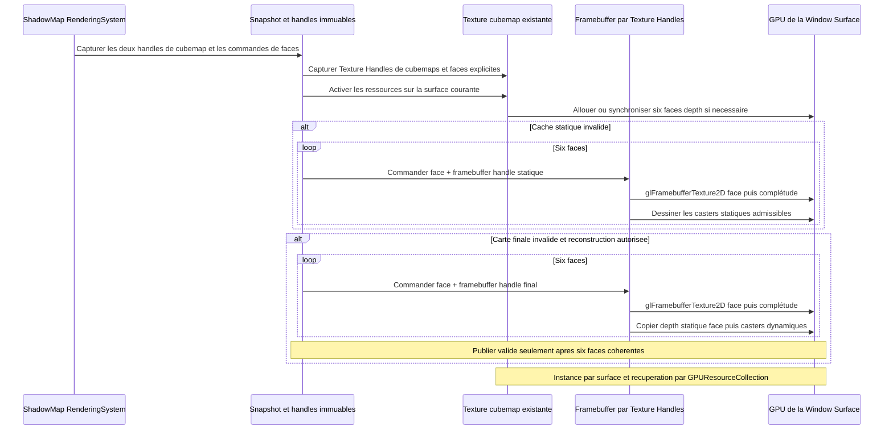


**Budget souple de sélection des ombres ponctuelles par EngineView.** Le `Light::Channel` de la vue conserve une politique X/Y/tolérance/hystérésis complémentaire au Prioritizer pour les cartes des `Light::Point` demandant des ombres. Le `ShadowMap::RenderingSystem` consomme la sélection résultante. Quatre paramètres configurables structurent son budget souple (les trois critères d'admission et l'hystérésis des places supplémentaires) :

- `targetShadowCount` (`X`) : **nombre cible** de lumières ponctuelles retenues, prioritaires par leur score.
- `maxShadowCount` (`Y`) : **limite supérieure absolue**, incluant toutes les lumières supplémentaires acceptées au voisinage du seuil. La contrainte `0 <= X <= Y` doit être validée explicitement, et les valeurs entières sont non négatives.
- `shadowPriorityTolerance` (`epsilon`) : **tolérance relative** sur le score de la **Xe lumière du classement brut**, exprimée comme fraction comprise dans `[0, 1]`. Par exemple `0.10` autorise des lumières supplémentaires jusqu'à **10 % sous** le score de référence ; le score est supposé fini et non négatif.
- `shadowSelectionHysteresis` (`h`) : **marge relative de remplacement entre lumières supplémentaires encore admissibles**, uniquement lorsque les places sont pleines ; une candidate doit dépasser strictement `score(incumbent) × (1+h)`. Le défaut est `0,10` (10 %), configurable par EngineView, indépendamment de la tolérance `epsilon`.

**Valeurs initiales validées : `targetShadowCount = 2`, `maxShadowCount = 4` et `shadowPriorityTolerance = 0,10` par EngineView**, chacune modifiable par le développeur. Elles s'appliquent uniquement aux PointLight demandant des ombres, **pas au Top-N Forward Point/Spot `N=8`**, pas aux Spot/Directional ombrées, ni au budget de reconstruction GPU par surface/image. `shadowPriorityTolerance` vaut **0,10 (10 %) par défaut** et reste configurable pour chaque `EngineView` ; la valeur initiale de l'hystérésis est également fixée à `0,10`. Les signatures précises sont à consolider. `X = 0` signifie **aucune ombre ponctuelle sélectionnée**, même si `Y > 0` : en l'absence de Xe lumière, il n'existe pas de seuil de tolérance. `Y = X` reproduit un budget strict ; `epsilon = 0` autorise seulement des supplémentaires de **score égal** à la Xe. Une contrainte de `Y` n'est jamais transgressée, même lorsqu'il existe plus de lumières de score proche. Ce budget **ne limite toujours pas** le nombre de mises à jour de cubemaps par image et ne concerne pas les directionnelles/spots.

**Filtrage spatial et classement.** Les candidates sont les `Light::Point` encore sélectionnées par `Light::Prioritizer`, actives et demandant des ombres. Leur score et leur éligibilité géométrique ont déjà été calculés par `Light::Point` : sphère d'influence contre six plans, puis `intensity × range² × priorityWeight / max(distanceCamera,minLightDistance)` pour les candidates non rejetées. `ShadowMap::RenderingSystem` n'utilise donc aucune formule propre aux lumières ; il applique la politique d'ombres complémentaires X/Y/tolérance/hystérésis aux scores déjà obtenus. Seules les candidates à score strictement positif participent.


**Sélection initiale à partir des scores.** Pour `n` candidates spatialement admissibles et triées par score brut décroissant, choisir d'abord `min(X, n)` meilleures. Si `n >= X > 0`, noter `P_X` le score de la **Xe du classement complet**, puis considérer **les suivantes dans cet ordre**. Tant que `score(candidate) >= P_X * (1 - epsilon)` et que le total retenu reste strictement inférieur à `Y`, accepter la candidate supplémentaire. Dès qu'une candidate est sous ce seuil, les suivantes du classement décroissant le sont aussi : arrêter. **Toujours comparer au score de la Xe**, jamais à celui de la dernière supplémentaire, afin d'éviter un effet de chaîne. Si `n < X`, toutes les candidates sont retenues (aucune Xe à utiliser comme référence) ; si `X = 0`, aucune n'est retenue. Les égalités de score sont départagées de manière stable, y compris lorsque le seuil et le maximum `Y` coupent un groupe d'ex æquo.

```text
target = min(targetShadowCount, eligibleCount)
referenceScore = score(sortedCandidates[targetShadowCount - 1])  // si eligibleCount >= X > 0
extraThreshold = referenceScore * (1 - shadowPriorityTolerance)
acceptExtra = score(candidate) >= extraThreshold && selectedCount < maxShadowCount
```

**Admissibilité et hystérésis.** L'ensemble des lumières **admissibles** est déterminé **avant toute hystérésis** : il comprend toujours les `min(X, n)` meilleures candidates spatialement éligibles (**socle cible**) et, seulement si `n >= X > 0`, les suivantes dont le score brut vérifie `score >= P_X * (1 - epsilon)` (**supplémentaires admissibles**). La tolérance est un **critère strict d'admission** pour les supplémentaires : une lumière précédemment retenue, mais sortie de cette plage, perd **immédiatement** son droit à une shadow map, même si l'hystérésis aurait empêché son remplacement. Aucune source hors de l'ensemble admissible ne peut être protégée par l'hystérésis. Le maximum absolu `Y` demeure intangible.

La politique de sélection d'ombres ponctuelles du `Light::Channel` conserve, **pour cette EngineView**, l'ensemble des `Light::Point` retenues lors de la précédente capture ; la mémoire d'hystérésis appartient au Channel, pas à `ShadowMap::RenderingSystem` ni directement à la vue. **Les X meilleures candidates admissibles sont toujours retenues**, sans être bloquées par une ancienne lumière supplémentaire : la cible demeure prioritaire. L'hystérésis ne concerne **que les remplacements entre lumières supplémentaires encore admissibles** lorsque les places au-delà des X premières sont pleines (jusqu'à `Y-X`). Une lumière supplémentaire nouvelle ne peut évincer une supplémentaire précédente toujours admissible que si son score dépasse **strictement** celui de la retenue selon le seuil proportionnel configurable :

```text
score(candidate) > score(incumbent) * (1 + shadowSelectionHysteresis)
```

- `shadowSelectionHysteresis` est un **taux fractionnaire** configurable pour la sélection d'ombres ponctuelles de la vue (par exemple `0.10` représente **10 %** d'avance requis) ; il est **fini et supérieur ou égal à zéro**. **Sa valeur par défaut et sa forme d'API restent à décider.** Un taux nul supprime la marge proportionnelle mais laisse l'obligation de dépasser strictement le score pour évincer une lumière encore éligible.
- **Ordre du calcul :** classer par score brut décroissant (égalité départagée par le plus ancien `LightRegistrationOrder` dans l'Engine), construire le socle des X meilleures, calculer `P_X`, puis déterminer **toutes** les supplémentaires admissibles par le seuil fixe (sans troncature préalable à `Y`). Éliminer immédiatement les retenues précédentes sorties de cet ensemble, qu'elles soient désactivées, supprimées, hors d'influence ou passées sous le seuil de tolérance. Les retenues historiques désormais entrées dans les X meilleures appartiennent directement au socle.
- **Premier classement ou places supplémentaires libres :** retenir obligatoirement le socle des X meilleures, conserver les **supplémentaires précédemment retenues encore admissibles** tant que le maximum le permet, puis remplir les places libres avec les meilleures nouvelles supplémentaires, **sans appliquer l'hystérésis aux places vacantes**. Il est inutile de refuser une nouvelle supplémentaire si une place libre existe sous `Y`.
- **Plafond `Y` atteint :** une candidate supplémentaire **elle-même admissible** peut remplacer la **moins bien classée des seules supplémentaires retenues**, pas une des X lumières du socle, si et seulement si son score vérifie l'inégalité stricte d'hystérésis. Répéter cette comparaison dans l'ordre des nouvelles candidates décroissantes, en gardant `Y` absolu. Les supplémentaires sorties de la tolérance ne sont **jamais comparées** : elles ont déjà perdu leur place. Lorsque `X = Y`, aucune place supplémentaire n'existe ; le socle des X meilleures est sélectionné sans hystérésis.
- **Cas limites :** pour un score retenu nul, seule une nouvelle supplémentaire de score strictement positif peut l'évincer ; deux scores nuls ne provoquent aucun échange par hystérésis. Les scores nuls sont éliminés avant ce budget : si une Xe candidate existe, son score de référence est strictement positif. Si `X = 0`, ne sélectionner aucune lumière ponctuelle ; si `n < X`, sélectionner les `n` candidates ; si `X = Y`, ne sélectionner que le socle, sans marge supplémentaire. Si les paramètres `X`, `Y` ou `epsilon` changent, **recalculer d'abord l'admissibilité** : supprimer les retenues devenues interdites, puis appliquer l'hystérésis uniquement entre les supplémentaires toujours admissibles. Lorsque `Y` baisse, garder le socle et retirer en priorité les supplémentaires aux plus faibles scores (égalité stable). Les scores/coefficients et taux doivent respecter leurs contraintes de finitude et de signe.

**Ordre de précédence entre tolérance et hystérésis.** La tolérance **délimite l'admissibilité** et prime toujours l'hystérésis. Une ancienne supplémentaire passée sous le seuil `P_X * (1 - epsilon)` est retirée **à la capture suivante** sans protection historique, même si son score reste proche de celui d'une autre supplémentaire ; elle continue d'éclairer via Forward **sans ombres**. À l'inverse, une ancienne supplémentaire toujours dans la plage admissible peut résister à une nouvelle supplémentaire marginalement mieux classée **si les places supplémentaires sont pleines**, sans jamais dépasser `Y`. Cette stabilité de l'historique n'empêche pas l'admission obligatoire des X meilleures. L'absence de place sous `Y` ne permet aucun dépassement, même si beaucoup de lumières ont exactement le score `P_X`.

**Portée et diagnostic.** L'hystérésis limite **les changements de membership**, et non le classement ou les couleurs RGB des sources d'éclairage Forward ; une `PointLight` moins bien classée mais conservée grâce à l'hystérésis continue à projeter une ombre valide. Une candidate bloquée par le seuil de tolérance, le maximum `Y` ou l'hystérésis reste **observable** comme `ombres demandées mais non sélectionnées`, avec une raison distinguant `hors tolérance`, `plafond atteint`, `remplacement évité par hystérésis` et `ombres désactivées explicitement`. Toute capture encode la sélection et les références de cartes d'ombres de façon **immuable** ; aucun changement de sélection n'est fait par le thread de rendu GPU. Les mêmes données d'entrée **et le même état antérieur de sélection** entraînent le même résultat ; l'hystérésis signifie qu'une sélection peut dépendre intentionnellement de l'historique. Le culling des `ShadowMap::Contributor` reste distinct du classement Forward.

**Éviction des caches de PointLight.** Dès qu'une `PointLight` **sort de l'ensemble retenu pour une `EngineView`** après classement, tolérance et hystérésis, le `ShadowMap::RenderingSystem` **retire immédiatement de son registre de caches actifs la paire logique statique/finale associée à cette vue et à cette lumière**, y compris ses réalisations par `Window::Surface`. Cette éviction vise aussi les sorties par désactivation des ombres, disparition de la lumière, exclusion spatiale ou abaissement de `X/Y` ; elle concerne la **perte de sélection pour une vue**, et non la simple attente d'une reconstruction GPU pour une lumière **encore retenue**. Une même `PointLight` retenue dans une autre vue garde **indépendamment** ses caches pour cette autre vue. Une variation temporaire de score ne doit pas laisser un cache invisible dans le système actif.

**Cycle de vie des caches d'ombres et des instances GPU.** La sortie d'une PointLight de la sélection retire immédiatement ses caches logiques actifs de `ShadowMap::RenderingSystem`. Le système relâche ses références à la paire statique/finale, sans détruire directement les objets OpenGL. Les `GPUResource::Handle` des `RenderSnapshot` antérieurs conservent par `shared_ptr` les `GPUResource::State` capturées, sans modifier rétroactivement la version de profondeur.

À la disparition du dernier propriétaire d'une `GPUResource::State`, son `LifeTime` signale la libération à la `GPUResourceCollection::ReclamationQueue` des surfaces abonnées. `Application::RenderRuntime::tickOnce()` appelle `reclaimReleased()` ; les instances `Texture`, `Framebuffer` et `Buffer` rejoignent normalement les pools natifs de leur surface, tandis que les instances non recyclables sont détruites. Une instance mise en pool peut **rester allouée en VRAM** ; sa mise en pool n'est pas une conservation de cache d'ombres et elle ne rend pas réutilisable l'ancienne profondeur. À l'activation d'une nouvelle `GPUResource::State`, une instance native compatible peut être recyclée **après resynchronisation**, jamais comme une carte d'ombres valide sans nouveau rendu.

**Contexte OpenGL requis pour la récupération.** Le runtime de rendu garantit le contexte courant de la bonne `Window::Surface` avant toute récupération/destruction native, **même lors d'un tick sans nouveau rendu** et lorsque plusieurs surfaces sont utilisées. L'implémentation existante de `tickOnce()` appelle `reclaimReleased()` après un chemin de rendu conditionnel ; ce contrat doit être assuré dans le runtime graphique générique. La fermeture de surface vide les instances de la collection avec son contexte valide. Aucune file d'éviction `ShadowMap` supplémentaire, aucun pool de cartes dormantes, aucun LRU d'ombres et aucun `GLsync` dédié ne découlent de ce contrat ; les dépendances de commandes GPU restent correctement ordonnées sur chaque contexte.

**Réadmission et budgets.** Une `PointLight` revenant dans la sélection de la vue est traitée **comme une première admission pour les ombres de cette combinaison** : elle crée une **nouvelle paire logique statique/finale**, avec **générations distinctes**, et les réalisations GPU nécessaires par surface sont invalides jusqu'à reconstruction complète. La nouvelle paire **ne réutilise jamais l'ancien couple de State/Handle ni les données de profondeur** : elle peut toutefois acquérir **une instance OpenGL native recyclée via GPUResourceCollection** lorsqu'elle est disponible et compatible, après synchronisation avec le nouvel état. Sa reconstruction consomme **une unité du budget par image et par `Window::Surface`** suivant la priorité stricte validée, que la précédente paire ait été entièrement statique ou non ; si le budget est épuisé, la lumière éclaire sans ombre jusqu'à actualisation. Les valeurs `targetShadowCount/maxShadowCount/shadowPriorityTolerance`, l'hystérésis de sélection et le score restent inchangés par cette règle d'éviction. Une destruction/recréation de `EngineView` ou de `PointLight` ne peut pas ressusciter des caches rattachés à une ancienne identité.

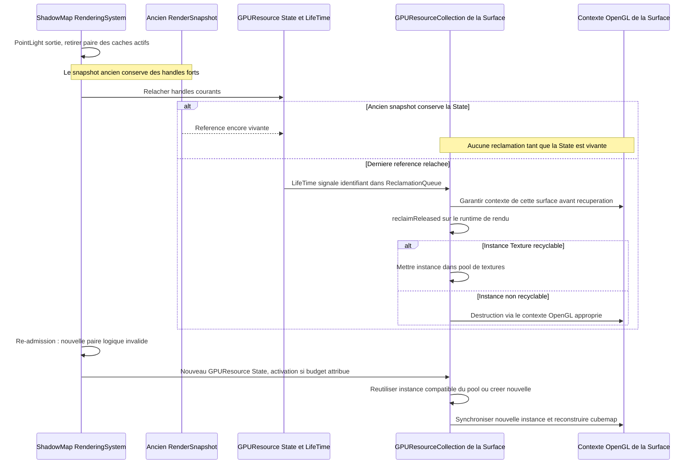


**Éclairage et observabilité.** Les lumières ponctuelles **écartées par le budget cible, la tolérance, le plafond absolu ou l'hystérésis continuent d'éclairer via Forward sans ombre**. Seules les lumières sélectionnées ajoutent des opérations de cubemap à l'**unique `RenderPass` d'ombres de la vue**. L'éclairage ne doit jamais échantillonner une carte périmée d'une lumière non sélectionnée, même si la ressource GPU existe encore. L'exclusion `ombres demandées mais refusées par budget` doit être **observable** (statut par vue/lumière et raison ou diagnostic équivalent) et distincte de `ombres désactivées explicitement`. Pas de journalisation répétée par lumière et par frame non sollicitée.


**Budget de reconstruction de cubemaps.** Le sous-système autonome `ShadowMap::RenderingSystem` expose une configuration **non négative** limitant, pour chaque **image rendue sur une `Window::Surface`**, le nombre de **paires de cubemaps ponctuelles à reconstruire intégralement** (nom indicatif : `maxPointShadowRebuildsPerImage`). Il s'agit d'un **compteur unique à la surface et à l'image**, partagé entre **toutes les `EngineView` effectivement dessinées dans cette image sur cette surface** ; ce n'est ni un compteur par EngineView, ni une modification de `targetShadowCount`/`maxShadowCount`. Les fenêtres/surfaces indépendantes possèdent des compteurs distincts ; un snapshot CPU ne consomme pas le budget tant qu'il n'est pas exécuté. Le budget par défaut est de **1 reconstruction complète de PointLight par image et par `Window::Surface`**, partagé entre toutes les vues dessinées sur cette surface. Le mode précis de configuration reste à définir, sans créer d'API d'ombres dans `EngineView`. **Aucun ordonnanceur adaptatif de raffinement par FPS n'est retenu** : le budget reste un nombre entier d'unités par image/surface et la résolution d'une lumière ne change que sur modification explicite de `shadowResolution`.

**Pas de raffinement progressif (révision validée).** Les résolutions successives 256→512→1024, les traitements de qualité croissante et tout redessin automatique d'un snapshot CPU inchangé uniquement pour affiner les ombres sont **abandonnés pour V0.1.4**. Lorsqu'une invalidation réelle survient (lumière déplacée, cast dynamique déplacé, projections Directional dépendantes de la caméra, etc.), Sparkle demande une reconstruction **complète à la résolution configurée**, soumise au budget par image et surface ; les caches statiques non touchés sont préservés. Entre deux reconstructions, la dernière shadow map complète historiquement admissible peut continuer à être affichée, même si les objets mobiles ont créé un léger retard, tant qu'aucune règle de désélection/admission ou incompatibilité de projection n'interdit cet historique. Les résultats partiels ne sont jamais publiés. Plusieurs demandes obsolètes sont départagées par leur score de priorité visuelle validé, sans bonus d'attente. L'objectif FPS de 60 configurable dans EngineView n'est **pas** un limiteur et ne commande pas le budget d'ombres en V0.1.4.

**Unité atomique de reconstruction.** Une unité du budget correspond à **une paire logique statique/finale pour une combinaison (EngineView, PointLight) sur la surface**, lorsqu'au moins une carte doit être mise à jour. Si seule la finale est invalide, la reconstruction de la finale et ses six faces coûte **une unité** ; si la statique et la finale sont invalides, reconstruire la statique, copier chaque face puis reconstruire la finale constitue **une unique unité**. Les **six faces** ne sont pas comptées individuellement et aucune carte finale **partiellement remise à jour** ne peut être publiée comme valide. Une paire entièrement valide ne coûte **aucune unité** et sa shadow map demeure disponible, même si le budget de reconstructions est épuisé. Les images où le budget vaut zéro peuvent donc continuer à afficher **les ombres déjà valides** sans aucune reconstruction.

**Priorisation stricte des reconstructions.** Le système considère uniquement les `PointLight` **déjà retenues** par le budget souple propre à chaque vue. Il examine leur validité **spécifique à la surface** et classe **toutes les reconstructions nécessaires par le score brut de priorité déjà validé** (score brut déjà calculé par `Light::Point`), **strictement décroissant**, pour chaque image et chaque surface. Pour un même score, le départage est **déterministe** par identité/ordre stable de la vue, puis par le **`LightRegistrationOrder` croissant de la lumière au sein du même Engine** (la plus ancienne d'abord) ; jamais selon l'ordre accidentel du Registry, les adresses ou la durée d'attente. **Aucun bonus lié à l'attente**, aucune ancienneté de demande, priorité croissante avec les frames différées, rotation round-robin, quota de rattrapage ni garantie de délai maximal de reconstruction : une demande moins prioritaire peut légitimement **rester différée indéfiniment** si des demandes plus prioritaires occupent le budget à chaque image. Ce comportement est voulu et observable, sans changement du score utilisé pour choisir les lumières ombrées par `EngineView`.

**Réévaluation à chaque image.** Les demandes dont les caches restent invalides et qui ont été différées **tant que leur PointLight reste sélectionnée** sont **réévaluées à la prochaine image réellement rendue sur cette surface**, avec le score de cette image et la nouvelle validité de leurs caches ; aucune file FIFO ni compteur d'attente persistants ne sont nécessaires. Une lumière perdant sa place est évincée de la liste des demandes et du cache actif, plutôt que maintenue en attente. Les lumières désormais valides n'entrent plus dans la liste de reconstructions ; celles dont l'intensité, le poids ou la distance caméra ont changé peuvent changer de rang immédiatement. La liste des demandes de **toutes les vues dessinées sur cette surface** est classée **avant** d'accorder les unités du budget commun, y compris si une vue à plus haute priorité est rendue plus tard dans l'ordre des vues établi. Le plan utilise les captures immuables et l'état de ressources propre à la surface, **sans modifier l'ordre des vues ni introduire un ordonnanceur de passes général**, sans accéder aux Entities mutables sur le thread GPU. Une paire (vue, lumière, surface) reconstruite une fois dans l'image ne consomme pas deux unités lors de son éventuelle réexécution. Cette préparation globale avant les vues et sa déduplication temporaire par image règlent les interactions inter-vues ; aucun mécanisme d'équité implicite ne peut renverser le score brut. La même lumière peut être prioritaire pour une vue et moins prioritaire pour une autre en raison de leurs caméras distinctes.

**Préparation globale par commande de snapshot (contrat validé).** `RenderingEngine` recueille à la capture **les demandes potentielles de PointLight de toutes ses EngineView ayant une caméra et admises aux ombres**, sans consulter les surfaces GPU. Chaque demande porte les valeurs immuables déjà capturées : système d'ombres concerné, vue, lumière, identité d'admission, score brut, ordinal de capture, références fortes de ressources/casters et description des reconstructions possibles (statique/finale). Les vues sans caméra et les lumières hors sélection d'ombres n'émettent aucune demande. Le Builder moteur place **une commande de préparation des reconstructions ponctuelles avant toutes les passes de délégation des vues** ; ce préambule est ordonné par les clés internes existantes de `RenderSnapshot::Builder`, sans valeur sentinelle au-dessus de `RenderPass::Order` ni réordonnancement des sous-snapshots.

**Calcul au rendu sur la surface.** Quand cette commande s'exécute, elle utilise `RenderContext::targetSurface` pour consulter les **réalisations et validités propres à cette surface** et l'identité d'admission encore autorisée (lecture synchronisée, jamais depuis une `Entity` mutable). Elle élimine les demandes devenues non admissibles, les paires déjà valides, puis **dédoublonne** selon la combinaison (système d'ombres, identité logique de vue, identité de lumière, admission) pour cette surface. Si des descriptions identiques de la même paire apparaissent, une seule demande est conservée ; des captures concurrentes divergentes ne sont pas fusionnées artificiellement. Les demandes invalides restantes sont classées par **score capturé décroissant**, puis par identité stable de vue et lumière à égalité ; seules les `maxPointShadowRebuildsPerImage` premières reçoivent une autorisation. La validité statique/finale et les générations sont déterminées au moment de cette préparation, sans modifier les données CPU du snapshot. Une paire valide coûte zéro et n'occupe pas de place ; un budget zéro réserve zéro reconstruction, sans retirer les cartes complètes historiques encore admissibles.

**État de l'image et dédoublonnage.** Le plan d'autorisations est **figé pour l'image** et un registre éphémère des paires reconstruites/traitées est associé au `RenderContext` **de cette image et de cette surface**, sous la responsabilité du système d'ombres. Cet état ne réside pas dans `RenderSnapshot`, les `RenderCommand` ou les ressources d'une autre surface, et ne crée pas de cache de cubemaps supplémentaire. Une deuxième exécution de la même délégation ou du même snapshot **dans ce même contexte d'image** n'entraîne ni réattribution ni second débit pour une paire déjà traitée ; au prochain rendu de fenêtre, un nouveau `RenderContext` fournit un nouvel état, même lorsque le snapshot CPU réutilisé est identique ou plus ancien. L'ordinal CPU défini pour Q-ARCH-001 ne remplace **jamais** cette frontière d'image GPU.

**Exécution des reconstructions dans les vues.** La `RenderPass` d'ombres de chaque vue conserve son emplacement habituel, avant opaque/WBOIT. Ses commandes consultent le plan déjà préparé et ne reconstruisent la paire `Point` que si elle est autorisée, encore admise et toujours invalide sur la surface. L'autorisation couvre **la totalité de la paire statique/finale nécessaire et les six faces atomiques**, au plus une fois dans l'image. Une paire devenue valide entre préparation et dessin est ignorée ; une paire révoquée est ignorée et son ancienne publication ne peut être ressuscitée. Si une reconstruction échoue, ne publier aucune carte partielle, remonter l'erreur normale de rendu et ne pas redistribuer dynamiquement la place vacante ; une demande devenue invalide après la préparation mais non sélectionnée attend l'image suivante. Ainsi **une vue exécutée plus tard peut gagner sur une vue exécutée plus tôt**, sans intervertir les vues, sans seconde boucle GPU et sans ordonnanceur global des passes.

**Portée de partage et sûreté des threads.** Le plan appartient à une exécution de surface et au `ShadowMap::RenderingSystem` du moteur ; ses demandes couvrent **toutes les vues de ce snapshot moteur**, indépendamment de leur ordre. Les ressources OpenGL sont activées et vérifiées sur le contexte de la surface courante ; l'exécution simultanée du même snapshot sur deux surfaces crée deux plans et deux budgets indépendants. Les verrous de publication de `Light::ShadowResults` restent distincts des données locales de l'image : les publications par lumière continuent à respecter le contrat Q-ARCH-001 et la protection contre la régression. L'appelant reste responsable de ne pas provoquer des doubles rendus indépendants du même moteur par plusieurs `EngineWidget` dans une image : Sparkle n'invente pas de planification entre snapshots moteurs indépendants.

**Report et diagnostic.** Une reconstruction différée par manque de budget reste candidate au rendu suivant, sans bonus d'attente. Tant que la `Point` demeure sélectionnée et que ses ombres restent activées, `Lighting::System` peut continuer à échantillonner **sa dernière carte complète publiée avec ses anciennes matrices** ; si aucune carte n'existe, la lumière éclaire sans ombre. La désélection, la désactivation ou la destruction de la lumière interdit toute réutilisation de cette carte. Les diagnostics distinguent l'exclusion de sélection, le budget différé avec ancienne carte disponible et l'absence de carte utilisable.

**Générations.** Une reconstruction peut être publiée même si sa capture est devenue obsolète, **seulement si son admission est encore active**, et jamais si une génération plus récente de cette même lumière/admission est déjà publiée sur cette surface. L'ordinal source est conservé dans le résultat et permet aux anciens snapshots d'écarter les cartes produites depuis leur futur. Le `ShadowResult` est publié par fusion incrémentale, sans remplacer les autres lumières. Les six faces d'une Point sont atomiques. Chaque nouvelle ressource logique GPU garde ses propres matrices et génération ; les anciennes sont recyclées seulement par `GPUResourceCollection`.


**Autres lumières et sécurité d'exécution.** Les ombres des **spots et directionnelles** suivent leur politique de cache déjà établie et ne consomment pas les unités du budget réservé aux cubemaps ponctuelles. Le budget est consommé **au rendu effectif d'une image par surface**, pas lors de `refreshRenderSnapshot()`, avec génération/validité vérifiées à l'exécution GPU sur la surface, tout en conservant les captures et les handles des `RenderSnapshot` immuables. Les snapshots anciens encore en vol doivent rester exécutables sans état mutable de gameplay ni altération des ressources qu'ils référencent : réutilisation de caches obsolètes, recomptage abusif d'une même paire et état de budget partagé par erreur entre surfaces sont interdits. Le nombre de faces actualisées par unité n'est pas un paramètre supplémentaire de cette décision.

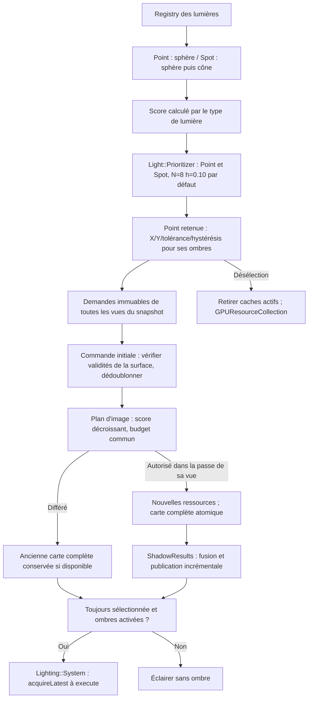


**Projection des ombres directionnelles — couverture automatique et plafond configurable (option A validée).** Pour toute `Light::Directional` active avec ombres activées, chaque `EngineView` calcule **automatiquement la région de sa propre shadow map à partir du volume visible de sa caméra**, tel que capturé dans le snapshot de cette vue ; l'application ne spécifie pas manuellement les limites d'un volume d'ombres distinct. `Light::Directional` expose toutefois **`shadowDistance`**, distance maximale de couverture des ombres exprimée en unités de monde `U` : ce plafond est propre à la lumière et s'applique à chacune des vues qui la consomment. Le calcul automatique couvre le frustum de caméra uniquement jusqu'au plan lointain effectif `min(cameraFar, shadowDistance)` (ou `shadowDistance` si le `far` de la caméra est infini). Il ne limite **pas** la lumière elle-même, qui continue d'éclairer hors de la zone ombrée sans atténuation de distance. La lumière utilise **une seule shadow map de profondeur par vue et par surface**, sans Cascaded Shadow Maps (CSM), sans atlas de cascades ni mutualisation obligatoire entre vues. Les matrices de l'ombre utilisent la direction de la lumière issue du `Transform3D` capturé et **une projection orthographique** ajustée pour couvrir conservativement la partie finie du frustum caméra à protéger ; il ne s'agit pas d'une région mondiale infinie. Le calcul des bornes de projection dans le repère de la lumière doit couvrir les récepteurs visibles et permettre aux `ShadowMap::Contributor` éligibles situés hors du frustum de la caméra de projeter leurs ombres sur ces récepteurs : **ne pas éliminer un caster au seul motif qu'il est invisible pour la caméra**. La capture de la caméra, de l'orientation lumineuse et des casters pertinents reste cohérente avec les générations et les publications historiques de §7.3. Un déplacement ou changement de projection de caméra peut entraîner la mise à jour des matrices et cartes ; il n'y a aucune garantie d'une résolution constante en unités de monde pendant les mouvements de caméra. Un changement de `shadowDistance` invalide les projections et caches d'ombres directionnels concernés, sans toucher à la géométrie des autres lumières ni aux snapshots déjà publiés ; les cartes historiques conservent leur plafond d'origine. `shadowDistance` doit disposer d'une **valeur initiale automatique** pour qu'une Directional fonctionne sans réglage, mais sa valeur numérique et les cas limites de validation restent à consolider. Les règles techniques restantes (calcul exact des bornes de profondeur, extension aux casters, frustum sans profondeur exploitable, résolution, précision, biais et politique de rafraîchissement) doivent être définies et testées avant implémentation, sans ajouter de volume manuel imposé, de cascades ni de seconde carte pour la V0.1.4.

**Flux complet d'un modèle voxel jusqu'aux commandes par vue.** Les données métier sont créées indépendamment du thread GPU. Le bake sépare les meshes opaques et translucides ; le rendu réunit les composants actifs par vue, tandis que les casters utilisent un chemin de capture distinct.

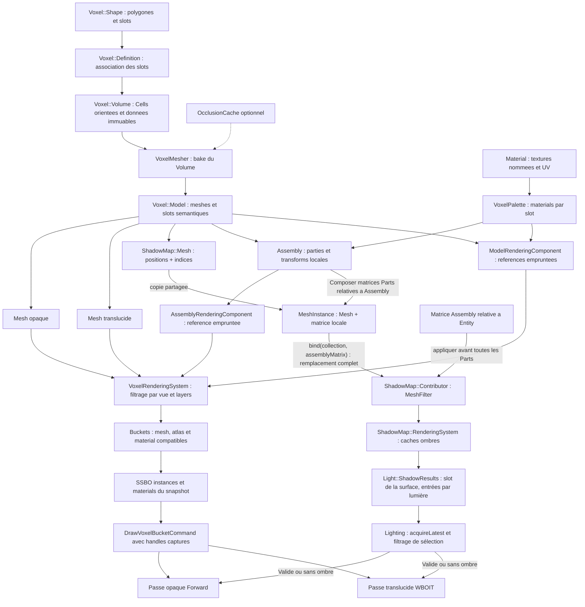

Les liaisons depuis `Model` et ses **meshes visuels** vers le rendu représentent la **géométrie du modèle emprunté**, et non la possession des objets par `VoxelRenderingSystem`. Un `ShadowMap::Contributor` est distinct des composants de rendu visuel ; il n'est jamais créé automatiquement par ce flux. Le mesh d'ombre du Model doit aussi être **lié explicitement** à un Contributor. Le `MeshFilter` détient une collection de `MeshInstance` dont les meshes partagent leurs données immuables et dont les matrices locales sont des valeurs. Pour une `Assembly`, le jeu compose les matrices des Parts **relatives à l'Assembly**, et fournit la **matrice commune de l'Assembly relative à l'Entity** à `bind(collection, assemblyMatrix)` après chaque nouvelle pose ou changement de la matrice commune. Le résultat suit `M_entityWorld * M_assembly * M_partLocal` sans double application des transformations. La matrice commune peut changer sans remailler ou recalculer les transformations locales des Parts ; aucune fusion géométrique ni notification automatique par l'Assembly n'est introduite.
