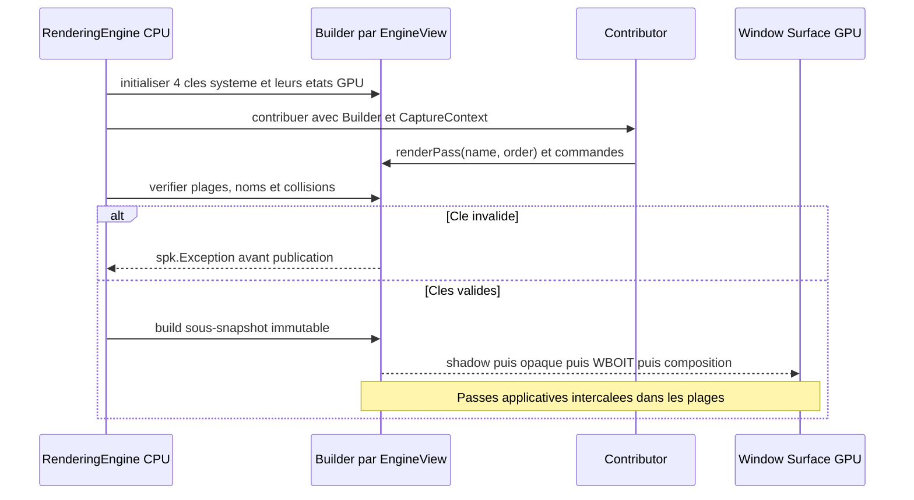
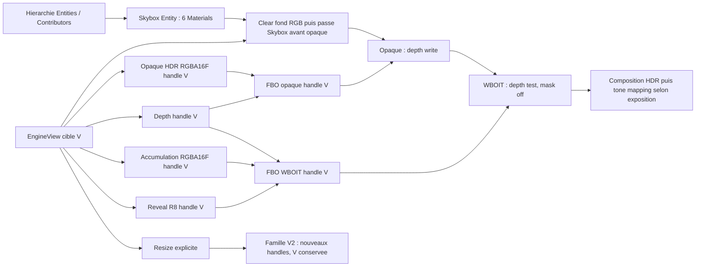
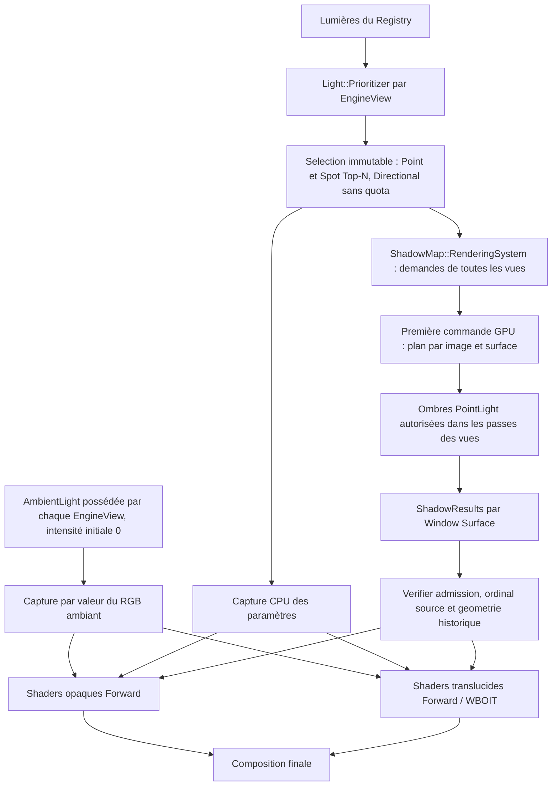
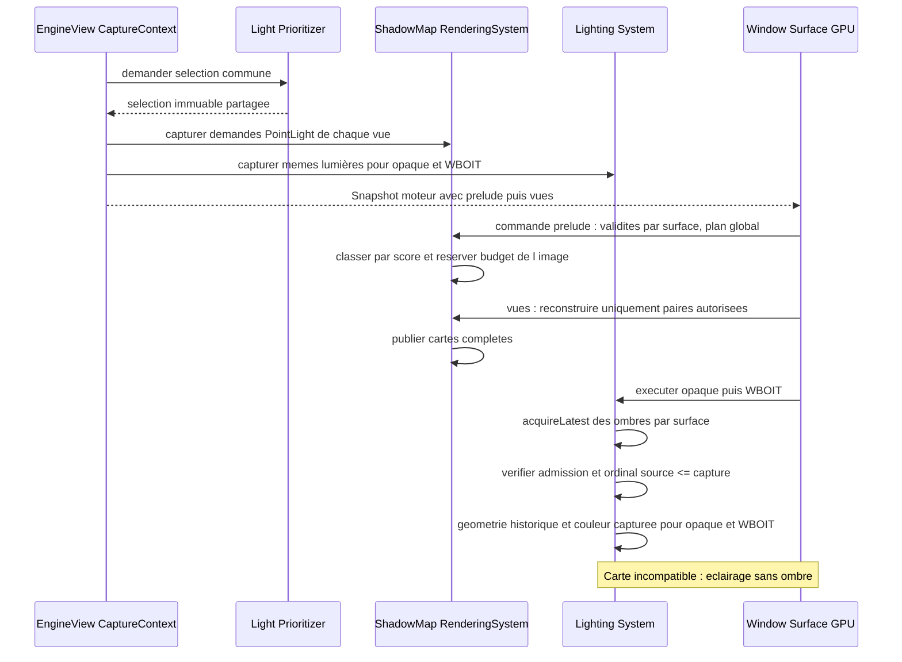
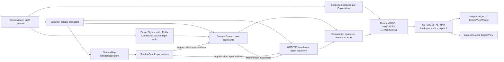

# Sparkle V0.1.4 — GPU, Forward et WBOIT

[Sommaire de l'architecture](../voxel-engine-v0.1.4-specification.md)

### 7.5 SSBO d'instances

Pour **chaque bucket non vide produit dans une vue et un RenderSnapshot**, le système crée un **nouveau `spk::ShaderStorageBuffer` d'instances**, écrit la totalité de ses données compactes et appelle sa validation (`validate()`) conformément au fonctionnement existant des ressources Sparkle.

Les occurrences d'un bucket sont toujours **contiguës et sans trous**. La disparition d'une instance à la frame suivante revient simplement à ne pas la recollecter. Aucun stockage persistant `InstanceID → offset`, swap-and-pop entre frames, dirty range, update partiel de buffer, commande de mise à jour d'une occurrence ou double buffering explicite de SSBO n'est requis.

Chaque commande conserve le **handle du SSBO propre à son snapshot** : un snapshot plus récent ne peut pas altérer le contenu des buffers d'un snapshot encore exploité. Le coût d'allocation et d'upload intégral, même en l'absence de changement, est accepté comme compromis de simplicité. Cette politique **ne rebake jamais** un Model chaque frame.

**Q-TECH-006 — SSBO d'instances sans matrice de normales (validé).** Les instances rendues en V0.1.4 utilisent une échelle **uniforme et strictement positive**. Le SSBO d'instances transporte donc uniquement la `spk::Matrix4x4` du modèle (`64` octets pour 16 flottants), sans matrice normale supplémentaire. Le shader transforme les positions avec `model * vec4(position, 1.0)` et les normales avec `normalize((model * vec4(normal, 0.0)).xyz)` ; la normalisation est obligatoire. Les transformations d'instances de scale nul, négatif ou non uniforme sont hors de ce contrat : l'implémentation doit les refuser avant publication du snapshot plutôt que produire un éclairage incorrect. Cela ne restreint pas les usages headless de `Transform3D` hors rendu.

**Q-TECH-006 — types GPU fidèles à la sémantique (validé).** Les données source C++ à deux composantes (UV, ancre UV et dimension UV) sont des `spk::Vector2`, celles à trois composantes (position, direction, normale, RGB) des `spk::Vector3` ; réserver `spk::Vector4` aux grandeurs réellement à quatre composantes. En `std430`, deux `vec2` adjacents ne nécessitent aucun padding ; après un `vec3` C++ de 12 octets, insérer `SPK_PADDING(1)` **uniquement lorsque le layout GLSL le requiert**, notamment avant un autre `vec3` aligné à 16 octets. Les structs d'upload sont trivially copyable, leur taille/alignement/offsets sont vérifiés par `static_assert(sizeof/alignof/offsetof)` et comparés à leur contrat GLSL. Ne pas réutiliser un `Vector4` uniquement pour emballer une donnée de dimension deux ou trois. Les bindings et arrangements exacts restent Q-TECH-006.

### 7.6 SSBO des matériaux par couple `Model`/`VoxelPalette`

La palette publique ne contient **aucun état GPU mutable**. Pour chaque couple `Model`/`VoxelPalette` réellement employé par le snapshot, le rendu construit un SSBO de matériaux **dans l'ordre des slots sémantiques du Model**.

La correspondance entre les **noms de slots** du Model et ceux de la palette est résolue **sur CPU**. Le shader peut ensuite accéder directement à son matériau par `MeshVertex::materialIndex`, **sans table d'indirection GPU**. Les slots supplémentaires de la palette n'ont pas à être encodés dans le SSBO adapté au Model. Les slots du Model sans triangles visibles restent pris en compte dans l'ordre et la validation du couple.

Les commandes utilisant le **même couple compatible** à l'intérieur d'un même snapshot, **y compris dans plusieurs vues de la même fenêtre**, peuvent partager ce SSBO si les paramètres de matériaux restent identiques. La table temporaire de mutualisation disparaît après la préparation du snapshot ; **aucun SSBO de matériaux n'est réutilisé entre deux snapshots**. Une même palette employée avec des Models différents peut nécessiter des dispositions de SSBO différentes. Deux palettes distinctes d'un même Model ne sont pas fusionnées dans un draw si leurs `materialIndex` auraient des interprétations différentes.

### 7.7 Buckets et commandes de dessin

Le `BucketKey` distingue toutes les ressources ou états qui doivent rester identiques au cours d'un dessin instancié : **vue et passe de rendu**, mesh, **identité logique de source `albedo`**, représentation de matériaux adaptée, et éventuels autres bindings nécessaires au pipeline réel. Une identité statique est celle du `Texture::Handle`/State ; une identité de source `EngineView` reste attachée à l'incarnation de sa vue après resize ou fallback, et ne se confond jamais avec le handle de texture momentanément résolu. La caméra, la profondeur et la destination GPU d'une vue ne doivent jamais être confondues avec celles d'une autre. Des géométries de Models différents ne sont **pas fusionnées automatiquement** parce qu'elles utilisent le même atlas.

Un `DrawVoxelBucketCommand` est un `RenderCommand` qui conserve les handles/ressources de mesh, de SSBO d'instances, de SSBO de matériaux et de textures nécessaires à l'exécution. Il n'emprunte aucune donnée d'Assembly mutable pendant son `execute(RenderContext&) const`. La gestion existante des ressources GPU de Sparkle assure que les handles capturés sont utilisables jusqu'à la fin effective de leur usage GPU, sans réutilisation anticipée d'un State appartenant à un ancien snapshot.

Une association compatible emploie au plus **une identité de source `albedo` par mesh/passe**, permettant **un draw instancié par mesh non vide et par bucket compatible**, hors éventuelles passes graphiques complémentaires. Les Materials utilisant **la même EngineView** peuvent partager cette identité, indépendamment de leurs régions UV ; plusieurs vues différentes, ou un mélange Texture statique/vue, restent incompatibles **dans un même mesh/passe**, même si leurs handles GPU effectifs coïncident temporairement. Le regroupement de draws provenant de Models différents ne mélange pas des `BucketKey` distinctes. Les occurrences présentant des mappings ou états de rendu incompatibles restent séparées.

**Résolution de source dynamique au dessin.** La validation du couple Model/Palette utilise uniquement la clé logique `Static(Texture::Handle/State)` ou `EngineView(identité de vie)`, dès l'association et avant la publication. Les ressources GPU sont capturées **par snapshot** : pour chaque occurrence utilisant une source `EngineView`, la capture choisit le handle logique et la version de cible (ou le fallback explicitement configuré) sur la base de l'état de cette vue. Le rendu sur la `Window::Surface` courante utilise ce handle capturé, après vérification que l'image a effectivement été produite pour la surface et cette version ; il ne recalcule ni l'identité de l'atlas, ni le batching, ni la politique du Material selon le dernier framebuffer disponible. Lorsqu'un producteur et un consommateur participent au même snapshot moteur, la composition de la vue source doit avoir été exécutée **avant** la vue consommatrice ; aucune dépendance inverse, réflexive ou cyclique n'est autorisée. Les vues absentes du snapshot ne produisent pas d'image par ce seul accès : seul un contenu local antérieurement valide ou le fallback explicitement choisi peut être échantillonné. Une cible en cours d'écriture ne peut être échantillonnée simultanément : `spk::Exception` plutôt qu'une lecture indéfinie.

**Ordre des passes GPU de chaque EngineView (Q-ARCH-006).** Le `RenderSnapshot::Builder` de la vue conserve `RenderPass::Key{name, order}` et les phases système ont des clés numériques **fixes et réservées** : ombres `sparkle.engineview.shadow/-1000000`, opaque `sparkle.engineview.opaque/0`, WBOIT `sparkle.engineview.wboit/1000000` et composition `sparkle.engineview.composition/2000000`. Les Contributions personnalisées peuvent être placées **avant les ombres** (`INT32_MIN..-1000001`), **entre ombres et opaque** (`-999999..-1`), **entre opaque et WBOIT** (`1..999999`), ou **entre WBOIT et composition** (`1000001..1999999`). La composition reste strictement la dernière passe du sous-snapshot ; après `2000000`, toute clé personnalisée est refusée. Le `RenderingEngine` crée et initialise ses quatre passes système, même sans draw, et les Contributors ne peuvent en altérer ni le nom ni l'ordre. Une contribution directe à une passe système emploie sa clé exacte ; des passes distinctes au même ordre sont interdites, alors que la fusion intentionnelle par nom/ordre identique demeure permise. Les erreurs sont vérifiées à la capture, avant publication du snapshot moteur, sans changer le comportement du Builder générique hors des vues. Toutes les passes restaurent explicitement leurs états GL requis ; la préparation du budget de PointLight a lieu **dans le snapshot moteur en amont des vues** et ne consomme aucune plage de passe interne à une vue.

**Tone mapping HDR et exposition de la vue (option A validée).** Les contributions lumineuses Point, Spot, Directional et AmbientLight sont additionnées dans un espace **RGB linéaire HDR**, éventuellement au-dessus de `1`. Les rendus opaque et accumulation WBOIT conservent ces valeurs dans des cibles **`RGBA16F`** jusqu'à la composition finale ; reveal reste en `R8`. La dernière passe système `sparkle.engineview.composition` mélange les contributions opaques et translucides **en HDR**, applique l'exposition capturée de la vue puis **un seul tone mapping** vers la plage d'affichage. Cette conversion préserve graduellement les détails des fortes luminances, au lieu d'un clamp direct. **Aucune nouvelle passe GPU**, aucun histogramme, auto-exposure ou adaptation temporelle. Chaque `EngineView` expose un réglage `exposure` (nom indicatif), initialement `1,0f`, fini et strictement positif ; le réglage ne modifie pas les autres vues ni les snapshots antérieurs. Le tone mapping ne s'applique ni aux valeurs avant l'accumulation WBOIT, ni aux widgets UI rendus ensuite. **Q-TECH-003 option B valide Reinhard classique** par canal après exposition ; **la sortie finale `GL_SRGB8_ALPHA8` est validée** ; seuls les états OpenGL sRGB et conventions d'échantillonnage/présentation restent à préciser dans Q-TECH-003. **Q-ARCH-008 (option A validée) :** la texture finale après composition, exposition et tone mapping est **l'unique sortie de l'EngineView**, tant pour un widget que pour un Material d'une autre vue. Aucun intermédiaire HDR n'est exposé comme source de Material, et aucune sortie HDR secondaire ni mode de sortie public ne sont créés. La vue consommatrice applique l'éclairage et le tone mapping de son propre pipeline à son albedo, sans répéter au moment de l'échantillonnage le tone mapping de la vue source. L'encodage sRGB après Reinhard et le décodage matériel lors d'une lecture comme albedo sont obligatoires ; les détails de configuration des cibles et widgets restent Q-TECH-003.

**Q-TECH-003 — Reinhard classique par canal (option B validée).** Dans `sparkle.engineview.composition`, l'entrée est la couleur RGB HDR linéaire **déjà recomposée** (opaque, WBOIT, RGB/Skybox). Pour chaque canal, former `x = max(0, C_HDR) * capturedExposure`, puis `C_reinhard = x / (1 + x)`, indépendamment des deux autres canaux. Cette expression décrit la fonction mathématique ; une implémentation algébriquement équivalente doit préserver les intensités extrêmes sans `inf/inf` ni NaN en cas de débordement du produit exposé. Aucun calcul par luminance ou white point, aucune courbe ACES. Références à E=1 : C=0→0, C=0,5→1/3, C=1→1/2, C=2→2/3, C=4→4/5, C=9→9/10 ; E=2 et C=2→4/5. L'alpha final vaut 1. Pas d'exposition ou de Reinhard sur les widgets UI. L'encodage gamma/sRGB et le format de la texture finale restent ouverts dans Q-TECH-003, sans conversion implicite supplémentaire à ce stade.

**Q-ARCH-009/010 — fond RGB et Skybox à six Materials génériques.** La cible opaque HDR démarre sur le RGB linéaire de la vue, noir par défaut, alpha 1. Si une `spk::Skybox` est admise depuis la hiérarchie d'Entities comme Contributor de la vue, **un mesh cubique inversé, centré sur la caméra, visible depuis l'intérieur**, porte six `spk::Material` ordinaires, un par face. Une conversion en `TextureCubeMap` GPU n'est ni requise ni utilisée par ce contrat. La Skybox suit l'orientation mais pas la translation de la caméra ; elle est dessinée dans la RenderPass système `sparkle.engineview.skybox/-1` avant opaque, avec depth test/write désactivés, sans altérer la profondeur partagée avec WBOIT. Les fragments WBOIT se composent ensuite devant cette base opaque. Les couleurs issues des Materials sont converties en RGB linéaire puis reçoivent l'exposition et le tone mapping habituels ; leurs canaux alpha sont ignorés, et alpha final=1. La Skybox n'émet ni ombre ni éclairage/illumination environnementale et ne crée aucune passe supplémentaire. Absence de Skybox ⇒ fond RGB ; Skybox explicitement configurée mais invalide ⇒ `spk::Exception`. Mesh, six Materials et handles résolus sont conservés dans les snapshots immuables et leurs ressources GPU se matérialisent séparément sur chaque Window::Surface. **Q-ARCH-011 révisée :** la Skybox est une Entity/Contributor de la hiérarchie ; les EngineView la sélectionnent selon leurs layers, sans pointeur `setSkybox`. La capture collecte le Contributor Skybox depuis la hiérarchie, copie de façon cohérente les six Materials et leurs handles résolus et garde les références nécessaires au mesh ; les commandes GPU ne lisent pas l'objet Skybox pendant `execute()`. Chaque vue et chaque surface utilisent toujours leur propre orientation, exposition et cible, même avec la même Skybox. La destruction de son Entity la retire des prochaines captures ; les snapshots déjà publiés n'exigent plus la vie de la Skybox. **Q-ARCH-012 révisée :** remplacement individuel des Materials de face, copies cohérentes aux captures ; synchronisation Q-TECH-007, éclairage unlit Q-ARCH-013 ; orientation UV et états OpenGL précis à finaliser en Q-TECH-003/006.

**Famille d'attachments et versions d'EngineView.** La composition de `Framebuffer` par `Texture::Handle` explicites appartient au type générique déjà existant, sans nouveau `RenderTarget`. L'EngineView construit atomiquement une famille de cibles (opaque, WBOIT, composition et profondeur **partagée**) pour chaque taille/version logique. Ses commandes GPU capturent des `Framebuffer::Handle` et `Texture::Handle` forts vers cette version. Un resize choisi par le jeu alloue des **nouveaux States** avant publication du nouveau snapshot ; jamais de `Framebuffer::resize()` mutable en place sur les anciens States, ni de réaffectation des attachments d'une version déjà capturée. Un snapshot ancien exécuté après resize continue à rendre sur **ses propres** ressources GPU logiques ; sur la même `Window::Surface` ses anciennes textures peuvent rester indépendamment valides, mais ne sont pas utilisées comme la nouvelle sortie courante. La disponibilité des pixels produits est suivie **par (surface, version/handle)** et pas par nom d'EngineView seul. Les deux surfaces A/B matérialisent les mêmes handles CPU en instances GL distinctes, avec un depth commun **à l'intérieur de chacune**, jamais partagé entre A et B.

### 7.8 Pipeline Forward classique, opaque et WBOIT

**Skybox unlit (Q-ARCH-013).** La géométrie inversée de Skybox n'est pas traitée par les shaders Forward éclairés. La passe système Skybox précédant opaque réutilise les Materials génériques uniquement pour échantillonner le rôle `albedo` et appliquer les UV par face, avec un shader **non éclairé** : aucun `Light::Selection`, SSBO de lumières, contribution `spk::AmbientLight`, évaluation de normale ou échantillonnage de shadow map. Le ciel n'est pas un Contributor lumineux et ne projette pas d'ombre. Sa couleur reste en RGB linéaire HDR dans l'attachment opaque ; la passe opaque conserve cette couleur et réinitialise uniquement la profondeur pour ses objets ; WBOIT se compose normalement devant le ciel, et la composition finale applique l'exposition puis l'unique tone mapping de l'EngineView. Sortie finale alpha 1. Une nouvelle lampe ou un changement de son intensité ne change pas les couleurs de Skybox si son Material, la caméra et l'exposition restent identiques. Les Materials peuvent conserver d'autres rôles, mais aucun autre rôle n'est utilisé dans le shader Skybox V0.1.4.

**Q-TECH-002 — stabilité des ombres sans raffinement progressif (validé).** La résolution de chaque shadow map est **1024×1024 en D32F par défaut**, configurable par lumière. La sous-sélection de PointLight à ombres a **X=2, Y=4** par défaut et par EngineView, indépendamment du Top-N Forward (N=8) et du nombre de reconstructions intégrales permis par image et surface. Les caches statiques et la dernière finale complète admissible restent disponibles pendant l'attente ; aucun rendu en 256/512 successif, aucune réémission de snapshot immobile pour améliorer la qualité ni ordonnanceur adaptatif au FPS. La reconstruction coûte une unité par paire PointLight, traite immédiatement la résolution configurée et publie atomiquement quand toutes ses faces sont prêtes. Les scores de priorité déterminent l'ordre des demandes concurrentes.

**Éclairage global par EngineView.** Les shaders calculent directement la couleur éclairée des surfaces opaques et translucides (Forward classique), sans G-buffer, Deferred ni culling lumineux par tiles GPU. Le `Light::Prioritizer` de la vue retient un Top-N global des `Point` et `Spot`, plus toutes les `Directional` actives hors budget N. La sélection immutable est commune à `Lighting::System` et `ShadowMap::RenderingSystem`. Aucun compute shader de culling de tiles, buffer de listes par tile ou mécanisme d'overflow de telles listes n'est requis.

**Ambiance possédée par chaque vue.** Chaque `EngineView` possède son propre `spk::AmbientLight`, et le shader reçoit son unique RGB linéaire `ambientRGB` **copié par valeur** dans le snapshot (`color × intensity`). Les valeurs initiales `RGB{1,1,1}` et `intensity = 0` donnent `(0,0,0)` sans configuration ; il n'existe jamais d'état « AmbientLight absent » ou de pointeur externe à résoudre. La couleur ambiante module uniformément l'albedo des surfaces de la vue et s'ajoute aux contributions directes Point/Spot/Directional en HDR linéaire, **sans ombre**, sans lecture de profondeur, sans portée ni illumination globale. Elle ne modifie pas l'alpha, ne consomme aucun slot Top-N et ne crée aucune shadow map. Opaque et WBOIT partagent cette valeur immuable ; les autres EngineView utilisent chacune leur instance et leur capture. `execute()` ne lit ni l'objet ni la vue mutable.

**FPS cible propre à EngineView, sans scheduler supplémentaire (validé).** Le paramètre configurable de cible FPS démarre à `60.0f` pour chaque EngineView. C'est un objectif indicatif et non une limitation de la fréquence réelle. En V0.1.4, il n'intervient pas dans le budget numérique de reconstructions d'ombres par surface/image et n'exige aucun redessin supplémentaire. Une future configuration de l'Application est hors périmètre.

**Exposition capturée.** La capture CPU fige pour chaque vue son exposition strictement positive ; les anciens snapshots conservent leur valeur même après modification de la configuration. Les commandes de composition consultent exclusivement cet état capturé, jamais l'EngineView mutable dans `execute()`. Les différentes surfaces exécutant une même capture reçoivent le même réglage logique, sur des ressources GPU distinctes.

**Capture et buffers.** La capture CPU fige la `Light::Selection`, les paramètres des lumières retenues et les matrices de vue ; les mêmes données alimentent la passe opaque et l'unique passe WBOIT de cette EngineView. Les ressources GPU sont matérialisées sur la `Window::Surface` courante et synchronisées avant les dessins. `RenderCommand::execute()` ne relit pas de lumière, caméra, vue ou Assembly mutable. La sélection ne dépend pas du depth buffer opaque et reste valide pour les fragments translucides.

**Préparation GPU commune avant les vues.** Le snapshot moteur commence par une commande de préparation des reconstructions de PointLight qui examine les **demandes immuables de toutes ses EngineView** et vérifie leur état GPU **sur la `Window::Surface` exécutante**. Elle dédoublonne les paires, trie strictement leurs scores capturés et attribue un budget unique pour cette image/surface. Le plan figé et les marques de paires traitées sont **temporaires dans le `RenderContext` de l'image**, indépendants du snapshot et des autres surfaces. Chaque passe d'ombres ponctuelles de vue ne reconstruit que ses paires autorisées, une seule fois par image ; l'opaque et le WBOIT s'exécutent ensuite selon l'ordre inchangé des vues. Les cartes anciennes admissibles continuent à pouvoir être utilisées en cas de report.

**Résolution des textures d'ombres par lumière.** Point, Spot et Directional disposent chacun d'une résolution standard initiale et d'un réglage explicite individuel `shadowResolution` (nom indicatif) ; ce paramètre ne dépend pas de la taille de sortie de l'EngineView. Les six faces d'une cubemap Point sont carrées et de même taille ; les caches statiques/finals d'une lumière ont les mêmes dimensions pour pouvoir être combinés. Changer la résolution impose de nouvelles cibles et une reconstruction, pas un redimensionnement en place des handles utilisés par des snapshots en vol. Le filtre PCF 3×3 calcule ses offsets à partir de la résolution **historique** de la carte admissible, jamais d'une valeur actuelle incompatible. Pas d'ajustement automatique à la distance ou à la capacité de la surface.

**Ombres et états historiques cohérents.** `ShadowMap::RenderingSystem` ne traite que les lumières sélectionnées. Chaque carte finalisée transporte son identité d'admission, sa génération, son ordinal de capture source et son **état géométrique historique** (position/direction, portée, angle Spot, projections par face, plans near/far, résolution, format et profondeur). Pendant `execute()`, `Lighting::System` appelle `Light::ShadowResults::acquireLatest()` ; elle refuse toute ancienne admission ou carte d'une capture future et emploie les paramètres historiques pour toutes les comparaisons d'ombres, y compris le biais lié à la face. **RGB et intensity restent issus du snapshot consommateur**, car indépendants de la géométrie ; une variation de leur valeur ne modifie pas la carte, sous réserve que la lumière reste admissible. La contribution des Point/Spot est `RGB×intensity×Smoothstep` (Spot : facteur angulaire additionnel), avec **PCF 3×3 fixe pour Point, Spot et Directional** : neuf positions de comparaison et moyenne des visibilités dans les cartes 2D Spot/Directional, et PCF manuel inter-faces pour la cubemap Point. Ce filtrage exploite exclusivement les profondeurs, projections et biais historiques compatibles ; il n'introduit ni réglage public de taille ni nouvelle reconstruction de shadow map. Sans carte compatible, la lumière éclaire sans ombre. L'opaque et le WBOIT utilisent la même sélection, la même loi d'éclairage et une seule résolution effective de carte par exécution de vue, sans consulter d'Entity mutable.

La passe opaque calcule directement l'éclairage des fragments sélectionnés. Les fragments translucides utilisent la **même sélection**, reçoivent éventuellement les ombres des opaques et sont ensuite accumulés dans le WBOIT.

**Translucence WBOIT par MRT.** Pour chaque `EngineView` rendue, la géométrie translucide est parcourue **une seule fois dans une passe de dessin translucide**. Les fragments de cette passe alimentent **simultanément deux attachments couleur (Multiple Render Targets)** du framebuffer logique de la vue : l'un pour **l'accumulation pondérée** (couleur et poids), l'autre pour la **révélation** (transmittance résiduelle). La passe utilise un **blending indépendant par attachment**, configuré explicitement avec les `BlendRenderCommand` typées prévues dans la section 7.1. Les attachments sont initialisés avec leurs valeurs de clear appropriées avant tout dessin translucide. Une **passe distincte de composition** combine ensuite opaque, accumulation et révélation pour produire la texture finale. Il n'existe pas en V0.1.4 de seconde passe redessinant la même géométrie pour la révélation, ni de stratégie alternative configurable entre MRT et double dessin.

L'initialisation du framebuffer et des états est indépendante de la passe de dessin proprement dite : la règle « une seule passe de géométrie translucide » n'interdit ni commandes de préparation/clear ni composition. Le matériel et les commandes restent génériques à Sparkle et non spécifiques au voxel. Le rendu exige les capacités OpenGL permettant plusieurs sorties couleur et **des facteurs/équations de blending distincts par attachment** ; leur disponibilité doit être vérifiée explicitement et un contexte incompatible doit être rejeté par `spk::Exception`, sans fallback implicite à une stratégie à deux passes. **Formats des attachments WBOIT :** l'attachment d'**accumulation utilise `RGBA16F`** (quatre canaux flottants 16 bits) et l'attachment de **révélation utilise `R8`** (un canal normalisé non signé 8 bits). Ces deux formats sont imposés par le pipeline WBOIT générique V0.1.4, sans option de précision supplémentaire, variante `R16F` ni fallback automatique. L'API `Texture::Format` et la matérialisation GPU doivent supporter ces formats ; une surface/context OpenGL incapable de les créer en attachments rendables, ou incapable du blending indépendant, est rejeté avec une `spk::Exception` descriptive. **Restent à fixer et tester :** clear values des attachments couleur, facteurs et équations de blending par attachment, fonction de poids, comparaison du depth test et équation de composition. **La passe translucide réutilise le depth attachment opaque**, selon le contrat ci-dessous. La quantification de la révélation en `R8` doit être couverte par les tests graphiques. Les shadow maps, passes de profondeur préalables éventuellement nécessaires et composition de transparence sont **compatibles** avec le Forward Rendering : exclure le Deferred n'interdit pas ces passes auxiliaires. Aucune architecture privée d'éclairage voxel n'est introduite.

**Projection et réception des ombres.** En V0.1.4, **seules les surfaces opaques participent au rendu des shadow maps** des lumières directionnelles, spots et ponctuelles. Une surface **translucide ne projette jamais d'ombre**, quel que soit son alpha ; ni seuil d'alpha pour des ombres binaires translucides, ni atténuation/ombres colorées de transmission ne sont requis. Les surfaces translucides **peuvent en revanche recevoir les ombres** déjà calculées par les objets opaques et les prendre en compte dans leur éclairage Forward, avant d'écrire l'accumulation/révélation WBOIT. Les surfaces opaques continuent également à recevoir les ombres.

La sélection des contributeurs aux shadow maps respecte la séparation **opaque/translucide** : pour les voxels, une géométrie de profondeur **explicitement fournie par le `MeshFilter` du `ShadowMap::Contributor`** est la source des éventuels casters ; elle peut être différente du mesh visuel opaque. Le rendu translucide du `VoxelRenderingSystem` ne contribue jamais directement à une passe d’ombres. La source d’ombre doit respecter la règle de projection opaque, sans transmission translucide en V0.1.4 : cette précondition incombe au producteur du `ShadowMap::Mesh`, dont le seul attribut est la position, et n'est pas vérifiable par le système d'ombres. L'infrastructure d'ombres reste **générique Sparkle** et ne doit pas traiter différemment les voxels et les autres géométries classées opaques/translucides. Le contrat particulier des mécanismes de *cutout* non voxel préexistants reste distinct et n'est pas redéfini par cette décision. Le moteur ne doit pas fabriquer de stratégie d'ombres translucides implicite. Les lumières ponctuelles peuvent projeter des ombres lorsque leur composant les active explicitement et que les budgets de leur vue et de leur surface les autorisent.

**Profondeur partagée entre opaque et WBOIT (Q-ARCH-007).** Pour chaque **version logique** d'une `EngineView` et chaque `Window::Surface`, la passe opaque et la passe translucide WBOIT utilisent **exactement le même `Texture::Handle` de profondeur et la même instance GPU locale**, placés dans deux `Framebuffer::State` distincts par référence partagée, pas par copies de `Texture` ou deux textures de profondeur synchronisées. Une même instance GL de depth est ainsi attachée au FBO opaque puis au FBO WBOIT, sans copie/blit intermédiaire. La profondeur est initialisée pour le rendu opaque ; l'opaque effectue ses tests et ses écritures habituels. La passe WBOIT réutilise ensuite **sans copie ni recalcul** les profondeurs opaques : **depth test activé, depth write mask désactivé** pendant tous les dessins translucides. Le WBOIT ne doit ni effacer ni écraser le depth buffer de l'opaque. Les fragments translucides derrière une surface opaque sont ainsi écartés par ce test ; la transparence entre fragments translucides reste gérée par l'accumulation WBOIT, sans depth write.

Les `DepthRenderCommand` et `FramebufferRenderCommand` typées établissent cet état **explicitement à l'entrée de la passe**, sans dépendre de l'état GL résiduel des phases précédentes. Le framebuffer WBOIT contient les **deux** `Texture::Handle` couleur ordonnés : accumulation `RGBA16F` (support à ajouter à `Texture::Format`, encore absent du code actuel) et révélation `R8` (format `Texture::Format::GreyLevel`), plus **le même handle de profondeur** que l'opaque. Les capacités MRT, blending par attachment, formats color-renderable, nombre maximal de draw buffers, dimensions et échantillonnage compatibles sont vérifiés **sur la surface au moment de la matérialisation** ; le framebuffer doit être complet avant les draws, sinon `spk::Exception` descriptive, jamais de repli silencieux. La profondeur opaque n'est effacée qu'au début de la phase opaque ; WBOIT **ne la réinitialise pas**, conserve son test de profondeur et désactive ses écritures. Une commande de composition ne modifie pas rétroactivement les profondeurs capturées. La comparaison exacte reste un détail du contrat de profondeur du pipeline.

L'éclairage Forward classique avec sélection Top-N globale par vue, les ombres génériques et WBOIT font partie du pipeline V0.1.4. Les deux passes visuelles consomment la même sélection de lumières du Channel. `ShadowMap::RenderingSystem` produit et publie les cartes complètes, et `Lighting::System` les acquiert à l'exécution sur la surface appropriée.

L'infrastructure 3D non voxel peut conserver ses mécanismes existants, y compris ses usages spécifiques du cutout ; ce document ne change pas son contrat général.
