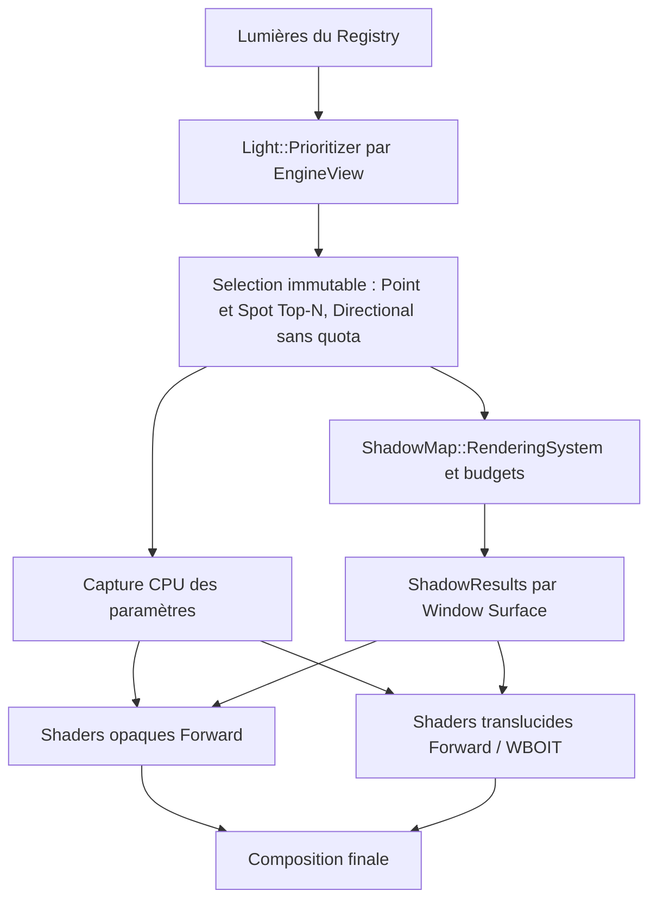
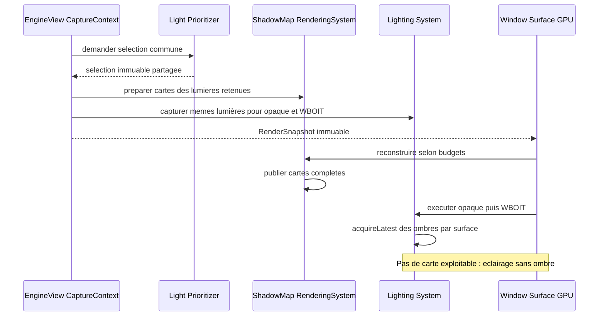
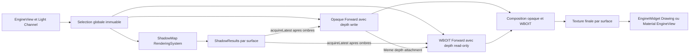

# Sparkle V0.1.4 — GPU, Forward et WBOIT

[Sommaire de l'architecture](../voxel-engine-v0.1.4-specification.md)

### 7.5 SSBO d'instances

Pour **chaque bucket non vide produit dans une vue et un RenderSnapshot**, le système crée un **nouveau `spk::ShaderStorageBuffer` d'instances**, écrit la totalité de ses données compactes et appelle sa validation (`validate()`) conformément au fonctionnement existant des ressources Sparkle.

Les occurrences d'un bucket sont toujours **contiguës et sans trous**. La disparition d'une instance à la frame suivante revient simplement à ne pas la recollecter. Aucun stockage persistant `InstanceID → offset`, swap-and-pop entre frames, dirty range, update partiel de buffer, commande de mise à jour d'une occurrence ou double buffering explicite de SSBO n'est requis.

Chaque commande conserve le **handle du SSBO propre à son snapshot** : un snapshot plus récent ne peut pas altérer le contenu des buffers d'un snapshot encore exploité. Le coût d'allocation et d'upload intégral, même en l'absence de changement, est accepté comme compromis de simplicité. Cette politique **ne rebake jamais** un Model chaque frame.

### 7.6 SSBO des matériaux par couple `Model`/`VoxelPalette`

La palette publique ne contient **aucun état GPU mutable**. Pour chaque couple `Model`/`VoxelPalette` réellement employé par le snapshot, le rendu construit un SSBO de matériaux **dans l'ordre des slots sémantiques du Model**.

La correspondance entre les **noms de slots** du Model et ceux de la palette est résolue **sur CPU**. Le shader peut ensuite accéder directement à son matériau par `MeshVertex::materialIndex`, **sans table d'indirection GPU**. Les slots supplémentaires de la palette n'ont pas à être encodés dans le SSBO adapté au Model. Les slots du Model sans triangles visibles restent pris en compte dans l'ordre et la validation du couple.

Les commandes utilisant le **même couple compatible** à l'intérieur d'un même snapshot, **y compris dans plusieurs vues de la même fenêtre**, peuvent partager ce SSBO si les paramètres de matériaux restent identiques. La table temporaire de mutualisation disparaît après la préparation du snapshot ; **aucun SSBO de matériaux n'est réutilisé entre deux snapshots**. Une même palette employée avec des Models différents peut nécessiter des dispositions de SSBO différentes. Deux palettes distinctes d'un même Model ne sont pas fusionnées dans un draw si leurs `materialIndex` auraient des interprétations différentes.

### 7.7 Buckets et commandes de dessin

Le `BucketKey` distingue toutes les ressources ou états qui doivent rester identiques au cours d'un dessin instancié : **vue et passe de rendu**, mesh, atlas `albedo`, représentation de matériaux adaptée, et éventuels autres bindings nécessaires au pipeline réel. La caméra, la profondeur et la destination GPU d'une vue ne doivent jamais être confondues avec celles d'une autre. Des géométries de Models différents ne sont **pas fusionnées automatiquement** parce qu'elles utilisent le même atlas.

Un `DrawVoxelBucketCommand` est un `RenderCommand` qui conserve les handles/ressources de mesh, de SSBO d'instances, de SSBO de matériaux et de textures nécessaires à l'exécution. Il n'emprunte aucune donnée d'Assembly mutable pendant son `execute(RenderContext&) const`. La gestion existante des ressources GPU de Sparkle assure que les handles capturés sont utilisables jusqu'à la fin effective de leur usage GPU, sans réutilisation anticipée d'un State appartenant à un ancien snapshot.

Une association compatible emploie au plus **un atlas `albedo` par mesh/passe**, permettant **un draw instancié par mesh non vide et par bucket compatible**, hors éventuelles passes graphiques complémentaires. Les occurrences présentant des mappings ou états de rendu incompatibles restent séparées.

### 7.8 Pipeline Forward classique, opaque et WBOIT

**Éclairage global par EngineView.** Les shaders calculent directement la couleur éclairée des surfaces opaques et translucides (Forward classique), sans G-buffer, Deferred ni culling lumineux par tiles GPU. Le `Light::Prioritizer` de la vue retient un Top-N global des `Point` et `Spot`, plus toutes les `Directional` actives hors budget N. La sélection immutable est commune à `Lighting::System` et `ShadowMap::RenderingSystem`. Aucun compute shader de culling de tiles, buffer de listes par tile ou mécanisme d'overflow de telles listes n'est requis.

**Capture et buffers.** La capture CPU fige la `Light::Selection`, les paramètres des lumières retenues et les matrices de vue ; les mêmes données alimentent la passe opaque et l'unique passe WBOIT de cette EngineView. Les ressources GPU sont matérialisées sur la `Window::Surface` courante et synchronisées avant les dessins. `RenderCommand::execute()` ne relit pas de lumière, caméra, vue ou Assembly mutable. La sélection ne dépend pas du depth buffer opaque et reste valide pour les fragments translucides.

**Ombres.** `ShadowMap::RenderingSystem` travaille seulement sur les lumières admissibles issues de la sélection commune et applique ses budgets et invalidations indépendamment. Il publie chaque carte finale complète et ses matrices/génération par surface. `Lighting::System` consulte `Light::ShadowResults::acquireLatest()` après la passe d'ombres, pendant `execute()`. Une carte encore exploitable peut être utilisée avec les matrices de **sa propre génération** ; toute lumière sélectionnée dépourvue de carte compatible reste éclairante sans ombre. Le contrat d'association entre les données lumineuses capturées et les générations de cartes acquises doit éviter de combiner des paramètres incompatibles.

La passe opaque calcule directement l'éclairage des fragments sélectionnés. Les fragments translucides utilisent la **même sélection**, reçoivent éventuellement les ombres des opaques et sont ensuite accumulés dans le WBOIT.

**Translucence WBOIT par MRT.** Pour chaque `EngineView` rendue, la géométrie translucide est parcourue **une seule fois dans une passe de dessin translucide**. Les fragments de cette passe alimentent **simultanément deux attachments couleur (Multiple Render Targets)** du framebuffer logique de la vue : l'un pour **l'accumulation pondérée** (couleur et poids), l'autre pour la **révélation** (transmittance résiduelle). La passe utilise un **blending indépendant par attachment**, configuré explicitement avec les `BlendRenderCommand` typées prévues dans la section 7.1. Les attachments sont initialisés avec leurs valeurs de clear appropriées avant tout dessin translucide. Une **passe distincte de composition** combine ensuite opaque, accumulation et révélation pour produire la texture finale. Il n'existe pas en V0.1.4 de seconde passe redessinant la même géométrie pour la révélation, ni de stratégie alternative configurable entre MRT et double dessin.

L'initialisation du framebuffer et des états est indépendante de la passe de dessin proprement dite : la règle « une seule passe de géométrie translucide » n'interdit ni commandes de préparation/clear ni composition. Le matériel et les commandes restent génériques à Sparkle et non spécifiques au voxel. Le rendu exige les capacités OpenGL permettant plusieurs sorties couleur et **des facteurs/équations de blending distincts par attachment** ; leur disponibilité doit être vérifiée explicitement et un contexte incompatible doit être rejeté par `spk::Exception`, sans fallback implicite à une stratégie à deux passes. **Formats des attachments WBOIT :** l'attachment d'**accumulation utilise `RGBA16F`** (quatre canaux flottants 16 bits) et l'attachment de **révélation utilise `R8`** (un canal normalisé non signé 8 bits). Ces deux formats sont imposés par le pipeline WBOIT générique V0.1.4, sans option de précision supplémentaire, variante `R16F` ni fallback automatique. L'API `Texture::Format` et la matérialisation GPU doivent supporter ces formats ; une surface/context OpenGL incapable de les créer en attachments rendables, ou incapable du blending indépendant, est rejeté avec une `spk::Exception` descriptive. **Restent à fixer et tester :** clear values des attachments couleur, facteurs et équations de blending par attachment, fonction de poids, comparaison du depth test et équation de composition. **La passe translucide réutilise le depth attachment opaque**, selon le contrat ci-dessous. La quantification de la révélation en `R8` doit être couverte par les tests graphiques. Les shadow maps, passes de profondeur préalables éventuellement nécessaires et composition de transparence sont **compatibles** avec le Forward Rendering : exclure le Deferred n'interdit pas ces passes auxiliaires. Aucune architecture privée d'éclairage voxel n'est introduite.

**Projection et réception des ombres.** En V0.1.4, **seules les surfaces opaques participent au rendu des shadow maps** des lumières directionnelles, spots et ponctuelles. Une surface **translucide ne projette jamais d'ombre**, quel que soit son alpha ; ni seuil d'alpha pour des ombres binaires translucides, ni atténuation/ombres colorées de transmission ne sont requis. Les surfaces translucides **peuvent en revanche recevoir les ombres** déjà calculées par les objets opaques et les prendre en compte dans leur éclairage Forward, avant d'écrire l'accumulation/révélation WBOIT. Les surfaces opaques continuent également à recevoir les ombres.

La sélection des contributeurs aux shadow maps respecte la séparation **opaque/translucide** : pour les voxels, une géométrie de profondeur **explicitement fournie par le `MeshFilter` du `ShadowMap::Contributor`** est la source des éventuels casters ; elle peut être différente du mesh visuel opaque. Le rendu translucide du `VoxelRenderingSystem` ne contribue jamais directement à une passe d’ombres. La source d’ombre doit respecter la règle de projection opaque, sans transmission translucide en V0.1.4 : cette précondition incombe au producteur du `ShadowMap::Mesh`, dont le seul attribut est la position, et n'est pas vérifiable par le système d'ombres. L'infrastructure d'ombres reste **générique Sparkle** et ne doit pas traiter différemment les voxels et les autres géométries classées opaques/translucides. Le contrat particulier des mécanismes de *cutout* non voxel préexistants reste distinct et n'est pas redéfini par cette décision. Le moteur ne doit pas fabriquer de stratégie d'ombres translucides implicite. Les lumières ponctuelles peuvent projeter des ombres lorsque leur composant les active explicitement et que les budgets de leur vue et de leur surface les autorisent.

**Profondeur partagée entre opaque et WBOIT.** Pour chaque `EngineView` et chaque `Window::Surface`, la passe opaque et la passe translucide WBOIT utilisent **le même attachment de profondeur logique et la même instance GPU locale**, associés aux framebuffers des phases correspondantes. La profondeur est initialisée pour le rendu opaque ; l'opaque effectue ses tests et ses écritures habituels. La passe WBOIT réutilise ensuite **sans copie ni recalcul** les profondeurs opaques : **depth test activé, depth write mask désactivé** pendant tous les dessins translucides. Le WBOIT ne doit ni effacer ni écraser le depth buffer de l'opaque. Les fragments translucides derrière une surface opaque sont ainsi écartés par ce test ; la transparence entre fragments translucides reste gérée par l'accumulation WBOIT, sans depth write.

Les `DepthRenderCommand` et `FramebufferRenderCommand` typées établissent cet état **explicitement à l'entrée de la passe**, sans dépendre de l'état GL résiduel des phases précédentes. Les attachments couleur MRT (`RGBA16F` et `R8`) sont propres au WBOIT, mais leur framebuffer doit référencer **le même depth attachment** que celui de l'opaque, et non une copie ou une texture différente. La compatibilité des dimensions, des échantillons et la complétude des framebuffers doivent être validées lors de leur matérialisation sur chaque surface ; toute incompatibilité déclenche `spk::Exception`. Le depth buffer possède la même règle de **versionnement des cibles immuables** lors du resize explicite : un nouveau snapshot ne modifie pas rétroactivement le depth attachment capturé par un snapshot antérieur. La fonction de comparaison exacte reste à choisir dans le contrat de profondeur du pipeline.

L'éclairage Forward classique avec sélection Top-N globale par vue, les ombres génériques et WBOIT font partie du pipeline V0.1.4. Les deux passes visuelles consomment la même sélection de lumières du Channel. `ShadowMap::RenderingSystem` produit et publie les cartes complètes, et `Lighting::System` les acquiert à l'exécution sur la surface appropriée.

L'infrastructure 3D non voxel peut conserver ses mécanismes existants, y compris ses usages spécifiques du cutout ; ce document ne change pas son contrat général.
