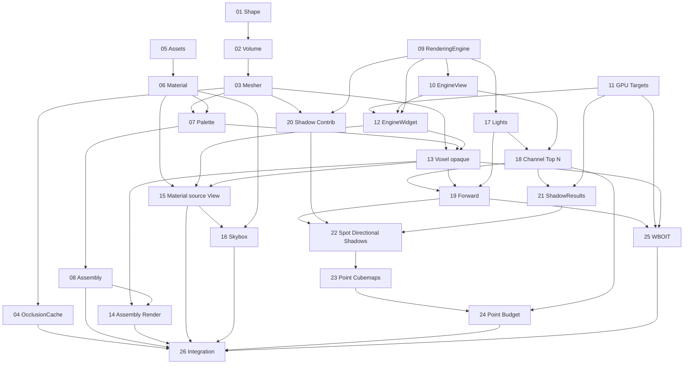

# Graphe de dépendances et chemin critique

Les liens entre fiches sont des prérequis **techniques**, pas seulement un ordre de numérotation.

**Deux chaînes parallèles au début :** la chaîne voxel (PR01–04) et la chaîne graphique (PR09–12). La chaîne AssetManager/Material (PR05–06) peut commencer sans les autres. Elles convergent sur PR13. Les ombres dépendent de l'éclairage mais PR25 WBOIT ne dépend pas du calcul des shadow maps ; elle peut progresser en parallèle des PR20–24.

**Chemin critique visible :** PR09 → PR10 et PR11 → PR12, puis PR03 + PR07 + PR12 → PR13. Il donne le fond d'une EngineView d'abord, puis un vrai voxel texturé.

**Risques :** préserver l'input après le remplacement de RenderingEngine en PR09, l'immuabilité des anciens Handles au resize en PR11 et les transactions mutation+invalidation en PR18. Tester ces frontières dès les PR correspondantes.

**Mode de collaboration :** fusionner d'abord les prérequis nécessaires, éviter les chaînes de branches divergentes et toute PR géante ; il n'est pas nécessaire de linéariser des branches indépendantes.
