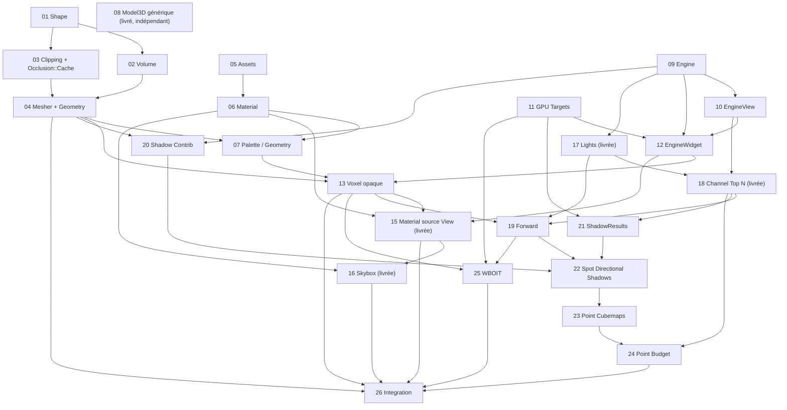

# Graphe de dépendances et chemin critique

**Après PR18 fusionnée :** le rendu voxel et les transformations ECS sont livrés. `Model3D` PR08 demeure indépendant ; **PR14 est retirée** et ne conditionne aucune PR future. Voir [PR13](PR-13-voxel-render-first.md) et [PR14 retirée](PR-14-assembly-render.md).

Les liens entre fiches sont des prérequis **techniques**, pas seulement un ordre de numérotation.

**Historique :** les chaînes voxel (PR01–04), graphique (PR09–12) et Assets/Materials (PR05–07) convergent sur PR13, maintenant fusionnée. Le WBOIT/HDR générique appartient déjà à la baseline PR12 ; PR25 ajoute son chemin de dessin voxel translucide, sans nouvelle infrastructure de vues. PR25 peut avancer en parallèle de PR20–24.

**Chemin critique restant :** PR19 → PR22 → PR23 → PR24 → PR26, avec PR20–21 nécessaires à PR22. PR25 peut avancer après PR19 en parallèle des ombres. PR15–PR18 sont livrées ; PR14 est retirée.

**Risques :** préserver les handles/snapshots historiques au resize et les invariants de génération/publication de PR18. Les sources CPU suivent mutation puis notification ; l'application coordonne la concurrence avec les captures.

**Mode de collaboration :** une branche par fiche, créée **depuis la tête courante de `V0.1.4`** et ciblant **`V0.1.4`**. Fusionner d'abord les prérequis dans `V0.1.4` ; deux fiches indépendantes peuvent avancer en branches parallèles, à resynchroniser avant fusion. Ne jamais créer une branche sur une autre branche de développement, ni cibler `main` avec une des 26 PR. La PR #37 reste le regroupement final `V0.1.4` → `main`.

**Contrat voxel :** PR-01 fournit les huit `Shape::Instance` dans `Shape::Data` ; PR-03 fournit le clipping directionnel CPU et son `Occlusion::Cache` facultatif ; PR-04 consomme le même algorithme de clipping avec ou sans cache. Aucun `ShapeTransformationCache` autonome, aucune liaison obligatoire au Mesher et aucune transformation répétée des Shapes.

**Réutilisation obligatoire :** les futures fonctionnalités graphiques étendent `Voxel::Renderer`/`DrawVoxelCommand` et `EngineView` de PR13, sans réimplémenter instancing, batching ou textures finales ; les casters de shadow maps sont explicitement liés par les composants d'ombres.

**Baseline PR19 :** PR15 apporte `view.texture()`, PR16 `CameraData` au binding UBO 1, PR17 les sources lumineuses et PR18 `Light::Selection`. Aucun nouveau mécanisme équivalent n'est requis.
