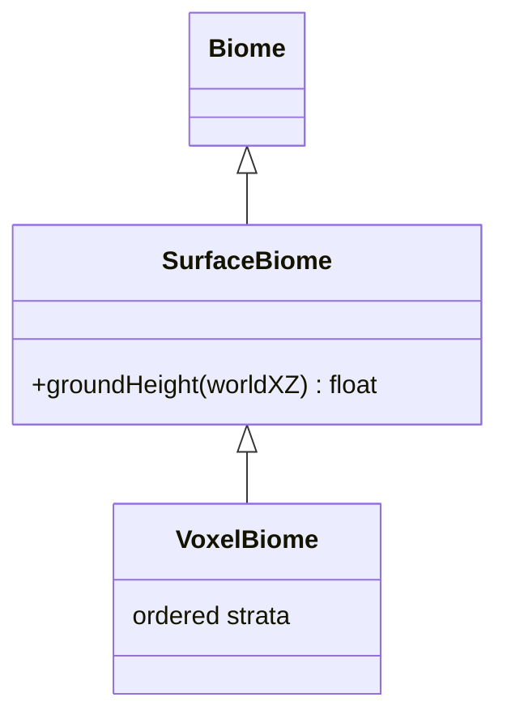
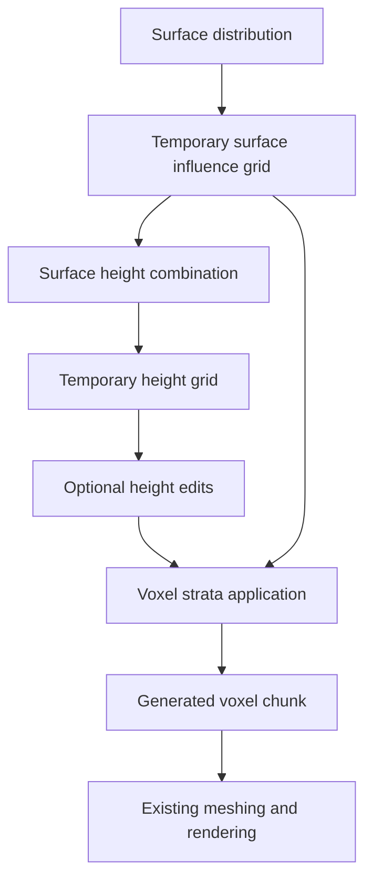

# Sparkle v0.1.5 — Biome and world-generation architecture

> Design record, 24 November 2026. Branch: `design/v0.1.5-biome-architecture`, based on V0.1.5.
> This document describes validated design decisions and explicitly marked open interfaces. It does not authorize implementation, a code PR, or a merge. [Open questions](biome-open-questions.md) is the companion inventory. This rewrite supersedes the earlier flat biome architecture; the history remains available in Git.

## 1. Purpose and decomposition

Sparkle provides reusable generation components, not a fixed geography or game design. It must also provide a ready-to-use voxel world: voxel support is a first-class specialization, not something every game must implement again.

The core principle is to generalize only what is shared at the relevant level. Biome identity, spatial distribution, terrain shape, material composition and decoration are separate concerns. A more specialized layer may reuse the layer below; the lower layer never depends on the upper one. Existing chunk generation, streaming and scheduling contracts are unchanged.

### 1.1 Three levels of abstraction (validated)

| Level | Namespace | Responsibility |
| --- | --- | --- |
| Generic biome | `spk::World` | Environment definition and dimension-independent pass foundations; no mandatory coordinate type, grid or height |
| Surface biome | `spk::World` | X/Z distribution, weighted surface influences, ground heights and reusable surface passes |
| Voxel surface biome | `spk::Voxel` | Surface-biome specialization with strata, voxel IDs and concrete terrain application |



The name `VoxelBiome` in the diagram is descriptive, not an approved C++ identifier; the precise namespace and name remain open.

The pass architecture follows the same levels: a generic biome-pass foundation, a reusable surface specialization implementing behavior specific to X/Z, and voxel-specialized passes that extend the applicable surface contract. This is an approved responsibility hierarchy, not a finalized C++ inheritance tree. Exact base classes, virtual hooks and typed access to voxel-specific definitions are open (B1/B2/E1). Do not force a pass for applying strata to inherit a pass for distributing biomes merely because both are surface operations. Inheritance expresses specialization; pipeline order expresses data dependencies.

### 1.2 What is deliberately excluded

A surface distribution has no vertical biome coordinate: one X/Z location has one cell of potentially multiple weighted surface-biome definitions, shared across vertical chunks. It is not a volumetric distribution. Surface terrain is described by one continuous altitude per X/Z position, so arbitrary overhangs, cave topology and floating-island undersides are not solved by the heightmap.

A future volumetric branch may derive from the generic biome foundation, with its own XYZ grid and passes. We do not design that API, density model or class hierarchy now; no dimension template or universal spatial grid is required for this release. Distribution dimensionality and terrain representation are separate concerns: a surface distribution could eventually inform other geometry generators.

### 1.3 Concrete design checks

- Finite tiered world: seeded finite placement, chunk-scale or column-scale regions, discrete plateaus, cliffs, stairs and eventually settlements.
- Floating island: surface regions and local variations may use the current components; the underside and full volume need later components. No mandatory biome hierarchy for main/sub-biomes.
- Minecraft-like streaming world: deterministic independent chunks, different reliefs (flat desert, mesas, steep pillars), hard or smooth transitions.

Voronoi, procedural noise, manual regions, environmental suitability, cellular and hierarchical placement are possible strategies, not mandatory dependencies or approved algorithm APIs. Finite Poisson-disk placement alone does not ensure coverage of every biome; assignments would need to guarantee that separately.

## 2. Generic biome foundation

### 2.1 Definition, identity and ownership

`spk::World::Biome` is a base with no mandatory data fields or terrain query. No required name, ID, registry, climate, altitude, voxel material or coordinate dimensionality. The exact destructor and base API remain open. Games derive their own definitions.

A definition is shared across many regions; placement stores non-owning const pointers, not copies or numeric IDs. The developer owns definitions, keeps addresses stable and guarantees lifetime until queued/executing jobs and all consumers have finished. No mutation of the definitions while they are read by generation work. A timeout does not end this obligation. Sparkle does not track these lifetimes automatically (E3).

### 2.2 Generic pass foundation — responsibilities validated (B1)

The generic biome-pass foundation owns the dimension-independent processing of one influence cell: validate the full cell, reject invalid weights and duplicate non-null biome pointers, normalize valid weights in place and preserve all slot indices. The exact rules are A3/A5; no extra buffer, sorting, or compaction is introduced. The same behavior can be reused by a future volumetric distribution. It knows neither coordinates nor spatial dimensionality, and does not own a grid, spatial traversal, allocation policy, height generation or material selection. The exact C++ class name, typed cell interface and helper signatures remain open.

## 3. Surface layer — distribution result and pass responsibilities

### 3.1 SurfaceBiome height query (C2 validated)

`spk::World::SurfaceBiome` derives from `Biome` and exposes a pure virtual query:

```cpp
virtual float groundHeight(const spk::Vector2 &worldPosition) const = 0;
```

The position is absolute world X/Z, and the result is absolute continuous elevation, as if that biome were present alone. The concrete biome decides how to compute it: a constant, a concrete `HeightMap`, shared sources or custom algorithms. Base altitude belongs to the chosen algorithm. No mandatory `TerrainHeightGenerator` reference or adapter; this supersedes the earlier mandatory abstract-source design. Whether an independent height-source abstraction is useful remains C1. Exact C++ spelling follows Sparkle conventions.

### A1 — Influence record (validated, surface specialization revised)

The surface grid stores references to surface biomes, not arbitrary generic biomes. The following nested type names are the natural continuation of the approved naming convention; exact declarations and any common record reuse remain to be finalized in B1/E1. The typed contract is approved.

```cpp
class SurfaceBiome : public Biome
{
public:
    virtual float groundHeight(const spk::Vector2 &worldPosition) const = 0;

    struct Influence
    {
        const SurfaceBiome *biome = nullptr;
        float weight = 0.0f;

        template <std::size_t TCapacity>
        class Grid;
    };
};
```

The record is a plain copyable, assignable aggregate. The raw pointer is non-owning and points to a read-only definition; both record fields are mutable. The empty state is `{nullptr, 0.0f}`. Weight is relative before normalization and normalized afterward. No custom validation or ownership in the record. A generic biome-level influence abstraction, if useful, may be extracted later; do not put a surface grid under the dimension-independent base.

### A2 — Fixed-capacity influence grid and pooling (validated)

- The surface layer owns the X/Z grid, conceptually `SurfaceBiome::Influence::Grid<TCapacity>`. The developer chooses a positive compile-time capacity without an arbitrary engine limit or mandatory default. The surface pass and grid share that capacity.
- Each cell is a `std::array<Influence, TCapacity>`; a single contiguous `std::vector<Cell>` stores all cells by value. The hook fills the actual destination cell by mutable reference; no temporary vector, transfer, automatic truncation or top-N selection. The strategy selects at most the configured number.
- All used cells are reset to empty slots when recycling; reserved storage is retained. A wholly null cell is unassigned. Direct mutable/const access is available through `at(position)`; coordinates, bounds and interpolation rules remain B3/B4. References live only as long as the owning storage.
- Each grid specialization shares static capacity-tier pools, measured in total cells (not the per-cell capacity), returning a `Grid::Lease` based on `spk::Pool<Grid>::Lease`. For example, 289 cells use the 512 tier. No per-position heap allocation.

```cpp
template <std::size_t TCapacity>
class SurfaceBiome::Influence::Grid
{
public:
    using Cell = std::array<Influence, TCapacity>;
    using Lease = typename spk::Pool<Grid>::Lease;
    Cell &at(const spk::Vector2 &position);
    const Cell &at(const spk::Vector2 &position) const;
    const SurfaceBiome *dominant(const spk::Vector2 &position) const;
private:
    std::vector<Cell> _cells;
};
```

Illustrative shape only; spatial configuration and full API are open. A surface grid accepts derived voxel biome definitions via their surface contract; how a voxel consumer obtains its richer typed definition is E1, not a reason to accept arbitrary volumetric biomes or impose a runtime cast on every height sample.

### A3 — Weight validation and normalization (validated 2026-11-24)

The generic distribution pass validates each populated destination cell after the strategy hook fills it and before publishing the distribution. The strategy supplies relative weights; the pass normalizes them in place. `Influence` remains a plain aggregate with no internal validation.

| Slot | Validity and handling |
| --- | --- |
| Null biome, weight equal to zero | Valid unused slot; no contribution. |
| Null biome, any other weight (including NaN or infinity) | `spk::Exception`. |
| Non-null biome, negative or non-finite weight | `spk::Exception`. |
| Non-null biome, finite weight equal to zero | Valid; preserve both biome pointer and weight. |
| Non-null biome, finite positive weight | Valid; include in normalization. |
| Same non-null biome pointer appearing more than once in a cell | `spk::Exception`, regardless of either weight. Multiple null slots are valid. |

Biome uniqueness is by pointer identity, not by biome contents or a mandatory ID. Duplicate checking is required, but no particular search algorithm is prescribed. No silent removal, merging, clamping, or substitution of invalid contributions is allowed.

**Normalization:**
- Validate the entire cell, even when every weight is zero.
- Accumulate the weights of non-null biomes into a `double` sum.
- If the sum is zero, leave the entire valid cell unchanged, including its non-null zero-weight references. An all-null cell is valid and is also left unchanged.
- If the sum is positive, divide each non-null weight by the sum in `double` and convert the result back to `float`. Null slots remain unused. No arbitrary equal redistribution and no correction of the final weight to force an exact sum of 1. The normalized sum is 1 mathematically, subject to floating-point rounding; test comparisons must account for rounding.
- Perform the operation on the existing fixed-capacity cell without a second influence buffer. Ordering and dominant selection are settled by A4/A5 below; normalization changes weights only and preserves slot indices. Validation/normalization scheduling after arbitrary downstream edits remains E2.

Examples: weights 3, 5, 2 become approximately 0.3, 0.5, 0.2; weights 0, 0 for two distinct non-null biomes remain 0, 0; two references to the same non-null biome are rejected even if both weights are zero. The precise test tolerance may be chosen when the numerical tests are implemented; it is not an exact-sum invariant.

### A4 — Dominant biome selection (validated 2026-11-24)

The public query belongs to `spk::World::SurfaceBiome::Influence::Grid<TCapacity>`:

```cpp
[[nodiscard]] const SurfaceBiome *dominant(const spk::Vector2 &position) const;
```

- The query reads the current cell at the supplied position and scans its slots in increasing array index order. Coordinate and bounds semantics follow the cell access contract to be finalized in B4.
- Only non-null biome pointers with strictly positive weights are eligible. The result is the non-owning pointer to the biome with the greatest stored weight. Exact equal positive weights select the first encountered eligible entry (strict `>`, not `>=`); no epsilon tie, ID, priority or pointer-address ordering is needed.
- If there is no eligible entry (all slots null or all weights zero), return `nullptr`. A valid distribution may have such a cell; absence of a dominant alone is not an exception from this query.
- A consumer that requires a usable biome to perform its task must throw `spk::Exception` if none is available. This includes biome-dependent height generation and voxel strata application when they require a contributing biome. Do not silently select a zero-weight biome or invent a fallback. C5 still settles other cases such as missing height sources and non-finite heights.
- Compute the result on demand in O(TCapacity) time, with constant auxiliary storage, no allocation, no sorting and no cached dominant. Direct valid cell edits are reflected in the next query. The query does not revalidate the entire distribution; validation/normalization after downstream edits remains E2.
- A5 preserves the slot order supplied by the strategy; ties are resolved using the current stored cell order, including any subsequent explicit edits.

Examples: weights 0.4, 0.4, 0.2 select the first 0.4 biome; all-zero weights with non-null pointers produce `nullptr`; an all-null cell also produces `nullptr`.

### A5 — Influence ordering (validated 2026-11-24)

- The generic distribution pass preserves the exact array indices of every influence supplied by the strategy. Validation and normalization do not reorder, compact, remove or move slots; normalization only changes weights as specified in A3.
- Null slots may appear at any index, including between non-null biome pointers. Non-null zero-weight slots also remain at their original indices. Consumers must not assume a populated prefix, sorted weights or an early termination at the first null slot.
- No mandatory ordering invariant is imposed on a valid cell. A downstream pass may explicitly edit any slot, subject to the validity rules in A3; the scheduling of validation/normalization following edits remains E2.
- Dominant selection follows A4: scan increasing indices and retain the first strictly positive maximum. The strategy controls its tie preference through the placement of entries in the cell. A downstream edit can intentionally change that preference.
- There is no sorting or compaction cost in the generic distribution pipeline.

Example, in index order: `{forest, 3}, {nullptr, 0}, {mountain, 5}, {desert, 2}` becomes `{forest, 0.3}, {nullptr, 0}, {mountain, 0.5}, {desert, 0.2}` (weights approximate). Mountain is dominant; no entry changes index.

**A1–A5 are resolved.** The surface distribution result semantics are settled; exact names, pass hooks, spatial sampling/access, height orchestration and broader lifecycle questions remain open.

### 3.2 Reusable surface distribution pass — responsibilities validated (B1)

The surface pass implements `apply(builder, coordinate, data)` using the existing generator, not a replacement generator. It owns the common X/Z traversal, sampling, allocation/recycling, cell reset, validation, in-place normalization and publication of the resulting lease to `TGenerationData`. The strategy supplies relative influences for an absolute world X/Z position directly in the destination cell. A strategy may consult a precomputed finite map or compute from seed/coordinates without persistent per-position state.

The surface pass calls the generic foundation for validation and normalization of each filled cell. No separate voxel distribution algorithm or voxel distribution class is required merely because the definitions are voxel biomes: the surface distribution behavior is reused. A game or specialized consumer may still provide the necessary configuration and strategy hooks. Voxel-specific behavior starts with material/strata application. Height combination is a separate surface pass, not part of distribution.

Exact hook signatures, typed cell API, configuration/destination, domain origin, sample spacing, edge behavior, initialization and deterministic concurrency contracts remain B1–B6. The pass does not generate heights, apply materials, or implement Voronoi math. There is no mandatory subscription/ContractProvider or global biome map.

## 4. Independent height sources and grids — validated design

The later discussion supersedes older, exploratory alternatives elsewhere in this document. This section records **confirmed decisions**, not yet compiled or implemented code. Precise header/type names remain to be checked against existing Sparkle conventions.

### 4.1 Separation of responsibilities

- `spk::World::HeightMap` is a **concrete, non-polymorphic procedural height source**, not an abstract base to derive for world-specific transformations.
- `HeightMap` owns a base altitude (default `0.0f`) and a **named associative collection** of independent Perlin noise layers. The collection is a `std::map<std::string, NoiseLayer>` (a collection, **not** an index-based vector/container); expose mutable and const references for direct insertion, lookup, modification and removal. No `addNoiseLayer()` API is necessary.
- Each `NoiseLayer` **owns a copy** of its `spk::Perlin`, together with `minimum` and `maximum` contribution bounds. Existing `spk::Perlin::sample2D(x, z, minimum, maximum)` supplies the remapping directly; do **not** modify `spk::Perlin` to give it persistent min/max values. An illustrative layer is `{perlin, -30.0f, 80.0f}`.
- Height at an absolute world X/Z position is `baseHeight + sum(layer.perlin.sample2D(worldX, worldZ, layer.minimum, layer.maximum))`. An empty collection yields flat ground at `baseHeight`. Height values stay continuous `float`; voxel-specific integer conversion belongs to voxel consumers.
- `HeightMap` is concerned only with **initial** height generation. Subsequent user-defined generator passes edit the resulting per-chunk `Grid`, e.g. lowering elevations toward the coast of a finite island. They do **not** mutate the procedural definition or require inheriting `HeightMap`.
- Configuration/layer edits are permitted **between** generation jobs, not concurrently with sampling from the same `HeightMap`.

### 4.2 Grid::Configuration, world extent and resolution

`HeightMap::Grid::Configuration` exposes **only** the grid's two-dimensional world-space `size` and sampling `scale`. `size` means **world footprint/extent**, **not** the number of stored samples. `scale` means **world units between adjacent samples**, and must be strictly positive and finite. Configuration may be written illustratively as:

```cpp
struct Configuration
{
    spk::Vector2UInt size; // World-space extent in X/Z, not sample counts
    float scale = 1.0f;    // World-space spacing between samples
};
```

- **Both endpoints are always included.** The earlier `EndBoundaryExclusion` enum and its alternate boundary policies were explicitly **removed**. There is no optional outer-border mode.
- **Required invariant on each axis:** `size.x / scale` and `size.y / scale` must both be nonnegative **integers** (within a carefully specified floating-point comparison tolerance). Reject any configuration for which either quotient is fractional; **never** silently round it or introduce an uneven final spacing.
- **Sample counts:** `sampleCountX = size.x / scale + 1`, `sampleCountY = size.y / scale + 1`. This `+1` is **one full sample interval of `scale` in world coordinates**, not an assumed unit-distance sample. Its position coincides with the supplied world-space extent, not a position beyond it.
- **Valid local positions:** `[0, size.x]` and `[0, size.y]`, including both endpoints. Every `at()` overload rejects a position outside this rectangle; e.g. size=16, scale=1: 16 is valid; 16.1 throws. There is **no extended query region** beyond `size`.
- Examples per axis:
  - `size=16, scale=1` → `17` samples at `0,1,...,16`.
  - `size=16, scale=2` → `9` samples at `0,2,...,16`.
  - `size=16, scale=4` → `5` samples at `0,4,8,12,16`.
  - `size=16, scale=0.5` → `33` samples at `0,0.5,...,16`.
  - `size=16, scale=3` → **`spk::Exception`**, since `16/3` is not an integer.
  - `scale=0`, a negative or non-finite scale, invalid size, or overflow of sample counts/capacity → **`spk::Exception`**.
- Validation is performed at the beginning of **`HeightMap::generate()`**, **before** obtaining/allocating a pooled grid. Constructing a `Configuration` alone is not expected to validate it.

### 4.3 Grid local-coordinate access and interpolation

All public `Grid::at()` coordinate arguments are **`spk::Vector2` local world-distance coordinates**, never `Vector2UInt` sample indices. No implicit conversion to world coordinates is exposed by these methods. Suggested API:

```cpp
float& at(const spk::Vector2& localPosition);
const float& at(const spk::Vector2& localPosition) const;

enum class Interpolation { Nearest, Bilinear };

float at(
    const spk::Vector2& localPosition,
    Interpolation interpolation) const;
```

- **No enum:** validate the local position lies in `[0,size]` on both axes; select sample index by `floor(localPosition / scale)` componentwise; return a **mutable or const reference** to the stored height. For instance with scale=1, `at({15.5, z})` aliases the sample at X=15, while `at({16, z})` aliases X=16. Exception on an out-of-range position.
- **`Nearest` enum:** validate the same local world-space domain; return a **`float` by value** corresponding to the mathematically nearest stored sample. Exactly half-way ties choose the **lower** sample index. If the operation somehow requires an unavailable sample, throw. With the now-always-included final sample and the valid `[0,size]` domain, normal in-range nearest queries have the required samples.
- **`Bilinear` enum:** validate the same domain; interpolate using existing adjacent stored samples and return a **`float` by value**. At an exactly aligned sample, including the final edge/corner, that sample's height is a valid result; **do not** require a nonexistent sample beyond the edge with zero interpolation weight.
- Every overload uses `spk::Exception` for invalid positions or missing required samples; no automatic clamping or extrapolation. Non-finite positions are invalid.
- Using a shared `Vector2` interface avoids exposing integer sample indices, while the no-enum overload remains suitable for mutating per-column/per-sample heights.

### 4.4 Generation, ownership and pool tiers

The intended public generation API is:

```cpp
[[nodiscard]] Grid::Lease generate(
    const Grid::Configuration& configuration,
    const spk::Vector2& worldOrigin) const;
```

- `HeightMap` receives the requested configuration and explicit **world origin**, validates it, computes sample dimensions, chooses a capacity tier, acquires/reconfigures a `Grid`, fills all height samples, and returns its RAII `Lease`.
- **The caller/pass never computes sample counts, selects a pool or resizes storage.** In particular, the generic generation pass only supplies configuration and origin, then stores the resulting lease.
- Pools are **static and shared by all `HeightMap` instances**, grouped by **power-of-two capacity measured in total number of stored samples**. E.g. `17×17 = 289` samples use the `512`-sample tier, `9×9 = 81` use the `128`-sample tier. Each tier's `spk::Pool<Grid>` reuses its grids and retained underlying allocations; a grid's logical dimensions, world origin and sample values are reset/overwritten each time.
- The common power-of-two tier selection and pool management will be factored into the generic `spk::CapacityPool<TElement>` approved in A2 (§3). Tier creation/lookups need synchronization; individual `spk::Pool` instances already implement thread-safe obtains/recycles. Protect lifetime and avoid mutable configuration during parallel generation.
- `Grid::Lease` denotes a `spk::Pool<Grid>::Lease` (exact alias location/name to settle). Existing `Pool<T>::Lease` is default-constructible and move-assignable: it can be held directly in `TGenerationData` and replaced without an `optional`.
- **No eviction, maximum idle count, or pool trimming** in v0.1.5. Pools retain freed grids; reconsider memory caps only if measurements justify it.

### 4.5 Generic HeightMapGenerationPass (two hooks)

- A reusable **abstract `HeightMapGenerationPass<TChunk,TGenerationData,TBuilder>`** derives from the existing `spk::World::Generator<...>::Pass` and fully implements its `apply(builder, chunkCoordinate, data)`. Game/voxel-specific subclasses only supply information through **two pure virtual hooks**:
  1. `_gridConfiguration(chunkCoordinate, const TGenerationData&)` → `Grid::Configuration`.
  2. `_gridDestination(TGenerationData&)` → a **reference to the `Grid::Lease` storage** to replace in `TGenerationData`.
- The pass has a non-owning `bind(HeightMap&)` connection to the concrete height source. Its lifetime must cover pass execution, and rebinding while jobs are running is unsupported. A separate virtual hook for selecting the `HeightMap` was **not** chosen.
- The pass calculates the world-space origin from **chunk coordinates × configured world-space `size`** (componentwise). It does **not** need an origin hook, nor does it use a sample count for the origin. The resulting origin and configuration are passed to `HeightMap::generate()`.
- `apply()` then move-assigns the returned `Lease` into the referenced destination. The intermediate grid is subsequently accessible to custom passes that alter the terrain, followed by voxel/mesh application passes. No changes to the existing `Generator` template or a concept constraining `TGenerationData` are needed.
- Specific signatures for coordinates and error handling when unbound should be finalized against actual Sparkle headers before implementation.

## 5. Surface layer — height orchestration

### C4 — Weighted height combination (validated)

For a world position p, each strictly positive surface influence has weight w_i and its biome supplies h_i(p) via groundHeight. The final altitude is:

`H(p) = sum_i(w_i(p) * h_i(p))`

A3 normalizes the weights, so there is no further division by count, capacity or weight sum. Rounding is as in A3; exact numerical accumulation/testing details are open. Example: 20 × 0.75 + 100 × 0.25 = 40. Null and zero-weight slots make no contribution. No positive influence is an error for a consumer that needs a biome (A4). Handling non-finite returned heights and efficient evaluation remain C5/C6.

Smoothly varying weights can blend continuous sources; abrupt weight changes can create cliffs. One formula is sufficient; no separate hard/smooth combiner or Voronoi-specific parameters. The placement strategy controls weights; each source is unaware of neighbors. Materials still follow the dominant biome.

### 5.1 Separate passes and data

- A previously validated, standalone `HeightMapGenerationPass` generates one bound procedural map without requiring biomes (§4).
- A surface-biome height-combination pass consumes the surface influence grid and evaluates the typed groundHeight contract, publishing a mutable height grid into temporary generation data. Its exact construction, sharing with the standalone pass, sampling alignment and output hooks remain C3/C6/C7. The standalone `HeightMap::generate` API is not assumed to already expose point evaluation or writable grid acquisition for this combiner.
- Custom passes can edit generated height samples (lower coastlines, flatten roads/towns) without changing procedural definitions. Revalidation/publication after edits remains E2.
- No integer voxel rounding in this layer; heights are continuous.

## 6. Voxel specialization

### 6.1 Responsibilities

A voxel surface biome specializes `SurfaceBiome` and adds ordered ground strata. The exact name (e.g. `spk::Voxel::Biome`) and pass inheritance/typed access remain E1. The voxel layer provides concrete reusable components, not only examples. It consumes the final height grid and the surface distribution, chooses the dominant compatible voxel biome, and applies its strata to the chunk builder. Absence of a required usable biome throws. Handling an incompatible surface-only definition, exact integer rounding and builder interactions remain open.

This layer does not recalculate the heights or distribution; it does not blend strata between biomes. It is independent of greedy meshing, rendering and Graphics.

### 6.2 Validated strata rules

1. **Surface-relative strata.** Ground composition is measured downward from the terrain surface, not from fixed world Y intervals.
2. **Multiple voxel types per stratum.** Each stratum holds a weighted collection of candidate voxel IDs.
3. **Configurable material distribution per stratum.** Initially envisioned as independent weighted selection, 2D noise-based distribution, or an extensible custom strategy.
4. **Variable stratum thickness.** A stratum has minimum and maximum thickness/depth; normalized 2D Perlin noise selects thickness spatially. Fixed thickness is the degenerate min=max case.
5. **Independent Perlin configuration.** Each stratum's thickness variation has its own Perlin settings (e.g. seed/frequency), instead of forcing one shared noise field.
6. **Discrete material composition at biome borders.** Each terrain column uses only the *dominant* biome's strata; mixing different biomes' stratum definitions is not required.
7. **Numeric voxel IDs.** Weighted materials are referenced by voxel ID; no mandatory material registry or object-reference resolution.
8. **2D material distribution.** Selection uses world X/Z; within a given stratum, the selected material stays consistent along that column's Y extent. Material-distribution noise and thickness noise are separate.
9. **Optional unbounded final stratum.** A biome may have a final infinite stratum or terminate at finite depth. Beyond a finite final stratum, the biome specifies no material; that does *not* imply air.
10. **Solid materials only.** Empty/air voxel ID 0 is not a candidate stratum material. Caves and voids are handled by other generation processes.
11. **Relative material weights.** Weights need not sum to 100%; they are normalized for selection. At least one usable positive weight is needed. Exact weight validation and distribution mapping remain to be specified.
12. **No special surface layer type.** The first stratum is the surface; snow and similar overlays may be addressed separately by later passes.

Example (illustrative only):

| Stratum | Thickness | Candidate materials (relative weights) | Distribution |
| --- | --- | --- | --- |
| Surface | 1 | Grass: 9, Dirt: 1 | 2D weighted/random or noise |
| Subsurface | 2–6 | Dirt: 8, Gravel: 2 | 2D noise |
| Deep | Unbounded | Stone: 9, Granite: 1 | 2D noise |

A stratum's thickness Perlin configuration is independent from its material-selection distribution.

## 7. Shared infrastructure — CapacityPool

`spk::CapacityPool<TElement>` is planned under the generic container layer (header proposal `include/container/capacity_pool.hpp`), not World or Voxel. It composes existing `spk::Pool<TElement>` instances and reuses their Lease/recycling contract. It selects or creates the pool with the next power-of-two capacity and supports a capacity-aware factory for reserving storage. Tier lookup/creation is thread-safe. Both surface influence and height grids use it; no eviction or trimming in this initial height-grid design without measurements.

Its detailed API, zero/overflow handling, tests and audit of other compatible implementations will be designed separately. Do not refactor unrelated pools automatically.

## 8. End-to-end generation



All passes use the existing `World::Generator<TChunk,TGenerationData,TBuilder>::Pass::apply(builder, coordinate, data)` integration. Each request has temporary generation data, with leases retained until consumers finish; no whole-world allocation is required. A strategy may retain its own shared precomputed state. The existing generator, chunk requests and streaming interfaces are not redesigned.

The first ground-generation phase includes distribution, heightmaps, biome height combination and voxel strata, progressively enriching the existing golden-image world. Later prefabs (trees, rocks, scenery, buildings), caves and volumetric topology are separate concerns. Whether the old Perlin fixture is replaced or retained alongside new goldens remains open. No implementation PR breakdown has been approved.

## 9. Validation and next discussions

Keep the stable IDs in [open questions](biome-open-questions.md). A1–A5, C2 and C4 are resolved in the revised surface scope. Remaining priorities are pass foundations and hooks (B), height sampling/orchestration (C/D), voxel type and layer integration (E), tests (F), then independent implementation planning. Tests cover fixed-capacity cells, validation, exact ordering, dominant selection, two substitutable strategies, shared boundaries and negative coordinates, height blending, memory recycling/concurrency, and specialized voxel golden images. Core must not depend on Graphics.

References: [existing contracts](contracts.md), [chunk architecture](architecture.md), [application passes](features.md), [PR #99](https://github.com/EreliaStudio/Sparkle/pull/99).
